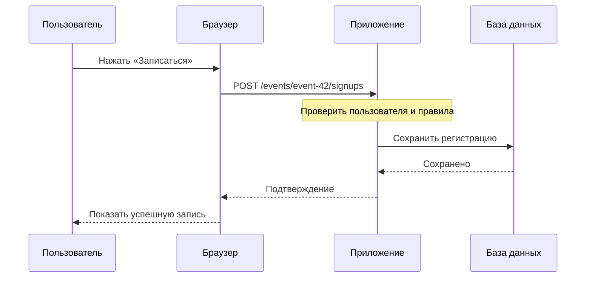

# Урок-образец: что происходит после нажатия кнопки

**Уровень:** вход с нуля. **Нужно до урока:** уметь читать простую таблицу. **Результат:** объяснить путь запроса, отделить интерфейс от хранения и найти место, где потерялось подтверждение.

## Зачем это понимать

Вы открываете школьный сайт «Клуб» и нажимаете «Записаться на экскурсию». Через секунду видите свою фамилию в списке. За этой секундой работают несколько частей. Системный дизайн начинается с вопроса: кто что делает и что случится, если одна часть остановится?

Браузер — программа на вашем устройстве. Он показывает страницу и отправляет сообщения. Сервер приложения — программа, которая принимает эти сообщения и выполняет правила. База данных — место долговременного хранения записей. В реальном маленьком проекте приложение и база могут работать на одном компьютере; на схеме мы отделяем обязанности, а не обязательно машины.

## Один запрос по шагам

1. Страница знает адрес API и отправляет просьбу зарегистрировать текущего пользователя на событие `event-42`.
2. Приложение проверяет, кто обратился, существует ли событие и разрешена ли запись.
3. Приложение сохраняет регистрацию в базе.
4. База подтверждает результат приложению.
5. Приложение отвечает браузеру.
6. Страница показывает подтверждение.

Сплошная стрелка обозначает запрос/действие, пунктирная — ответ. Это упрощённый путь: DNS, сетевое соединение и шифрование будут отдельным уроком. Браузер не должен сам объявлять регистрацию успешной до согласованного в API подтверждения.

## Что хранится

| event_id | user_id | created_at |
|---|---|---|
| event-42 | user-17 | условный момент T1 |
| event-42 | user-23 | условный момент T2 |

Одна строка — один факт записи пользователя на событие. Закрытие вкладки не должно удалять этот факт. Переменная в браузере и запись в базе — разные вещи.

**Инвариант** — правило, которое система обязана сохранять. Здесь: один пользователь не может быть записан на одно событие дважды. Базовое средство — ограничение уникальности пары `(event_id, user_id)` в базе. Проверка «сначала посмотрю, нет ли записи» в приложении сама по себе не защищает от двух одновременных запросов.

## Подумайте до ответа

База сохранила запись. Приложение отправило ответ, но сеть оборвалась. Браузер показал «Нет ответа».

- Можно ли утверждать, что регистрации нет?
- Что произойдёт при повторном нажатии?
- Где проверить действительный результат?

**Разбор:** отсутствие ответа не доказывает отсутствие записи. Пользователь может уже быть зарегистрирован. Нужны способ запросить состояние и защита от дублей. Подробно об этом — в уроке про повтор запросов. Сейчас достаточно различать «операция не произошла» и «мы не знаем, произошла ли она».

## Самостоятельная работа

Добавьте отмену регистрации. Сдайте схему из 4 участников и таблицу ответов для четырёх случаев:

1. Регистрация есть, отмена разрешена.
2. Регистрации уже нет.
3. Пользователь пытается отменить чужую регистрацию.
4. База недоступна.

Укажите, какой ответ увидит человек и какое состояние останется в базе. Не требуется выбирать единственно верный HTTP-код: сначала сформулируйте смысл контракта.

### Подсказки

1. Начните с права пользователя управлять конкретной записью.
2. Повторная отмена не должна восстанавливать запись или создавать ошибочную новую сущность.
3. Если база недоступна, приложение не знает, что изменение сохранено: нельзя честно показать окончательный успех без дополнительных гарантий.

### Критерии готовности

- Схема различает браузер, правила приложения и хранение.
- Нельзя удалить чужую регистрацию.
- Повторная отмена имеет определённый результат.
- Ошибка связи не трактуется автоматически как «ничего не произошло».
- Автор может объяснить схему без терминов «микросервис», «шард» и «кластер».

**Перенос:** что изменится, если на событие осталось одно место и одновременно пришли две регистрации? Запишите вопрос к следующему уроку: «как выполнить проверку места и запись как одно безопасное изменение?»

### Источник для преподавателя

[AWS: Timeouts, retries, and backoff with jitter](https://d1.awsstatic.com/builderslibrary/pdfs/timeouts-retries-and-backoff-with-jitter.pdf) — почему отсутствие успешного ответа не означает отсутствие побочных эффектов. Пример «Клуб» и задания выше — авторская учебная модель, не кейс AWS.
