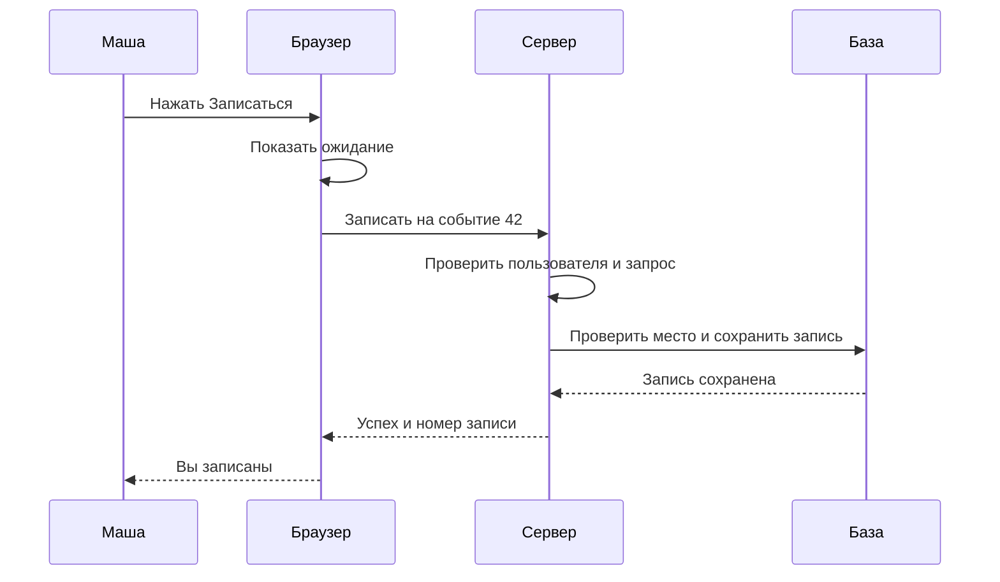
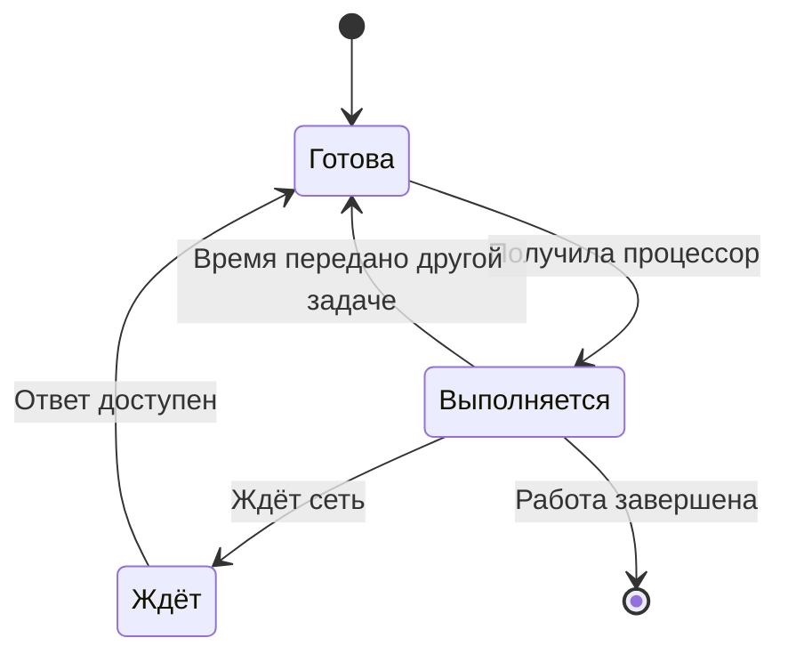
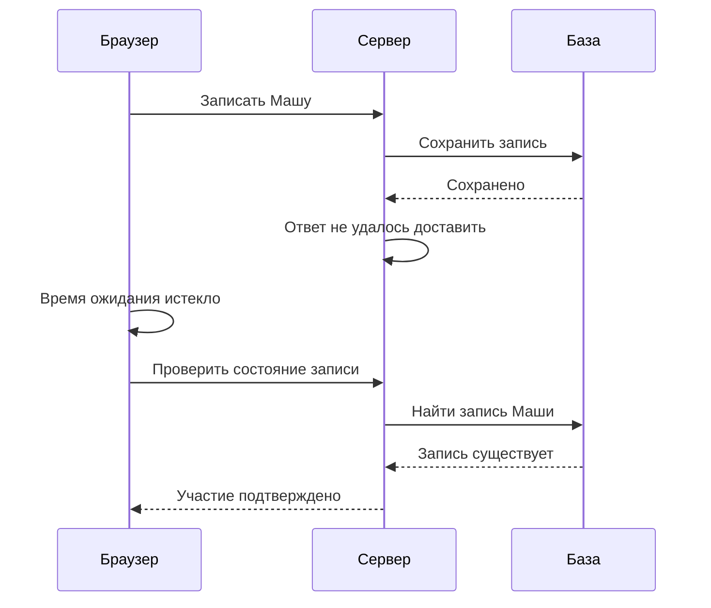

В школе открыли «Клуб» — сайт, где можно найти событие и записаться на него. Маша выбирает встречу астрономического кружка, нажимает кнопку и видит «Вы записаны». Через минуту она закрывает браузер. Где теперь хранится её запись? Что произойдёт, если выключится компьютер организатора?

Чтобы ответить, не нужно заранее знать язык программирования. Нужно различать участников и понимать, какие действия они выполняют. После этой главы вы сможете нарисовать путь запроса, объяснить разницу между памятью и постоянным хранилищем и назвать несколько причин, по которым ответ не приходит.

## Как пройти курс и проверить понимание

У курса два связанных маршрута. Эти 16 глав ведут от первого запроса до защиты сервиса «Клуб». [Инженерный маршрут](/system-design/hard-parts) углубляет сети, устройство хранения, транзакции, консенсус и обработку потоков. Его завершают поиск, журнал операций и самостоятельные архитектурные кейсы. В блоках указаны предварительные знания; можно пройти базу целиком или открыть нужный блок после соответствующей главы.

На старте достаточно понимать, что программа выполняет инструкции, и уметь считать пропорции. SQL, кворум и таймаут не считаются заранее известными. Когда появляется новый механизм, сначала проследите одно действие. Затем объясните, что изменится при задержке, повторе или падении процесса. Для локальных лабораторий понадобится Python 3.9 или новее; SQL-эксперимент отдельно требует PostgreSQL. Платные API и облачная инфраструктура для завершения курса не нужны.

Создайте рабочую папку с четырьмя файлами: требования, схема, расчёты, истории отказов. После каждой главы добавляйте один наблюдаемый результат. Например, после HTTP — таблицу ответов и историю потерянного ответа; после данных — инвариант и две конкурирующие транзакции. Короткий проверочный вопрос помогает обнаружить ошибку, но не оценивает автоматически все ваши объяснения.

[Скачиваемые лаборатории](/downloads/system-design-labs.zip) содержат исполняемые модели поиска, конкурентных операций и обработки событий. Их ограничения записаны рядом с командами запуска. Упрощённая модель может доказать конкретный контрпример, но не производительность произвольной системы.

Ориентиры курса — фундаментальные вопросы DDIA, инженерные документы и интервью-направления Alex Xu, Educative и DesignGurus. Мы используем собственные примеры и связываем темы по предварительным знаниям. Собеседование проверяет ход рассуждения за ограниченное время; эксплуатация дополнительно требует измерений, процедуры восстановления и ответственности за изменения. К окончанию курса у вас будет пакет решений, а не только список изученных терминов.

## 1. Клиент и сервер выполняют разные работы

Браузер показывает страницу, принимает нажатия и отправляет сообщения. В этом взаимодействии он выступает клиентом. Программа, которая получает сообщение, проверяет условия записи и сохраняет результат, выступает сервером. Слова обозначают роли: одна программа может отвечать браузеру и одновременно обращаться к другой программе как клиент.

Представим библиотеку. Читатель сообщает библиотекарю, какую книгу хочет получить. Библиотекарь проверяет каталог и фиксирует выдачу. Такая аналогия помогает разделить просьбу и её обработку. Но компьютерное сообщение может потеряться или повториться, а несколько обработчиков могут работать одновременно. Поэтому бытовое представление не объясняет все ошибки программы.

В «Клубе» браузер отправляет примерно такую просьбу: «Запиши пользователя 17 на событие 42». Сервер проверяет, существует ли событие, имеет ли пользователь право записываться и осталось ли место. Только серверное решение меняет официальный список участников. Надпись в браузере сама по себе ничего не доказывает: интерфейс может ошибиться или показать старые данные.

```text
Браузер Маши ── просьба записаться ──> Сервер «Клуба»
                                          │
                                   сохранить запись
                                          ↓
                                     База данных
Браузер Маши <── результат операции ── Сервер «Клуба»
```

Горизонтальные стрелки показывают сообщения по сети. Вертикальная стрелка обозначает обращение к хранилищу; оно тоже может проходить по сети. Прямоугольник сервера и база — разные роли, даже если сначала они работают на одном компьютере. Если компьютер сломается, обе роли могут стать недоступны одновременно. Позже эта общая граница отказа повлияет на архитектуру.

Проверьте модель на другом действии: Маша меняет цвет страницы на тёмный. Если настройка нужна только этому браузеру, её можно сохранить локально. Если она должна появиться и на телефоне Маши, серверу придётся связать настройку с её учётной записью.

### Проследим одну запись без пропущенных шагов

До нажатия кнопки в браузере уже есть описание события. Эта копия могла загрузиться несколько минут назад, поэтому показанное число мест не является разрешением занять место. Нажатие создаёт намерение пользователя. Код страницы собирает сообщение, а сервер принимает решение по своему актуальному состоянию. Пока ответ не получен, интерфейс может показывать «Проверяем запись».

Для начала выберем простой вариант: сервер отвечает об успехе только после сохранения записи. Он не отправляет письмо и не создаёт сложный отчёт на пути ответа. Эти дополнительные действия пока не нужны, чтобы подтвердить место. Так легче понять, какое событие даёт право показать окончательный результат.

Диаграмма «От намерения до подтверждения» показывает участников слева направо, а ход работы сверху вниз. Стрелка к самому себе означает локальное действие программы; обратная стрелка — ответ другой стороне.



Текстовый ход: браузер принимает намерение и ждёт; сервер проверяет запрос; база подтверждает сохранение; только затем интерфейс показывает окончательный успех. Если места нет, ветка заканчивается понятным отказом без новой записи. Скорость нажатия не меняет правила принятия решения.

Другой допустимый интерфейс сразу показывает предполагаемый результат, а затем исправляет его при отказе. Такой подход называют оптимистическим обновлением. Он может сделать действие отзывчивее, но состояние «пока предполагаем успех» нельзя путать с сохранённым фактом. Для бронирования последнего места выберем явное ожидание: человеку важнее точность подтверждения, чем мгновенная красивая надпись.

Ещё одно различие касается размещения. Сервер как роль может работать на ноутбуке организатора или в отдельном центре обработки данных. Если выключили только компьютер организатора, удалённый сервер способен продолжить работу. Если сервер работал именно на этом компьютере, приложение остановится. Схема должна подписывать размещение, когда вопрос зависит от отказа устройства.

## 2. Данные занимают место и имеют срок жизни

Компьютер хранит сведения в виде битов. Бит имеет два возможных значения; восемь бит составляют байт. Текст, фотография и программа представлены последовательностями байтов. Один символ не обязательно занимает один байт: в распространённой кодировке UTF-8 длина зависит от символа.

Оперативная память нужна работающей программе для быстрых обращений. Например, сервер держит в ней список текущих запросов. При завершении процесса его обычное содержимое памяти перестаёт быть доступным этому процессу. Постоянное хранилище — диск или другой носитель — предназначено для сохранения данных между запусками.

Допустим, сервер записывает участников только в список внутри программы. Пока программа работает, всё выглядит правильно. После перезапуска список снова пуст. Это ошибка выбора срока жизни данных: обещанная пользователю запись должна переживать перезапуск, а выбранное место хранения этого не обеспечивает.

Файл на диске решает часть проблемы, но создаёт другие вопросы. Кто защищает его от одновременной записи? Что делать, если процесс остановится посередине изменения? Как найти все события одного участника? База данных предоставляет механизмы для таких задач. Она тоже является программой и использует память и постоянное хранение. Само слово «база» не гарантирует сохранность: важны настройки записи, резервные копии и процедура восстановления.

В учебном примере сто записей по условным 200 байт занимают 20 000 байт полезных данных. Реальная база потребует дополнительное место для служебных полей, индексов и журналов. Пока достаточно научиться разделять полезный объём и накладные расходы. Позже мы будем оценивать их отдельно.

Не путайте сохранение и доступность. Запись может лежать на исправном диске, но быть недоступной из-за остановленного сервера. И наоборот, интерфейс может работать, хотя последняя запись ещё существует только в памяти и рискует исчезнуть.

### Одна запись существует в нескольких представлениях

Маша видит имя события на экране. В сообщении оно может быть записано текстом, в памяти программы — объектом с полями, на диске — частью файла базы. Представление — способ организовать одни и те же сведения для конкретной работы. Совпадение смысла не означает, что все копии автоматически обновляются одновременно.

Чтобы передать данные по сети, программа превращает их в последовательность байтов по известным правилам. Это называют сериализацией. Получатель выполняет обратное преобразование. Если стороны по-разному понимают формат или единицы, байты могут дойти без потерь, а смысл окажется неверным. Например, число 60 может обозначать секунды у отправителя и минуты у получателя. В следующей главе мы составим явный договор сообщения.

Выберем поля записи: ID участника, ID события, состояние и время создания. ID — устойчивое обозначение объекта. Имя Маши может измениться, а её ID остаётся связанным с тем же человеком. Если связывать записи только по имени, две Маши смешаются, а исправление фамилии потребует угадывать прежнюю связь.

Теперь сравним три места хранения. В памяти процесса удобно держать временный результат вычисления: его можно получить заново. В локальном хранилище браузера удобно держать черновик формы, если потеря устройства не должна считаться потерей официальной записи. В серверной базе храним факт участия, общий для всех устройств и организаторов. Выбор следует из обещания пользователю, а не из того, куда проще записать строку кода.

Обещание «сохранено» тоже имеет границы. Перезапуск приложения, отказ компьютера и физическая потеря диска — разные события. Файл может пережить первое и не пережить третье. Позже для защиты от потери носителя появятся дополнительные копии. Сейчас в учебной схеме фиксируем: подтверждённая база переживает перезапуск процесса, но уничтожение всех носителей не входит в её обещание.

Проверить выбор можно мысленным выключателем. После каждого шага остановите браузер, затем сервер, затем узел хранения и спросите, какие факты сохранятся. Если ответ требует «мы надеемся, программа успела», момент подтверждения ещё не определён. Сначала сформулируйте гарантию, затем выбирайте механизм, который её выполняет.

## 3. Программа, процесс и одновременная работа

Программа — набор инструкций. Процесс — запущенный экземпляр программы со своей памятью и ресурсами. Один и тот же сервер можно запустить дважды: получатся два процесса. Они не начинают автоматически видеть все изменения в памяти друг друга.

Процесс выполняет работу с помощью потоков исполнения. Пока один поток ждёт ответа базы, другой может обрабатывать следующий запрос. Конкретные языки также предлагают задачи, корутины и цикл событий. Сейчас важен общий вопрос: программа умеет переключаться между незавершёнными действиями или ждёт каждое до конца?

Конкурентность означает, что несколько действий продвигаются в перекрывающиеся промежутки времени. Параллельность означает, что действия действительно исполняются одновременно, например на разных ядрах процессора. На одном ядре программа может обслуживать несколько сетевых соединений конкурентно, переключаясь во время ожидания.

Предположим, один запрос требует 5 миллисекунд вычислений и 95 миллисекунд ожидания базы. Это учебные числа. Обработка строго по одному запросу займёт около 100 миллисекунд на каждый. При конкурентной работе ожидание одного запроса можно совместить с работой над другим. Но база и процессор имеют предел мощности: бесконечное число задач не создаст бесконечную производительность.

Обратная сторона конкурентности — пересечение действий. Два запроса могут одновременно увидеть последнее свободное место и оба попытаться занять его. Здесь недостаточно «быстрого сервера»: понадобится правило, которое защищает решение от гонки. Мы подробно построим его в главе о транзакциях.

### Что происходит, пока программа ждёт

Операционная система распределяет время процессора между готовыми к работе задачами. Планировщик — часть системы, которая выбирает следующую такую задачу. Когда текущая задача ждёт диск или сеть, она может временно освободить процессор. Это не означает, что её действие завершено: сохранены сведения о месте, с которого продолжить работу после события.

Диаграмма «Выполнение и ожидание» показывает упрощённые состояния задачи. Здесь нет подробностей конкретного языка и устройства планировщика; важен переход от использования процессора к ожиданию внешнего результата.



Текстовый ход: готовая задача получает процессор; при ожидании сети перестаёт исполняться; после получения ответа снова готова продолжить. Пока она ждёт, процессор может выполнять другую задачу. Передача процессора другой задаче сама по себе не отправляет ответ клиенту и не сохраняет его данные.

Вернёмся к пяти миллисекундам вычислений и 95 миллисекундам ожидания. Если обрабатывать запросы строго по одному, за секунду получится около десяти завершений. Если ожидания перекрываются, процессорная часть допускает теоретически до 200 таких запросов в секунду на одном полностью занятом ядре: 1 000 миллисекунд делим на пять. Это верхняя граница только для указанной вычислительной работы, без расходов переключения, базы и сети.

Чтобы скрыть 95 миллисекунд ожидания, нужны другие готовые задачи. Но если каждая из них отправляет запрос в уже перегруженную базу, ожидание вырастет. Конкурентность помогает использовать простаивающий ресурс; она не уменьшает объём работы, который должен сделать медленный ресурс. Поэтому фраза «добавим потоки» должна сопровождаться вопросом, чего именно сейчас ждём.

Память тоже расходуется на незавершённые действия. Если условный запрос удерживает 100 KB временных данных, тысяча таких запросов занимает около 100 MB без прочих расходов. Разрешить миллион одновременно — значит изменить требование к памяти, даже если почти все ждут сеть. Позже ограничение числа ожидающих задач станет частью защиты от перегрузки.

Разные процессы удобны для разделения работы и отказов, но их память по умолчанию раздельна. Если процесс A хранит Машину запись только у себя, процесс B не найдёт её автоматически. Общая база решает вопрос общего состояния; конкретный протокол обращения к ней должен защищать и одновременные изменения. Подробное введение в процессы и их состояния есть в [OSTEP: The Abstraction — The Process](https://pages.cs.wisc.edu/~remzi/OSTEP/cpu-intro.pdf).

## 4. Сеть передаёт сообщения, но не обещает мгновенный ответ

Доменное имя вроде `club.example` удобно человеку. Система DNS помогает получить сведения об адресах, по которым можно обратиться к нужной службе. IP-адрес используется для доставки сетевых пакетов, а порт помогает направить соединение нужной программе на узле. Адрес не описывает бизнес-действие: «записаться на событие» будет передано уже в сообщении приложения.

Данные идут через несколько сетевых устройств. Передача занимает время; устройства могут быть перегружены, соединение может оборваться. Транспортные протоколы решают часть проблем доставки, но приложение всё равно может не дождаться ответа. Поэтому у запроса обычно есть таймаут — ограничение ожидания.

Представьте последовательность: сервер сохранил запись Маши, затем соединение оборвалось. Браузер не получил подтверждения. Из этого нельзя заключить, что запись не выполнена. Возможны разные истории: запрос не дошёл, сервер ещё работает или операция завершена, но потерялся ответ. Различать эти истории по одному таймауту нельзя.

Задержка и пропускная способность также различаются. Задержка говорит, сколько ждёт одна операция. Пропускная способность показывает объём работы за единицу времени. Автобус может перевозить много людей за час, но поездка отдельного пассажира не становится мгновенной. В компьютерной системе аналогия ограничена тем, что запросы отличаются по размеру и могут конкурировать за несколько ресурсов.

### Найти адрес, доставить байты, понять результат

Путь сообщения состоит из нескольких задач. Сначала клиенту нужны сведения о сетевом адресе. Затем нужно доставить данные к нужному узлу и службе. Наконец, программа на той стороне должна разобрать сообщение и выполнить действие. Успех предыдущего этапа не доказывает успех следующего: найденный адрес не означает, что приложение работает, а доставленные байты не означают, что место забронировано.

TCP, один из транспортных протоколов, предоставляет упорядоченный поток байтов между сторонами соединения. Это полезно для передачи сообщения целиком, но не является подтверждением бизнес-операции. Ответ о сохранении создаёт приложение после собственной работы. Другие протоколы организуют доставку иначе; детали выбора транспорта пока не меняют эту границу ответственности.

Если DNS временно недоступен, у браузера иногда остаются ранее полученные сведения об адресе. Если действующее соединение уже установлено, для каждого следующего сообщения не обязательно снова искать адрес. Поэтому реальная история зависит от состояния клиента. Объяснение «браузер всегда выполняет ровно пять шагов» следует воспринимать как учебный первый проход, а не универсальную трассу.

На диаграмме «Сохранение без подтверждения» прочитайте сначала путь к базе, затем отсутствие ответа. Отдельное событие ожидания в браузере не отменяет выполненную сервером работу.



Текстовый ход: сервер завершает сохранение, но браузер не получает первоначальный ответ. После таймаута браузер отдельно проверяет состояние и узнаёт существующий результат. Если повторить изменяющее действие вместо проверки, потребуется защита от второго эффекта; это тема следующей главы.

Для первой модели «Клуба» выберем явное состояние «результат пока неизвестен» и возможность проверки. Оно честнее двух крайностей: бесконечного ожидания без объяснения и сообщения «запись не выполнена», которое не следует из наблюдений. Пользователю можно предложить дождаться проверки, не заставляя его угадывать, стоит ли снова нажимать кнопку.

## Практика: восстановите потерянную историю

Нарисуйте пять шагов записи Маши. Затем поставьте крестик в двух местах: перед получением запроса сервером и после сохранения данных, но до получения ответа браузером. Объясните, что увидит Маша и где будет находиться запись в каждом случае. Отдельно отметьте, что переживёт перезапуск процесса.

**Подсказка 1.** Начните со списка наблюдений браузера, а не с догадки о сервере.

**Подсказка 2.** В обеих историях браузер может увидеть одинаковое сообщение об истечении времени ожидания.

**Подсказка 3.** Проверить состояние можно отдельным запросом, но повтор изменяющего запроса потребует защиты от дубликатов.

### Разбор

В первом случае записи ещё нет, если никакая другая попытка её не создала. Во втором она уже сохранена. Браузер не способен различить случаи по отсутствию ответа. После перезапуска список в памяти процесса пропадёт; подтверждённая запись в правильно настроенном постоянном хранилище должна сохраниться в пределах его гарантий. Последнее уточнение понадобится при изучении отказа самого хранилища.

Для проверки переноса замените запись на событие отправкой письма. Можно ли просто повторить действие? Какие последствия увидит адресат? Ответ «повтор всегда безопасен» недостаточен: письмо может прийти дважды.

## Практика 2: почему второй сервер потерял Машу

У «Клуба» два процесса A и B. Каждый хранит участников только в своей памяти. Первый запрос Маши пришёл в A и получил успех. Следующее чтение пришло в B, который вернул пустой список. Организатор предлагает всегда направлять Машу в A. Объясните, какую часть проблемы это скроет и что произойдёт после перезапуска A. Затем предложите схему хранения для записи и для незаконченного текста комментария.

### Подсказки

Сначала перечислите физические копии: память A, память B и устройство Маши. Затем проверьте каждую предложенную схему выключением A. Наконец, различите официальный факт участия и черновик, который пока не отправлен на сервер.

### Решение и критерии

Закрепление Маши за A сделает некоторые чтения последовательными, но не сохранит память после его остановки. Кроме того, организатор через B всё ещё может не видеть участницу. Для официальной записи нужен общий источник, переживающий требуемые отказы; оба процесса читают и изменяют его по согласованным правилам. Ответ об успехе должен следовать после принятого системой момента сохранения.

Черновик можно хранить в браузере, если договор допускает его потерю при очистке или потере устройства. Если черновик должен открываться на телефоне, потребуется серверная копия с понятным моментом синхронизации. Не обязательно отправлять каждое нажатие клавиши: можно сохранять периодически, но тогда нужно обозначить, какая часть последних изменений ещё не подтверждена.

Работа принята, если на схеме видно, где живёт каждый факт и что именно переживает перезапуск. Дополнительно посчитайте память: 5 000 черновиков по условным 2 KB — около 10 MB полезного текста, но эта оценка не включает объекты программы, историю изменений и служебные поля. Маленький объём не отменяет требования к сроку жизни.

## Что сохранить в учебной папке

Сохраните схему с четырьмя подписями: клиент, сервер, память, постоянное хранилище. Под схемой напишите два предложения: что подтверждает успешную запись и что известно после таймаута. Если сможете объяснить это другому человеку без слова «магия», можно переходить к HTTP.

## Источники

[MDN: как работает интернет](https://developer.mozilla.org/en-US/docs/Learn_web_development/Howto/Web_mechanics/How_does_the_Internet_work) помогает связать сеть, адреса и маршрутизацию. Для углубления в процесс и память используйте открытый учебник [Operating Systems: Three Easy Pieces](https://pages.cs.wisc.edu/~remzi/OSTEP/), сначала введение и главы о процессах. Числа и персонажи этой главы — учебная модель.
