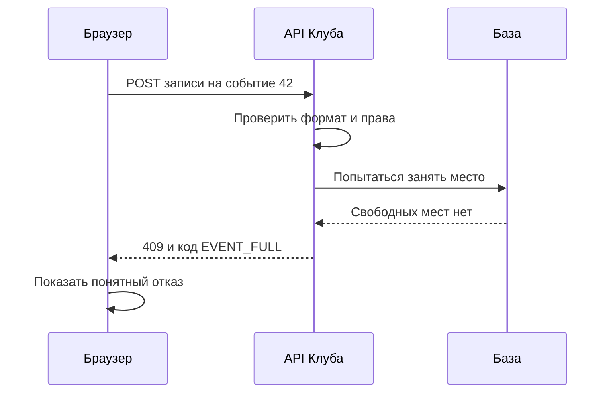
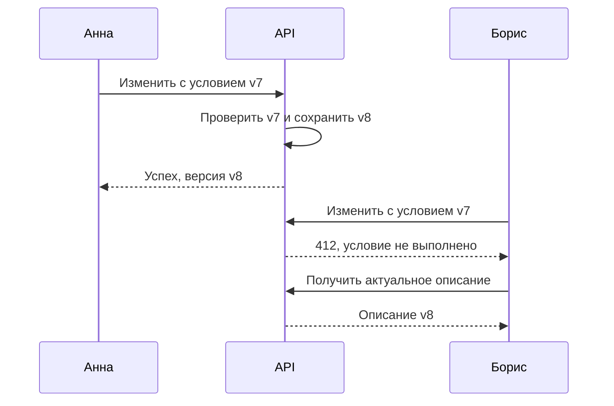
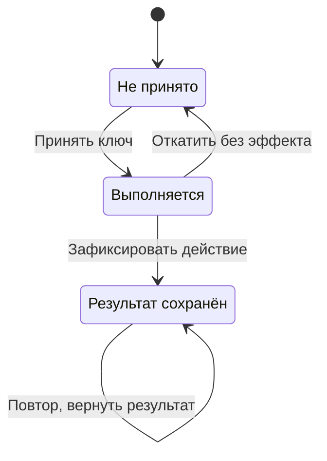

Маша открывает список событий, а организатор редактирует название встречи. Оба работают в браузере, но просят сервер выполнить разные действия. Чтобы сервер понимал просьбу одинаково на телефоне и компьютере, участникам нужен договор: как назвать действие, какие данные передать и как сообщить результат. Такой договор называют интерфейсом программирования приложения, или API.

HTTP — один из протоколов, на которых строят API. Протокол определяет форму и смысл сообщений. Знание HTTP помогает отличать ошибку соединения от отказа записать участника и проектировать ответы, с которыми клиент умеет работать. Для этой главы достаточно понимать роли клиента, сервера и постоянного хранилища.

## 0. Как запрос доходит до обработчика

Маша вводит `https://club.example/events/42`. Браузер знает имя сервиса, но сеть пересылает пакеты по адресам. Прежде чем обсуждать JSON, проследим, как клиент находит нужный процесс и почему ответ может задержаться ещё до обработчика.

IP-адрес нужен для доставки пакета узлу, порт — для выбора транспортного endpoint на узле. Процесс работает с сокетом: программным интерфейсом обмена. Один сервер может принимать HTTPS на порту 443 и обращения к другому сервису на другом порту. Имя `club.example` не является IP-адресом, а путь `/events/42` не выбирает сетевой порт.

### Имя, адрес и срок кэша

Клиент обращается к resolver — компоненту поиска DNS-записей. Рекурсивный resolver может ответить из кэша или обратиться к серверам DNS, пока не получит авторитетный ответ. Запись A содержит IPv4-адрес, AAAA — IPv6-адрес, CNAME связывает имя с другим именем. Это распределённый поиск с кэшами, а не обязательный запрос к одному центральному справочнику.

TTL задаёт срок использования кэшированной записи. Пусть resolver получил адрес A с TTL 300 секунд, а через минуту владелец сменил запись на B. Старый ответ ещё может использоваться около четырёх минут. Смена записи не рассылает всем клиентам приказ очистить кэш. Снижение TTL заранее помогает будущим ответам, но не сокращает уже выданные сроки. Отсутствие имени также бывает закэшировано. Механизмы определены в [RFC 1035](https://www.rfc-editor.org/rfc/rfc1035.html) и [RFC 2308](https://www.rfc-editor.org/rfc/rfc2308).

DNS не проверяет, отвечает ли приложение, и не переводит открытое соединение на новый адрес. Поэтому миграция требует времени совместной работы старого и нового маршрутов, проверки фактического трафика и правил завершения соединений. Подробную лабораторную проведём в [сетевой базе](/system-design/hard-parts/network-foundations).

### Доставка пакетов и доставка сообщения

В обычном HTTP/1.1 или HTTP/2 клиент устанавливает TCP-соединение. TCP предоставляет упорядоченный поток байтов: при потере сегмента восстанавливает данные, а приложение читает байты без обязанности собирать сетевые пакеты. При этом одно чтение из сокета не обязано вернуть целый HTTP-запрос; границы сообщений задаёт HTTP. TCP-подтверждение не означает, что приложение проверило запрос или база зафиксировала запись. Эти свойства транспорта описывает [RFC 9293](https://www.rfc-editor.org/rfc/rfc9293).

Скорость ограничивают разные механизмы. Получатель сообщает, сколько данных готов удержать в буфере: это управление потоком, flow control. Отправитель также ограничивает данные в пути по состоянию сети: это управление перегрузкой, congestion control. Медленное чтение приложением и потери на сетевом маршруте требуют разных исправлений. Нельзя назвать любую низкую скорость нехваткой CPU сервера. Различие окон приёма и перегрузки описано в [RFC 5681](https://www.rfc-editor.org/rfc/rfc5681.html).

RTT — время пути туда и обратно. Bandwidth — объём, который канал способен передать за единицу времени. Канал 100 Мбит/с с RTT 80 мс может быстро передавать большой файл, но каждый зависимый обмен всё равно ждёт путь туда и обратно. Произведение 100 Мбит/с × 0,08 с = 8 Мбит, или около 1 МБ, даёт порядок объёма данных в пути для загрузки такого канала. Это не обещание скорости приложения и не рекомендация сделать все буферы по 1 МБ.

### Несколько запросов на одном соединении

Переиспользование соединения сокращает повторную установку транспорта и TLS. HTTP/2 передаёт несколько потоков сообщений по одному TCP-соединению, но потеря байтов в нём задерживает последующие байты даже для другого HTTP-потока. HTTP/3 работает поверх QUIC, который обеспечивает отдельное упорядочивание данных потоков. Потеря задерживает затронутые потоки, а остальные могут продолжать работу. Общая сеть, congestion control и зависимости обработки никуда не исчезают. Поэтому «HTTP/3 всегда быстрее» не является правилом выбора. Сравнение задают [RFC 9113](https://www.rfc-editor.org/rfc/rfc9113.html), [RFC 9000](https://www.rfc-editor.org/rfc/rfc9000) и [RFC 9114](https://www.rfc-editor.org/rfc/rfc9114.html).

### Лабораторная: разложить ожидание

Используйте публичный учебный адрес ниже либо свой HTTPS endpoint. Выполните несколько отдельных проб; команда читает страницу и ничего не записывает:

```bash
curl --version
curl -sS -o /dev/null --connect-timeout 3 --max-time 10 \
  -w 'dns=%{time_namelookup} connect=%{time_connect} tls=%{time_appconnect} first=%{time_starttransfer} total=%{time_total} http=%{http_version}\n' \
  https://example.com/
```

Сохраните значения и версию клиента. При новом HTTPS-соединении `time_connect` отсчитывается от начала операции, а не от окончания DNS; другие величины также нельзя просто сложить. Для учебной пробы без redirect и proxy разности дают приблизительные этапы. Если dns=0,02; connect=0,07; tls=0,15; first=0,25; total=0,27 секунды, получится 20 мс DNS, ещё 50 мс connect, 80 мс TLS, 100 мс до первого байта после TLS и 20 мс получения остатка. Последние 100 мс включают обмен по сети и ожидание серверной стороны: это не чистое CPU-время обработчика. Формат и ограничения метрик приведены в [документации curl](https://curl.se/docs/manpage.html).

Чтобы исследовать reuse, запросите два адреса одного origin в одном процессе curl или посмотрите Network в браузере. Проверьте по verbose-выводу или инструментам браузера, было ли соединение переиспользовано; второй запрос нельзя заранее объявить тёплым. Кэш DNS, HTTP cache, TLS resumption и открытое соединение — разные состояния. `--http2` и `--http3` доступны не во всех сборках; отсутствие поддержки не доказывает проблему сервера.

**Самостоятельно.** Измерьте пять проб, назовите самый изменчивый этап и предложите дополнительное наблюдение для проверки причины. Успешный ответ содержит единицы, условия соединения и гипотезу, которую можно опровергнуть. Если растёт first−tls, проверьте tracing на сервере и сетевой RTT: один клиентский timing не отличит ожидание БД от медленного маршрута.

## 1. Из чего состоит HTTP-запрос

Клиент отправляет метод, адрес ресурса, заголовки и иногда тело. Метод описывает намерение: прочитать, создать или изменить. Адрес уточняет, к чему относится действие. Заголовки передают дополнительные сведения, например формат тела. Тело содержит данные самого действия.

```http
POST /events/42/enrollments HTTP/1.1
Host: club.example
Content-Type: application/json
Idempotency-Key: signup-17-42-attempt-a

{"participantId":17}
```

Это учебный пример. В реальном API личность участника обычно устанавливают по проверенной сессии, а не доверяют произвольному `participantId` из тела. Даже корректно оформленный запрос может исходить от человека, который пытается записать кого-то без разрешения.

Ответ тоже содержит заголовки и, возможно, тело. Код состояния позволяет клиенту сначала определить общий результат: `200` — успешное получение, `201` — создание, `400` — некорректный запрос, `401` — нужна действительная аутентификация, `403` — действие запрещено, `404` — ресурс не найден. Конкретный договор должен объяснять, что означают ошибки именно в этом API.

Для законченного события можно вернуть `409 Conflict` с машинным кодом `EVENT_CLOSED`. Клиент использует код, чтобы показать подходящий текст. Не стоит заставлять программу распознавать русский текст ошибки: формулировку могут исправить, и логика клиента сломается.

GET предназначен для чтения и имеет безопасную семантику: клиент не просит изменить состояние ресурса. Сервер при этом может записать технический лог. PUT обычно означает установку представления ресурса по известному адресу, DELETE — удаление связи с ресурсом по адресу. POST допускает обработку переданных данных, например создание новой записи.

Идемпотентность — другое свойство. Несколько одинаковых запросов имеют тот же предполагаемый эффект, что один. Повтор DELETE может вернуть уже другой статус, но требуемый эффект «ресурса больше нет» сохраняется. POST не получает такое свойство автоматически; при необходимости его добавляют договором приложения.

### Как сервер превращает байты в решение

Получив сообщение, сервер сначала должен понять его границы и формат. Затем обработчик выбирается по методу и пути. Обработчик — часть программы, отвечающая за определённую операцию. Он проверяет формат данных, личность клиента, разрешения и бизнес-условия. Эти проверки решают разные вопросы: число 42 может быть правильным ID, а доступ к событию 42 — запрещённым.

URL удобно разбирать на части. В `https://club.example/events/42?language=ru` схема `https` задаёт защищённый способ обращения, имя обозначает службу, путь выбирает ресурс, параметры уточняют представление. Путь не обязан совпадать с файлом на диске. На сервере может вообще не быть папки `events`: программа сопоставляет адрес нужному действию.

JSON — текстовый формат структурированных значений. Объект записывается как набор полей, например `{"status":"confirmed","eventId":42}`. Договор определяет тип каждого поля: число, строка, список или другой объект. Строка `"42"` и число `42` — разные значения формата, даже если человек читает их одинаково. Клиент не должен угадывать тип по содержимому.

Для нашей записи ответ может содержать `enrollmentId`, `eventId` и `status`. Номер записи позволяет потом запросить состояние, а статус уточняет бизнес-результат. Успешный HTTP-обмен с телом `status=pending` не означает, что место уже подтверждено. Семантика кода и тела должна быть согласована заранее.

Диаграмма «Два уровня результата» показывает, что корректно доставленный запрос может закончиться бизнес-отказом. Клиент получает понятный ответ, хотя желаемое изменение не произошло.



Текстовый ход: API принимает и проверяет запрос, база не разрешает новую запись, сервер возвращает договорённую ошибку. Клиент показывает отсутствие мест, а не сообщение «интернет не работает». Повторять такой запрос десятки раз без изменения условий бессмысленно.

Для синхронной операции выберем `201` после создания записи. Если позднее появится длительная фоновая обработка, можно вернуть `202 Accepted` и адрес проверки, но этот код подтверждает принятие, а не окончательный успех. GET также нельзя использовать для записи на событие: ссылки могут автоматически открываться для предпросмотра или проверки. Запрашиваемый эффект должен соответствовать методу. Семантика методов и кодов определена в [RFC 9110](https://www.rfc-editor.org/rfc/rfc9110.html), разделы 9 и 15.

## 2. Что именно защищает HTTPS

Перед обменом данными клиенту нужно найти сервер и установить подходящее соединение. В упрощённой истории браузер получает адрес через DNS, устанавливает транспортное соединение, договаривается о защищённом обмене с помощью TLS, затем передаёт HTTP-сообщения. В разных версиях HTTP транспортные детали отличаются, поэтому эту последовательность полезно считать моделью, а не неизменным числом сетевых шагов.

TLS помогает удостовериться в стороне соединения и защищает сообщения в пути от чтения и незаметного изменения посторонним участником сети. Сертификат связывает имя сервера с ключом в рамках доверия браузера. Клиент должен проверить цепочку до доверенного корня, срок и допустимость сертификата, а также совпадение имени с ожидаемым сервисом. Сертификат от доверенного центра для другого имени не подходит. Правила имени описывает [RFC 9525](https://www.rfc-editor.org/rfc/rfc9525.html), защищённый обмен — [TLS 1.3, RFC 8446](https://www.rfc-editor.org/rfc/rfc8446). Значок защищённого соединения не означает, что владелец сайта честен или что его обработчик правильно проверяет права.

Если сервер возвращает Маше чужую запись, HTTPS аккуратно доставит чужую запись Маше. Поэтому проверка доступа остаётся обязанностью приложения. Аналогично, секрет может попасть в серверный лог уже после расшифровки. Защищённый канал и защита данных на конечных узлах решают разные части задачи.

Соединение можно использовать повторно. При последовательном просмотре десяти событий браузер не обязан каждый раз начинать весь обмен заново. Поэтому оценка задержки должна учитывать, измеряем ли мы первый запрос или запрос по уже установленному соединению. Это пригодится, когда будем сравнивать медленную сеть и медленную базу.

### Канал, личность и право доступа проверяются отдельно

Представьте три вопроса при записи. Первый: связался ли браузер с нужным сайтом и защищён ли обмен? На него отвечает настройка защищённого соединения. Второй: кто отправил запрос? Для этого приложение проверяет сессию или другой способ входа. Третий: может ли этот человек записаться именно на это событие? Здесь нужны правила самого «Клуба».

Сессия связывает последующие обращения с результатом входа. Браузер предъявляет выданный сервером идентификатор, а сервер проверяет его действительность и пользователя. Сам идентификатор не должен быть предсказуемым паролем вида `user17`. Детали защиты сессий изучим в главе о безопасности; сейчас важно не доверять полю имени, присланному клиентом.

Контрпример: Маша отправляет JSON с `participantId=18`. TLS не запрещает ей написать такое тело: он защищает доставку выбранных ею байтов. Сервер должен либо получить участника из проверенной сессии, либо отдельно проверить право записывать другого человека. Проверка только на странице не защищает API: сообщение можно отправить без этой страницы.

Точка завершения защищённого соединения тоже имеет значение. Иногда браузер общается с промежуточным сервером, который затем обращается к приложению. Если второй участок проходит по отдельной сети, его защита определяется собственными настройками. Надпись HTTPS в браузере не описывает автоматически весь внутренний путь до базы.

При расследовании ошибки разделяйте наблюдения. Ошибка поиска имени возникает до бизнес-обработки. Ошибка проверки сертификата означает, что клиент не установил требуемое доверие к соединению. Ответ `403` означает, что сервер смог ответить и отказал по договору доступа. Для пользователя сообщения должны быть простыми, но разработчику нужны разные категории, иначе он начнёт исправлять сеть вместо правил разрешений.

Для «Клуба» выбираем защищённое соединение, серверную проверку сессии и отдельную проверку доступа к событию. Ни одну из этих частей нельзя убрать со словами «другие две уже есть». Полезное объяснение границ TLS даёт [MDN: Transport Layer Security](https://developer.mozilla.org/en-US/docs/Web/Security/Transport_Layer_Security).

## 3. Проектируем небольшой API каталога

Начнём с трёх сценариев: получить события, посмотреть событие и записаться. Для каждого запишем вход, успешный ответ и ошибки. Такой набор можно проверить независимо от языка сервера.

| Операция | Запрос | Успех | Одна важная ошибка |
|---|---|---|---|
| Список | `GET /events?limit=20` | События и указатель следующей страницы | Недопустимый лимит |
| Подробности | `GET /events/42` | Название, время, правила записи | Событие не найдено |
| Запись | `POST /events/42/enrollments` | ID записи и её состояние | Мест больше нет |

Список не должен без ограничений возвращать все события за десять лет. Разделение результата на страницы называют пагинацией. В простом варианте передают смещение и лимит. Но при добавлении новых строк между запросами страницы могут сдвигаться. Курсор фиксирует позицию относительно выбранного порядка, например пары «время создания, ID». Это не делает данные неизменными; договор всё равно должен объяснять поведение при добавлении и удалении событий.

Сортировка по одному времени может быть неоднозначной: у двух событий окажутся одинаковые значения. Дополнительный уникальный ID позволяет выбрать устойчивый порядок. Перед проектированием курсора нужно сначала определить этот порядок, а уже затем кодировать позицию в непрозрачную строку.

Проверка входа касается типов, диапазонов и смысла. `limit=-5` не подходит по диапазону. Несуществующий ID может быть допустимым числом, но не обозначать событие. Передача неизвестного поля должна обрабатываться последовательно: договор решает, игнорировать его или отвергать запрос. Молчаливое изменение поведения между версиями создаёт трудные для поиска ошибки.

Полезно заранее ограничить размер тела и длину строк. Проверка «это JSON» не запрещает прислать огромный документ. Ошибки должны помогать законному клиенту исправиться, не раскрывая секреты и внутреннюю структуру сервера.

### Страница результата — часть договора, а не случайный срез

Пусть первая страница при сортировке от новых к старым содержит события 50, 49 и 48. Пока Маша её читала, появилось событие 51. Запрос «пропустить первые три и взять следующие три» теперь начнётся с 48: пользователь увидит его повторно. Сервер выполнил смещение правильно, но предположение о неизменном списке оказалось неверным.

Курсор «продолжить после пары, соответствующей событию 48» не сдвигается из-за нового элемента перед ним. Однако он не обещает общий снимок списка: событие может исчезнуть, а изменяемое поле сортировки — поменять положение. Для обычного просмотра выберем устойчивую сортировку по времени создания и ID, с допустимостью появления новых элементов при обновлении первой страницы. Для полной отчётной выгрузки потребуется отдельный договор снимка или зафиксированного диапазона.

Необязательное новое поле ответа обычно проще добавить, чем переименовать старое обязательное поле. Даже такое изменение надо проверить: строгий клиент может отвергать неизвестные поля. Совместимость означает, что существующий клиент продолжает правильно работать, а не только успешно разбирает JSON. Поэтому в контракте описывают и возможность расширения, и смысл отсутствующего значения.

### Защищаем редактирование от потери чужого изменения

Два организатора открыли описание версии 7. Анна исправила место встречи и сохранила версию 8. Борис поменял название в своей старой копии и отправил весь документ. Если сервер безусловно заменит данные, исправление Анны исчезнет. HTTP доставил всё правильно, ошибка — в договоре конкурентного обновления.

Один вариант — передавать ожидаемую версию и выполнять изменение только при её совпадении. В HTTP для условных изменений применяется, например, `If-Match` с подходящим ETag, полученным от сервера. Сравнение и изменение должны быть связаны атомарно на сервере: отдельная проверка до обычного UPDATE оставляет окно гонки.

Диаграмма «Условное редактирование» показывает, почему устаревший клиент получает отказ вместо молчаливой перезаписи. Метки v7 и v8 здесь обозначают значения выбранного договором валидатора.



Текстовый ход: изменение Анны превращает v7 в v8. Условие Бориса уже неверно, поэтому он получает отказ, читает актуальное описание и решает, как совместить изменения. Автоматически повторить старую полную замену с новым валидатором — значит снова потерять исправление Анны, только обходным путём.

Для простого редактора «Клуба» выберем явный конфликт и предложим повторное редактирование. Автоматическое объединение полезно для независимых полей, но требует правила на случай изменения одного поля двумя людьми. Проверку предпосылки описывает [RFC 9110, If-Match](https://www.rfc-editor.org/rfc/rfc9110.html#section-13.1.1).

## 4. Повтор после неизвестного результата

Сервер создал запись, но ответ пропал. Маша нажимает кнопку ещё раз. Если каждый POST просто добавляет строку, появятся две записи. Отключение кнопки в браузере уменьшает число случайных повторов, но не защищает от повторной доставки, другого устройства и параллельного запроса.

Клиент может присвоить намерению ключ идемпотентности. Сервер связывает ключ с пользователем, параметрами и результатом. При повторе того же намерения сервер возвращает ранее сохранённый результат. Если ключ тот же, а параметры отличаются, запрос отклоняют: иначе клиент мог бы получить ответ от чужого по смыслу действия.

```text
Клиент                    Сервер                 База
  │ POST, ключ A             │                    │
  ├─────────────────────────>│ создать запись      │
  │                          ├───────────────────>│
  │            ответ потерян ×                    │
  │ POST, ключ A             │                    │
  ├─────────────────────────>│ найти результат A   │
  │<──── тот же результат ───┤                    │
```

Схема задаёт идею, но оставляет главный вопрос: что произойдёт, если сервер остановится между созданием записи и сохранением результата ключа? Позже транзакция позволит связать эти изменения. Сейчас зафиксируйте требование: защита должна переживать перезапуск и одновременные повторы, а не только последовательные обращения к одному процессу.

Срок хранения ключа тоже входит в договор. Если сервер хранит ключи сутки, повтор через неделю может считаться новой попыткой. Кроме технического ключа полезно бизнес-ограничение «один участник — одна запись на событие». Эти механизмы защищают разные уровни: ключ узнаёт намерение, уникальность пары защищает правило продукта.

### Как обрабатывается параллельный повтор

Представим, что два одинаковых запроса пришли почти одновременно. Недостаточно выполнить «найти ключ; если не найден, создать запись»: оба обработчика могут не найти ключ и оба начать работу. Система должна позволить только одному из них принять это намерение к исполнению. В следующей главе для такой границы появятся ограничения базы и транзакции.

Для локальной записи в «Клубе» выберем одну транзакцию: сохранить ключ и параметры, создать участие, сохранить результат операции. Если она не завершилась, её изменения не становятся подтверждённой записью. Если завершилась, но ответ потерян, повтор найдёт готовый результат. Это упрощает восстановление по сравнению с отдельным ключом в памяти приложения.

Диаграмма «Состояние намерения» показывает клиентскую операцию, а не транспортное соединение. Истечение времени ожидания меняет знание клиента, но не переводит серверное намерение в отменённое состояние.



Текстовый ход: сервер принимает одно намерение, выполняет его и сохраняет результат либо откатывает незавершённую работу. Повтор после завершения получает прежний результат. При параллельном запросе в состоянии выполнения договор может предписывать ожидание или специальный ответ о незавершённой обработке.

Внешняя отправка письма не откатывается вместе с записью в базе. Поэтому этот протокол пока доказывает однократный локальный эффект, а не универсальное «всё в интернете выполняется ровно один раз». Уведомления потребуют отдельной схемы доставки, которую разберём позже.

## Практика: три запроса с одним ключом

Первый запрос записывает Машу на событие 42 с ключом A. Второй полностью повторяет первый. Третий использует ключ A, но событие 43. Опишите ответы и состояние данных. Затем добавьте четвёртую попытку: другой пользователь случайно использует строку A.

**Подсказка 1.** Решите, в какой области ключ уникален: во всём сервисе, внутри пользователя или внутри операции.

**Подсказка 2.** Сравнение ключа должно сопровождаться проверкой существенных параметров.

**Подсказка 3.** Угадываемый ключ не должен позволять прочитать результат другого пользователя.

### Разбор

Первый запрос создаёт запись. Второй возвращает согласованный сохранённый результат без новой записи. Третий отклоняется из-за несовпадения намерения. Для четвёртого результат зависит от договора области ключа, но доступ к чужому результату запрещён в любом случае. Практичный вариант — область «пользователь и тип операции», дополненная проверкой параметров и серверной авторизацией.

Для переноса измените задачу: пользователь может отменить запись, а затем записаться заново. Должно ли новое намерение использовать прежний ключ? Обычно нет: новое действие получает новый ключ, а модель данных отдельно определяет, как хранить отменённую и активную запись.

## Практика 2: клиент получил три разных результата

Предложите поведение интерфейса для трёх случаев: сервер вернул `409` с `EVENT_FULL`; сервер вернул `202` и адрес операции; ответа вообще нет после заданного времени ожидания. Для каждого укажите, что достоверно известно, какой следующий запрос допустим и какую надпись увидит Маша. Затем добавьте потерянный ответ на проверку состояния.

### Подсказки

Сначала разделите бизнес-отказ, принятое незавершённое действие и неизвестный исход. Затем проверьте, не создаёт ли следующий запрос новое намерение. Наконец, задайте предел частоты проверки: ожидание не требует непрерывно отправлять запросы.

### Решение и критерии

При `EVENT_FULL` Маша знает, что эта попытка не создала запись согласно нашему договору. Интерфейс показывает отсутствие мест и может предложить очередь ожидания, если продукт её поддерживает. При `202` клиент знает о принятии операции и проверяет выданный адрес до конечного результата. Надпись «Вы записаны» пока преждевременна.

При таймауте результат неизвестен. Клиент проверяет состояние намерения либо повторяет его с тем же ключом по правилам API. Он не генерирует новый ключ только потому, что предыдущий ответ не дошёл. Потерянный ответ проверки также не отменяет действие: проверку можно повторить с ограниченной частотой и показать продолжающееся ожидание.

Ответ принят, если все три случая различены, не обещан несуществующий успех и предусмотрена остановка автоматических проверок с понятным способом вернуться к результату. Для переноса измените операцию на редактирование названия: дополнительно учтите конфликт версии, который повтор тем же старым документом не исправляет.

## Проверка готовности

Составьте один успешный и один ошибочный HTTP-ответ для записи. Объясните, почему HTTPS не проверяет доступ к событию и почему `201` после первой попытки может потеряться. Законченная работа содержит контракт, а не только перечень URL.

## Источники

Начните с [обзора HTTP в MDN](https://developer.mozilla.org/en-US/docs/Web/HTTP/Guides/Overview). Семантика методов определена в [RFC 9110, раздел 9](https://www.rfc-editor.org/rfc/rfc9110.html#section-9). Реальный пример договора повторов описан в [документации Stripe](https://docs.stripe.com/api/idempotent_requests); его конкретные сроки и правила не следует автоматически переносить в «Клуб».
