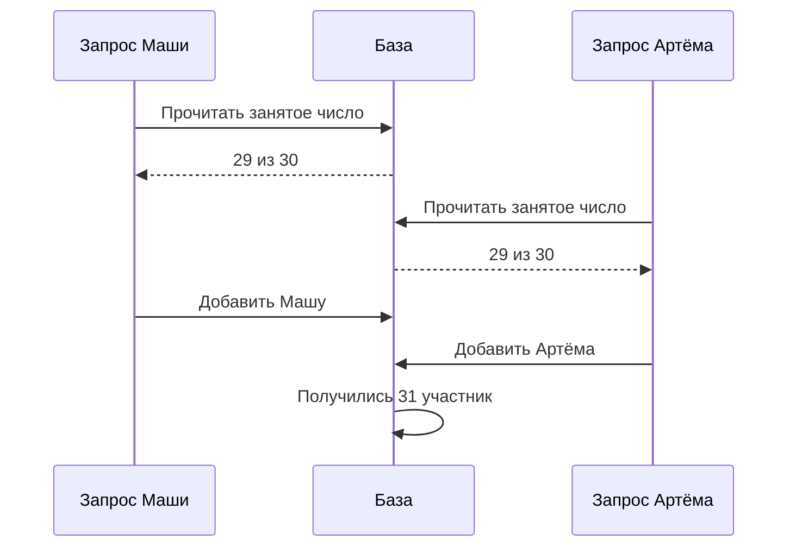
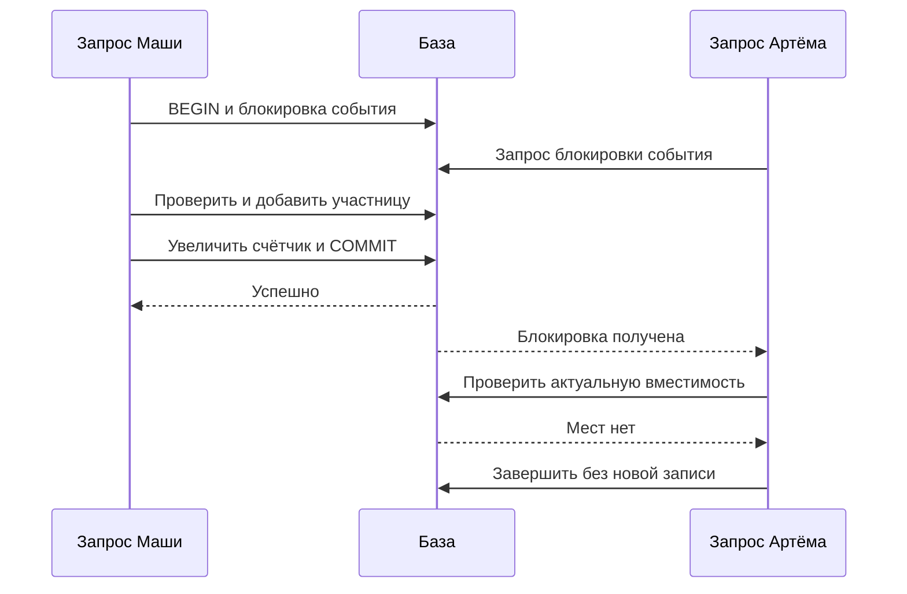
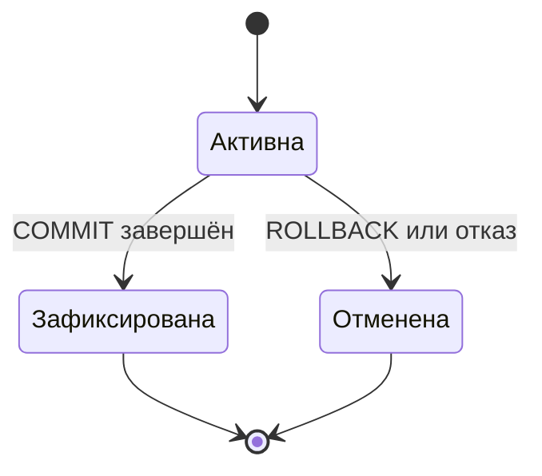

На встречу «Клуба» осталось одно место. Маша и Артём нажимают «Записаться» почти одновременно. Оба запроса прочитали число свободных мест, равное единице. Если каждый независимо добавит участника, организатор получит переполненную встречу. Быстрый сервер не исправляет эту ошибку: нужно определить, какие изменения допускается выполнять вместе.

В этой главе мы сначала построим модель данных, затем научимся читать её через SQL и ускорять нужные запросы. После этого разберём транзакции — механизм, который помогает сохранять правила при ошибках и одновременной работе. Код можно читать как точную запись действий; запоминать синтаксис заранее не требуется.

## 1. Таблицы и правила данных

Участник, событие и запись участника на событие — разные сущности. Сущность здесь означает объект, о котором система хранит сведения. У участника есть имя, у события — название и вместимость. Запись связывает конкретного участника с конкретным событием.

Если хранить участников прямо внутри текстового поля события, простые вопросы станут неудобными. Как найти все встречи Маши? Как переименовать её без изменений в десятках мест? Как запретить повторную запись? Выделение отдельной таблицы связей делает эти операции явными.

```sql
CREATE TABLE participants (
  id bigint PRIMARY KEY,
  name text NOT NULL
);

CREATE TABLE events (
  id bigint PRIMARY KEY,
  title text NOT NULL,
  capacity integer NOT NULL CHECK (capacity >= 0),
  occupied integer NOT NULL DEFAULT 0,
  CHECK (occupied >= 0 AND occupied <= capacity)
);

CREATE TABLE enrollments (
  event_id bigint REFERENCES events(id),
  participant_id bigint REFERENCES participants(id),
  created_at timestamptz NOT NULL DEFAULT now(),
  PRIMARY KEY (event_id, participant_id)
);
```

Первичный ключ однозначно определяет строку. В таблице записей им служит пара значений: событие и участник. Поэтому база не позволит создать две одинаковые пары. Внешний ключ проверяет, что связанный участник или событие существует. Ограничение `CHECK` проверяет условие для сохраняемой строки.

`NULL` означает отсутствие значения, а не пустую строку или ноль. Например, неизвестное время окончания события нельзя бездумно заменить нулевой датой. Операции с `NULL` имеют специальные правила: обычное сравнение `= NULL` не заменяет проверку `IS NULL`.

Поле `occupied` дублирует число строк записи и потому требует осторожности. Мы используем его как учебный счётчик для атомарного ограничения вместимости. Все добавления и удаления должны обновлять его согласованно с таблицей записей. Периодическая сверка может обнаружить ошибку, но сама по себе не заменяет правильный путь изменения.

### Проверяем модель на нескольких строках

Схема выше — договор о допустимых данных, а не рисунок будущего интерфейса. Возьмём участников `(17, Маша)` и `(18, Артём)`, события `(42, Астрономия)` и `(43, Робототехника)`. Записи `(42,17)` и `(43,17)` означают, что Маша участвует в двух событиях. Повторная строка `(42,17)` запрещена независимо от того, какой обработчик её добавляет.

Такую связь называют «многие ко многим»: у события много участников, у участника много событий. Таблица `enrollments` представляет отдельный факт связи. Это помогает отличить «Маша существует в системе» от «Маша записана на встречу». Удаление участия не должно само по себе удалять учётную запись Маши.

Предположим, разработчик проверяет отсутствие пары в коде, а ограничение ключа убирает. При двух одновременных попытках оба обработчика могут прочитать отсутствие записи и затем добавить её. Проверка интерфейса помогает пользователю, но не закрывает все пути изменения. Ограничение в базе ставит общую границу для запросов из приложения, административного инструмента и фоновой задачи.

Внешний ключ решает ещё один вопрос: запись не должна ссылаться на событие, которого нет. Но он не выбирает продуктовую политику удаления. Можно запретить удаление события, пока есть связанные записи, либо явно удалить связи вместе с ним. Для «Клуба» сначала выберем запрет физического удаления события с участниками и отдельный сценарий отмены. Он позволяет уведомить людей и сохранить объяснимую историю.

В учебной схеме пока нет поля состояния отмены: это намеренное ограничение первой версии. Перед добавлением отмены нужно решить, сохраняем ли прежнее участие или удаляем строку. Сохранение истории требует различать активную запись и прошлую попытку; простая уникальность пары тогда может потребовать изменения модели. Не стоит ослаблять её раньше, чем сформулирован новый инвариант.

Ограничение `CHECK` в строке событий защищает диапазон счётчика, но не доказывает его равенство числу строк `enrollments`. Это правило относится к нескольким изменениям. Его мы обеспечим общей транзакцией в четвёртом разделе. Разделение важно: нельзя прочитать условие `occupied <= capacity` и заключить, что вся модель уже защищена от переполнения любым возможным способом.

Подробные правила первичных, внешних ключей и ограничений описаны в [PostgreSQL: Constraints](https://www.postgresql.org/docs/current/ddl-constraints.html). Для проектирования достаточно понимать их наблюдаемый эффект; устройство хранения ключей внутри движка пока не нужно.

## 2. SQL отвечает на конкретный вопрос

SQL позволяет описать, какие данные нужны. Запрос списка участников события соединяет строки записи с участниками по ключу:

```sql
SELECT p.id, p.name
FROM enrollments AS e
JOIN participants AS p ON p.id = e.participant_id
WHERE e.event_id = 42
ORDER BY p.id;
```

`WHERE` выбирает записи нужного события. `JOIN` находит соответствующего участника. `ORDER BY` задаёт порядок результата: без него база не обещает удобный или постоянный порядок строк. Псевдонимы `e` и `p` сокращают имена таблиц, не создавая новые данные.

Представьте, что к запросу добавили таблицу сообщений участников. У Маши пять сообщений, и теперь её запись может встретиться пять раз. Это не «база продублировала пользователя»: запрос соединил одну строку с пятью подходящими строками. Перед подсчётом нужно определить, что является одной строкой результата.

Нормализация помогает избегать противоречивых копий фактов. Если название события записано в каждой строке участия, исправление опечатки потребует обновить всех участников. Когда название хранится в таблице событий, изменяется один факт в одном месте. Позже мы иногда намеренно создадим копии для ускорения чтения, но тогда понадобится механизм обновления и явный источник истины.

Проверяйте запрос на маленьком наборе: два события, три участника, одна повторная попытка записи. Небольшую таблицу можно прочитать глазами. Ошибку в связи легче увидеть здесь, чем среди миллиона строк.

### Выполним запрос сначала вручную

Для события 42 таблица записей содержит `(42,17)` и `(42,18)`, а для 43 — `(43,17)`. Условие `WHERE e.event_id = 42` оставляет две строки. Соединение по `p.id = e.participant_id` добавляет к первой имя Маши, ко второй имя Артёма. Выбор полей после `SELECT` оставляет ID и имя; сортировка упорядочивает их по ID.

Это логическое объяснение результата, а не обещание, что движок физически выполнит действия именно в таком порядке. База вправе выбрать другой план, если он сохраняет смысл запроса. Именно поэтому полезно отдельно проверять правильность результата на маленькой таблице и скорость на подходящем объёме.

Допустим, организатор хочет увидеть события без участников. Простое внутреннее соединение покажет только события, для которых найдены связанные строки. Чтобы сохранить событие даже при отсутствии связи, существует `LEFT JOIN`: недостающие поля другой стороны будут пустыми в смысле `NULL`. При подсчёте нужно считать реальный ключ участника, а не все строки результата, иначе сохранённая пустая строка может выглядеть как один участник.

```sql
SELECT ev.id, COUNT(e.participant_id) AS participants_count
FROM events AS ev
LEFT JOIN enrollments AS e ON e.event_id = ev.id
GROUP BY ev.id
ORDER BY ev.id;
```

`GROUP BY` объединяет строки результата по событию. `COUNT(e.participant_id)` считает непустые значения участника. Для нашего набора получится два человека у 42 и один у 43; новое событие 44 без записей получит ноль. Такой ручной ожидаемый результат удобно сохранить рядом с тестовыми данными.

Другая распространённая ошибка — получить список записей, а затем для каждой отдельно запросить имя участника. Если участников 100, получится один запрос списка и ещё 100 запросов имён. Этот рисунок обращений часто называют N+1. Одно соединение или пакетный запрос может сократить число обменов. Однако выбирать нужно по требуемому результату и измерению: один огромный запрос с ненужными данными тоже способен быть дорогим.

Внешние значения следует передавать параметрами запроса. Программа не должна склеивать введённое имя с SQL как с готовым фрагментом команды. Параметр помогает отделить данные от структуры запроса. Это вопрос корректного обращения с вводом; подробную модель безопасности разберём позже.

## 3. Индекс сокращает поиск, но требует работы

Если нужно найти записи участника среди миллиона строк, полный просмотр может быть дорогим. Индекс хранит дополнительную структуру, которая помогает быстро выбрать подходящий диапазон. Для распространённого B-tree полезна аналогия с упорядоченным справочником: вместо чтения каждой строки можно последовательно сузить область поиска.

Аналогия ограничена тем, что индекс обновляется при изменениях, занимает место и обслуживается алгоритмами базы. Создание десяти индексов не делает каждую операцию в десять раз быстрее. Запись теперь должна изменить больше структур, а планировщик всё равно выбирает подходящий путь.

Наш первичный ключ `(event_id, participant_id)` хорошо соответствует поиску участников события. Для запроса «все события Маши» может понадобиться другой индекс:

```sql
CREATE INDEX enrollments_by_participant
ON enrollments (participant_id, event_id);
```

Порядок полей важен: сначала группируются записи участника, затем его события. Полезность индекса зависит от фильтров, сортировки, объёма результата и статистики. Если запрос возвращает почти всю таблицу, последовательное чтение может оказаться разумнее.

Команда `EXPLAIN` показывает выбранный план. `EXPLAIN ANALYZE` дополнительно исполняет запрос и измеряет его работу. Последнее особенно важно помнить для изменяющих запросов: это не безобидный просмотр текста. Учебные эксперименты следует проводить на отдельной базе с тестовыми данными.

Для проверки индекса запишите гипотезу: «поиск событий одного участника будет читать меньше данных». Затем сравните планы на одинаковых данных до и после изменения. Маленькая таблица может не показать выигрыша, и это нормальный результат. Условные учебные измерения нельзя выдавать за производительность будущей системы.

### Как порядок ключей связан с вопросом

Представьте упорядоченные пары `(42,17)`, `(42,18)`, `(43,17)`, `(43,25)`. Все записи события 42 находятся рядом. Если же вопрос касается участника 17, нужные пары находятся в разных группах событий. Индекс с обратным порядком `(participant_id, event_id)` группирует их иначе: сначала все события одного человека.

Из этого не следует, что индекс никогда нельзя использовать без первого поля. Возможности движков шире простой аналогии, а конкретный план зависит от статистики. Но ведущие поля объясняют, почему один порядок обычно естественнее для заданного ограничения диапазона. Такое обоснование полезнее автоматического создания индекса на каждом столбце. Особенности составных индексов описаны в [PostgreSQL: Multicolumn Indexes](https://www.postgresql.org/docs/current/indexes-multicolumn.html).

Выберем два запроса, которые действительно нужны продукту: список участников события и личная история Маши. Для первого уже есть ключ с ведущим `event_id`, для второго добавим индекс с ведущим `participant_id`. Поиск по имени организатора пока не объявляем критическим и не добавляем под него структуры на всякий случай.

При вставке записи база теперь должна поддержать строку и связанные индексы. Если индекс занимает условные 40 байт полезного представления на строку, миллион записей добавит порядка 40 MB до служебных расходов. Это учебная оценка, не точный размер индекса PostgreSQL. Её задача — показать, что ускорение чтения требует дополнительного хранения и работы при записи.

Для эксперимента подготовьте одинаковые данные, прогрейте одинаковым способом или явно измерьте холодный старт, выполните запрос несколько раз и сохраните план. Сравнивайте не только одну удачную задержку. Если результат пуст, база могла выполнить мало работы; если у одного участника половина таблицы, выбор индекса может отличаться от редкого участника.

План — объяснение выбранного пути, а не свидетельство корректности бизнес-правила. Быстрый запрос, который возвращает чужих участников из-за неверного условия, остаётся неправильным. Проверки результата и производительности решают разные задачи.

## 4. Транзакция защищает последовательность действий

Транзакция объединяет операции: либо их изменения фиксируются вместе, либо не становятся окончательным результатом. Для записи участника нужно согласовать добавление строки и увеличение занятого числа мест. Если один шаг не удался, другой не должен остаться сам по себе.

Одна атомарность ещё не объясняет взаимодействие двух транзакций. Изоляция определяет, какие промежуточные и конкурентные изменения они видят. На уровне Read Committed в PostgreSQL каждый запрос видит снимок зафиксированных данных на начало этого запроса. Два отдельных чтения внутри одной транзакции могут увидеть разные состояния.

Вот опасная история: оба обработчика читают `occupied=29`, оба решают, что при `capacity=30` место есть, затем добавляют разных участников. Проверка в программе не защищает промежуток между чтением и изменением.

Диаграмма «Две проверки одного места» показывает ошибочный порядок. Оба обработчика принимают решение по состоянию, которое уже может измениться до их записи. На схеме нет общей защищённой операции.



Текстовый ход: Маша и Артём отдельно видят свободное место и создают разные строки. Уникальность пары участник–событие не конфликтует: пары различаются. Поэтому запрет дубликатов одного человека не равен запрету переполнения события.

Один возможный путь — заблокировать строку события в транзакции. После `SELECT ... FOR UPDATE` другой участник такой же процедуры будет ждать освобождения строки. Первый обработчик проверяет вместимость и отсутствие записи, добавляет участника, увеличивает счётчик и фиксирует транзакцию. Второй после ожидания повторно оценивает актуальное состояние.

```text
Транзакция Маши:   блокировка → проверка → запись → COMMIT
Транзакция Артёма: попытка блокировки → ожидание → новая проверка
```

Другой путь — условное изменение счётчика: увеличить `occupied`, только если он меньше `capacity`, и проверить число изменённых строк. Это изменение и добавление участника всё равно должны входить в одну транзакцию. При конфликте уникальности нельзя случайно сохранить увеличенный счётчик: обработчик должен откатить связанные изменения.

Третий вариант — более строгая изоляция, например Serializable, с обработкой отказа сериализации и повтором всей транзакции. Ни один вариант не освобождает от определения правил. Удаление записи, изменение вместимости и повтор запроса должны пользоваться совместимым механизмом.

Не держите блокировку, пока пользователь вводит данные или пока внешний сервис отправляет письмо. Долгая транзакция заставляет ждать другие операции. Сначала фиксируют короткое изменение базы, а работу за её пределами связывают с результатом отдельным протоколом.

### Соберём полный путь с блокировкой

Для «Клуба» сначала выберем блокировку строки события. Она понятна, потому что все записи одного события проходят через одно место принятия решения. Обработчик начинает транзакцию и блокирует событие по ID. Затем проверяет, есть ли уже пара участника и события. Если есть, возвращает согласованный результат повтора без увеличения счётчика. Если пары нет, проверяет вместимость, создаёт связь, увеличивает `occupied` и фиксирует оба изменения.

Диаграмма «Второй запрос проверяет новое состояние» показывает нормальное выполнение при последнем месте. Важна проверка после получения блокировки, а не сохранённое ранее значение из памяти обработчика.



Текстовый ход: Маша удерживает право изменить событие и сохраняет запись. Артём получает блокировку после её завершения, видит заполненное событие и не добавляется. Если Маша откатила бы транзакцию, Артём увидел бы прежнее свободное место. Ожидание не означает автоматический отказ.

Для доказательства выпишем предпосылки: счётчик изначально соответствует активным строкам; все добавления и удаления используют тот же протокол; блокировка удерживается до конца транзакции; сохранение связи и счётчика атомарно. Тогда каждое следующее решение основано на завершённом предыдущем состоянии и сохраняет ограничение. Обходной административный INSERT без обновления счётчика разрушит предпосылку.

Можно отказаться от счётчика и считать активные строки под той же общей блокировкой. Это уменьшает число дублируемых фактов, но подсчёт большой группы может потребовать больше работы. В нашей небольшой первой версии такой вариант тоже допустим. Счётчик полезен для быстрого решения, когда команда готова поддерживать все пути изменения и сверку.

### Где находится граница сбоя

Рассмотрим состояния транзакции отдельно от состояния браузера. До фиксации изменения могут быть подготовлены внутри базы, но их нельзя объявлять завершённой записью. После фиксации клиентский ответ ещё может потеряться. Названия «активна», «зафиксирована» и «отменена» помогают не смешивать эти случаи.

Диаграмма «Транзакция и её исход» показывает два возможных конечных решения. Истечение времени ожидания у клиента не нарисовано как переход к отмене, потому что оно само по себе не сообщает исход базы.



Текстовый ход: начатая транзакция либо фиксирует связанные изменения, либо завершается без них как подтверждённого результата. Клиент узнаёт исход через ответ или последующую проверку. После перезапуска приложение не должно восстанавливать участие из своего прежнего предположения: источник истины — состояние базы.

Сбой между увеличением счётчика и вставкой связи безопасен только при общей транзакции. Два независимых коммита оставят «занятое» место без участника. Обратный порядок двух коммитов оставит участника без обновлённого счётчика. Перестановка шагов уменьшает одну неприятность, но не делает их атомарными.

Если произошёл конфликт, который требует повторить транзакцию, заново выполняются чтение и решение. Нельзя повторить только INSERT с прежним результатом проверки вместимости. Внешние письма и другие необратимые действия выносят из повторяемого тела или связывают с устойчивым намерением отправки. Иначе повтор базы может создать несколько внешних эффектов.

## 5. Одна задача допускает разные модели данных

Теперь нужно хранить программу встречи: секции, ведущих и оборудование. Таблица с секциями удобна для запросов «все встречи одного ведущего» и для общих ограничений. Документ встречи удобен, если программу обычно читают целиком и меняют как один объект. Но документ, в который вложили копии имён ведущих, создаёт новую работу при переименовании. Модель выбирают по запросам, совместным изменениям и размеру объекта.

Key-value означает, что приложение получает значение по известному ключу. Оно может хранить сериализованный документ, но вопрос «все встречи с телескопом» уже требует дополнительных ключей или индекса. Графовая модель явно представляет вершины и связи; она полезна, когда запрос проходит цепочки отношений, например «какое оборудование доступно через партнёров площадки». Само слово NoSQL не описывает ни гарантию транзакции, ни способ хранения, ни полезный запрос.

| Запрос | Что нужно проверить в модели |
| --- | --- |
| Полная программа встречи | Число чтений, размер документа, атомарность изменения |
| Все встречи ведущего | Обратная связь или secondary index, обновление при переносе |
| Переименовать ведущего | Один исходный факт и все производные копии |
| Найти свободное оборудование через партнёров | Глубина связей, ограничения обхода, изменение доступности |

Разделите исходные и производные данные. Имя ведущего имеет одно авторитетное место. Поисковый документ может содержать копию, но тогда получает версию и путь обновления. «Схема не нужна» обычно означает, что проверка схемы перенеслась из базы в приложение и договор между версиями. Код всё равно ожидает определённые поля.

## 6. От SQL-запроса к страницам и журналу

Движок читает и пишет блоками, а не переносит с диска только выбранное поле. Страница попадает в память через buffer pool. Индекс помогает найти страницы, но выбранные строки могут потребовать дополнительного чтения таблицы. Поэтому запрос с индексом всё ещё бывает дорогим. План соединения также зависит от размеров: nested loop повторяет поиск, hash join строит структуру одной стороны, merge join использует упорядоченные потоки. Их можно изучать после проверки SQL-результата, а не выбирать по названию.

В B+tree внутренние страницы направляют поиск, листья хранят упорядоченные ключи. Высота сокращает число переходов, соседство ключей помогает диапазону. При записи нужно обслужить индекс, иногда разделить страницу. У LSM другой путь: изменения попадают в память и журнал, затем в отсортированные файлы SSTable; фоновое слияние упорядочивает и удаляет ненужные версии. Чтение может проверить несколько файлов, а compaction повторно записывает данные. Оба подхода платят за чтения, записи и место разным образом. SQL-база может использовать LSM; документная база может использовать B-tree.

Журнал предварительной записи, WAL, связывает быстрые изменения в памяти с восстановлением. До записи изменённой страницы на диск должен быть сохранён соответствующий журнал. После crash движок восстанавливает допустимое состояние по журналу и контрольной точке. Подтверждение транзакции зависит от правил сохранения WAL. Не следует переносить обещание durable commit на конфигурацию, которая подтверждает до нужного flush. [PostgreSQL: WAL](https://www.postgresql.org/docs/18/wal-intro.html).

При 100 тысячах записей по 200 байт исходные значения занимают около 20 MB без индексов и служебных данных. Два индекса не занимают ноль байт; один UPDATE может создать новую версию строки и обновить структуры. При 10 тысячах обновлений в секунду по 200 байт нижняя оценка новых значений — 2 MB/с; это ещё не WAL, compaction, replication и backup. Считать storage нужно по физическому пути, а не только по размеру JSON.

OLTP обслуживает отдельные действия пользователей, OLAP ищет закономерности по множеству строк. Если аналитика читает три числовых поля из ста, колоночное хранение может сократить чтение и улучшить сжатие. Но онлайн-запись и обновление множества колонок требуют другого анализа. Перед копией в аналитическое хранилище определите допустимое отставание и сверку. Подробная модель хранения, compaction и crash приведена в [глубоком блоке о движках](/system-design/hard-parts/storage-engines).

## 7. Снимок и бизнес-правило — разные договоры

MVCC хранит версии строк и определяет, какие версии видит запрос. В PostgreSQL Read Committed два обычных SELECT одной транзакции могут увидеть разные подтверждённые состояния, потому что снимок берётся на начало каждой команды. В Repeatable Read снимок устойчивее, но проверки по нескольким строкам всё ещё могут допустить write skew. Например, двое дежурных читают общий состав и каждый изменяет свою строку; нет общего обновляемого поля, которое столкнуло бы записи.

Уровень Serializable запрещает результат, который невозможно получить последовательным исполнением транзакций. При конкуренции база может вернуть ошибку сериализации. Приложение повторяет весь блок с новой проверкой, сохраняя ID исходного намерения. Если внутри уже отправлено письмо, откат SQL его не отзывает: внешнюю работу выносят в надёжно сохранённое намерение. Сериализуемость не исправляет неверную последовательную логику.

Блокировка `FOR UPDATE` защищает найденные строки. Отсутствующая строка, диапазон и правило «не меньше двух активных организаторов» требуют отдельного механизма. Для начала можно блокировать общую guard-row и после получения блокировки перечитать условие в Read Committed. Долгие транзакции удерживают версии и ресурсы; они не должны ждать пользовательского ввода.

Для PostgreSQL нельзя заучивать общую таблицу уровней и игнорировать реализацию: Read Uncommitted работает как Read Committed, а Repeatable Read не допускает phantom reads, но допускает serialization anomaly. Уровни и аномалии проверяйте по [документации PostgreSQL 18](https://www.postgresql.org/docs/18/transaction-iso.html). В [блоке об изоляции](/system-design/hard-parts/isolation) есть двухсессионные трассы и разбор исправления.

### Самостоятельная проверка выбора

Для программы встречи выберите таблицы или документ. Затем добавьте два новых условия: один ведущий работает в 500 встречах, а программу редактируют одновременно три администратора. Назовите запрос, который стал дороже, и инвариант, которому нужна конкурирующая проверка. После этого объясните, почему смена B-tree на LSM не устраняет проблему копий имени.

Разбор: исходный выбор зависит от чтения целой программы и независимых изменений. Массовая смена имени выявляет стоимость денормализации. Конкурентное изменение требует версии документа/CAS либо транзакционного протокола; повтор всей записи поверх старой версии способен потерять изменение. Storage engine влияет на цену физической работы, а не выбирает за приложение правильную модель связей. Решение следует пересматривать при изменении запросов, размера объекта и числа конкурентных изменений.

## Практика: две попытки и перезапуск

Для события вместимостью 30 уже записаны 29 участников. Нарисуйте два конкурентных запроса. Выберите блокировку строки или условное обновление. Добавьте сбой после увеличения счётчика, но до добавления участника. Докажите, что итог не содержит 31 участника и ошибочно занятого места.

**Подсказка 1.** Выпишите инвариант: количество активных записей не превышает вместимость, а счётчик соответствует записям.

**Подсказка 2.** Отметьте начало и конец общей транзакции.

**Подсказка 3.** Незавершённое изменение не должно быть самостоятельным подтверждённым результатом.

### Разбор

В варианте с блокировкой один обработчик получает право изменить строку первым. Второй ждёт и затем видит заполненное событие. При остановке до коммита связанные изменения не считаются завершённой транзакцией; после восстановления база применяет свои механизмы восстановления. Если коммит состоялся, но ответ потерялся, повтор защищают ключ идемпотентности и уникальность пары.

Теперь организатор хочет уменьшить вместимость до 20. База не может сама придумать справедливое правило отмены десяти записей. Продукт должен выбрать: запретить уменьшение, создать очередь ожидания или предложить явный процесс переноса. Архитектурная корректность начинается с такого решения.

## Практика 2: отмена записи сломала счётчик

У события вместимость 30, счётчик равен 30, активных строк тоже 30. Обработчик отмены сначала удалил строку Маши отдельным коммитом, затем упал до уменьшения счётчика. Новый участник получает «мест нет». Покажите состояние обеих таблиц и исправьте протокол. Затем добавьте два одновременных повтора отмены.

### Подсказки

Первая: ошибка здесь не в индексе и не в скорости запроса. Вторая: уменьшать счётчик можно только в связи с действительно удалённым активным участием. Третья: после первого успешного удаления второй повтор уже не должен повторно освобождать место.

### Решение и критерии

После сбоя строк участия 29, а счётчик 30. Если просто уменьшать его при каждом запросе отмены, повторы способны сделать счётчик меньше настоящего числа участников. Исправленный обработчик блокирует событие, проверяет участие, удаляет его и уменьшает счётчик в одной транзакции. Когда строки уже нет, повтор завершает запрос по договору без изменения счётчика.

Обработка записи и отмены использует одну границу блокировки, поэтому они не принимают несовместимые решения о том же месте. Если отмена фиксируется первой, новый участник может занять освободившееся место. Если попытка записи проверяет заполненное событие раньше отмены, отказ соответствует состоянию в момент её решения; клиент может повторить позже как новое намерение.

Для восстановления уже повреждённых данных сначала требуется определить источник истины и остановить повторение ошибки. В нашей модели активные строки — проверяемые факты участия, по которым можно пересчитать счётчик в контролируемой операции. Сверка исправляет последствия, но не заменяет транзакционный протокол на будущее.

Работа принята, если показаны оба порядка конкурентных действий, повторы не освобождают лишних мест и объяснено, почему индекс не исправляет расхождение. Для переноса измените модель: отменённые строки сохраняются для истории. Тогда удаление заменится сменой состояния, и счётчик должен учитывать только переход из активного состояния.

## Источники

Для практики используйте [учебник PostgreSQL](https://www.postgresql.org/docs/current/tutorial.html). Затем прочитайте разделы [индексы](https://www.postgresql.org/docs/current/indexes.html), [EXPLAIN](https://www.postgresql.org/docs/current/using-explain.html) и [изоляция транзакций](https://www.postgresql.org/docs/current/transaction-iso.html). Для лаборатории закрепите версию базы: ссылка `current` со временем меняется.
