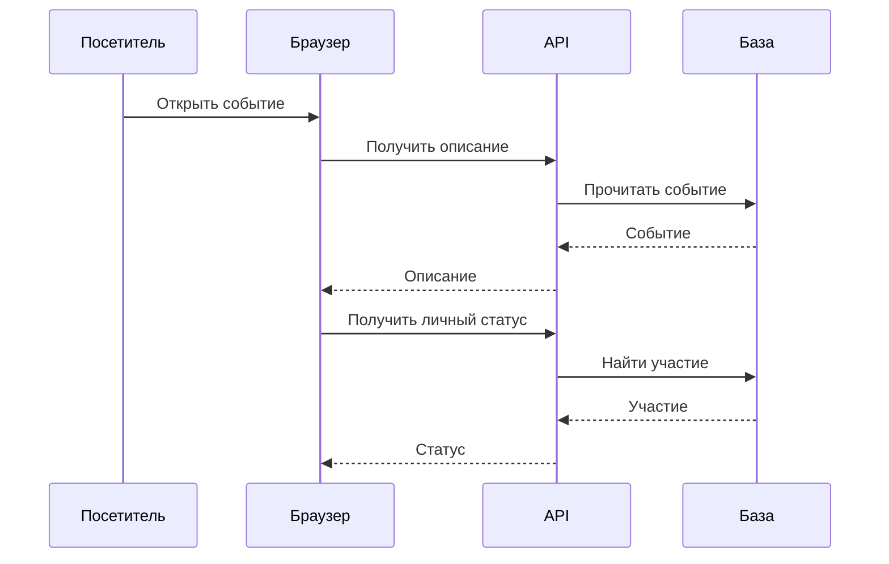
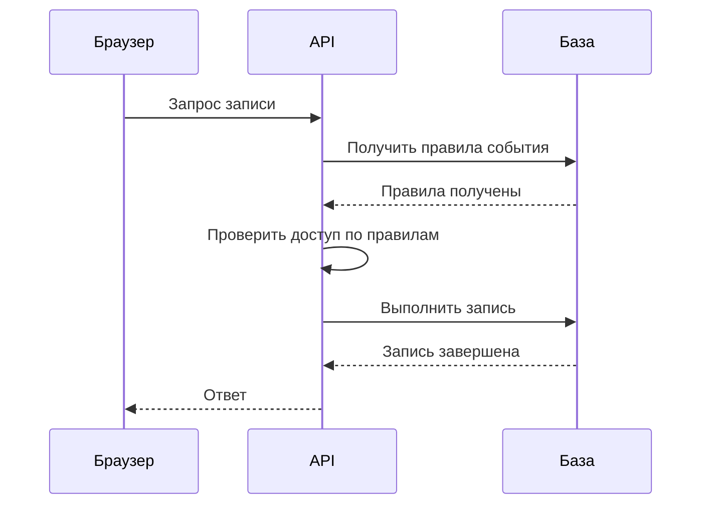
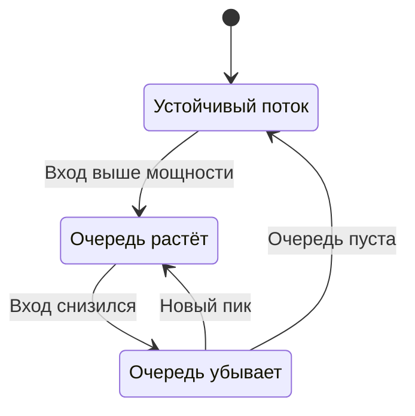

Организатор «Клуба» просит подготовить сайт к городскому запуску: «Будут десятки тысяч пользователей, всё должно работать быстро». По этой фразе нельзя выбрать размер сервера. Десятки тысяч посетителей за месяц и десятки тысяч одновременных отправок формы — разные нагрузки. Прежде чем рисовать новые компоненты, нужно уточнить, какую работу они будут выполнять.

Эта глава использует только учебные числа. Вы научитесь превращать требования в измеримые условия и проверять порядок величин. Цель расчёта — обнаружить риск и сравнить варианты, а не предсказать будущее с точностью до последнего запроса.

## 1. Сначала договоримся о результате

Функциональные требования описывают действия: посмотреть события, записаться, отменить запись. Требования к качеству задают ограничения этих действий: сколько ждать, какую потерю данных допустимо пережить, кто имеет доступ. Утверждение «система масштабируемая» ничего не проверяет без нагрузки и желаемого результата.

Для первой версии «Клуба» выберем три главных сценария. Гость читает публичный каталог. Участник записывается на событие. Организатор видит список участников. Оплата, видеотрансляция и рекомендации пока не входят в задачу. Такое ограничение помогает закончить проект, а не замолчать возможные потребности.

Инвариант — правило, которое должно сохраняться при всех допустимых действиях. Например, число активных записей не превышает вместимость. Требование свежести говорит, насколько старые данные можно показывать. Название события может обновляться в каталоге в течение минуты, а результат собственной записи пользователь должен видеть сразу после подтверждения. Разные операции получают разные гарантии.

Уточните границу измерения задержки. «Ответ за 300 миллисекунд» может означать время внутри сервера или от отправки клиентом до получения полного ответа. Во втором случае участвуют сеть и размер данных. Также задайте долю запросов и окно наблюдения: например, 95% подходящих запросов за сутки должны укладываться в выбранную задержку при заданном профиле нагрузки.

Требование должно позволять принять или отклонить результат. Слова «быстро», «много» и «надёжно» полезны в начале разговора, но перед проверкой их придётся раскрыть. Если исходных данных нет, запишите предположение и спросите, насколько решение изменится при ошибке в нём.

### Из общего пожелания получаем проверяемый сценарий

Возьмём городскую встречу на 2 000 мест. Организатор ожидает большой интерес и просит «не падать при запуске». Уточним: сколько людей одновременно откроют страницу, сколько нажмут кнопку, допустима ли очередь ожидания, как сообщать об отсутствии мест? Если десять тысяч человек хотят две тысячи мест, система не обязана успешно записать всех. Она обязана корректно принять ограниченное число и объяснимо отказать остальным.

Пользовательский успех и технический успех связаны, но не равны. Ответ «мест нет» при заполненном событии может быть корректной обработкой запроса. Ошибка базы вместо решения — технический сбой. Если смешать эти категории в метрике, честный отказ будет выглядеть как плохая надёжность, а неверно созданная лишняя запись — как успех.

Сформулируем учебный договор: в течение десятиминутного запуска система обрабатывает заданный профиль чтений и записей; ни одно подтверждённое участие не превышает вместимость; 95% ответов на запрос записи укладываются в 300 миллисекунд на серверной границе; потеря ответа допускает безопасную проверку результата. Затем отдельно добавим требование к клиентскому ожиданию, которое зависит от сети.

| Вопрос | Предположение первой оценки | Что изменится при ошибке |
|---|---|---|
| Сколько людей придёт одновременно | Объявление создаёт один выраженный пик | Понадобится иной запас мощности |
| Какие действия важнее | Запись важнее сложного отчёта | Изменятся приоритеты обработки |
| Насколько свежим должен быть каталог | Допустима минута | Поменяется политика кэширования |
| Можно ли потерять подтверждённую запись | В пределах выбранного отказа нельзя | Нужен иной способ подтверждения и хранения |

Такая таблица отделяет известное от принятого для расчёта. Если цифру придумали для упражнения, помечаем её учебной. Если получили из наблюдения, записываем период и способ измерения. Например, будний день без объявлений мало говорит о вечернем запуске популярного события.

Результат обсуждения — несколько проверяемых сценариев, а не длинный список прилагательных. Для каждого есть входная нагрузка, ожидаемое поведение и запрещённый исход. Нагрузочный эксперимент затем воспроизводит эти сценарии. Он не доказывает поведение системы при произвольном будущем трафике, но позволяет проверить выбранные предположения.

## 2. Считаем запросы и не теряем единицы

Пусть у «Клуба» 50 000 активных пользователей в день. Каждый делает 12 чтений и 2 записи. Активность за день часто обозначают DAU. Это число людей, а не скорость запросов.

```text
Чтения за сутки = 50 000 × 12 = 600 000
Записи за сутки = 50 000 × 2 = 100 000
Всего           = 700 000 запросов/сутки
Средняя скорость = 700 000 / 86 400 ≈ 8,10 запроса/с
```

Почему делим на 86 400? В сутках 24 часа, в часе 60 минут, в минуте 60 секунд. Размерность «запросы за сутки» превращается в «запросы за секунду». Скорость часто обозначают RPS — requests per second.

Пользователи не приходят равномерно. Для учебной модели предположим пик в восемь раз выше среднего: около 64,8 RPS. Множитель восемь не является законом. Его нужно получить из наблюдений, расписания запуска или сценария риска. Если все участники нажмут кнопку после одного объявления, профиль может сильно отличаться.

Предположим, полезное тело ответа чтения занимает 4 KB, где KB означает 1 000 байт. Средняя скорость чтений — около 6,94 RPS. Значит, полезный исходящий поток составляет примерно 27,8 KB/s, а в модельном пике — 222 KB/s. Заголовки, повторы, изображения и видео в расчёт не включены. Это нужно написать рядом с формулой.

Биты и байты различаются в восемь раз. Скорость канала часто указывают в Mbit/s, а размер файла — в MB. Бинарные единицы обозначают иначе: KiB равен 1 024 байтам. Выберите единицы и сохраняйте их во всём расчёте, иначе небольшая запись формулы скроет большую ошибку.

Среднее помогает оценить общий объём, пик — поведение при концентрации работы. Ни одно из чисел не определяет мощность сервера без стоимости запроса. Чтение одной строки и построение сложного отчёта могут иметь одинаковый RPS и совершенно разную нагрузку на процессор и базу.

### Одно действие человека может создать несколько запросов

Открытие страницы не обязательно равно одному HTTP-запросу. Браузер может получить описание, обложку, список участников и личный статус. Сервер, в свою очередь, может сделать несколько обращений к базе. Поэтому заранее определяем, что считаем: действия людей, внешние запросы или внутренние операции.

Пусть за минуту страницу открыли 600 человек. Это десять открытий в секунду. Если каждое открытие создаёт четыре API-запроса, внешняя нагрузка — 40 RPS, не десять. Если один из четырёх запросов делает три обращения к базе, а остальные — по одному, база получает шесть обращений на открытие, то есть 60 в секунду. Кэш и объединение запросов могут изменить коэффициенты, поэтому они являются частью модели.

Диаграмма «Границы счёта» показывает одно открытие страницы. Подписи стрелок короткие; число стрелок к базе объясняет, почему нагрузку разных слоёв считают отдельно.



Текстовый ход: одно человеческое действие вызвало два внешних запроса и два обращения к базе в изображённой упрощённой схеме. Полная модель может включать больше вызовов. Нельзя переносить измеренный RPS API в расчёт базы без знания этого соответствия.

Разделяйте классы работы. Если 90% запросов — короткие чтения, а 10% — дорогие отчёты, их число не отражает долю потребления процессора. Сначала оцените стоимость каждого класса, затем умножьте её на скорость этого класса. При условных 2 миллисекундах CPU на чтение и 100 миллисекундах на отчёт поток 90 чтений и 10 отчётов в секунду требует около 1,18 секунды CPU за секунду. Одного полностью доступного ядра уже недостаточно в этой упрощённой модели.

Повторные попытки тоже увеличивают поток. Если каждая исходная операция всегда выполняется дважды, внутренняя нагрузка удваивается. В реальности доля повторов зависит от ошибок и задержек, а при перегрузке способна увеличиваться именно тогда, когда ресурса уже не хватает. Поэтому полезно считать хотя бы два сценария: обычный поток и поток с заданной долей повторов.

Сначала оцените порядок величины вручную. Результат «700 000 запросов в сутки требуют 700 000 RPS» выдаёт потерянное деление на время. Проверка размерности ловит такую ошибку раньше, чем сложная таблица с десятками красивых коэффициентов.

## 3. Задержка имеет распределение

Десять запросов могут завершиться за разные промежутки времени. Средняя задержка удобна, но скрывает редкие медленные ответы. Процентиль p95 — значение, не превышаемое примерно 95% наблюдений в выбранном наборе. Он не означает, что каждый пользователь всегда получает такой результат.

Допустим, из ста запросов 95 завершились за 100 миллисекунд, а пять — за 5 секунд. Среднее будет около 345 миллисекунд, хотя большинство видело совсем другую скорость. Высокие процентили помогают заметить медленный край распределения. Для устойчивой оценки p99 нужна достаточная выборка; один маленький тест не доказывает поведение за месяц.

Если обработчик последовательно выполняет три вызова по 40 миллисекунд, только они добавят около 120 миллисекунд. Если независимые вызовы исполняются параллельно, ожидание приблизится к самому медленному из них плюс накладные расходы. Параллельность не бесплатна: она увеличивает число одновременных обращений к зависимостям.

```text
Последовательно: запрос ── A 40 ms ── B 40 ms ── C 40 ms ── ответ
Параллельно:     запрос ── A/B/C одновременно ── сбор результатов ── ответ
```

Стрелки показывают время, а не объём данных. Сначала проверьте, действительно ли B не требует результата A. Если требует, перестановка на рисунке не сделает операции независимыми.

Закон Литтла связывает среднее число операций внутри устойчивой системы, скорость их завершения и среднее время: `L = λ × W`. При 100 запросах/с и среднем времени 0,2 секунды внутри рассматриваемой границы находится в среднем около 20 запросов. Граница может включать очередь и обработку либо только обработку — нужно выбрать последовательно. Если очередь бесконтрольно растёт, нельзя без оговорок применять формулу как описание устойчивого режима.

### Как читать процентиль и не складывать несовместимые числа

Для ручной проверки отсортируйте сто измерений от быстрых к медленным. По простому правилу ближайшего ранга p95 будет 95-м элементом. Программные библиотеки могут интерполировать между наблюдениями, поэтому договор измерения должен закреплять способ расчёта. На больших выборках главный смысл сохраняется: интересует хвост распределения, а не только среднее.

Предположим, два последовательных вызова имеют по 95 быстрых ответов длительностью 10 миллисекунд и по пять медленных длительностью 1 000. Если медленные случаи приходятся на разные запросы, 90 полных запросов займут 20 миллисекунд, а десять — 1 010. p95 каждого вызова по указанному правилу равен 10, но p95 суммы равен 1 010. Складывать процентили как длительности одного конкретного запроса нельзя.

Зато для конкретной трассы можно сложить последовательные интервалы: ожидание соединения, работу API, запрос базы и формирование ответа. Трасса — запись прохождения одного запроса через этапы. Она объясняет, где потрачено время именно этого обращения. Распределение строится уже по многим таким обращениям.

Диаграмма «Последовательная зависимость» показывает случай, где проверка доступа требует результата чтения события. Эти шаги нельзя просто запустить одновременно, чтобы уменьшить нарисованное время.



Текстовый ход: API получает правила, выполняет зависящую от них проверку, затем записывает участие. Задержка содержит все эти последовательные участки и ожидания между ними. Для независимых данных, например обложки и публичного описания, возможен параллельный путь, но он создаст больше одновременных обращений.

### Закон Литтла как проверка согласованности оценки

В формуле `L = λ × W` все величины средние и относятся к одной границе. Если λ измеряет только завершённые запросы базы, а W включает ожидание браузера до отправки, произведение не описывает число запросов внутри базы. Сначала нарисуйте вход и выход рассматриваемой области, затем измеряйте поток и время между ними.

Пусть сервис устойчиво завершает 200 запросов/с, а среднее время внутри него равно 0,5 секунды. В среднем там находится 100 незавершённых запросов. Уменьшение времени до 0,1 секунды при том же потоке совместимо с 20 запросами. Но формула не объясняет, как добиться уменьшения: нужен эксперимент с очередью, кодом или зависимостью.

Диаграмма «Когда очередь растёт» описывает режимы потока относительно мощности. Переходы означают изменение наблюдаемого режима, а не переключение особой функции сервера.



Текстовый ход: при длительном превышении входа очередь увеличивается; после снижения ниже мощности она может сокращаться; возвращение к пустой очереди означает завершение разгрузки. Если приходит 300 запросов/с, а выполняется 200, за минуту накопится 6 000 запросов при отсутствии отказов. Когда вход станет 100, чистая разгрузка составит 100 запросов/с и займёт ещё минуту.

Растущую без ограничения очередь нельзя описывать как устойчивое среднее ожидание. Измерение первых десяти секунд такого опыта может дать приятную цифру, которая через минуту перестанет соответствовать действительности. Поэтому всегда сохраняйте длительность теста и изменение очереди во времени.

## 3а. Почему запас по среднему не защищает хвост

У зависимостей бывает разное время обслуживания. Короткий запрос приходит после длинного и ждёт, хотя сам требует мало CPU. Поэтому отношение среднего RPS к максимальному не описывает весь риск. Нужно измерять время в очереди отдельно от service time, распределение размеров и популярность ключей.

Для понимания нелинейности используем модель M/M/1: один исполнитель, независимые поступления с экспоненциальными интервалами и экспоненциальное время обслуживания. Это математические условия, не описание любого HTTP-сервера. При интенсивности λ ниже мощности μ среднее время в системе равно `W = 1 / (μ − λ)`. При μ=100 задач/с и λ=50 получаем 20 мс; при λ=90 — 100 мс. Среднее обслуживание остаётся 10 мс, а ожидание растёт. При λ ≥ μ модель уже не имеет устойчивого среднего. Модели и закон Литтла изложены в [университетском материале MIT по очередям](https://web.mit.edu/urban_or_book/www/book/chapter4/4.4.html).

Реальный сервис может иметь несколько исполнителей, коррелированные всплески, блокировки и тяжёлый хвост. Формулу нельзя использовать как точный production SLA. Полезен её механизм: при небольшом запасе отклонение времени обслуживания создаёт очередь, которую следующие запросы уже не успевают быстро сократить. Нужен эксперимент с тем же распределением нагрузки, а не только средним.

### Сто параллельных вызовов и один медленный

API собирает страницу из 100 независимых вызовов. Предположим для учебной модели, что каждый с вероятностью 1% превышает заданную границу времени. Вероятность, что ни один не превысит её, равна `0,99^100`, около 36,6%. Хотя каждая зависимость редко медлит, хотя бы один медленный вызов появится примерно в 63,4% страниц. Это объясняет, почему широкий fan-out увеличивает риск ожидания последнего результата.

Условия независимости и одинакового распределения здесь существенны. Общая сеть или БД создаёт корреляцию; фактический результат надо измерять. Расчёт не определяет p99 всей страницы. Возможные изменения — сократить fan-out, объединить чтения, ограничить параллелизм или разрешить частичный результат. У каждого решения своя цена: меньше одновременных вызовов защищает зависимость, но может увеличить длину последовательного пути.

### Локальная модель: увидеть очередь без сервера

Следующий Python-код имитирует независимые поступления и одного исполнителя. Его можно сохранить в `queue_model.py` и запустить `python3 queue_model.py`; сторонние пакеты не нужны. Числа характеризуют эту модель, а не ноутбук или API.

```python
import random
from statistics import mean

for arrival_rate in (50, 80, 90):
    rng = random.Random(42)
    arrived = finished = 0.0
    waits, residence = [], []
    for i in range(200_000):
        arrived += rng.expovariate(arrival_rate)
        service = rng.expovariate(100)
        started = max(arrived, finished)
        finished = started + service
        if i >= 1_000:  # не включаем начальный пустой режим
            waits.append(started - arrived)
            residence.append(finished - arrived)
    ordered = sorted(residence)
    p99 = ordered[int(0.99 * (len(ordered) - 1))]
    print(arrival_rate, 'RPS',
          'queue_ms=', round(1000 * mean(waits), 1),
          'mean_ms=', round(1000 * mean(residence), 1),
          'p99_ms=', round(1000 * p99, 1))
```

Ожидается рост mean и p99 при переходе от 50 к 90. Теоретические средние — 20, 50 и 100 мс; симуляция даёт близкие, но не тождественные значения. p99 оценивается из выборки; в коде выбран конкретный способ определения ранга. Попробуйте постоянное service time 0,01 вместо экспоненциального и сравните очередь при том же среднем обслуживании. Изменился разброс, а не мощность по среднему.

**Самостоятельно.** Для λ=80 посчитайте среднее число работ в системе через закон Литтла. Можно ли из p99 получить требуемый размер пула? Почему запуск модели при λ=110 на короткое время не подтверждает устойчивость?

**Разбор.** В модели W=0,05 с, поэтому L=80×0,05=4. В эту границу входит очередь и обслуживание. Произведение λ×p99 не является следствием закона Литтла; лимит пула выбирают по защищаемому ресурсу и измерениям. При λ=110 вход выше μ=100, очередь имеет положительный долгосрочный рост; конечный тест просто останавливается до бесконечности.

### Сетевой бюджет — отдельная строка

Если 1000 чтений/с возвращают по 40 КБ полезных данных, поток равен 40 МБ/с, или 320 Мбит/с. Это без headers, TLS и повторов. Кэш может уменьшить запросы к origin, но байты всё равно нужно доставить клиенту. Для межрегионального fan-out считайте число вызовов, объём каждого и направление передачи. Сервер с достаточным CPU может быть ограничен каналом, а число пользователей само по себе не определяет ни одну из этих величин.

## 4. Хранение, запас и чувствительность

Пусть новая запись занимает условные 300 байт полезных полей и создаётся 100 000 записей в день. За год получится около 10,95 GB полезных данных. Если хранить только 90 дней, устойчивый полезный объём при постоянном потоке будет около 2,7 GB. Срок хранения часто влияет на стоимость сильнее небольшого изменения формата строки.

К полезному объёму добавляются индексы, служебные структуры, журнал изменений, временное место для операций и резервные копии. Реплика создаёт ещё одну копию данных, но не обязательно ту же структуру расходов на каждом уровне. Вместо универсального «умножить на три» лучше перечислить слои и отметить, какие коэффициенты пока неизвестны.

Запас мощности нужен для пиков, отказов и роста, однако его размер тоже обосновывается. Если два узла вместе выдерживают нужную нагрузку, смогут ли они выдержать её после потери одного? Проектировать только суммарную нормальную мощность недостаточно, когда требуется пережить отказ.

Анализ чувствительности проверяет, какие предположения опаснее всего. Пересчитайте модель для пика ×4 и ×20, ответа 4 KB и 40 KB, срока хранения 90 и 365 дней. Если небольшое изменение предположения требует другой архитектуры, это место нужно измерить раньше остальных.

Денежную оценку можно оставить формулой: объём хранения умножить на цену единицы за месяц, исходящий трафик — на цену передачи. Цены зависят от сервиса и даты, поэтому неподтверждённые тарифы не стоит подставлять как факт. Даже формула помогает увидеть, платим ли мы главным образом за хранение, вычисления или доставку больших файлов.

### Собираем бюджет по слоям

Возьмём рассчитанные 2,7 GB полезных записей за 90 дней. Для учебного бюджета дополнительно предположим 1,35 GB индексов и служебных данных на одну копию. Получится 4,05 GB. Три одинаковые копии потребуют 12,15 GB. Если отдельно хранить семь полных резервных копий такого объёма, это ещё 28,35 GB, всего 40,5 GB без журналов и временного места.

Эта схема намеренно проста: реальные резервные копии могут быть сжатыми или добавочными, а объём индексов не обязан быть ровно половиной полезных данных. Смысл расчёта — сделать расходы видимыми и не назвать 2,7 GB полным бюджетом только потому, что это число легко получить. Каждый неподтверждённый коэффициент должен быть заменяемым параметром.

Запас вычислительной мощности проверяется отдельно. Если один экземпляр по учебному тесту выдерживает 150 запросов/с, а пик равен 240, двух экземпляров достаточно только по суммарной нормальной мощности. После потери одного останется 150. Три дают 300 после одного отказа при предположении, что общая база и распределение запросов выдерживают такой режим.

Проверка чувствительности превращает одну цифру в решение. При росте полезного ответа в десять раз трафик вырастет в десять раз, но число запросов не изменится. При росте числа действий пользователя удвоятся и RPS, и соответствующий поток данных. При увеличении хранения с 90 до 180 дней постоянный объём стареющих записей примерно удвоится при том же потоке поступления.

Сравнивая архитектуры, используйте одинаковые условия. Нельзя считать вариант A с тремя копиями и резервным запасом, а вариант B с одной копией и без отказов, затем объявлять B экономичнее для того же обещания. Сначала уравняйте гарантии или честно назовите, что меняется вместе с ценой.

## Практика: два разных запуска

Сравните две учебные модели. В первой 10 000 участников делают по 10 запросов равномерно за час. Во второй те же 100 000 запросов приходят за одну минуту. Посчитайте средний RPS внутри каждого окна. Затем предположите среднее время запроса 0,3 секунды и оцените число незавершённых запросов для устойчивого режима.

**Подсказка 1.** Объём одинаков, длительность окна различается.

**Подсказка 2.** Сначала переведите оба окна в секунды.

**Подсказка 3.** Для закона Литтла используйте скорость и время в согласованных единицах.

### Разбор

За час скорость около 27,8 RPS, за минуту — около 1 666,7 RPS. При указанных условиях среднее число запросов внутри системы составит примерно 8,3 и 500. Это не готовый размер пула соединений: часть запросов может ждать сеть, часть — базу, а заданная задержка может перестать выполняться под пиком.

Для самостоятельного переноса уменьшите допустимую задержку вдвое. Нельзя просто заявить, что теперь системе нужно вдвое меньше ресурсов. Формула описывает совместимые наблюдаемые величины; способ ускорения ещё требуется найти и проверить.

## Практика 2: проверьте обещание запуска

Команда ожидает 120 запросов/с, средний ответ чтения 10 KB, долю чтений 80%. Два экземпляра выдерживают по 80 запросов/с заданного профиля. Обещан тот же уровень обслуживания после отказа одного экземпляра. За сутки создаётся 20 000 записей по 500 байт, срок хранения — 180 дней. Все числа учебные.

Посчитайте полезный исходящий поток чтений, объём записей без накладных расходов и запас после отказа. Затем измените предположение: в момент объявления поток увеличился в три раза на две минуты. Объясните, какие выводы требуют измерения, а какие уже следуют из арифметики.

### Подсказки

Сначала отделите чтения от всех запросов. Затем посчитайте оставшуюся мощность после потери одного экземпляра, а не общую до отказа. Наконец, не включайте неизвестную стоимость запроса в расчёт хранения и не выдавайте полезный объём за полный размер базы.

### Решение и критерии

Чтений 96 в секунду, полезный поток равен 960 KB/s в десятичных единицах. За день появляется 10 MB полезных записей, за 180 дней — 1,8 GB при постоянном потоке и указанном сроке. Индексы, реплики, журналы и копии добавляются отдельно.

В норме два экземпляра дают учебную мощность 160 запросов/с. После одного отказа остаётся 80, поэтому обещание обработать 120 при прежнем качестве не обосновано. При пике 360 даже оба экземпляра слабее потока. Если они действительно продолжают завершать 160 в секунду и никто не отказывается от запроса, за 120 секунд очередь вырастет на 24 000. Реальная задержка может изменить мощность, вызвать повторы и раньше исчерпать память; это уже предмет эксперимента.

Возможные решения — увеличить мощность, ограничить вход, сократить необязательную работу или пересмотреть пользовательское обещание. Критерий правильного ответа: числа имеют единицы, перечислены предпосылки, а предложение связано с конкретным ограничением. Просто добавить очередь и заявить «пик обработан» нельзя: нужно посчитать время разгрузки и проверить, готовы ли пользователи столько ждать.

## Источники

[Google SRE: Service Level Objectives](https://sre.google/sre-book/service-level-objectives/) помогает связать измерения с пользовательским результатом. Понятия времени ответа, очередей и мощности дальше будут применяться в главе [Handling Overload](https://sre.google/sre-book/handling-overload/). Все приведённые здесь объёмы — условия упражнений, а не опубликованные показатели «Клуба» или другой компании.
