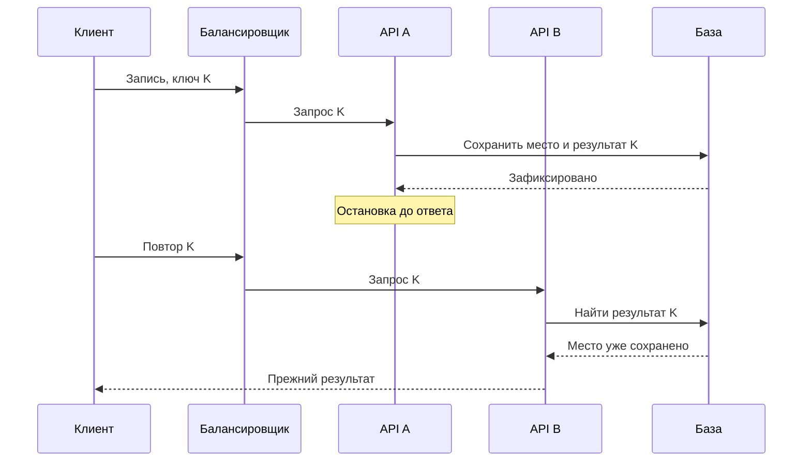
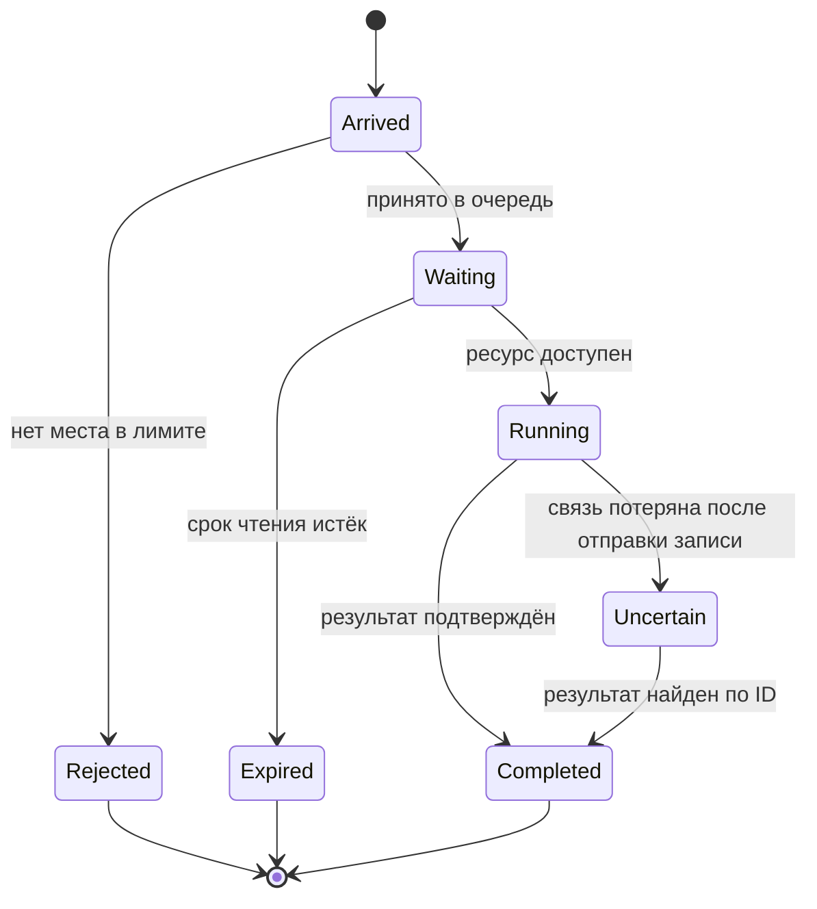

В городской «Клуб» пришли новые школы. В обычное время страницы открываются быстро, но после общего объявления запись начинает тормозить. Команда предлагает купить более мощную машину или разделить приложение на сервисы. Оба решения стоят работы, а причина пока неизвестна. Возможно, один запрос слишком долго держит соединение с базой и остальные ждут в очереди.

Масштабирование начинается с наблюдения. В этой главе мы разделим вычисления, ожидание и ограничение мощности. Затем рассмотрим несколько экземпляров приложения, защиту от перегрузки и условия, при которых выделение сервиса оправдывает свою цену.

## 1. Ищем ограничение по измерениям

Узкое место — ресурс или этап, который ограничивает выполнение нужной работы. Это может быть процессор, диск, сетевой канал, база, блокировка строки или маленький пул соединений. Низкая загрузка процессора не означает, что система здорова: все обработчики могут ждать одну занятую блокировку.

Для записи в «Клуб» проследим этапы: получить запрос, проверить пользователя, дождаться соединения, выполнить транзакцию, сформировать ответ. Отдельно измерим время в очереди и время самой работы. Иначе рост ожидания легко принять за медленный SQL-запрос.

Учебная таблица показывает возможную картину:

| Нагрузка | Среднее ожидание соединения | Работа базы | CPU приложения |
|---|---:|---:|---:|
| 20 RPS | 1 ms | 15 ms | 12% |
| 100 RPS | 8 ms | 16 ms | 30% |
| 200 RPS | 180 ms | 18 ms | 35% |

Эти числа не являются результатом реального теста. В модели заметно, что задержка растёт прежде всего до начала работы с базой. Следующий вопрос: пул действительно мал или запросы слишком долго удерживают его соединения? Увеличение пула без проверки может перегрузить базу и ухудшить результат.

Нагрузочный тест должен повторять существенные свойства сценария: долю чтений и записей, размеры ответов, популярность событий, длительность и всплески. Равномерное чтение случайных ID не проверяет гонку за одно популярное событие. Тест на ноутбуке полезен для поиска механизма, но его абсолютные числа нельзя переносить на другую среду.

Перед экспериментом запишите гипотезу и критерий. Например: «Обработчик держит соединение во время отправки письма; перенос отправки за пределы транзакции уменьшит ожидание пула без нарушения записи». После изменения проверяется не только задержка, но и бизнес-результат при сбое отправки.

### От наблюдения к проверяемой причине

Разложим запрос по времени. Он провёл 120 миллисекунд в ожидании свободного соединения, 20 — в базе и 10 — в остальной работе. Ускорение SQL вдвое сократит общий путь со 150 до 140 миллисекунд, если остальное не изменится. Это полезное изменение, но оно не объясняет основное ожидание. Для поиска причины нужно связать задержку с тем ресурсом, которого запросу не хватает.

Пул соединений — ограниченный набор заранее открытых каналов к базе. Обработчик берёт свободный канал, выполняет работу и возвращает его. Если все каналы заняты, следующий запрос ждёт. Пул нужен, чтобы не создавать бесконечное число соединений, но ошибка жизненного цикла способна превратить его в очередь даже при свободной базе.

Предположим, есть десять соединений. Каждое занято одним запросом примерно 100 миллисекунд. В идеализированной модели это даёт около ста обслуживаний в секунду без запаса. Если девяносто миллисекунд из ста запрос ждёт письмо, удерживая соединение, полезная работа базы занимает лишь десятую часть владения. Возврат соединения до отправки письма меняет ограничение. Увеличение пула только скрывает ошибку и расходует больше ресурсов.

Следующий шаг — воспроизвести ситуацию с контролируемым замедлением почтового сервиса. Сравните время владения соединением, глубину очереди и успешность записи до и после изменения. Проверьте, что отказ письма не отменяет сохранённое место и не теряет намерение уведомить. Такое исследование проверяет конкретную гипотезу, а не все мыслимые причины сразу.

У тестового клиента тоже есть пределы. Если он отправляет следующий запрос только после ответа на предыдущий, при замедлении сервера входной поток сам уменьшается. График может выглядеть спокойнее реального наплыва пользователей. Для сценария независимого прихода нужен генератор с заданным расписанием и измерением опозданий самого генератора. Иначе часть ожидаемых запросов вообще не попадёт в измерение.

Записывайте версию приложения, объём данных, профиль ключей и состояние кэша. Тест на пустой базе и повторный тест после прогрева отвечают на разные вопросы. Сравнение двух результатов имеет смысл, когда различия условий перечислены. Для первой лабораторной достаточно малой среды, если вывод сформулирован как свойство механизма, а не как обещание промышленной мощности.

## 2. Несколько экземпляров приложения

Вертикальное масштабирование добавляет ресурсы одному узлу: память, ядра или более быстрый диск. Оно сравнительно просто, но имеет пределы и не устраняет единую точку отказа. Горизонтальное масштабирование добавляет экземпляры, между которыми распределяется работа.

Балансировщик принимает запрос и выбирает доступный экземпляр. Выбор может учитывать число соединений, загрузку или простой порядок. Сам по себе балансировщик не копирует данные между процессами и не исправляет ошибку конкурентного доступа к базе.

```text
                    ┌── Приложение A ──┐
Клиенты → Балансировщик                  ├→ Общая база
                    └── Приложение B ──┘
```

Стрелки показывают путь запросов. Оба экземпляра используют один источник истины. Потеря A позволяет направить новые запросы в B, если B имеет достаточную мощность. База пока остаётся общей зависимостью, поэтому количество приложений не доказывает устойчивость всей системы.

Проблема появится, если A хранит пользовательскую сессию только в своей памяти. Следующий запрос попадёт в B, который ничего о ней не знает. Можно временно закреплять клиента за экземпляром, но отказ этого экземпляра всё равно потеряет локальное состояние. Другие варианты — общее хранилище сессий или проверяемые сервером токены с подходящими правилами отзыва.

Слово stateless означает, что обработка запроса не зависит от незаменимого состояния предыдущего запроса именно в этом процессе. Оно не означает, что приложению вообще не нужны данные. Состояние остаётся в базе, хранилище сессий и других явно выбранных местах.

Проверки здоровья также имеют разные цели. Проверка жизнеспособности показывает, способен ли процесс продолжать работу. Готовность сообщает, можно ли сейчас направлять ему запросы. Если при каждой краткой недоступности базы перезапускать все приложения, можно превратить временное затруднение в каскадный отказ.

При остановке экземпляр сначала перестаёт принимать новые запросы, затем получает время закончить текущие. Такой порядок называют корректным завершением. Но нельзя ждать бесконечно: нужен предел времени и безопасное поведение незавершённых операций.

### Путь запроса при добавлении экземпляра

Новый экземпляр сначала загружает конфигурацию, устанавливает необходимые связи и объявляет готовность. После этого балансировщик начинает передавать ему часть запросов. Равномерный выбор по кругу удобен для одинаковых задач; при сильно разной длительности один процесс может накопить больше незавершённой работы. Алгоритм балансировки выбирают по наблюдаемой нагрузке, а не только по числу запросов.

Схема ниже показывает отказ после фиксации. Обратите внимание: переключение на другой процесс не сообщает, успел ли первый выполнить операцию.



Повтор сохраняет ключ K, а результат хранится вне памяти A. Поэтому B может ответить без повторного занятия места. Если балансировщик сам повторяет запрос, его политика должна учитывать эту семантику. Переключение адреса не даёт права автоматически повторять любую необратимую операцию с новым идентификатором.

На остановке процесс снимает готовность, чтобы новые запросы перестали направляться к нему, и ждёт текущие до установленного срока. Между сменой готовности и обновлением всех маршрутов есть задержка, поэтому процесс должен корректно обработать оставшиеся обращения. После крайнего срока часть клиентов увидит неизвестный исход и воспользуется тем же механизмом повторов.

Автоматическое масштабирование также действует с задержкой: требуется заметить нагрузку, создать процесс, дождаться готовности и прогреть необходимые данные. Если пик длится десять секунд, а подготовка — минуту, новые экземпляры придут после пика. Для известного объявления можно заранее подготовить запас. При этом общий лимит базы нужно разделить между экземплярами: десять процессов с пулом по сто соединений создают другой режим, чем два таких процесса.

## 3. Ограничиваем очередь и защищаем полезную работу

Очередь сглаживает короткие всплески: работа подождёт свободного обработчика. Но если входящий поток долго выше мощности обработки, очередь растёт без ограничения. Пользователи ждут, память расходуется, старые запросы теряют смысл, а клиенты создают новые повторы.

В учебной модели приходит 300 задач/с, а завершается 200 задач/с. За минуту накопится 6 000 задач. Если затем вход снизится до 100 задач/с, чистая скорость разгрузки будет 100 задач/с, и очередь опустеет ещё за минуту. Если вход останется 300, очередь сама не исчезнет.

Ограничение очереди превращает скрытое ожидание в явный выбор. Когда мест нет, система может быстро отклонить запрос, предложить повтор позже или перейти к ограниченному режиму. Для записи на событие нельзя незаметно подменить успех отказом. Ответ должен честно сообщать, создана ли запись или только принята задача на обработку.

Backpressure означает, что более медленный потребитель передаёт ограничение назад к производителю: «не присылай больше, чем я могу принять». Механизм зависит от границы: приостановка чтения, ограничение одновременных задач, квота или отказ. Без такого сигнала каждый слой может накапливать собственную очередь и скрывать реальное время ожидания.

Таймаут ограничивает длительность ожидания, но не всегда автоматически прекращает работу на другой стороне. Полезно передавать общий срок завершения и не начинать дорогую задачу, если результат уже никому не нужен. Повторы также должны иметь предел: три слоя по три попытки способны многократно увеличить число обращений к самой слабой зависимости.

Деградация сохраняет наиболее важные функции. Например, «Клуб» временно отключает рекомендации и сложную статистику, но продолжает принимать корректные записи. Сначала определите приоритеты продукта, затем выделяйте ресурсы. Иначе дорогой необязательный отчёт может занять весь пул, нужный кнопке записи.

### Сколько работы можно держать незавершённой

При устойчивом потоке среднее число задач внутри системы связано со скоростью и временем пребывания: примерно скорость поступления, умноженная на среднее время. Если Клуб обслуживает 100 запросов в секунду, а каждый находится внутри в среднем 0,2 секунды, одновременно в системе около двадцати запросов. Если время выросло до двух секунд при прежнем входе, это уже около двухсот. Это применение закона Литтла при подходящих условиях устойчивости, а не способ предсказать неограниченно растущую очередь.

Двести запросов могут удерживать память, соединения и контекст. Поэтому один лимит RPS не защищает от замедления. Ограничение параллелизма задаёт число активных работ, а ограниченная очередь — число ожидающих. Когда оба предела заняты, новое действие быстро отклоняется до дорогой части. Такой ранний контроль входа называют admission control.

Посмотрите на состояния запроса. Отказ до начала и неизвестный исход после отправки записи имеют разный смысл.



Для безопасно отменяемого чтения срок позволяет убрать бесполезную работу. Для записи, которая уже ушла в базу, нужен поиск результата: нельзя считать состояние `Uncertain` обычным отказом и заново создавать действие. Отдельно проверяют, действительно ли отмена прерывает выполнение у зависимости. Освобождение ожидания клиента само по себе не освобождает блокировку базы.

У очереди полезно наблюдать возраст, а не только длину. Сто коротких чтений и сто минутных обработок имеют одинаковую длину, но разные сроки. Если старые задания просрочены, их обработка может мешать свежим полезным запросам. Политика удаления зависит от вида работы: забытое чтение можно отменить, а принятое обязательство сохранить прогресс требует завершения или явно предусмотренного восстановления.

## 4. Когда выделять отдельный сервис

Модульный монолит позволяет держать разные части кода в одном приложении, сохраняя ясные интерфейсы между ними. Это удобная начальная форма: проще развёртывание, вызовы внутри процесса и локальные транзакции. Рост кода сам по себе не требует сетевых границ.

Выделение сервиса может помочь, если часть работы требует другого масштабирования, отдельного жизненного цикла или изоляции отказов. Например, преобразование видео требует много вычислений и может выполняться дольше HTTP-запроса. Его полезно отделить от обработки записи, чтобы очередь тяжёлых задач не забрала ресурсы API.

За границу процесса придётся заплатить. Появятся сетевые таймауты, версии контрактов, повторные сообщения, независимые развёртывания и новые сигналы наблюдаемости. Транзакция, которая раньше меняла две таблицы вместе, больше не охватывает произвольные сервисы автоматически.

Хорошее обоснование выглядит конкретно: «Видеообработка исчерпывает CPU и увеличивает p95 записи; отдельный пул worker позволяет ограничить её конкуренцию». Слабое обоснование звучит как «микросервисы лучше масштабируются» без указания нагрузки, границ и цены сопровождения.

### Граница вычислений и граница данных

Разделим два решения, которые часто смешивают. Можно оставить один исходный проект и базу, но запускать обработку видео в отдельном процессе с собственным пределом CPU. Это изоляция исполнения. Можно дополнительно передать отдельному сервису владение метаданными видео и независимое развёртывание. Второй шаг меняет контракт данных и требует больше координации.

Для Клуба сначала сравним три варианта. Внутрипроцессный модуль прост в вызове, но тяжёлая работа влияет на тот же процесс. Отдельный worker ограничивает вычисления и позволяет повторять задания, сохраняя общую модель разработки. Полноценный сервис даёт независимый жизненный цикл, но превращает часть локальных вызовов в сетевые и требует явного владельца состояния.

Критерий выбора должен быть проверяемым. Если проблема — длительность видеокодирования, отдельный worker уже может её решить. Если две команды независимо меняют контракт обработки и выпускают его в разные сроки, сервисная граница может иметь дополнительную ценность. Если проблема — запрос без индекса, перемещение этого запроса за сетевую границу не устраняет стоимость.

После разделения определите поведение при недоступности нового процесса. Создание материала может вернуть состояние «обработка ожидается», но не «видео готово». Появляются ID задания, повторы и критерий завершения. Независимое масштабирование полезно лишь при управлении общей зависимостью: сто worker способны быстрее перегрузить одно хранилище, чем десять.

## Практика: пережить потерю экземпляра

Два одинаковых экземпляра выдерживают по 150 запросов/с каждый при целевой задержке. Ожидаемый пик — 240 запросов/с. Команда утверждает, что система готова к отказу одного экземпляра. Проверьте утверждение и предложите два разных решения. База пока выдерживает 400 запросов/с нужного профиля.

**Подсказка 1.** Посчитайте мощность оставшегося экземпляра.

**Подсказка 2.** Решение может менять ресурсы или обещание продукта.

**Подсказка 3.** Если добавляете экземпляр, проверьте лимиты общей базы и пула соединений.

### Разбор

В норме 300 запросов/с больше ожидаемого пика. После отказа останется 150, что меньше 240. Можно добавить третий экземпляр: после потери одного останется учебная мощность 300. Можно ограничить необязательную нагрузку или заранее согласовать режим отказа части запросов. Просто поставить очередь недостаточно для длительного превышения мощности.

Для трёх экземпляров заранее проверьте сам переход: балансировщику потребуется время заметить отказ, а часть запросов уже находится на потерянном процессе. Запас 300 после отказа отвечает на вопрос устойчивой мощности оставшихся экземпляров, но не обещает отсутствие ошибок в момент отказа. Клиенты должны безопасно повторять неизвестные операции, а общий поток повторов не должен съедать весь запас.

Второе решение можно выразить численно. Если 100 из 240 запросов в секунду относятся к необязательной статистике, при отказе их временно отклоняют или откладывают по выбранному контракту. Оставшиеся 140 ниже условной мощности одного экземпляра 150. При этом нужно проверить, что статистические и критические запросы действительно соответствуют профилю измерения: один тяжёлый отчёт не обязательно равен одной записи. Приоритет работает, только если ограничение действует до того, как отчёт занял общий ресурс.

Для проверки запустите пик, остановите экземпляр и измерьте время перестройки маршрута, задержку критических операций и очередь. Затем восстановите процесс и убедитесь, что он не получает полный поток до готовности. Такой опыт проверяет последовательность отказа и возвращения, которую арифметическая сумма мощностей сама не описывает.

Утверждение о 150 запросах/с справедливо только для заданного профиля и среды. Перед переносом результата нужно проверить, что база, балансировщик и остальные зависимости выдерживают совместную нагрузку. Это и есть переход от арифметики компонентов к поведению системы.

## Практика: найти причину, не маскируя её ресурсами

В учебном Клубе восемь соединений. Запись держит соединение 200 миллисекунд: 20 уходит на транзакцию, 180 — на внешний вызов. Приходит 60 новых запросов в секунду. Затем внешняя зависимость замедляется вдвое. Оцените идеальный предел по времени владения, предложите изменение и перечислите проверки правильности. База в условии способна выполнить нужные короткие транзакции; остальные ограничения пока не измерены.

### Подсказки и подробный разбор

Сначала считайте именно время владения, а не только SQL. До замедления восемь каналов дают приблизительно 8 / 0,2 = 40 обслуживаний в секунду без запаса. Вход 60 уже выше этой границы. После удвоения внешнего ожидания владение станет 0,38 секунды, предел — около 21,1. Удвоение CPU приложения не уберёт это ожидание.

Перенесите внешний вызов за пределы владения соединением. Теоретическое ограничение этого пула по двадцати миллисекундам станет около 400 операций в секунду, но это не обещание скорости системы: проверьте базу, остальной код и профиль. Если внешний вызов необязателен для ответа, сохраните намерение выполнить его надёжно и обрабатывайте отдельно. Если он определяет сам успех операции, потребуются состояния ожидания и сверки, а не выдуманный успешный ответ.

После изменения проверьте падение между записью и внешним действием, повтор запроса с тем же ID и отказ экземпляра. Измерьте время владения, очередь и долю корректных результатов при прежнем потоке. Успешный опыт должен подтвердить причину улучшения и сохранение бизнес-правил. Для более сложной политики повторов и восстановления очереди продолжите [углублённый разбор перегрузки](/system-design/hard-parts/overload).

## Источники

Прочитайте [Google SRE: Handling Overload](https://sre.google/sre-book/handling-overload/) и [Addressing Cascading Failures](https://sre.google/sre-book/addressing-cascading-failures/). Для реального примера того, как вычислительная ошибка распространилась по системе, используйте [разбор инцидента Cloudflare 2 июля 2019 года](https://blog.cloudflare.com/details-of-the-cloudflare-outage-on-july-2-2019/). Это описание конкретного исторического события, а не схема нынешней инфраструктуры компании.

Различие жизнеспособности и готовности процесса показано в [официальном описании проверок Kubernetes](https://kubernetes.io/docs/concepts/configuration/liveness-readiness-startup-probes/). Механизм полезно понять и без использования Kubernetes в учебном Клубе.
