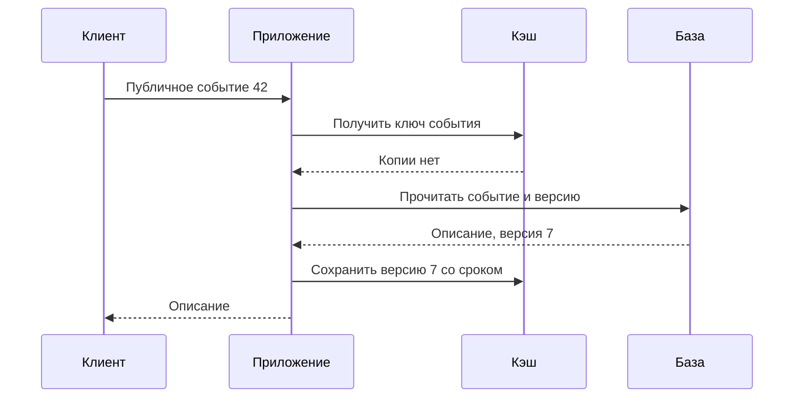
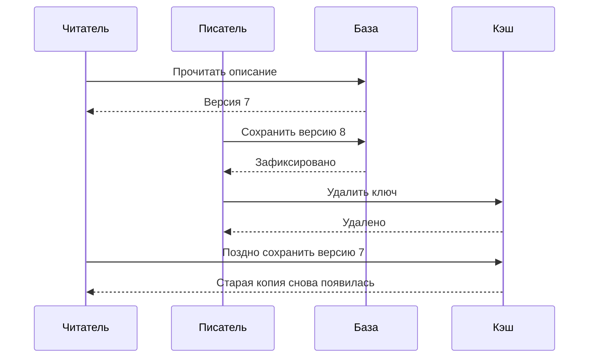

Тысяча посетителей открывает страницу одного городского события. Название, обложка и описание для всех одинаковы. Если каждый запрос повторно читает одни и те же данные из базы, часть работы можно избежать: сохранить готовую копию рядом с потребителем. Но организатор может изменить время встречи. Как долго посетителям разрешено показывать прежнее время?

Кэш — хранилище копий, которые помогают уменьшить задержку или объём повторной работы. Его полезность зависит не только от скорости чтения, но и от допустимого устаревания. В «Клубе» мы будем кэшировать публичный каталог, сохраняя записи участников в базе как источник истины.

## 1. Где может находиться копия

Браузер может хранить обложку, чтобы не загружать её заново. CDN размещает копии ближе к пользователям. Промежуточный сервер может хранить HTTP-ответы. Само приложение может сохранять результат запроса к базе. Эти слои похожи идеей повторного использования, но имеют разные правила ключей, доступа и обновления.

Ключ определяет, какую копию мы ищем. Для публичного описания события это может быть `event:42:public:v3`. Для списка важны фильтр, сортировка, язык и страница. Если забыть язык, посетитель может получить ответ на другом языке. Если забыть пользователя в приватном ответе, возможна утечка данных.

TTL — время, в течение которого копия считается пригодной по выбранной политике. Оно не означает, что данные в источнике не изменяются. При TTL 60 секунд каталог потенциально показывает старую версию в пределах соответствующей модели обновления. Следует также учитывать задержки распространения и другие слои кэша: обещание не рождается из одной настройки.

Когда память заполнена, кэш удаляет часть записей по политике вытеснения. Популярный вариант учитывает недавние обращения, но конкретный алгоритм зависит от продукта. Удаление копии нормально, если её можно восстановить. Если потеря кэша уничтожает единственную запись пользователя, это уже не просто кэш и требуется другой контракт хранения.

Hit ratio — доля обращений, в которых найдена пригодная копия. Из 1 000 запросов/с при 95% попаданий примерно 50 запросов/с пойдут дальше, если каждый промах создаёт ровно одно чтение. Последнее условие существенно: параллельные промахи, дополнительные запросы и ошибки могут изменить реальную нагрузку.

### Политика кэша начинается с операции

Разделим данные события на описание, обложку, предварительное число мест и факт записи конкретного ученика. Для описания команда допускает минутную задержку, для обложки подходит неизменяемая версия, для числа мест возможна приблизительная подсказка. Факт подтверждённой записи имеет иной договор: ученик не должен увидеть отрицание только из-за старой копии. Выбор одного общего TTL для всех четырёх объектов скрывает эти различия.

Внутрипроцессный кэш читает данные без отдельного сетевого обращения, но каждый экземпляр имеет свою копию. После перезапуска она исчезает; после обновления разные процессы могут видеть разные версии. Общее кэш-хранилище уменьшает число независимых копий, зато добавляет сетевую зависимость и общий предел мощности. CDN сокращает путь до зрителя, однако его ключи и правила обновления не обязаны совпадать с ключами приложения.

В модели стоимости пусть обращение к кэшу занимает одну миллисекунду, промах добавляет двадцать миллисекунд чтения базы, а hit ratio равен 90%. Средняя задержка этой части пути приблизительно равна 1 + 0,1 × 20 = 3 миллисекунды. Здесь исключены конкуренция, запись копии и другие затраты. При нулевых попаданиях будет уже 21 миллисекунда: кэш может добавить работу, если данные почти не используются повторно.

Ёмкость тоже считают. Сто тысяч объектов по 2 КБ дают около 200 МБ полезного содержимого в десятичных единицах. Ключи, служебные структуры и выбранное представление увеличат память. Если набор постоянно меняется и не помещается, вытеснение может уничтожить ожидаемую пользу. Поэтому перед введением кэша полезно оценить, какие объекты действительно повторяются в пределах выбранного срока.

Устаревание требует точки отсчёта. TTL обычно начинается при заполнении или обновлении копии по конкретной политике, а не в момент изменения исходной записи. Читатель мог долго держать старый результат перед заполнением. Поэтому «TTL одна минута» без ограничения запоздалого заполнения не доказывает «не больше минуты после изменения». Гарантию продукта нужно связать со всем путём, включая реплики, фоновые задачи и второй слой кэша.

## 2. Cache-aside и четыре истории одного ключа

В схеме cache-aside приложение сначала обращается к кэшу. При попадании возвращает копию. При промахе читает базу, сохраняет копию и отвечает клиенту. Кэш в этой модели находится рядом с основным путём данных, а не заменяет источник истины.

```text
Клиент → Приложение → Кэш
                       │
                 попадание? ── да → ответ
                       │ нет
                       ↓
                      База → заполнить кэш → ответ
```

Теперь рассмотрим изменение описания. Приложение обновляет базу, затем удаляет соответствующий ключ. Следующее чтение заполнит его новым значением. Это понятная начальная политика, но не доказательство отсутствия старых данных.

Гонка выглядит так: читатель получил старую версию из базы и задержался. Писатель сохранил новую версию и удалил ключ. Затем первый читатель записал в кэш старую версию. Удаление после обновления не предотвратило устаревшее заполнение. Такой случай нужно либо принимать в рамках договора свежести, либо защищать дополнительным механизмом.

Версия записи помогает отличить старое значение от нового. Можно хранить номер версии и не позволять более старому заполнению перезаписать более новое при поддержке нужной атомарной операции. Другой вариант — использовать неизменяемый ключ версии, а отдельно управлять указателем на актуальную версию. Это добавляет сложность, поэтому сначала уточните, действительно ли минутная задержка каталога неприемлема.

Для статической обложки удобно имя с версией или хэшем содержимого. Новая картинка получает новый URL, а старая копия остаётся корректной для старого адреса. Для статуса собственной записи подход другой: после успешной операции можно читать надёжный источник или возвращать подтверждённое состояние прямо в ответе.

Отдельная история — ошибка базы. Нельзя автоматически сохранять любой ответ об ошибке как будто это нормальное отсутствие события. Иначе краткий сбой породит длительное ложное «событие не найдено». Негативный кэш действительно бывает полезен для отсутствующих ключей, но требует короткого срока, ясного происхождения результата и понимания последствий создания нового объекта.

### Промах и запись: две независимые последовательности

Схема показывает благополучное чтение. Смотрите, где приложение обращается к источнику и когда появляется новая копия.



Если сохранение копии не удалось, приложение всё равно может вернуть прочитанное описание, если его контракт это допускает. Но следующий запрос снова создаст промах. Если база недоступна, нельзя заменить ошибку выдуманным пустым объектом и сохранить его. Если кэш отвечает слишком медленно, его ожидание должно иметь предел, иначе ускоряющий слой сам задержит каждый запрос.

Теперь проследите гонку, которую не видно в первой схеме. Читатель уже получил старую версию, а писатель успел обновить источник.



Удаление до изменения базы тоже не является универсальным исправлением: между удалением и commit другой читатель заполнит прежнее значение. Повторное удаление с задержкой снижает риск в некоторых условиях, но без границы времени старых читателей не даёт строгого доказательства. Нужно либо принять ограниченное устаревание, либо добавить механизм, который действительно распознаёт старое заполнение.

Одного номера внутри значения иногда мало. Если писатель удалил ключ полностью, запоздалому читателю не с чем сравнить версию. Для условной записи требуется сохранить минимальную допустимую версию или другой барьер, учитываемый атомарно. Версионные неизменяемые ключи предотвращают перезапись одной версии другой, но указатель на текущую версию сам нуждается в политике свежести. Это не бесплатная строгая согласованность.

Альтернатива для критического собственного результата проще: вернуть подтверждённое состояние прямо после изменения и читать его из подходящего источника. Кэш остаётся для публичного каталога. Так Клуб не усложняет все чтения ради одного сценария, которому действительно нужна более сильная гарантия.

## 3. Холодный кэш, горячий ключ и лавина промахов

Предположим, база выдерживает 150 чтений/с, приложение получает 1 000, а попадания составляют 95%. При обычной работе база видит около 50 чтений/с. После очистки кэша нагрузка способна приблизиться к 1 000 чтений/с. Хороший средний hit ratio скрывал зависимость от прогретых копий.

Лавина промахов возникает и для одного популярного ключа. Если его срок истёк одновременно для множества запросов, каждый может начать одинаковое дорогое чтение. Механизм single-flight объединяет конкурентные заполнения: один запрос получает данные, остальные ждут его результат или используют допустимую старую копию. Если объединение действует только внутри одного процесса, несколько экземпляров всё равно могут заполнять ключ параллельно.

Случайное отклонение TTL помогает не истекать тысячам ключей в одну секунду. Оно не устраняет горячий ключ, который сам получает почти весь поток. Для такого ключа могут понадобиться копии ближе к клиентам, ограничение заполнения и отдельная защита нагрузки на источник.

Stale serving позволяет некоторое время отдавать старую копию, пока новая загружается или источник недоступен. Политика полезна для описания события, если пользовательский договор это допускает. Для текущего числа свободных мест старая копия не может служить разрешением создать запись: окончательное решение остаётся за транзакцией.

Прогрев заранее загружает ожидаемо популярные данные, но невозможно гарантировать, что предсказаны все обращения. Поэтому дополнительно нужны ограниченные очереди и admission control, изученные в предыдущей главе. Система должна иметь понятное поведение даже тогда, когда кэш пуст целиком.

Измеряйте попадания вместе с задержкой, числом обращений к источнику, ошибками и временем заполнения. Высокий hit ratio может сосуществовать с медленным критическим сценарием: популярные обложки попадают в кэш, а запись на событие по-прежнему ждёт блокировку.

### Кто выполняет заполнение и что происходит при его отказе

Внутри одного процесса single-flight можно представить как таблицу выполняющихся загрузок по ключу. Первый запрос создаёт запись «загрузка идёт». Следующие присоединяются к её результату вместо нового чтения базы. После успеха или ошибки запись освобождается. Ожидание ограничено: клиент не должен навсегда зависнуть из-за умершего владельца загрузки.

Если экземпляров приложения десять, локальная таблица ограничит число одновременных заполнений примерно одним на экземпляр, а не одним на всю систему. Иногда это достаточно. Распределённое владение заполнением может сильнее уменьшить поток, но требует срока аренды и восстановления. Для обычного кэша часто допустимо редкое параллельное чтение; нельзя усложнять координацию так, чтобы отказ её сервиса остановил все страницы.

Допустим, тысяча запросов обращается к одному холодному ключу, чтение базы занимает 100 миллисекунд, а локальное объединение работает на десяти процессах. При подходящих условиях вместо тысячи одновременных чтений будет до десяти. Это оценка для одной волны и одного ключа, не общая верхняя граница всей нагрузки. Миллион разных холодных ключей требует лимита на суммарное заполнение, даже если каждый заполняется только один раз.

Для временного использования старой копии задайте две границы: обычную свежесть и максимально допустимый возраст при восстановлении. После первой можно обновлять фоновой задачей; после второй требуется новый результат или явный отказ. Бесконечно отдавать старую копию при постоянно сломанном обновлении означает незаметно изменить договор. Измеряйте возраст реально выданных данных и ошибки обновления, а не только долю попаданий.

План полного отказа кэша должен определить предел обращений к базе. Возможны ограниченный обход, временное использование локальной старой копии или сокращённый каталог. Для приватных и критических данных сокращённый ответ не должен обходить доступ или объявлять сохранённым то, что не проверено. Восстановление кэша также выполняют постепенно: массовое одновременное наполнение способно создать вторую волну перегрузки.

## 4. HTTP-кэширование и приватные материалы

HTTP позволяет задавать правила использования ответов через заголовки. `Cache-Control` описывает политику, а валидаторы вроде ETag помогают проверить, изменилось ли содержимое. При условном запросе сервер может подтвердить пригодность копии без повторной передачи тела.

`no-cache` означает необходимость проверки перед повторным использованием, а не обязательный запрет хранения. `no-store` запрещает хранить ответ соответствующим кэшам. Разница важна при работе с личными сведениями. Одного привычного названия заголовка недостаточно: нужно проверить, какую гарантию он выражает.

CDN хорошо подходит для публичных обложек и больших неизменяемых материалов. Для закрытого файла требуется проверить право доступа. Подписанный URL может предоставлять временный доступ, но становится самостоятельным секретом: тот, кто получил ссылку, часто может воспользоваться ею до истечения срока согласно контракту сервиса.

Короткий срок действия уменьшает окно доступа, но не обеспечивает мгновенный отзыв. Если требование говорит «после удаления доступа файл не выдаётся уже через секунду», придётся выбрать механизм проверки или отзыва, который действительно укладывается в этот срок. Заявление «ссылка подписана» не отвечает на вопрос о ранее сохранённой копии.

Не размещайте персональный ответ в общем кэше под ключом одного URL без учёта прав. Безопасность должна сохраняться на всех путях: через приложение, через CDN и при прямом обращении к объекту.

### Условный запрос и границы доступа

ETag — валидатор представления: сервер связывает его с выбранной версией ответа. Браузер, у которого уже есть копия, отправляет условие с прежним валидатором. Если представление по правилам проверки не изменилось, сервер может вернуть 304 без тела, и браузер использует свою копию. Это экономит передачу тела, но запрос и проверка всё равно происходят; снижение байтов не обязательно означает такое же снижение работы базы.

Правило `private` допускает хранение в частном кэше, но запрещает обычное повторное использование общим кэшем. Оно само по себе не шифрует содержимое и не удаляет уже скачанные данные с устройства. `Vary` указывает, какие заголовки запроса влияют на выбор представления, например язык. Это способ разделения вариантов, а не универсальная авторизация: правильность прав нужно проверять отдельно.

Для публичной обложки с неизменяемым URL версии длительный срок удобен: новое содержимое получает новый адрес. Для страницы редактора можно запретить хранение личного ответа или потребовать подходящую проверку, исходя из его состава. Для платного видео Клуб отдельно решает, кто проверяет право до выдачи сегмента и может ли общая копия использоваться после этой проверки. Ключ кэша и подписанный доступ должны соответствовать одному договору.

При отзыве права рассматривают уже выданную ссылку, копию CDN и копию браузера. Очистка одного слоя не доказывает исчезновение остальных. Сервис может прекратить будущую выдачу, но уже полученные байты находятся вне его полного контроля. Поэтому архитектурное обещание формулируют как прекращение определённых серверных ответов за выбранный срок, а не как мгновенное исчезновение файла у всех зрителей.

## Практика: изменение времени встречи

Организатор меняет время события с 18:00 на 19:00. Публичный каталог может устаревать на минуту, но страница редактирования должна показать подтверждённое изменение сразу. Предложите две политики чтения и опишите четыре случая: попадание, промах, обновление и отказ кэша.

**Подсказка 1.** Для двух страниц не обязательно выбирать одинаковый источник.

**Подсказка 2.** Удаление ключа не исключает запоздалое заполнение старой версией.

**Подсказка 3.** Отказ кэша должен иметь лимит обращений к базе.

### Разбор

Публичная страница использует копию с ограничением свежести, а редактор получает подтверждённое состояние из ответа изменения или читает источник, который обеспечивает нужную гарантию. При промахе приложение читает базу и заполняет кэш. При обновлении использует выбранную схему инвалидирования с оговорёнными гонками. При отказе защищает базу ограничением конкурентных чтений и честной деградацией.

Для минутного договора уточните начало отсчёта и поведение задержавшегося читателя. Если копия получена из источника давно, но записана в кэш только сейчас, новый полный TTL продлит её жизнь. В простой учебной политике можно ограничить весь срок жизни результата с момента его чтения, запретить позднее заполнение после этой границы и учитывать свежесть самого источника. При чтении отстающей реплики её отставание тоже входит в бюджет. Без этих условий одну минуту после изменения нельзя считать доказанной верхней границей.

Страница редактора после успешного ответа обновляет локальную модель подтверждённой версией. Если сразу выполняет дополнительное чтение, она передаёт минимальную ожидаемую версию или обращается к владельцу данных. Иначе сама проверка после сохранения способна вернуть старую копию и визуально отменить правильный результат. В тесте задержите читателя до изменения, затем разрешите ему заполнить кэш: именно эта последовательность показывает, выполняется ли выбранный договор.

Для переноса замените время встречи остатком мест. Каталог может показать приблизительное число, но успешная запись должна проверять вместимость по источнику истины. Это отделяет удобство отображения от правила, которое нельзя нарушать.

## Практика: пустой кэш во время объявления

Каталог получает 1200 запросов в секунду. В норме hit ratio равен 95%, и каждый промах создаёт одно чтение базы. База обслуживает до 200 таких чтений в секунду в заданном профиле. Кэш перезапущен. Предложите режим первых тридцати секунд и восстановление. Отдельно объясните, что меняется, если все запросы относятся к одному событию или к разным событиям.

### Подсказки и подробный разбор

Обычная нагрузка базы составляет 1200 × 0,05 = 60 чтений в секунду. При полностью холодном кэше без защиты она приблизится к 1200, в шесть раз больше указанного предела. Значит, запас обычного режима не доказывает готовность к очистке. Нельзя просто включить безусловный обход для всех запросов.

Для одного события объединение заполнений резко уменьшает число одинаковых чтений. Ограничьте время ожидания, обработайте ошибку владельца загрузки и учтите число экземпляров. Для разных событий такое объединение почти не поможет: нужен общий предел обращений к источнику, приоритет популярных объектов и явная политика отказа лишних запросов. Допустимые старые копии уменьшают отказ, только если они действительно сохранились в другом слое.

После восстановления наблюдайте скорость заполнения, нагрузку базы, возраст копий и успешность страниц. Увеличивайте приём постепенно. Проверьте отдельно личный статус записи: его нельзя подменять публичным кэшированным ответом ради высокого hit ratio. Успешное решение описывает не только нормальный быстрый путь, но и предел работы, когда ускоряющий слой отсутствует целиком.

## Источники

Правила HTTP-кэша изложены в [MDN: HTTP caching](https://developer.mozilla.org/en-US/docs/Web/HTTP/Guides/Caching). Реальный исторический разбор больших кэшей — [Scaling Memcache at Facebook, NSDI 2013](https://www.usenix.org/conference/nsdi13/technical-sessions/presentation/nishtala). Читайте его ради механизмов и условий, а не как готовый список компонентов для небольшой системы.

Точная семантика HTTP-кэширования задана в [RFC 9111](https://www.rfc-editor.org/rfc/rfc9111.html); используйте её для проверки смысла директив, а не переносите значение слова «кэш» между слоями автоматически.
