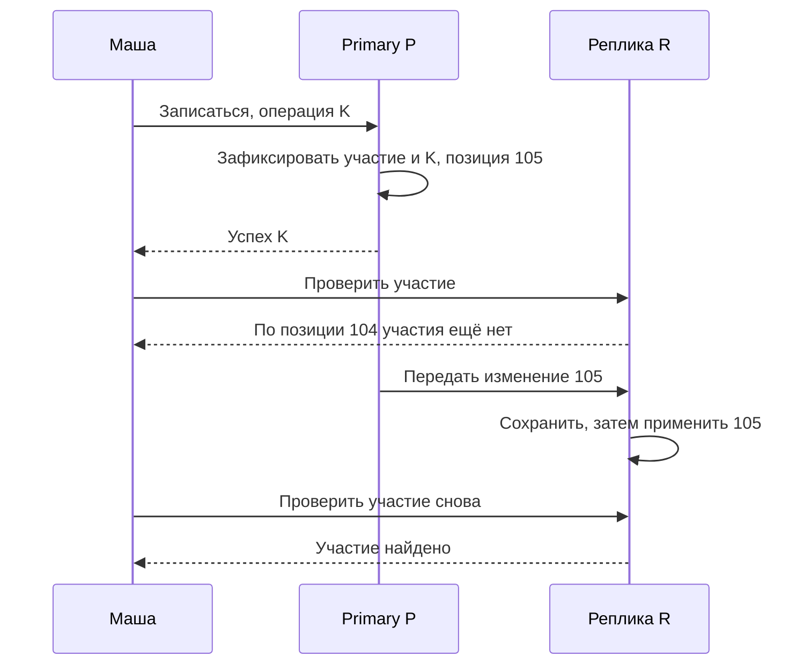
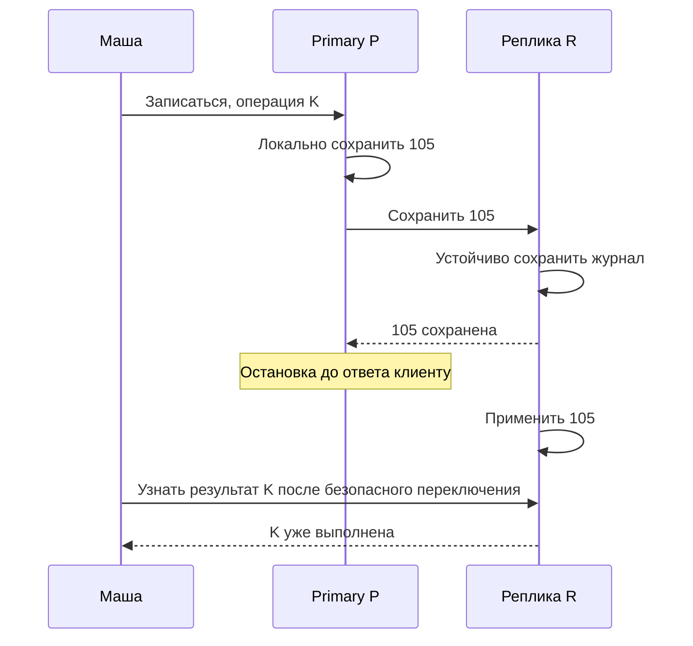

Маша записалась на событие и получила подтверждение. Затем обновила страницу — и снова увидела кнопку «Записаться». В базе ошибки нет: запись сохранена на основном узле, а чтение попало на копию, которая ещё не получила изменение. Для пользователя это выглядит как потеря результата, хотя причина — задержка распространения данных.

Репликация создаёт и поддерживает несколько копий данных. Она помогает распределять чтение и переживать отдельные отказы, но заставляет выбрать, когда считать запись подтверждённой и какую копию разрешено читать. В этой главе мы будем рассуждать через конкретные истории операций, а не через обещание «сильной согласованности» без определения.

## 1. Зачем базе несколько копий

В модели с одним основным узлом, primary, записи принимает он. Дополнительные узлы получают изменения и воспроизводят их у себя. Они называются репликами. Механизм передачи может использовать журнал изменений: основная база фиксирует операции, а реплика применяет соответствующую последовательность.

При асинхронной репликации основной узел может подтвердить запись, не дожидаясь применения изменения на реплике. Ответ обычно не включает ожидание удалённой копии, но после потери основного узла подтверждённые данные могут отсутствовать на доступном кандидате для переключения.

При синхронной репликации подтверждение ждёт определённого условия от других узлов. Важно назвать условие: получение, сохранение в устойчивом журнале или применение изменения для чтения. Разные настройки дают разные гарантии. Фраза «у нас синхронная реплика» без числа узлов и правила подтверждения недостаточна для анализа отказа.

```text
Клиент → Primary: сохранить запись 105
Primary → Клиент: успех
Primary ── позже ──> Реплика: применить запись 105
```

Здесь показан допустимый асинхронный порядок. Между ответом клиенту и применением на реплике чтения могут различаться. Задержку распространения называют replication lag. Она зависит от сети, нагрузки и скорости применения журнала, а во время серьёзного сбоя может расти неопределённо долго.

Реплика не заменяет резервную копию. Ошибочное удаление может быстро распространиться на все реплики. Для восстановления состояния до ошибки нужен подходящий исторический снимок или журнал и проверенная процедура возврата. Реплика в первую очередь поддерживает другую доступную копию текущих изменений.

### Как появляется новая реплика

Новой машине недостаточно передавать только будущие изменения: ей нужен исходный набор данных. Поэтому протокол связывает снимок с позицией журнала. Снимок содержит состояние на определённой границе, а последующие записи доводят его до текущего состояния. Если между границей снимка и началом журнала есть пропуск, реплика навсегда пропустит изменения, хотя поздние записи будут приходить исправно.

Представьте, что копирование снимка занимает час. Пока оно идёт, Клуб продолжает принимать записи. Журнал должен сохранять необходимую историю до завершения копирования и догона. Если старые участки удалены раньше, новая копия не может просто объявить себя актуальной: ей понадобится поддерживаемое восстановление или новый снимок. Это операционная причина следить за отставанием, а не только за свободным местом на реплике.

Повторная передача одного участка нормальна после потери ответа. Получатель должен понимать его позицию и применять данные по правилам выбранного механизма, а не считать каждый пакет новым пользовательским действием. Позиция относится к конкретной истории; после смены владельца сравнение одних чисел из разных ветвей недостаточно.

Возьмём условный объём 60 ГБ и полезную скорость копирования 20 МБ/с в десятичных единицах. Только передача снимка займёт минимум 3000 секунд, то есть 50 минут. Если текущие изменения поступают быстрее, чем реплика умеет их применять, догон никогда не закончится при неизменной нагрузке. Нужно увеличить способность обработки, уменьшить вход или выбрать другой план. Готовность реплики определяется проверенной позицией, а не окончанием загрузки файлов.

## 2. Какие чтения нужны пользователю

Каталог «Клуба» допускает минутное устаревание. Его чтения можно направлять на реплику, пока наблюдаемая задержка совместима с договором. Результат собственной записи имеет другую семантику: после подтверждения Маша ожидает увидеть себя участником.

Гарантия read-your-writes означает, что пользовательские чтения отражают его уже подтверждённые записи в определённой области сессии или клиента. Простой вариант — после записи читать соответствующие данные с основного узла. Другой — передать отметку позиции записи и дождаться, пока выбранная реплика достигнет её, с ограничением ожидания и запасным маршрутом.

Ожидание фиксированных трёх секунд не доказывает эту гарантию. Реплика обычно может укладываться в три секунды, но при сбое отстать сильнее. Таймер основывается на прогнозе, а позиция журнала — на подтверждении конкретного прогресса. При недоступности всех подходящих узлов придётся честно решить, ждать, отказать или ослабить обещание.

Монотонное чтение означает, что пользователь не движется назад к более старому состоянию после уже увиденного нового. Если один запрос попадает на быструю реплику, а следующий — на сильно отстающую, на экране может снова появиться прежнее название события. Закрепление маршрута или перенос отметки виденной версии помогает, но имеет цену и границы.

Сначала составляйте таблицу операций и гарантий. Каталог: устаревание допустимо. Проверка вместимости при записи: нужна корректная транзакция у уполномоченного владельца данных. Собственный статус: нужно видеть подтверждённое действие. Аналитика: допустима отдельная задержка. Одна настройка для всего приложения часто оказывается либо слишком дорогой, либо недостаточной.

### Обещание чтения имеет область

Для Маши важно увидеть свою запись на конкретный курс. Это не требует автоматически ждать все изменения всех курсов. Клуб может переносить минимальную нужную версию только для результата этой операции. Более широкая сессионная гарантия потребует учитывать несколько объектов и мест хранения; один номер подходит не каждой архитектуре.

Закрепление клиента за primary после записи — простой вариант, если узел доступен и объём таких чтений невелик. Закрепление за одной репликой предотвращает некоторые перемещения между копиями, но само по себе не доказывает, что эта реплика уже получила запись. Два разных обещания — «не двигаться назад» и «увидеть собственное изменение» — требуют своих проверок.

Не следует определять отсутствие записи по чтению, которое заведомо допускает отставание, а затем принимать необратимое решение. Например, обработчик не должен возвращать оплату только потому, что локальная реплика ещё не увидела выданный доступ. Производное представление подходит для просмотра; критическое решение требует источника с нужной гарантией или явной сверки.

В контракте API полезно различать «объекта нет в актуальной истории» и «нужное состояние пока недоступно». Второй результат позволяет интерфейсу показать проверку статуса, а клиенту — повторить чтение без создания новой операции. Выбранная гарантия должна определять это поведение до первого отказа.

## 3. Что означает согласованность

Линеаризуемая операция выглядит так, будто произошла мгновенно в некоторой точке между вызовом и ответом. Если запись завершилась до начала чтения, последующее чтение не должно вернуть более старое значение при соблюдении модели этого объекта. Одновременные операции система упорядочивает некоторым допустимым образом.

Рассмотрим регистр с числом мест. Операция записи значения 0 завершилась, затем другой клиент начал чтение. Ответ 1 нарушает линеаризуемость такого регистра. Если чтение началось до завершения записи, возможны разные допустимые порядки. Поэтому для проверки нужны моменты начала и конца, а не только список значений.

Eventual consistency обещает сближение копий при оговорённых условиях: новые изменения прекращаются, связь восстанавливается и механизм распространения продолжает работать. Она сама по себе не задаёт срок сходимости и правило разрешения всех конфликтов. Для продукта надо добавить, сколько ждать и что делать, пока копии различаются.

Причинная согласованность сохраняет порядок связанных действий. Если организатор создал событие, а затем написал комментарий «запись открыта», читателю не хочется увидеть комментарий без самого события. Независимые изменения могут не иметь общего необходимого порядка. Эта идея отличается от требования единого глобального порядка всех операций.

Слово consistency в ACID относится к сохранению правил данных транзакциями и приложением, а в моделях распределённого чтения — к наблюдаемым историям операций. Совпадение английского слова не делает понятия одинаковыми. База может обеспечивать локальные транзакции и одновременно иметь отстающие асинхронные реплики.

Ни одна из гарантий не бесплатна. Ожидание удалённых подтверждений увеличивает задержку и связывает доступность операции с доступностью нужных узлов. Слабая гарантия уменьшает ожидание, но переносит часть сложности в продукт и восстановление конфликтов.

### Проверяем историю, а не название режима

Запишите четыре времени: начало записи, её успешный ответ, начало чтения и ответ чтения. Если чтение началось после завершения записи, для линеаризуемого регистра оно должно учитывать её либо более позднюю запись. Если интервалы перекрываются, старое значение может быть допустимо: система вправе поставить чтение раньше записи в общей истории. Одного сравнения времён ответов недостаточно.

Линеаризуемость отдельного чтения и отдельной записи не делает составную проверку атомарной. Два клиента могут последовательно прочитать остаток 1, а затем каждый записать 0 и оба решить, что получили место. Для операции «занять, если осталось» нужен единый механизм условного изменения или транзакция, сохраняющая инвариант. Модель чтения не заменяет правильный контракт изменения.

Eventual consistency также требует правила конфликтов. Если один регион добавил курс в избранное, а другой удалил его, фраза «потом сойдутся» ещё не говорит, какое состояние получится. Надо определить идентичность операций, допустимый порядок и правило разрешения. Выбор последнего времени ненадёжен без рассмотрения часов и может потерять осмысленное действие пользователя.

Разные гарантии нельзя расположить на простой шкале «хорошая база — плохая база». Для асинхронной аналитики задержка приемлема и снижает стоимость критического пути. Для подтверждения последнего места нарушение порядка создаёт два несовместимых обещания. Правильный выбор следует из наблюдаемого поведения операции, а не из рекламного названия продукта.

## 4. Разделение сети, кворум и переключение

При разделении сети узлы продолжают работать, но часть сообщений между ними не проходит. Основной узел может быть жив и обслуживать одних клиентов, пока другая группа считает его недоступным. Нельзя по отсутствию ответа уверенно отличить остановку от изоляции.

Теорема CAP касается несовместимости определённых гарантий согласованности и доступности во время такого разделения в заданной модели. Это не совет «всегда выбрать любые два свойства из трёх». Для конкретной операции нужно решить: разрешаем ответ на изолированной стороне с риском расхождения или отказываемся отвечать до возможности сохранить нужный порядок.

Кворум использует пересечение групп подтверждения. При трёх репликах запись может требовать две, чтение — две. Такие группы пересекаются. Но арифметика `R + W > N` сама по себе не доказывает линеаризуемость: нужно определить работу версий, конкурентных записей, незавершённых операций, выбора актуального значения и изменений состава узлов.

Переключение primary на реплику, failover, также является протоколом. Сначала нужно выбрать достаточно актуальную копию и убедиться, что старый владелец не продолжит принимать конфликтующие записи. Два одновременно пишущих «основных» узла называют split brain. Просто поменять DNS или адрес в приложении недостаточно, если старый узел остаётся доступным части клиентов.

Fencing ограничивает полномочия старого владельца. Например, каждое новое владение получает возрастающий номер эпохи, а хранилище отвергает действия со старой эпохой. Механизм работает только если защищаемый ресурс действительно проверяет номер. Токен в памяти приложения без проверки на стороне ресурса не блокирует запоздалую запись.

После восстановления связи нужен план возврата старого узла. Он может содержать изменения, которых нет у нового владельца. Автоматически объединить их безопасно получается не во всех задачах. Для записи на последнее место бизнес-инвариант особенно плохо сочетается с независимыми подтверждениями в двух разделённых частях.

### Сохранность данных и право продолжать запись

После отказа primary есть две отдельные проверки. Первая: достаточно ли актуален кандидат, чтобы сохранить уже выданные обещания? Вторая: исключён ли прежний владелец из успешной записи? Более новая копия не решает вторую задачу, а надёжное отключение старого владельца не добавляет отсутствующие изменения кандидату.

Если большинства протокола нет, узлы могут сохранить данные, но временно потерять право подтверждать новые изменения. Это отличается от уничтожения информации. Добавление пустого узла и объявление его частью нового большинства требует специального протокола изменения состава; произвольное голосование не восстанавливает историю.

Вернувшийся primary сначала рассматривают как потенциально расходящуюся копию. Его нельзя сразу включать в запись из-за привычного имени. Проверяют историю, сохраняют необходимые данные для сверки и приводят его к выбранной актуальной ветви поддерживаемым способом. Только затем он может стать репликой или участвовать в новом управляемом переключении. Репликация сокращает часть времени восстановления, но не устраняет эту работу.

## Пошаговый пример: где находится запись 105

Возьмём один курс и два узла. Primary P принимает изменения, реплика R повторяет его журнал. До начала опыта оба применили позицию 104. Маша отправляет запись на курс с ID операции K. В этой учебной модели каждая позиция обозначает целое изменение; реальный журнал может иметь более подробное устройство, которое здесь не требуется.

P проверяет, что K ещё не выполнена, фиксирует участие Маши и результат K. Затем отправляет изменение R. На R различаем три состояния: сообщение получено, устойчиво сохранено, применено к данным чтения. Получение по сети не доказывает сохранность после выключения, а сохранность не означает немедленную видимость запросам.

### Схема: ответ уже есть, а чтение ещё старое

Следите за порядком ответа Маше и применения позиции 105 на R.



Первое чтение не отменяет совершённую запись. Оно показывает, что выбранный маршрут не выполняет ожидание Маши. Если приложение предложит немедленно записаться повторно с новым ID, проблема интерфейса станет дополнительной нагрузкой, а при слабых ограничениях — дублем. Поэтому результат операции K и уникальность записи ученика полезны независимо от репликации.

Для чтения после записи API может вернуть токен «история H, минимум 105». При следующем запросе R проверяет применённую позицию. Если там 104, ограниченно ждёт или передаёт запрос P. Если подходящий узел недоступен, возвращает явную временную неопределённость. Он не должен молча выдать старое отрицание и одновременно заявить read-your-writes.

## Меняем правило подтверждения и проверяем падение

Теперь P отвечает только после устойчивого сохранения 105 на R. Это меняет гарантию переживания отказа одного узла, но не обязательно момент чтения с R: сохранённую запись ещё требуется применить. Попросите себя назвать, что именно подтверждает каждая стрелка, прежде чем использовать слово «синхронно».

### Схема: сохранено удалённо, но ответ потерян

Смотрите на ситуацию после остановки P: у R есть данные, у Маши пока нет ответа о результате.



Последняя часть схемы предполагает отдельное безопасное переключение: R выбран уполномоченным владельцем, а старый P лишён возможности продолжать запись. Просто доступность порта R этого не доказывает. Результат K перенесён вместе с участием, поэтому повтор можно распознать. Если копировать только итоговую строку, забыв память об операции, обещание повторяемого API может измениться.

Проверьте четыре точки остановки на бумаге. До локального сохранения операция не зафиксирована. После него, но до сохранения R, клиенту ещё нельзя выдавать успех по новому правилу. После сохранения R, но до ответа операция существует, хотя клиент не знает исхода. После ответа и потери P запись сохраняется на R в рамках модели отказа одного узла. Ни в одном случае один таймаут не сообщает клиенту, какая точка уже пройдена.

Цена нового правила — ожидание сети и удалённого сохранения. Если связь с R потеряна, P не может продолжать подтверждать записи по прежней гарантии. Команда выбирает ждать, отказать либо явно изменить режим. Автоматический переход к локальному подтверждению улучшит доступность, но ослабит сохранность; это должно быть видимо в контракте и процедуре восстановления.

Для самостоятельной проверки добавьте вторую реплику S, отставшую до 103. Объясните, почему наличие 105 на R не позволяет безусловно продвинуть S. Затем рассмотрите потерю связи без выключения P: именно здесь потребуется защита от двух владельцев. Полный протокол с барьерами, сессионным чтением и возвращением региона разобран в [блоке о нескольких регионах](/system-design/hard-parts/multiregion), а границы повторного эффекта — в [блоке о доставке](/system-design/hard-parts/delivery).

## 5. Три модели записи требуют разных правил

Single-leader направляет изменения одному лидеру и передаёт журнал ведомым. Его удобно связать с одним порядком, но failover должен выбрать достаточно актуального владельца и лишить старого прав. Multi-leader принимает изменения в нескольких местах; это может помочь локальной работе, но одновременные записи требуют конфликта и merge. Leaderless направляет запись нескольким репликам без одного лидера данных; чтение выбирает версии и часто помогает догону. Протокол координации метаданных при этом всё ещё возможен.

История конфликта: редактор A добавил «телескоп», B из прежней версии добавил «камеру». Если значение — весь список и победит одна последняя запись, часть изменения исчезнет. Для множества можно предложить merge, но добавление и удаление одного предмета требуют точной семантики. Вектор версий помогает отличить причинное изменение от конкурентного. LWW выбирает по заданному timestamp/order и может намеренно потерять одну версию; часы не доказывают, какая правка причинно последняя.

Сходимость означает, что после распространения изменений и прекращения новых записей копии согласуются по выбранному протоколу. Она не обещает свежесть каждого чтения или отсутствие конфликта до merge. Read repair чинит копии при чтении, anti-entropy сравнивает состояние фоном. Если потерянное значение нигде не сохранилось, ни один механизм не восстановит его из названия eventual consistency.

## 6. Кворум пересекает множества, протокол объясняет значение

При N=3, W=2, R=2 любое выбранное множество записи пересекается с множеством чтения хотя бы в одной реплике. Но writer может остановиться после первой копии, а разные reads увидеть разные частично распространённые версии. Без правила чтения/обратной записи и версий один read увидит новое, следующий — старое. Формула не гарантирует весь объектный контракт.

У sloppy quorum временно принимают записи узлы за пределами обычного набора владельцев. W=2 и R=2 здесь могут относиться к разным наборам; прежнее доказательство пересечения неприменимо. Hinted handoff хранит намерение вернуть данные владельцу, но до этого момента чтение должно иметь собственный договор. [Dynamo, 2007](https://www.amazon.science/publications/dynamo-amazons-highly-available-key-value-store) разбирает такую доступность и конфликты; его нельзя путать с текущим контрактом DynamoDB.

CAP рассматривает линеаризуемость и завершение каждого запроса к исправному узлу в модели, допускающей разделение сети. В partition нельзя одновременно гарантировать оба свойства для всех исполнений. Быстрый ответ с ошибкой сохраняет полезный прикладной deadline, но не является успешной операцией CAP availability. Это не правило «выберите два свойства»: без partition всё ещё нужно платить задержкой за координацию. [Gilbert–Lynch, 2002](https://www.comp.nus.edu.sg/~gilbert/pubs/BrewersConjecture-SigAct.pdf).

### Цена подтверждения и новое условие выбора

При условном RTT до нужной удалённой копии 45 ms её синхронное подтверждение добавляет сетевое ожидание на критический путь; pipelining повышает throughput, но не отменяет задержку отдельной зависимости. Async подтверждение может быть быстрее, но окно потери определяется реально не дошедшим suffix журнала. Режим сохранения на remote disk отличается от remote apply: читатель увидит запись только после её применения. Сверяйте с [PostgreSQL Standby](https://www.postgresql.org/docs/18/warm-standby.html).

Самостоятельно разделите каталог и выдачу кабинок при partition A | B,C. Для каждой операции укажите, кто отвечает, какую версию возвращает и что делает повтор после таймаута. Разбор: каталог может вернуть копию с отмеченным возрастом; критическая выдача требует стороны с подтверждёнными полномочиями и сохранением инварианта. Изолированный старый лидер не получает право выдачи только потому, что его процесс работает. Для причинных чтений можно передавать минимум версии, но его нужно сопоставлять с веткой/epoch после failover. Пересматривайте модель, когда появились конфликтующие локальные записи, другой RPO или иной договор чтения.

## Практика: подтверждение перед отказом

Primary подтвердил запись 105. Реплика применила только записи до 104. После этого primary стал недоступен. Команда хочет немедленно переключить приложение на реплику и обещать отсутствие потерь. Объясните, какие данные нужны для решения и какие обещания совместимы с указанной историей.

**Подсказка 1.** Сравните подтверждение клиенту и сохранение на кандидате.

**Подсказка 2.** Недоступность узла не доказывает, что его данные уничтожены.

**Подсказка 3.** Скорость восстановления и отсутствие потерь могут потребовать разных действий.

### Разбор

На доступной реплике записи 105 нет, поэтому немедленное переключение не даёт обещания нулевой потери. Можно ждать восстановления или получения недостающего журнала, выбрать более актуальную копию, если она есть, либо принять явно допустимую потерю. Одновременно требуется исключить старого писателя. Нельзя решить оба вопроса одной сменой адреса.

Для переноса измените правило подтверждения: клиент получает успех только после устойчивого сохранения на двух узлах. Это улучшает защиту от потери одного узла при соблюдении механизма, но не отменяет необходимости выбрать правильного нового владельца и проверить границы гарантий.

## Практика: догон и собственное чтение

Новая реплика получила снимок на позиции 1000. Пока его копировали, накопилось 120 000 изменений. После запуска догона новые изменения поступают по 300 в секунду, а реплика применяет 500 в секунду. Затем Маша получила подтверждение записи на primary и читает реплику, которая ещё не дошла до этой позиции. Рассчитайте минимальное время догона в модели и предложите поведение чтения.

### Подсказки и подробный разбор

Чистое сокращение отставания равно 500 − 300 = 200 изменениям в секунду. При постоянных скоростях понадобится 120 000 / 200 = 600 секунд, то есть десять минут. Деление на 500 дало бы время обслуживания исходного набора без учёта всей продолжающей поступать очереди. В реальной системе скорость и стоимость изменений различаются, поэтому расчёт является ориентиром при заданных условиях.

Обычное чтение каталога может использовать реплику, если допускаемый возраст не нарушен. Собственный статус Маши требует другого пути: чтения primary либо ожидания нужной применённой позиции с ограниченным сроком. Если срок истёк, ответ должен отражать недоступность подтверждённого состояния, а не отрицать запись. Фиксированное ожидание «ещё одну секунду» не является доказательством догона.

Измените условие: применение замедлилось до 250 изменений в секунду. Тогда очередь растёт на 50 в секунду; ожидание само не решит проблему. Нужны изменение нагрузки или ресурсов и пересмотр маршрутов чтения. Проверьте, что наблюдение lag не опирается на устаревшую метрику во время потери связи.

## Источники

Для конкретного механизма прочитайте [PostgreSQL: Log-Shipping Standby Servers](https://www.postgresql.org/docs/18/warm-standby.html). Исторический пример другого выбора гарантий — [Dynamo, Amazon, 2007](https://www.amazon.science/publications/dynamo-amazons-highly-available-key-value-store). Его не следует отождествлять с современным DynamoDB. Последствия переключений иллюстрирует [разбор инцидента GitHub 21 октября 2018 года](https://github.blog/news-insights/company-news/oct21-post-incident-analysis/).

Формальные определения согласованности и доступности при разделении сети приведены в [первичной работе Gilbert–Lynch](https://www.comp.nus.edu.sg/~gilbert/pubs/BrewersConjecture-SigAct.pdf). Они задают условия рассуждения и не выбирают продукт вместо архитектора.
