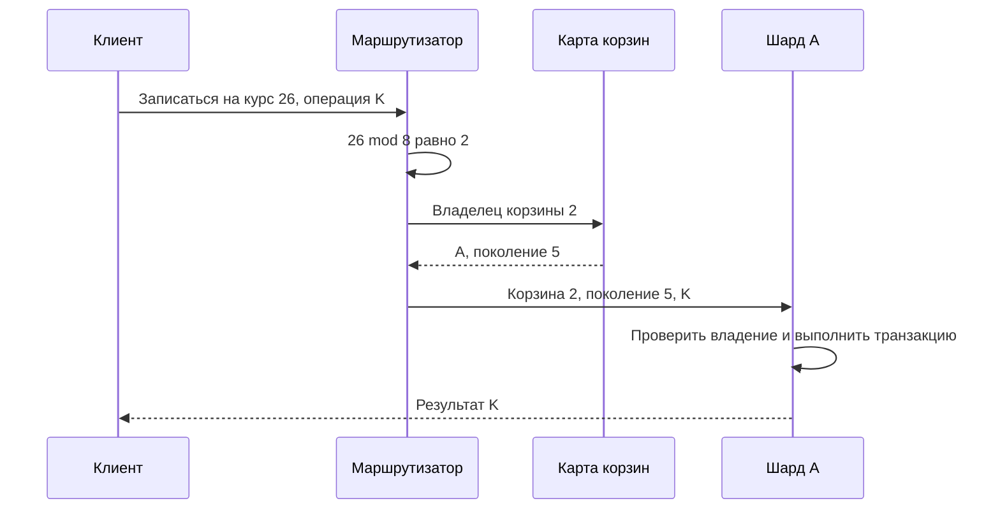
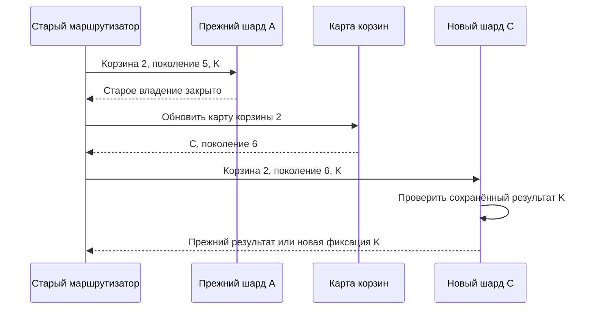

«Клуб» вырос: теперь в нём участвуют сто школ. Одна школа проводит городской фестиваль и создаёт 40% всех записей. Команда распределила школы по восьми узлам и удивилась, что один узел всё равно перегружен. Равное число школ на узле не означает равную работу.

Репликация создаёт копии, а разбиение распределяет разные части данных. Эти механизмы можно сочетать, но они решают разные задачи. В этой главе мы выберем тип хранения по запросам, сравним ключи разбиения и разберём перенос данных. Завершим поиском — полезным примером отдельного производного представления.

## 1. Начинаем с вопросов к данным

Название технологии не объясняет, какие операции она должна выполнять. Сначала запишем запросы «Клуба»: найти событие по ID; показать события школы за неделю; перечислить участников; защитить последнее место; найти события по словам в описании; отдать большой видеофайл.

SQL-база подходит для связанных данных и транзакционных правил, если её возможности и масштаб соответствуют нагрузке. Хранилище ключ–значение удобно, когда известен ключ и нужен объект целиком. Документная модель позволяет хранить вложенные структуры, но не избавляет от решения вопросов индексации и согласованности. Поисковый движок строит специальные структуры для текста. Объектное хранилище хранит большие файлы по ключам.

Это не рейтинг технологий. Один и тот же продукт может предоставлять несколько моделей, а SQL-система — распределять данные. Выбор зависит от поддерживаемых операций, гарантий, эксплуатации и проверенной стоимости. Лозунг «NoSQL масштабируется» слишком широк для технического решения.

Для начального «Клуба» участники, события и записи остаются в SQL-базе. Обложки и видео хранятся отдельно как объекты, а база содержит их метаданные и ключи. Поиск можно сначала реализовать средствами базы; отдельный движок появляется, когда нужны конкретные возможности или доказан другой предел нагрузки.

У каждой копии должен быть известен источник истины. Если поиск показывает старое название, исправлять нужно основную запись и путь обновления индекса. Ручное изменение только поисковой копии исчезнет при переиндексации и создаст расхождение.

### Один объект может иметь несколько представлений

Для Клуба источник истины о записи на курс удобно держать вместе с ограничением вместимости. Поисковый документ хранит слова описания, а личная история — подходящую для ученика выдачу. Это могут быть разные представления одной деятельности. Выбор отдельного хранилища оправдан конкретным запросом, но требует доставки изменений и восстановления производных данных.

SQL подходит там, где связи и совместные изменения важны для правил данных. Key-value модель удобна для получения значения по точному ключу, но сама по себе не создаёт запросы по произвольным полям. Документное представление объединяет связанную структуру, однако изменение множества документов всё равно требует подходящего контракта. Объектное хранилище хорошо принимает большие байты по ключу, но не заменяет таблицу прав доступа к ним.

Сравнивайте не только форму хранения, но и операции: диапазон, сортировка, уникальность, условное изменение, транзакционная граница, восстановление. Один и тот же движок может поддерживать несколько возможностей, а названия классов не гарантируют одинакового поведения у всех продуктов. Для первого Клуба несколько таблиц и индексов одной базы часто достаточны; дополнительные хранилища вводят после выявленного требования.

Каждая новая копия создаёт обязательства. Что произойдёт, если событие об удалении не дошло? Можно ли заново построить представление из источника? Как понять, до какой версии оно актуально? Пока эти вопросы не имеют ответа, ускоренное чтение может скрывать потерю или устаревание данных.

## 2. Партиции, шарды и горячие ключи

Партиционирование делит данные на части по правилу. Части могут жить внутри одной базы. Шардинг обычно означает размещение частей на разных узлах. Термины в продуктах могут отличаться, поэтому на схеме полезнее подписать физическое размещение и владельца, чем спорить о названии.

При диапазонном разбиении один узел хранит, например, события за январь, другой — за февраль. Диапазоны удобны для запросов по времени и удаления старых данных. Но если все новые события идут в последний диапазон, вся свежая запись может сосредоточиться на одном узле.

При хэш-разбиении функция преобразует ключ в число, по которому выбирают часть. Это помогает распределить разные ключи, но не разделяет работу одного ключа. Миллион обращений к одному событию всё равно направится его владельцу, если правило связывает событие только с одним шардом.

```text
Ключ school_id → правило размещения → шард
       10                              A
       11                              C
       12                              B

Популярная школа 10 остаётся на A,
даже если на B и C почти нет работы.
```

Такую концентрацию называют горячей партицией или горячим ключом, в зависимости от масштаба. Нужно измерять распределение обращений и объёма, а не только число строк. Старая большая школа может занимать много диска, но почти не создавать запросов; маленькая активная школа — наоборот.

Ключ `school_id` позволяет читать события школы локально. Ключ `participant_id` удобен для личной истории ученика, но список участников события может потребовать обращения к многим узлам. Ключ `event_id` группирует событие и его записи, облегчая локальную защиту вместимости, но популярное событие остаётся горячим.

Можно разделить данные школы по дополнительным корзинам, например по хэшу события. Тогда чтение всех событий школы собирает результаты из нескольких частей. Иногда это оправданно, иногда проще выделить большой школе отдельный ресурс. Решение должно назвать одновременно выигрыш и подорожавшие операции.

### Цена запроса к нескольким частям

Предположим, список школы распределён по восьми шардам. Для первых двадцати событий каждый шард может вернуть своих двадцать кандидатов, после чего приложение объединит до 160 строк и выберет общий порядок. Это упрощённый вариант для одинаковой сортировки; фильтры и доступ могут потребовать дополнительной работы. Запрос к одному шарду стал восемью обращениями плюс объединением.

Если нужен полный ответ, задержка зависит от последнего обязательного шарда. При отказе одной части приложение выбирает явный неполный ответ или ошибку, а не скрывает пропуск как пустой результат. Для административной выгрузки потеря строк недопустима; для рекомендательной подборки неполный набор иногда приемлем. Это разные контракты поверх одной карты данных.

Связи между объектами также дорожают. Если вместимость курса находится на одном шарде, а его участники — на других, проверка и создание записи теряют простую локальную атомарность. Можно изменить ключ, использовать поддерживаемую распределённую транзакцию или изменить бизнес-процесс. Нельзя сохранить прежнее обещание одной подписью «сначала проверим, потом запишем».

Для диагностики сравнивают число ключей, объём байтов и стоимость запросов отдельно. Равный размер дисков не означает равный CPU, а равный RPS не означает одинаковые блокировки. Популярность во времени тоже меняется: спокойный курс может стать горячим за минуту после объявления. План должен учитывать перенос или защиту такой нагрузки, а не только первоначальную равномерную раскладку.

## 3. Рост и перенос данных

Наивное правило `hash(key) % N` меняет размещение множества ключей при изменении числа узлов N. Добавление одного узла превращается в большой перенос. Consistent hashing уменьшает долю ключей, которым нужно поменять владельца, при типичных изменениях состава. Виртуальные узлы помогают гибче распределять диапазоны ответственности.

Однако такой алгоритм отвечает только на вопрос размещения. Он не копирует данные, не разрешает конкурентные записи и не доказывает отсутствие потерь. Во время переноса старый и новый владельцы должны согласовать, кто принимает изменения и как читатели находят актуальную копию.

Один возможный план: создать новую часть, скопировать исходный снимок, догнать изменения по журналу, проверить данные, переключить маршрутизацию и некоторое время сохранить старую копию для контролируемого возврата. На каждом шаге нужно определить, как узнать о завершении и что делать после перезапуска управляющего процесса.

Простой подсчёт строк полезен, но недостаточен. Две копии могут содержать одинаковое число разных записей. Сверяют ключи, версии, контрольные суммы выбранных диапазонов и результаты важных запросов. Полная сверка имеет стоимость, поэтому для большой системы её планируют вместе с переносом, а не после сообщения «готово».

Двойная запись в старое и новое хранилище кажется удобной, но создаёт окно частичного успеха: одна запись прошла, другая нет. Нужен восстанавливаемый источник изменений или другой механизм согласования. В следующем модуле мы изучим журнал событий и outbox как способы сделать намерение публикации частью надёжной записи.

Откат после переключения особенно сложен, если новые изменения появились только у нового владельца. Вернуть старый адрес недостаточно: он может быть устаревшим. План возврата должен включать судьбу этих изменений. Поэтому слово «обратимо» требует описания данных, а не только конфигурации.

Расчёт помогает проверить реалистичность плана. Если нужно перенести 20 миллионов строк со скоростью 2 000 строк/с, только последовательное копирование занимает минимум 10 000 секунд, около 2 часов 47 минут. Индексы, сверка, догоняющий поток и ограничение нагрузки увеличат время. Это нижняя оценка, а не обещание даты завершения.

### Перенос является восстановимым процессом

Управляющая задача хранит ID переноса, источник, цель, поколение карты, позицию копирования и состояние. После restart она читает их и продолжает, а не начинает независимое второе переключение. Каждая команда должна иметь понятный повтор: «закрыть запись для переноса T» отличается от безусловного выключения случайного владельца.

Пока идёт снимок, старый шард принимает изменения и сохраняет их в доступном для догона журнале. Перед переключением фиксируют барьер: все изменения до него перенесены, а новые записи прежнего поколения больше не принимаются. Новому владельцу нужны также сведения об удалениях и результаты запросов, по которым клиент может повторить действие. Копирование только видимых итоговых строк часто упускает эту память.

Для позднего снимка используется версия объекта. Если цель уже применила версию 12, копия версии 11 не должна её затереть. Сравнение и применение выполняются атомарно. Версия объекта не заменяет поколение маршрута: первая говорит о свежести данных, второе — о праве узла писать. Оба условия нужны, если в модели возможны старые сообщения и старые маршрутизаторы.

## 4. Поиск как производное представление

Пользователь вводит «звёзды для начинающих» и ожидает найти подходящее событие, даже если слова стоят в другом порядке. Поисковый индекс хранит структуру, которая помогает сопоставлять слова и документы. Настройки языка, разбор слов, фильтры и ранжирование определяют, какие результаты он вернёт.

Основная запись события сохраняется в базе, а её поисковое представление обновляется отдельно. Между изменением и появлением в поиске проходит время. Для «Клуба» можно задать учебное требование: обновление каталога появляется в поиске за минуту при нормальной работе. При сбое следует показывать состояние задержки и иметь способ восстановить индекс.

Удаление тоже является изменением. Если система передаёт только создания и обновления, удалённые события останутся в поиске. Нужен маркер удаления или другой надёжный путь очистки. Для приватных событий особенно опасно считать индекс окончательным разрешением доступа: найденный ID ещё не доказывает, что пользователь вправе читать объект.

Переиндексация строит новое представление из источника истины. Удобно создавать новый индекс рядом со старым, догонять изменения и затем переключать читателей. Номер версии схемы индекса помогает не смешивать документы, подготовленные разными правилами.

Поисковая выдача также требует пагинации и устойчивого договора порядка. Если индекс меняется между страницами, результаты могут двигаться. В зависимости от возможностей движка используют снимок, курсор или допускают определённую нестабильность. Выбор должен соответствовать пользовательскому сценарию: бесконечная лента и выгрузка полного отчёта требуют разных гарантий.

### От текста к проверяемому поисковому результату

Для простого понимания индекса представьте словарь: слово связано со списком документов, где оно встречается. Поиск нескольких слов получает кандидатов из таких списков, затем применяет фильтры и порядок. Реальные движки учитывают анализ языка и другие признаки, но основной вывод для архитектора тот же: индекс является специально подготовленным представлением, а не непосредственным чтением строки базы.

После изменения курса есть несколько задержек: сохранение исходника, доставка изменения в индекс и публикация его для поисковых запросов. Подтверждение приёма документа движком не всегда означает немедленную видимость поиску. Поэтому Клуб измеряет задержку от изменения до наблюдаемого результата, а не только скорость отправки события. Конкретный механизм обновления видимости описан в документации выбранного продукта.

При переиндексации новый индекс сначала строят на снимке, затем доводят текущими изменениями до выбранной границы. До переключения сравнивают запросы, фильтры прав и удаления. Если новая версия анализатора изменила выдачу, это может быть ожидаемым продуктовым изменением, а не потерей документа. Проверка должна различать отсутствие объекта и другой порядок результатов.

Для закрытого курса найденный ID является лишь кандидатом. Проверка доступа должна оставаться корректной после отзыва прав, даже если индекс отстал. Цена дополнительной проверки может быть оправдана тем, что поисковая свежесть не становится границей безопасности. При отказе индекса Клуб может предложить ограниченный список из основной базы, но должен ограничить его стоимость и честно сообщить о сокращённой функции.

## Пошаговый маршрут одного запроса

Зададим небольшой каталог из восьми логических корзин. В учебном примере `bucket = course_id mod 8`: остаток от деления ID курса на восемь. Для настоящего распределения произвольных ключей обычно используют согласованную хеш-функцию; простая формула здесь позволяет проверить результат вручную. Курс 26 попадёт в корзину 2, курс 42 — тоже в 2, курс 27 — в 3.

Корзина отличается от машины. Карта поколения 5 назначает корзины 0–3 шарду A, а 4–7 — B. В запросе есть курс, ID операции K и поколение карты. Маршрутизатор вычисляет корзину, находит владельца и направляет запрос. Шард проверяет полномочие на эту корзину и только затем выполняет проверку вместимости в своей локальной транзакции.

### Схема: вычислить корзину, затем найти её владельца

Смотрите на два решения маршрутизатора: математическое преобразование ключа и чтение карты назначения.



Все писатели должны одинаково представлять ключ. Если один использует строку с пробелом, другой число, а третий другую хеш-функцию, единое размещение нарушится. Это часть контракта данных. Кэш карты сокращает служебные обращения, но порождает устаревшие маршруты, которые нужно безопасно отклонять.

Чтение списка участников курса 26 идёт туда же, поскольку эти записи расположены по курсу. Личная история ученика по всем курсам теперь может находиться в разных корзинах. Придётся обращаться к нескольким владельцам либо поддерживать отдельное представление истории. Его обновление и допустимое отставание — новая обязанность, а не бесплатный побочный эффект разбиения.

## Добавление машины не должно менять смысл операции

Пусть корзина 2 стала слишком большой и её переносят с A на C. Функция `mod 8` остаётся прежней; меняется назначение одной корзины в карте. Сначала копируют данные, догоняют изменения и закрывают старую запись на проверяемой границе. Затем C получает право поколения 6. Только после этого новая карта направляет запросы на C.

### Схема: старый маршрут встречает новый порядок владения

Следите за ID K: при повторном направлении это та же операция, а не новая попытка купить ещё одно место.



Если K завершилась на A прямо перед закрытием, её результат должен попасть на C вместе с данными. Тогда потерянный ответ не создаст повторного места. Если A успел только получить запрос, но не зафиксировал его до барьера, C выполняет его впервые. Различие определяется сохранённым состоянием, а не догадкой маршрутизатора по таймауту.

На время передачи может потребоваться короткое ожидание или явный отказ записи. Для небольшого Клуба такой вариант проще, чем два одновременно пишущих владельца. После первой новой записи на C нельзя просто вернуть карту к A: старая копия уже не содержит всей новой истории. Возврат становится отдельным переносом с проверкой данных.

Наконец, различайте большую корзину и горячий курс. Если корзина 2 перегружена множеством независимых курсов, более мелкие корзины помогут распределить работу. Если почти весь поток относится только к курсу 26, перенос сменит перегруженную машину, но не разделит операцию. Для публичного описания помогут кэш и чтение копий; для последнего места требуется сохранить единое решение о вместимости.

Проверьте модель на трёх запросах: чтение одного курса, список школы и подтверждение места после потерянного ответа. Назовите число затронутых корзин и механизм правильности каждого результата. Затем замените hash-разбиение диапазонами ID: какие чтения станут проще и куда пойдут новые возрастающие ID? Подробные варианты маршрута, полосы счётчика и передача прав разобраны в [блоке о горячих ключах](/system-design/hard-parts/hot-keys).

## Практика: выбрать ключ и защитить миграцию

Есть 100 школ, восемь шардов и одна школа с 40% записей. Главные запросы: список событий школы, участники события и личная история ученика. Сравните `school_id`, `event_id` и пару «школа, корзина». Выберите вариант и назовите запрос, который станет дороже. Затем опишите перенос популярной школы без молчаливой потери новых записей.

**Подсказка 1.** Сначала обозначьте, что должно изменяться в одной локальной транзакции.

**Подсказка 2.** Распределение разных событий не разделяет одно сверхпопулярное событие.

**Подсказка 3.** Копирование снимка требует догнать изменения, произошедшие после его создания.

### Разбор

Универсального лучшего ключа нет. `event_id` помогает держать участников события и правило вместимости рядом, но усложняет общий список школы и личную историю. Дополнительное представление может ускорить эти чтения ценой задержки обновления. Разбиение школы по корзинам распределяет её события, однако запрос школы обращается к нескольким частям.

При переносе нужен известный источник изменений, проверка полноты и единственный уполномоченный путь записи в момент переключения. Сравнение количества строк и смена адреса без этих шагов не доказывают сохранность. Для следующей попытки измените условие: теперь одна встреча получает 70% всего потока. Объясните, почему прежнее распределение по событиям больше не решает основное ограничение.

## Практика: индекс после удаления курса

Преподаватель удалил закрытый курс версии 20. Поисковый индекс уже применил удаление версии 21, но медленный перенос старого снимка прислал версию 20. Одновременно приложение переключает чтения на новый индекс. Опишите, как не воскресить документ и как проверить готовность нового индекса. В этой задаче основная база остаётся источником истины.

### Подсказки и подробный разбор

Отсутствие строки не позволяет отличить удаление от ещё не загруженного документа. Приёмник сохраняет достаточную отметку удаления с версией либо использует эквивалентный протокол, который отвергает старое состояние. Поздняя версия 20 не должна отменить 21. Правило сравнения действует атомарно, иначе два обработчика снова смогут перезаписать друг друга.

Перед переключением нужно знать границу снимка и обработанных изменений. Проверяют ключи, версии и удалённые объекты, затем поведение важных поисковых запросов. Равное число документов не доказывает равное содержание. Выборка помогает найти частые ошибки, но не даёт доказательства отсутствия редкого повреждения; степень проверки выбирают по риску.

Если новый индекс уже принимает свежие изменения, откат чтений на старый допустим только при сохранении его актуальности по требуемому контракту. В противном случае сначала догоняют его или ограничивают функцию. Отдельно проверяют доступ к закрытым материалам: даже ошибочно воскресший кандидат не должен открыть объект пользователю без прав.

## Источники

[Bigtable, Google, 2006](https://research.google/pubs/bigtable-a-distributed-storage-system-for-structured-data/) показывает связь ключа строки и размещения. [Dynamo, Amazon, 2007](https://www.amazon.science/publications/dynamo-amazons-highly-available-key-value-store) полезен для изучения распределения ответственности и репликации. Практический исторический пример миграции и проблем горячих разделов — [How Discord Stores Trillions of Messages, 2023](https://discord.com/blog/how-discord-stores-trillions-of-messages). Их решения нужно переносить вместе с предпосылками, а не только с названиями технологий.

Для механизма видимости поисковых изменений используйте [Elastic: Near real-time search](https://www.elastic.co/docs/manage-data/data-store/near-real-time-search). Свежесть индекса и доставка события — отдельные этапы.
