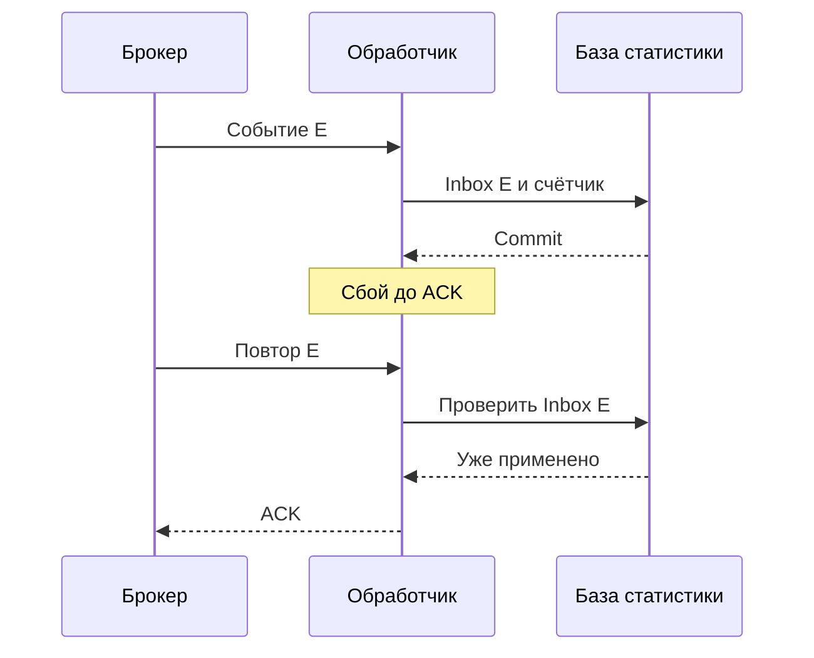
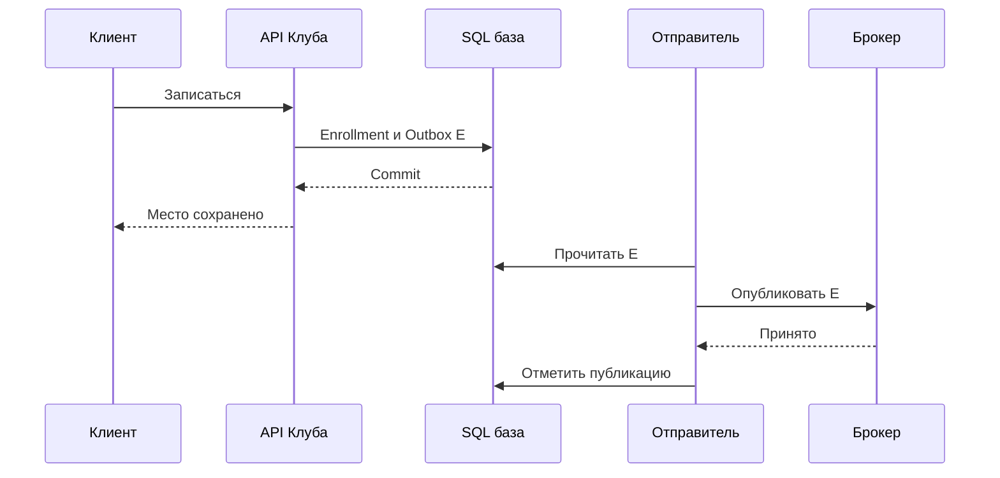

После записи на занятие Клуб отправляет письмо ученику. Сначала сервер делал всё подряд: сохранял запись, обращался к почтовому сервису, ждал ответ и только потом отвечал браузеру. Однажды почтовый сервис замедлился. Места на занятии были заняты правильно, но ученики несколько секунд смотрели на вращающийся индикатор и нажимали кнопку повторно.

Отправка письма не должна определять успех записи. Ученику можно ответить после сохранения места, а письмо подготовить отдельно. Вместе с этим решением появляется новая обязанность: помнить о незавершённой работе и безопасно возвращаться к ней после сбоя.

## 33. Работа, которая может подождать

Сервер кладёт задание в очередь. Отдельная программа, обработчик, забирает его и отправляет письмо. Пока обработчик занят, остальные задания ждут. Очередь хранит намерение выполнить работу; она не создаёт дополнительную вычислительную мощность. Если письма поступают быстрее, чем отправляются, ожидание растёт.

Предположим, после объявления нового занятия появляются 6000 уведомлений. Почтовый сервис принимает 100 писем в секунду. Даже без ошибок отправка займёт не меньше минуты. Если ученикам обещано письмо за десять секунд, очередь этого обещания не спасёт. Нужно изменить лимит провайдера, распределить отправку или пересмотреть срок.

У очереди задач, публикации для подписчиков и журнала событий разные назначения. Задание «отправь письмо» обычно должен выполнить один обработчик из группы. Событие «ученик записался» может понадобиться уведомлениям, аналитике и списку преподавателя. Каждая подсистема обрабатывает его самостоятельно. Журнал сохраняет последовательность событий и позицию чтения, поэтому обработчик может вернуться к старой позиции. Конкретный брокер может поддерживать несколько таких моделей, но выбирать модель нужно до продукта.

Получив задание, обработчик не должен навсегда забирать его из системы. Обычно он подтверждает завершение отдельно. В одних системах сообщение возвращается после закрытия соединения без подтверждения. В других выдаётся на ограниченный срок, после которого снова становится доступным. Такой срок иногда называют арендой. Если обработка длится дольше, аренду продлевают или допускают одновременную повторную попытку.

Для наблюдения нужны длина очереди и возраст самого старого задания. Длина без возраста может обмануть: сто задач по миллисекунде и сто задач по минуте означают разное ожидание. У журнала также измеряют отставание позиции потребителя. Затем связывают его с пользовательским сроком: когда ученик реально получит уведомление?

### Сначала определите, что именно обещает ответ

После появления очереди слово «готово» становится неоднозначным. Для записи на занятие готовым считается сохранённое место. Для экспорта списка готовым может считаться лишь создание задания. Во втором случае сервер возвращает идентификатор операции и состояние «ожидает обработки», а клиент позднее получает ссылку на результат. Ответ «экспорт готов» сразу после помещения задания в очередь был бы ложным: обработчик ещё мог не запускаться.

Проведём одно уведомление через систему. API проверяет право ученика занять место. База сохраняет запись и намерение уведомить. Отправитель передаёт намерение брокеру — сервису, который принимает и выдаёт сообщения. Брокер назначает работу обработчику. Обработчик вызывает почтового провайдера и сохраняет известный результат. На каждом переходе меняется владелец следующего действия. Для разбора инцидента нужен ответ: кто сейчас обязан продвинуть работу и где это обязательство записано?

Не вся отложенная работа требует отдельного брокера. В небольшой версии Клуба таблица заданий с временем следующей попытки может оказаться достаточной. Но строку нельзя просто прочитать и удалить перед выполнением. Несколько обработчиков должны согласованно назначать владельца, замечать зависшую попытку и повторять её. Брокер предоставляет готовые механизмы доставки и управления нагрузкой, но не знает, что означает успешно отправленное письмо для вашего продукта.

Задачи также отличаются срочностью. Подтверждение записи нужно раньше, чем ночной отчёт преподавателю. Одна общая очередь может поставить короткие уведомления за несколькими тяжёлыми экспортами. Клуб отделяет эти классы работы и выделяет им ограниченные ресурсы. При этом приоритет не должен навсегда лишать отчёты обработки: задаётся допустимый возраст, после которого нужна реакция. Приоритетная очередь без такой политики умеет лишь дольше откладывать неудобную проблему.

Модель мощности проверяют после восстановления зависимого сервиса. Если во время остановки накопилось 6000 писем, а затем продолжают приходить 80 писем в секунду при мощности 100, старый долг сокращается на 20 в секунду. На его погашение нужно около 300 секунд при постоянных скоростях. Деление 6000 на 100 дало бы минуту только без новых поступлений. Учебный расчёт не учитывает повторы и разные длительности, но уже показывает, почему очередь не исчезает сразу после зелёного сигнала мониторинга.

## 34. Доставка и результат обработки

Рассмотрим последовательность:

```text
Обработчик получает задание
Обработчик отправляет письмо
Почтовый сервис принимает письмо
Обработчик падает до подтверждения задания
Брокер выдаёт то же задание повторно
```

Брокер поступил разумно: он не получил подтверждения завершения. Но повторная доставка может привести ко второму письму. Поэтому «доставить сообщение» и «однократно изменить внешний мир» — разные гарантии.

При доставке не более одного раза система допускает потерю, избегая повторной выдачи. При доставке хотя бы один раз допускает повторы, чтобы не терять работу из-за неопределённого результата. Название «ровно один раз» требует уточнения: внутри какого набора операций действует гарантия? Транзакция журнала сама по себе не охватывает внешний почтовый сервис.

У Клуба каждое событие получает постоянный `event_id`. Обработчик может хранить таблицу уже применённых событий. Если его эффект — изменение собственной SQL-базы, вставку идентификатора и сам эффект выполняют в одной транзакции. Уникальность идентификатора останавливает повтор. Если сначала отметить событие обработанным, а потом менять данные, падение между шагами потеряет эффект.

С письмом труднее: локальная транзакция не включает провайдера. Если провайдер поддерживает ключ идемпотентности, Клуб передаёт стабильный ключ и проверяет условия его действия. Если не поддерживает, остаётся окно неопределённости. Тогда продукт должен принять возможный дубль либо использовать сверку статуса, которую действительно предоставляет провайдер. Запись `sent=true` перед вызовом не устраняет проблему, а меняет возможный дубль на возможную потерю.

Порядок тоже имеет область действия. Очередь с несколькими обработчиками не обещает, что раньше полученная задача раньше завершится. Для событий одного ученика можно использовать одинаковый ключ разделения журнала. При этом последовательность между разными разделами не становится общей. Если нужны версии прогресса, обработчик должен сравнивать версии, а не надеяться на скорость сети.

### Два подтверждения отвечают на разные вопросы

Подтверждение публикации означает, что брокер принял сообщение согласно выбранным условиям хранения. Оно не сообщает, что письмо отправлено. Подтверждение потребителя означает завершение конкретной доставки на стороне обработчика. В RabbitMQ эти механизмы независимы. Если интерфейсу нужен окончательный бизнес-результат, Клуб хранит отдельный статус операции; по ответу брокера его восстановить нельзя.

Следующая диаграмма показывает сохранение локальной статистики, а не отправку письма. Именно эта граница позволяет одной SQL-транзакции охватить и эффект, и отметку о нём.



Время идёт сверху вниз. После первого commit счётчик уже увеличен. Повтор не пытается «отменить» сбой: он обнаруживает сохранённый факт и завершает оставшееся подтверждение. Если первая транзакция не зафиксировалась, отметки тоже нет, поэтому работа выполняется заново. Условие действует, пока inbox хранит этот идентификатор и эффект относится к той же базе.

Уникальный ключ важен и при одновременных попытках. Два обработчика могут вместе проверить отсутствие E, поэтому отдельного чтения перед изменением недостаточно. Транзакция пытается вставить E под ограничением уникальности; только получивший право применяет изменение. Конфликт не следует трактовать как повреждение события: это предусмотренный путь повтора. Если вместе с тем же идентификатором приходит другое содержимое, это уже конфликт контракта, который нужно отклонить и расследовать.

Период хранения inbox связывают с периодом возможной повторной доставки. Допустим, сообщения можно повторно проиграть за месяц, а отметки очищают через сутки. Тогда вчерашний эффект после ручного запуска может повториться. Решение — согласовать сроки, хранить более устойчивый бизнес-ключ либо явно создавать новую операцию пересчёта вместо повторения старого внешнего действия. Кнопка «прочитать журнал сначала» требует такого же проектирования, как обычная обработка.

## 35. Как не потерять событие после записи в базу

Наивный сервер сначала сохраняет запись ученика, затем публикует событие. При падении между этими действиями место занято, но письмо никто не отправит. Если поменять порядок, событие может уйти, а транзакция записи — отмениться. Ученику придёт подтверждение несуществующего места.

Клуб добавляет таблицу исходящих событий, outbox. В одной транзакции сервер сохраняет запись на занятие и строку события. Либо сохраняются обе строки, либо ни одна. Отдельный отправитель читает outbox и публикует события в брокер.

```text
Одна SQL-транзакция: enrollment + outbox
После commit: отправитель → брокер
После приёма брокером: отметка публикации
Далее: обработчик → бизнес-эффект → подтверждение
```

Если отправитель падает после публикации, но до отметки, событие будет опубликовано повторно. Outbox закрывает окно потери намерения, но оставляет необходимость обработки дублей. Это нормальная граница решения, которую нужно записать в архитектуре.

Исходящие события можно читать периодическим запросом или получать изменения из журнала базы. Второй подход называют CDC, захватом изменений. Он требует управления позициями чтения, историей журнала и восстановлением после отставания. Для небольшого Клуба простой отправитель может быть достаточным. Важнее проверить, как два его экземпляра распределяют работу и что происходит с зависшей строкой.

В событии полезно хранить идентификатор, тип, версию схемы, идентификатор записи и время возникновения. Не следует отправлять целую строку пользователя «на всякий случай»: каждое лишнее поле размножает персональные данные. Получатель должен понимать, какие поля обязательны и как вести себя при неизвестной версии.

### Как отправитель восстанавливается после остановки

У каждой строки outbox Клуб хранит `event_id`, ссылку на бизнес-объект, полезные поля, время создания и состояние публикации. Идентификатор создаётся один раз вместе с исходной транзакцией. Новая попытка отправителя не получает новый `event_id`: иначе потребитель не узнает повтор. Ошибка доставки меняет сведения о попытке, но не смысл события.

В учебной реализации отправитель выбирает ограниченную пачку и временно закрепляет её за собой. После подтверждения брокера отмечает опубликованные записи. Если процесс пропал, другой отправитель позже получает просроченную работу. Срок владения уменьшает конкуренцию, но не доказывает, что старый процесс остановился: после паузы он ещё может отправить сообщение. Поэтому устойчивость к дублям остаётся обязательной даже при аккуратном распределении строк.



Обратите внимание на последнюю пару стрелок. Если ответ брокера или обновление базы потерялись, строка может снова попасть в отправку. Диаграмма доказывает сохранность намерения после commit, но не отсутствие повторных публикаций. Она также не гарантирует вечное хранение: выбранные настройки базы и брокера, резервирование и процедура очистки входят в условия надёжности.

Получатели развиваются независимо, поэтому полезно заранее договориться об изменениях схемы события. Добавление необязательного поля обычно проще удаления обязательного. Но совместимость определяется кодом потребителя: он должен действительно уметь читать старый и новый варианты. Переименование поля с сохранением смысловой неоднозначности не безопаснее его удаления. Клуб проверяет новые сообщения на сохранённых примерах и выпускает читателей раньше, чем начинает отправлять обязательную новую форму.

Удалять опубликованные строки outbox можно после установленного срока и проверки пути восстановления. Неопубликованные строки нельзя очищать только потому, что они старые. Их возраст означает задержанное обязательство перед пользователем. Для диагностики полезно различать «не удаётся опубликовать», «опубликовано, но не обработано» и «эффект неизвестен»: этим ситуациям нужны разные действия.

## 36. Процесс, который не помещается в транзакцию

Платный интенсив состоит из удержания места, оплаты в песочнице и выдачи доступа. Эти шаги могут выполняться разными системами. Держать SQL-транзакцию открытой, пока ученик вводит реквизиты, нельзя: она занимает ресурсы и не делает внешний платёж частью базы.

Вместо этого Клуб хранит состояние процесса: `reserved`, `payment_pending`, `confirmed`, `expired`, `refund_pending`. Переходы проверяют допустимое предыдущее состояние. Для каждого шага определены срок ожидания, повтор и действие после окончательной ошибки. Такой процесс с компенсирующими действиями называют сагой.

Компенсация не возвращает время назад. Освобождение места отменяет удержание, но уже отправленное письмо не исчезнет. Возврат оплаты является отдельной операцией, которая сама может ожидать подтверждения. Поэтому «ошибка» не всегда конечное состояние: иногда требуется состояние «нужна сверка» и работа оператора.

Сообщения с постоянной ошибкой после ограниченного числа попыток помещают в отдельную очередь разбора, часто называемую DLQ. Для неё нужны владелец, сигнал и процедура повторного запуска. Бесконечно хранить там задания означает молча отказаться от обещания пользователю. Перед повтором проверяют причину ошибки, совместимость версии события и идемпотентность эффекта.

### Ошибка шага и неизвестный результат — разные состояния

Если провайдер явно отказал до выполнения операции, процесс может выбрать следующий предусмотренный переход. Если ответ не пришёл, преждевременный переход к компенсации способен создать противоречие: оплата могла пройти, а повтор компенсации ещё не известен. Состояние «проверяем оплату» хранит неопределённость честнее, чем общее «ошибка». У него есть ответственный, срок следующего запроса и предел, после которого нужна ручная проверка.

Рассмотрим процесс покупки после окончательного отказа выдачи доступа. Сначала он записывает намерение возврата, затем делает внешний вызов с постоянным ключом. Получив подтверждение, сохраняет завершение компенсации. При потере ответа повторяет проверку или вызов в пределах контракта провайдера. Пользователь до завершения видит ожидающий возврат, а не обещание, что деньги уже вернулись. Даже в песочнице полезно сохранять эту разницу: иначе учебная схема скрывает самое сложное окно сбоя.

Повторы ограничивают по времени и числу попыток. Между ними увеличивают задержку и добавляют небольшую случайную составляющую, чтобы обработчики не атаковали восстановившийся сервис одновременно. Ошибка формата не лечится десятью повторными запросами; временная недоступность может исчезнуть. Классификация ошибок помогает направить первую в разбор, а вторую — в отложенную попытку. При этом статус пользователя не должен зависеть от того, насколько легко оператору найти строку в очереди.

Перед повторным запуском очереди разбора оператор проверяет, действительно ли исправлена причина отказа. Если новая версия обработчика научилась читать старую схему, полезно сначала обработать ограниченную пачку и сравнить результаты. Массовый повтор тысяч задач без ограничения скорости может снова перегрузить зависимый сервис. Поэтому процедура включает размер пачки, возможность остановки и наблюдение за возрастом обычных сообщений: разбор старого долга не должен лишить текущих пользователей обслуживания.

Для события об изменении адреса уведомлений возникает ещё один вопрос: письмо должно уйти на адрес, действовавший при записи, или на текущий? Первый вариант требует сохранить нужное значение вместе с событием и определить срок хранения персональных данных. Второй читает профиль во время обработки и допускает изменение получателя между событием и отправкой. Ни один ответ не следует из устройства брокера. Продуктовая политика определяет, какие данные передаются и что означает повтор через несколько дней.

## Разобранный пример и задания

**Пример.** Сервер сохранил enrollment и outbox, отправитель опубликовал событие дважды. Обработчик статистики в одной транзакции вставляет `event_id` в inbox и увеличивает счётчик записей. Первая попытка проходит. Вторая сталкивается с уникальным ключом и не увеличивает счётчик. После успешной транзакции обе доставки можно подтвердить. Если обработчик упал до commit, следующая попытка выполнит всю транзакцию заново.

**Задание 1.** В этой последовательности отметьте все точки падения. Для каждой напишите, кто повторит работу и где распознают дубль.

**Подсказка.** Отдельно рассматривайте commit базы, подтверждение брокера и подтверждение потребителя.

**Разбор.** До первого commit нет ни записи, ни события. После него намерение сохранено. Неопределённость публикации даёт дубль с тем же ID. Неопределённость обработки закрывает локальная транзакция inbox и счётчика. Гарантия закончится, если внутрь добавить внешний вызов без собственного контракта повторов.

**Задание 2.** Оплата завершилась после истечения удержания, а место уже получил другой ученик. Предложите два допустимых продуктовых решения.

**Разбор.** Можно вернуть оплату и объяснить отказ либо предложить другое занятие после согласия ученика. Нельзя незаметно увеличить число мест или считать поздний ответ доказательством действующего удержания. Решение должно явно связывать состояние оплаты и состояние места.

### Подробное решение первого задания

Составьте таблицу как минимум из шести границ. Перед сохранением исходной транзакции повторяет клиент; его ключ операции защищает саму запись ученика. После commit, но до публикации работу продолжает отправитель outbox. Во время неопределённого подтверждения публикации он повторяет E с прежним ID. После получения E, но до commit статистики повторяет брокер, и транзакция потребителя запускается заново. После commit статистики, но до ACK повтор распознаётся по inbox. После ACK обычная доставка закончена, но ручное повторное чтение журнала всё ещё требует той же защиты.

Для проверки нарочно остановите учебные процессы на этих границах и сравните три факта: существует ли запись ученика, существует ли намерение и сколько раз изменился счётчик. Одного числа доставок недостаточно: две доставки с одним изменением счётчика являются ожидаемым результатом. Внешнее письмо добавьте отдельной строкой: без контракта провайдера таблица не может доказать единственный внешний эффект.

### Подробное решение второго задания

Пусть удержание H истекло, а место уже подтверждено другому ученику. Поздний успех относится к платежу P, но не оживляет H. Обработчик сохраняет P и проверяет текущее состояние H. Затем атомарно записывает выбранное намерение компенсации, чтобы падение между проверкой и возвратом не потеряло работу. Повтор уведомления о P находит тот же процесс и не создаёт ещё один возврат.

Вариант с другим занятием требует согласия пользователя и нового резервирования; нельзя молча перенести старое удержание на другой объект. Если подходящего места нет либо согласия не получили, остаётся возврат или предусмотренный ручной разбор. Проверьте четыре случая: повтор позднего уведомления, недоступный провайдер возврата, падение после принятого возврата и повторный запуск старого обработчика. Во всех случаях количество мест сохраняется, а незавершённый денежный результат остаётся видимым.

## Чтение

[S13: Kafka, гарантии доставки](https://kafka.apache.org/41/design/design/), [S14: подтверждения RabbitMQ](https://www.rabbitmq.com/docs/confirms), [S15: transactional outbox](https://docs.aws.amazon.com/prescriptive-guidance/latest/cloud-design-patterns/transactional-outbox.html), [S16: orchestration saga](https://docs.aws.amazon.com/prescriptive-guidance/latest/cloud-design-patterns/saga-orchestration.html). Примеры Клуба — учебные модели; они не описывают внутреннюю архитектуру этих продуктов.

Уточнение границ подтверждения: [RabbitMQ: Consumer Acknowledgements and Publisher Confirms](https://www.rabbitmq.com/docs/confirms). Механизм сохранения намерения: [AWS: Transactional outbox](https://docs.aws.amazon.com/prescriptive-guidance/latest/cloud-design-patterns/transactional-outbox.html). Расчёты очереди и трассы отказов выше — учебные сценарии Клуба.
