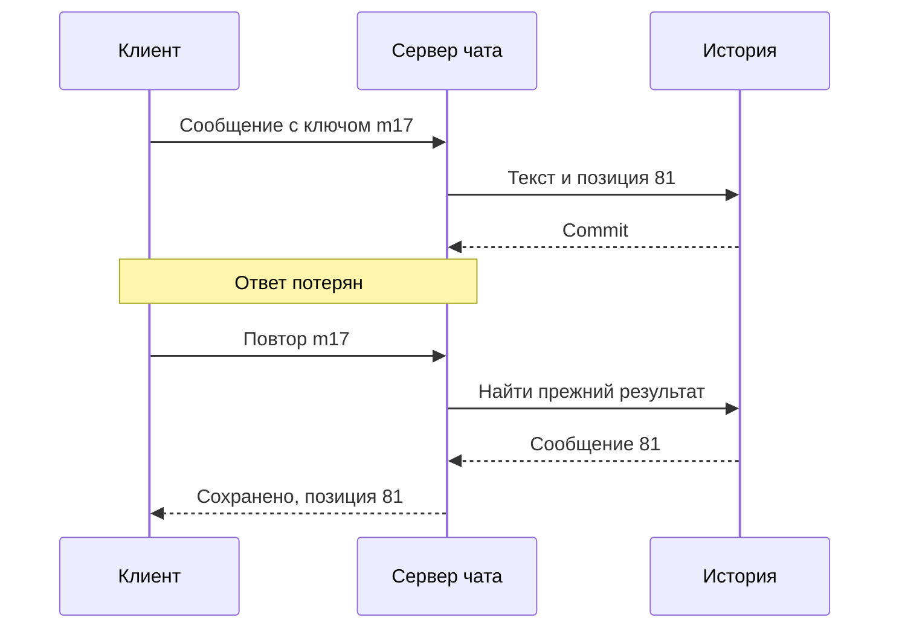
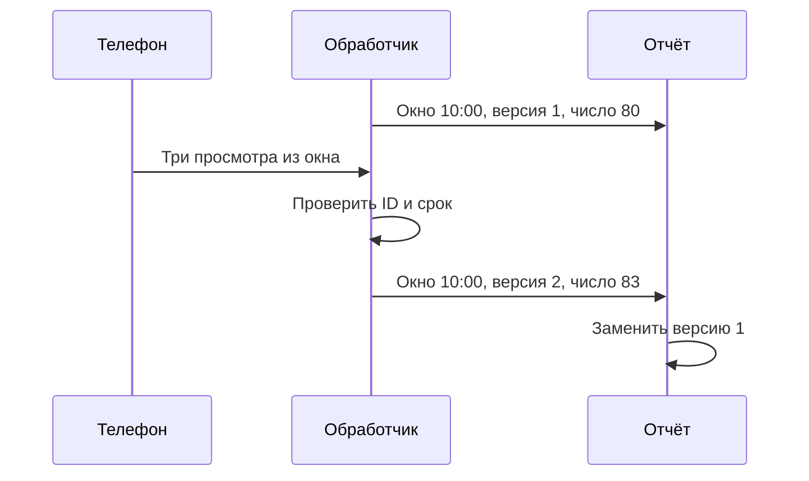

Перед занятием участники Клуба обсуждают домашнее задание в чате. У Маши пропадает связь в метро. Через минуту телефон подключается снова, и приложение показывает зелёный индикатор соединения. Однако между последним старым сообщением и первым новым не хватает нескольких реплик. Соединение восстановилось, а история — ещё нет.

У чата по меньшей мере три разные обязанности: принять сообщение, сохранить его и доставить нужным участникам. Лента добавляет четвёртую: выбрать, какие события показать конкретному человеку. Статистика просмотров решает ещё одну задачу: посчитать события с учётом задержек и повторов. Один открытый сокет не выполняет всё это автоматически.

## 37. Как сервер сообщает об изменениях

Самый простой клиент периодически спрашивает сервер: «Что нового после этой позиции?» Такой опрос называют polling. Его легко встроить в обычный HTTP API. Цена зависит от числа клиентов и частоты. Если 3000 открытых страниц спрашивают каждые пять секунд, получается примерно 600 запросов в секунду, даже когда никто не пишет. Это условный расчёт без учёта закрытых вкладок и неравномерного расписания.

Для уведомлений только от сервера подходит SSE: клиент открывает HTTP-поток, по которому сервер передаёт события. Отправлять сообщение клиент всё ещё может отдельным POST-запросом. WebSocket даёт двусторонний обмен по длительному соединению. Его полезно выбирать, когда обе стороны часто передают данные, а не только потому, что слово встречается в описаниях чатов.

Длительное соединение требует памяти на сервере, учёта таймаутов посредников и обработки отключения. Клиент может исчезнуть без аккуратного сообщения о закрытии. Поэтому стороны посылают проверочные сообщения, heartbeat. Отсутствие ответа означает подозрение на недоступность, а не доказательство, что пользователь закрыл приложение. Мобильная сеть может просто задержать данные.

При массовом восстановлении связи нельзя заставлять все клиенты переподключаться через одинаковую секунду. Случайная добавка к задержке и ограничение частоты попыток распределят нагрузку. Сервер также ограничивает размер очереди исходящих сообщений для медленного клиента. Если она бесконечна, один забытый телефон способен удерживать всё больше памяти.

Клуб хранит последнюю подтверждённую клиентом позицию чата. После reconnect клиент запрашивает сообщения после неё, а затем продолжает получать новые. Если история за этот период уже удалена, сервер сообщает, что требуется новая загрузка доступного диапазона. Молчаливое продолжение с текущего момента создало бы необъяснимый пробел.

### Соединение, пользователь и история имеют разный срок жизни

Соединение принадлежит конкретному устройству и может оборваться через секунду. Учётная запись живёт дольше, а разговор обычно существует независимо от присутствия участников. Поэтому сервер хранит связь «устройство — соединение — пользователь», но сами сообщения привязывает к разговору. Если положить историю только в память процесса с сокетом, перезапуск уничтожит её вместе с маршрутом доставки.

При установлении соединения клиент предъявляет действующую сессию. Сервер проверяет право подписаться на выбранную группу. Проверка входа в приложение не означает права слушать любой канал, чей ID прислал браузер. Последующая отправка сообщения тоже проверяется по текущим правилам. Когда участника удаляют из группы, нужно прекратить новые доставки или определить ограниченное окно обновления прав; сохранённая подписка не должна превращаться в бессрочное разрешение.

В большой установке один сервер может хранить сообщение, а другой — держать соединение получателя. Между ними возникает маршрут уведомления: событие о новом сообщении направляется процессам, которым нужны данные этого разговора. Реестр соединений помогает найти адресата, но запись в таком реестре может устареть. Неудачная доставка в сокет не отменяет уже сохранённое сообщение. Получатель восстановит историю по курсору, поэтому надёжность хранения не зависит от точности онлайн-реестра.

Представьте медленный телефон, которому сервер готов отправлять сто сообщений в секунду, а он успевает читать пять. Буфер соединения увеличивается на разницу, пока память не закончится. Клуб ограничивает его размер и при превышении закрывает доставку с требованием повторной синхронизации. Можно также объединять заменяемые уведомления, например несколько состояний «печатает». Сам текст сообщений не следует молча удалять из истории ради экономии памяти.

У WebSocket есть управляющие сообщения Ping и Pong для проверки соединения, но прикладное подтверждение сохранения сообщения имеет другой смысл. Ответ Pong показывает, что другая сторона обработала управляющее сообщение; он не доказывает, что пользователь получил все реплики чата. Для каждого уровня нужен собственный наблюдаемый факт. Упрощённая подпись «соединение активно» не должна скрывать задержку доставки истории.

## 38. Идентификатор и порядок сообщения

Пользователь нажал «Отправить». Клиент создаёт `client_message_id`, который сохраняется при повторах. Сервер проверяет права на разговор и сохраняет сообщение с уникальностью пары отправитель/клиентский ID. Затем возвращает постоянный `message_id`. Если ответ потерялся, повтор не должен создавать новую реплику.

Состояния интерфейса следуют за этими действиями: «отправляется», «сохранено сервером», при необходимости «доставлено устройству». Статус «прочитано» требует отдельного определения. Открытая вкладка не доказывает, что человек посмотрел на текст. Продукт может считать прочтением попадание сообщения в видимую область, но это договорённость, а не физическое измерение внимания.

Для порядка внутри одной группы Клуб назначает последовательный номер `sequence`. Два сообщения с одинаковым временем не создадут неоднозначности. Время устройства полезно для отображения, но телефон может иметь неверные часы. Серверный номер определяет порядок принятия, хотя он не обязательно совпадает с порядком, в котором люди начали печатать.

Один последовательный счётчик для всех чатов не нужен. Он связал бы независимые группы общей точкой координации. Достаточно определить порядок внутри разговора. Очень большой разговор может потребовать отдельного решения, однако сначала стоит измерить его нагрузку. Распределение данных по разговору удобно для чтения истории, но популярная группа может стать горячим разделом.

Онлайн-статус хранится как временное предположение: «мы недавно видели активность одного из устройств». Для него можно использовать TTL и обновление heartbeat. У одного человека несколько устройств, поэтому закрытие одного соединения не всегда означает уход. Для безопасности решение «разрешить доступ к материалам» нельзя основывать на этом приблизительном статусе.

### Как назначить позицию, не оставив скрытого пропуска

Выбранная последовательность внутри разговора должна соответствовать доступным сообщениям. Если процесс сначала увеличил счётчик, а потом упал до записи текста, появится номер без сообщения. Это не обязательно нарушение: протокол может допускать пропуски номеров. Но тогда клиент не вправе считать любой такой пропуск потерей и бесконечно его запрашивать. В учебном варианте Клуба номер и сообщение сохраняются в одной транзакции, а курсор означает подтверждённую границу чтения доступной истории.

Следующая схема разделяет ключ повтора клиента и позицию в разговоре. Первый помогает узнать повтор действия, вторая задаёт порядок уже сохранённых сообщений.

У клиента временная реплика m17 заменяется постоянной записью 81. Если пользователь сознательно отправляет тот же текст ещё раз, это новое действие с другим клиентским ключом. Сравнение только по тексту ошибочно удалило бы законное сообщение «Да», которое человек написал дважды. Для разных устройств ключи не должны случайно совпадать; сервер проверяет также принадлежность операции отправителю и разговору.

Чтение истории и включение живого потока требуют согласования. Наивный вариант сначала дочитывает базу, потом подписывается. Новое сообщение между этими действиями может не попасть ни в ответ, ни в поток. Один допустимый протокол Клуба сначала регистрирует подписку и временно буферизует уведомления, затем читает историю до отмеченной верхней позиции H. После этого выдаёт буферизованные сообщения за H. Пересечение безопасно благодаря удалению дублей, а ограничение буфера не позволяет зависшему клиенту бесконечно занимать память.

Другой вариант использует единый восстанавливаемый журнал: клиент читает с позиции и продолжает ждать следующие записи в той же модели. Выбор зависит от инфраструктуры. Существенно не название транспорта, а доказательство, что между историей и текущими событиями нет неучтённой щели. Если буфер переполнен или срок хранения закончился, сервер возвращает явное требование полной синхронизации.

## 39. Из чего складывается лента

В ленте ученика появляются новые материалы преподавателей, объявления групп и завершённые задания друзей, если это допускают настройки. Есть два основных подхода. При появлении события можно сразу записать его ID в ленты всех получателей. Это fan-out on write, распределение при записи. Чтение получается дешёвым, зато одна публикация создаёт много записей.

Другой подход собирает ленту при чтении из событий тех, на кого подписан ученик. Это fan-out on read. Публикация проста, но каждый просмотр требует объединить несколько потоков. Выбор зависит от соотношения публикаций, просмотров и числа подписчиков.

Предположим, у обычного преподавателя 200 подписчиков, а у главного канала Клуба — 100 000. Десять публикаций первого создадут 2000 элементов лент. Одна публикация второго — 100 000. Если большинство подписчиков не открывает приложение, значительная работа окажется напрасной. Можно использовать гибрид: обычные события распределять заранее, популярный канал добавлять при чтении. Тогда потребуется объединение и удаление дублей по ID события.

Лента является производным представлением. Исходное объявление хранится отдельно. Удаление или изменение прав должно отражаться в выдаче, даже если старый ID остался в персональной ленте. Иначе предварительное распределение превратит старую копию в обход ограничения доступа.

При пагинации новые записи сдвигают позиции. Запрос «пропусти первые двадцать» может вернуть повтор или пропустить запись, если сверху появились новые события. Курсор хранит устойчивую границу, например пару время/ID последнего элемента. Для строгой повторяемости потребуется также определить снимок или верхнюю границу просмотра. Сам курсор не отменяет удаления и изменение видимости.

### Стоимость ленты включает отмену старых решений

В предварительно построенной ленте полезно хранить ссылку на исходную публикацию, а не независимую копию всего текста и прав. Тогда изменение содержания не требует обязательно переписать сто тысяч элементов. При чтении сервер получает актуальный объект или подготовленное представление с известной версией. Однако дополнительное чтение стоит времени: одна экономия записи может превратиться в много обращений за содержимым. Пачки запросов и кэш допустимы, если их политика согласована с обновлением и приватностью.

Рассмотрим удаление участника из закрытой группы. Его лента уже содержит идентификаторы прежних объявлений. Фоновая очистка полезна для порядка, но до её окончания сервер всё равно должен прекратить выдачу закрытого содержимого. Если доступ проверяется только в момент распределения, удаление из группы не отзовёт прежнюю копию. Поэтому путь чтения проверяет текущую видимость или использует механизм отзыва с явно ограниченной задержкой.

Подписка тоже требует продуктового решения. Новый участник должен видеть все прежние публикации, только последние десять или лишь будущие? При распределении на запись прошлые элементы не появятся сами. Нужно либо добавить фоновое заполнение, либо объединить новые записи с чтением доступной истории автора. Аналогично отписка не обязательно удаляет ранее открытые материалы: сначала определяют ожидаемое поведение, затем устройство хранения.

Для сравнения вариантов запишем условную цену. Пусть автор публикует P раз, у него F подписчиков; предварительное распределение создаёт примерно P × F ссылок. При сборке на чтении важны число открытий ленты R и число читаемых потоков K: простая реализация делает работу порядка R × K до дополнительных оптимизаций. Это не формула времени сервера: стоимость записи, объединения и кэширования различается. Она лишь показывает, какие величины измерять, прежде чем выбирать стратегию по одной фотографии нагрузки.

Порядок ранжированной ленты может меняться после пересчёта оценок. Курсор по времени публикации подходит хронологической выдаче, но не автоматически фиксирует результаты сортировки по популярности. Если пользователь должен продолжать тот же просмотр без перестановок, серверу нужен идентификатор снимка или иная устойчивая граница. Такое обещание увеличивает хранение и сложность; иногда продукт принимает обновление ленты с заметной кнопкой «показать новые».

## 40. Когда произошло событие

Ученик посмотрел урок в 10:02, но телефон отправил просмотр в 10:17. Время события — 10:02, время обработки — 10:17. Если считать статистику только по прибытию, просмотр попадёт в другой интервал. Для технического мониторинга поступления это может быть уместно, а для отчёта по занятиям — нет.

Потоковый обработчик группирует события по окнам, например по пяти минутам. Чтобы не ждать бесконечно, он выбирает правило, когда публиковать предварительный результат и сколько принимать опоздания. Watermark выражает оценку продвижения времени событий. Он не заставляет потерянные сообщения появляться и не является гарантией идеальных часов клиента.

Клуб может обновлять пяти минутные счётчики ещё час после конца окна, а более поздние просмотры учитывать отдельной корректировкой. В отчёте тогда нужна пометка о предварительных данных. Если события приходят из нескольких источников, один простаивающий источник способен задерживать общий прогресс; правило обработки бездействия должно быть явным.

Повторы просмотров удаляются по `event_id`, но срок хранения идентификаторов стоит памяти. Если повтор пришёл после очистки этой истории, возможен повторный учёт. Для приблизительного счётчика это иногда допустимо; для оплаты по просмотрам нужна другая строгость, сверка и более точное определение события. Название одной и той же метрики ещё не делает эти задачи одинаковыми.

### Предварительный отчёт и исправленный отчёт

Пусть окно относится к просмотрам с 10:00 до 10:05. В 10:06 система знает о 80 событиях и публикует предварительное число. В 10:17 телефон присылает ещё три события этого окна. Если допустимое опоздание ещё не истекло, обработчик обновляет итог до 83 и увеличивает версию результата. Получатель отчёта должен заменить прежнее значение, а не прибавить 83 к уже известным 80. Контракт между обработчиком и отчётом так же важен, как правило формирования самого окна.

Диаграмма не утверждает, что любое позднее событие принимается. После установленной границы Клуб направляет его в отдельную корректировку либо исключает из конкретной метрики с видимым учётом таких случаев. Бесконечное ожидание всех телефонов не позволит завершить ни один отчёт, а молчаливое отбрасывание исказит смысл слова «просмотры». Выбор должен быть объяснён преподавателю.

Время устройства требует отдельного доверия. Телефон может ошибаться на час или отправить дату из будущего. Поэтому сервер ограничивает допустимый диапазон, сохраняет время приёма и различает исправление часов от обычного опоздания. При оплате по просмотрам простого заявления клиента недостаточно: нужны проверяемые правила события, защита от повторов и сверка. Для учебной статистики можно принять менее строгие допущения, но они должны быть названы.

## Разобранный пример: возвращение в чат

Маша получила сообщения до номера 80. Сервер сохранил её сообщение с клиентским ID `m17` как номер 81, но ответ потерялся. За время отсутствия появились номера 82–86. После reconnect клиент повторяет отправку `m17` и запрашивает историю после 80. Сервер возвращает прежний результат отправки и сообщения 81–86. Интерфейс объединяет их по постоянным ID, заменяя временную реплику сохранённой.

Одновременно может прийти живое уведомление о номере 86. Оно не создаёт дубль, потому что модель клиента хранит сообщение по ID. Если пришёл номер 88 без 87, клиент не обязан немедленно считать данные потерянными: он может дочитать диапазон. Но правила такого восстановления должны существовать до первого сбоя.

## Практика и проверка

**Задание 1.** Выберите polling, SSE или WebSocket для страницы статуса обработки видео, которую ученик открывает на две минуты. Обоснуйте выбор без требования «самая современная технология».

**Подсказка.** Сервер передаёт редкие изменения, клиент почти ничего не отправляет.

**Разбор.** Polling с умеренным интервалом может быть достаточным. SSE полезен при большом числе ожидающих страниц и существующей поддержке потоков. WebSocket возможен, но его двусторонние возможности здесь не дают обязательного преимущества. Сравните инфраструктурную сложность и допустимую задержку.

**Задание 2.** В ленте 50 000 подписчиков, но ежедневно читают её 2000. Для одной публикации сравните предварительное распределение и сборку при чтении. Каких данных не хватает?

**Разбор.** Известно число предварительных записей, но неизвестны число просмотров на читателя, количество подписок и цена объединения. Нельзя выбрать вариант только по доле активных. Нужно измерить чтения и определить приемлемую задержку.

**Задание 3.** Позднее событие пришло после закрытия отчётного окна. Опишите, что увидит преподаватель. Хороший ответ задаёт правило корректировки и отличает предварительное число от окончательного.

### Подробное решение первого задания

Сначала задайте допустимую задержку: например, страница обработки может показывать готовность в течение пяти секунд после завершения. При 100 открытых страницах опрос раз в пять секунд создаёт около 20 запросов в секунду. Если endpoint дешёвый, это может быть приемлемой ценой за простой HTTP-путь. При 100 000 страниц та же настройка создаёт около 20 000 запросов в секунду, и решение нужно пересмотреть. Эти дополнительные числа — условия сравнения, а не пределы конкретного сервера.

Для SSE проверьте поддержку длительных ответов балансировщиком, восстановление после разрыва и число одновременно открытых соединений. Статус задания всё равно хранится отдельно: событие «готово» может потеряться, поэтому после подключения клиент запрашивает текущее состояние. Для WebSocket потребуется тот же контракт восстановления. Выбор считается обоснованным, когда кроме названия технологии есть оценка числа запросов или соединений, условия отключения и способ получить окончательный статус после сбоя.

### Подробное решение второго задания

Для одной публикации предварительное распределение потребует 50 000 элементов, если всем подписчикам предназначен один элемент. Пусть каждый из 2000 активных читателей открывает ленту четыре раза: это уже 8000 просмотров, а не 2000. Если у читателя десятки подписок, объединение нескольких потоков может стоить дороже одной записи заранее. Если же пользователи смотрят одну общую страницу автора, кэш способен резко изменить соотношение затрат.

Предложите измерительный план: определить распределение числа подписок, число просмотров на активного читателя, долю попаданий в кэш и время объединения. Затем сравните один и тот же набор действий при двух реализациях, включая удаление публикации и потерю фонового обработчика. Гибрид выбирает границу популярности по этим данным; произвольное число подписчиков само по себе не доказывает оптимальность.

## Чтение

[S40: WebSocket, RFC 6455](https://www.rfc-editor.org/info/rfc6455/), [S29: хранение сообщений Discord](https://discord.com/blog/how-discord-stores-trillions-of-messages), [S13: Kafka](https://kafka.apache.org/41/design/design/). Дополнительные официальные материалы: [SSE в MDN](https://developer.mozilla.org/en-US/docs/Web/API/Server-sent_events/Using_server-sent_events) и [время событий в Apache Flink](https://nightlies.apache.org/flink/flink-docs-stable/docs/concepts/time/). Варианты ленты Клуба — учебное сравнение, а не описание конкретной социальной сети.

Границы транспорта: [RFC 6455, WebSocket](https://www.rfc-editor.org/rfc/rfc6455.html). Понятия окон, времени событий и опозданий: [Apache Beam Programming Guide](https://beam.apache.org/documentation/programming-guide/#watermarks-and-late-data). Протокол восстановления Клуба и расчёты ленты в главе являются учебными вариантами.
