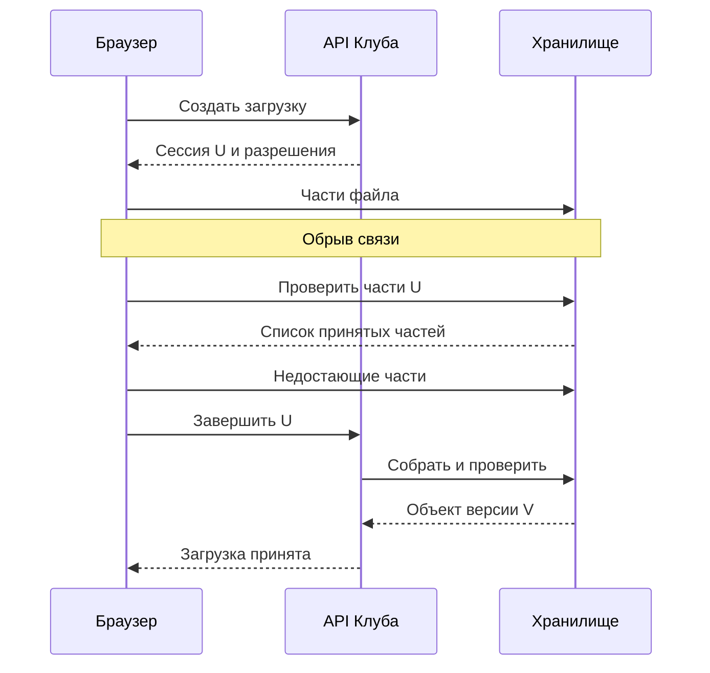
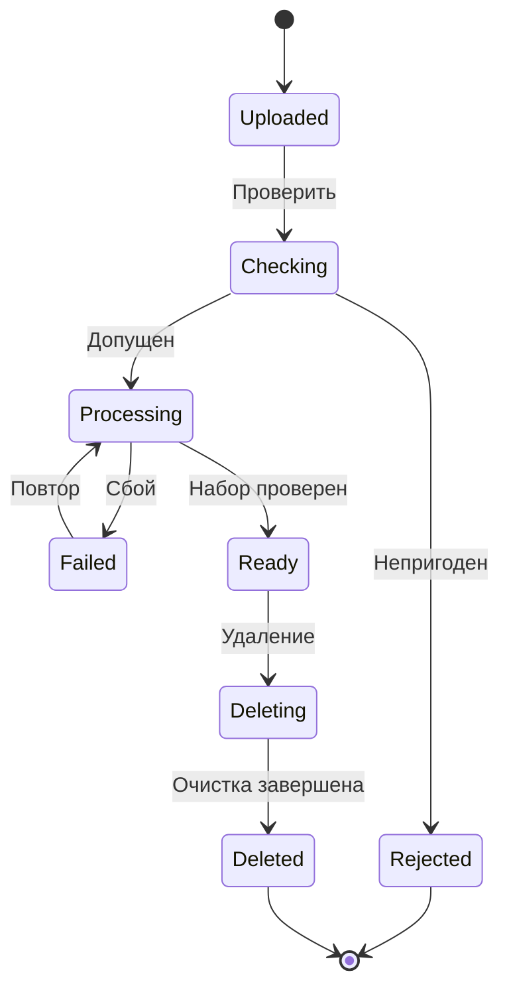
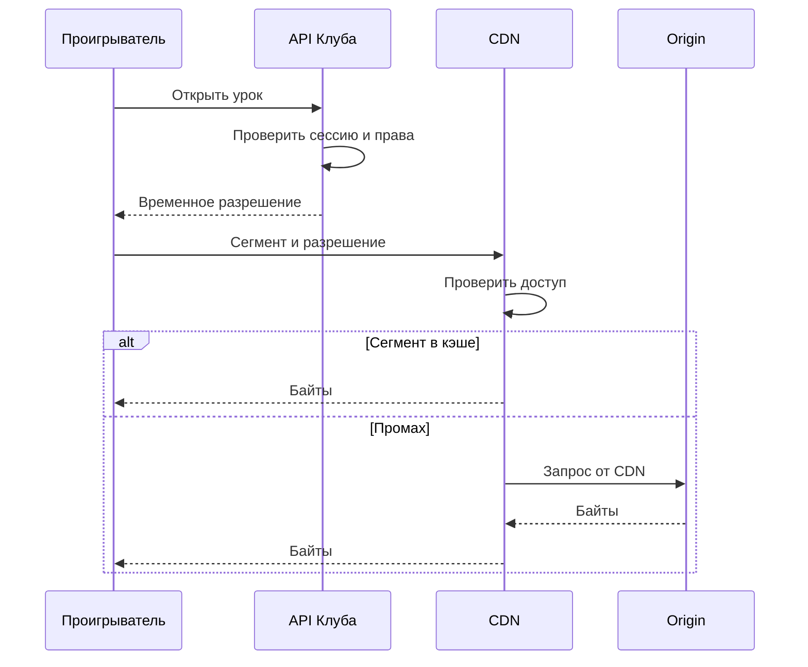

Преподаватель Клуба загружает запись занятия размером 2 ГБ. На отметке девяносто процентов соединение обрывается. Если загрузка представляла собой один длинный запрос без возобновления, преподавателю придётся передать почти весь файл заново. При этом API Клуба всё время удерживал соединение и, возможно, пропускал через себя большой поток байтов.

Видеоматериал полезно рассматривать как несколько связанных объектов. Есть исходный файл, подготовленные варианты качества, обложка, субтитры и описание в базе. У этих объектов разные размеры и жизненные циклы. Метаданные удобно хранить в SQL, большие файлы — в объектном хранилище, а длительную обработку выполнять отдельно от ответа браузеру.

## 41. Загрузка, которую можно продолжить

Объектное хранилище принимает содержимое под ключом, например `uploads/lesson-72/version-3/source`. Ключ похож на путь, но приложение не должно предполагать обычные файловые операции и их гарантии. Перед выбором сервиса проверяют его конкретный контракт чтения, записи, версий и условных операций.

Сначала браузер обращается к API: преподаватель хочет добавить материал к занятию. API проверяет право редактирования, допустимый размер и квоту, создаёт сессию загрузки. Затем выдаёт ограниченный доступ к конкретному объекту или частям загрузки. Большие байты могут идти прямо в хранилище. Краткоживущая ссылка должна разрешать нужное действие и нужный ключ, а не доступ ко всем материалам группы.

При загрузке частями файл делится на блоки. Клиент хранит ID сессии и результаты успешно переданных частей. После обрыва он повторяет только отсутствующие части. Завершение — отдельная операция, которая собирает объект из нужного набора. Нельзя считать, что наличие нескольких частей уже означает готовый файл.

В учебной модели файл 2 ГБ делится на двадцать частей по 100 МБ. Если оборвалась одна часть, повторяем 100 МБ вместо двух гигабайт. Здесь использованы десятичные единицы и идеальное деление; реальный протокол задаёт свои минимальные размеры, максимальное число частей и правила последнего блока. Эти параметры берут из документации, а не из примера курса.

Контрольная сумма помогает обнаружить повреждение при передаче. Отправитель вычисляет значение для выбранного алгоритма, получатель сравнивает его с вычисленным по принятым байтам. Она не заменяет проверку прав и безопасности содержимого. Успешно переданный файл всё ещё может иметь неподходящий формат или содержать опасный для обработчика вход.

Незавершённые загрузки занимают место. Клуб устанавливает срок жизни сессии, предлагает возобновление и очищает забытые части. Очистка должна учитывать загрузки, которые ещё действительно идут. Просто удалить всё, что создано вчера, опасно для медленного соединения и больших материалов.

### Завершение передачи нужно подтвердить отдельно

Сессия загрузки связывает пользователя, материал, ожидаемую версию и ограничения. Браузер не выбирает произвольный ключ существующего видео: его назначает сервер. Иначе право добавить собственный материал могло бы превратиться в право перезаписать чужой. Квоту проверяют не только по заявленному размеру. После завершения сервер сверяет фактический объект с разрешённым объёмом и освобождает временно зарезервированную часть квоты по выбранному правилу.

После потери соединения клиент спрашивает, какие части сервер или хранилище уже приняли, и продолжает ту же сессию. Локальный индикатор «100%» означает лишь, что браузер передал свои байты; подтверждение сборки объекта может ещё отсутствовать. Если ответ на завершение потерялся, нужно проверить состояние известной загрузки, а не безусловно начать новую. Иначе появятся лишние исходники, обработчики и счета за хранение.



В этой учебной схеме приложение управляет финализацией. В другом протоколе браузер может завершать загрузку напрямую, но Клуб всё равно должен проверить результат прежде, чем публиковать его. Стрелка «объект версии V» не утверждает, что видео пригодно для просмотра: она завершает только этап передачи.

Проверка контрольной суммы требует одинакового алгоритма и одинакового набора байтов с обеих сторон. Нельзя автоматически считать любой идентификатор ответа хранилища контрольной суммой всего файла: у составной загрузки и разных сервисов свои правила. Аналогично расширение `.mp4` говорит лишь о названии. Проверяющий обработчик должен разобрать содержимое в ограниченном окружении и отклонить файл, который не соответствует принятому контракту.

Для оставленных загрузок нужна управляемая уборка. Сначала отмечают сессию истёкшей, запрещают её завершение, затем удаляют временные части согласно возможностям хранилища. Если просто удалить части, пока приложение ещё считает сессию активной, пользователь получит непонятную ошибку в конце долгой передачи. Условия очистки становятся частью интерфейса: срок возобновления нужно сообщить заранее.

## 42. Как исходный файл становится уроком

После завершения загрузки видео ещё не публикуется. Клуб переводит материал в состояние `uploaded` и ставит задание проверки. Обработчик проверяет ожидаемый тип, доступность декодирования, ограничения длительности и размера. Для работы с недоверенными файлами ему нужны ограниченные ресурсы и права, чтобы ошибка медиабиблиотеки не давала доступ ко всему приложению.

Следующий этап — перекодирование, или transcoding. Из исходника готовят несколько представлений, например с разным разрешением и битрейтом. Это вычислительная работа, которая может занимать значительное время. Её выполняют обработчики с ограничением параллелизма, а пользователю показывают отдельный статус подготовки.

Для потокового воспроизведения материал можно разделить на сегменты. Файл описания, manifest, сообщает проигрывателю, какие варианты и сегменты доступны. Проигрыватель выбирает вариант с учётом соединения и переключает качество. Это уменьшает необходимость скачивать весь файл перед просмотром, но добавляет число объектов и запросов.

Все выходные файлы конкретной попытки Клуб пишет в отдельный префикс версии. Когда проверено наличие нужных объектов и согласованность manifest, база атомарно меняет ссылку опубликованной версии. Старый проигрыватель продолжает использовать старую версию, новый получает новую. Перезапись одних и тех же сегментов во время воспроизведения создала бы смесь поколений.

```text
created → uploading → uploaded → checking → processing → ready
                         ↘ rejected         ↘ failed
ready → deleting → deleted
```

Стрелка отражает разрешённый переход, а не обещание автоматического успеха. После `failed` можно повторить обработку исходника. Для `rejected` требуется объяснение преподавателю: повтор тех же байтов обычно бесполезен. Состояние `ready` устанавливают только после проверки результата, а не после запуска последней задачи.

Повтор обработки использует ключ видео, версию исходника и версию рецепта обработки. Это позволяет отличить повтор прежнего задания от намеренного создания нового формата. Незавершённый результат не должен заменять уже опубликованную рабочую версию.

### Публикация — отдельное решение после вычислений

Рецепт обработки описывает, какие файлы должны получиться: варианты качества, звуковая дорожка, субтитры и изображения, если они нужны уроку. Каждому результату задают проверяемый признак готовности. Факт завершения процесса перекодирования недостаточен: он мог записать неполный файл, использовать неверный исходник или завершиться успешно только для одного качества. Проверяющий шаг читает описание результата и сверяет его с ожидаемой версией задания.

Обработка может распараллеливаться, но число одновременных работ ограничивается мощностью и памятью. Если один материал создаёт три задания, поток из ста новых материалов превращается в триста вычислений. Очередь каждой стадии показывает собственное отставание: например, проверки быстры, а перекодирование высокого качества занимает основное время. Среднее время всей подготовки скрывает этот источник задержки, поэтому Клуб измеряет ожидание и выполнение отдельно.

Для первой версии можно публиковать материал только после готовности всех обязательных вариантов. Другой продукт разрешает сначала низкое качество, затем добавляет высокое. Второй подход тоже корректен, если manifest обещает только уже доступные сегменты, а статус интерфейса объясняет ограничение. Нельзя сначала объявить три качества, а отсутствие двух считать внутренней деталью, которую проигрыватель обязан пережить.

Диаграмма ниже показывает один выбранный вариант: готовность наступает после полного набора. Ошибка обработки допускает повтор, а отклонённый исходник требует исправления. Это различие предотвращает бесконечную обработку одних и тех же непригодных байтов.



Схема намеренно не изображает удаление во время каждого промежуточного состояния, чтобы не перегружать рисунок. В реализации запрос удаления должен запрещать последующую публикацию также для загрузки и обработки. Это отдельный инвариант: состояние `deleting` или новая версия запрета имеют преимущество перед завершением старого задания. Полноту такого правила проверяют таблицей переходов, а не только красивым графом.

## 43. Объект живёт дольше одного запроса

В SQL хранят владельца, занятие, состояние, размер, версию и ключи объектов. В хранилище лежат байты. Между этими системами нет общей транзакции, поэтому возможны несоответствия. Объект загружен, а финальная запись в базу не прошла. Или база уже ссылается на материал, который удалили ошибочным скриптом.

Первый случай создаёт объект без действующей ссылки, orphan. Для очистки нужен периодический поиск кандидатов и безопасный срок ожидания. Сначала проверяют, что объект не принадлежит активной загрузке, обработке или опубликованной версии. Потом отмечают намерение удалить и удаляют. Полезен предварительный отчёт, чтобы ошибка условия не уничтожила целый каталог.

Во втором случае очистка не поможет: нужна проверка наличия объектов и процедура восстановления. Сверка сравнивает ссылки базы с хранилищем. Проверять только количество объектов недостаточно: один потерянный файл и один лишний дадут прежнее число. Проверяют идентификаторы и при необходимости контрольные суммы.

Удаление занятия начинается с запрета новых просмотров по правилам продукта. Затем удаляются производные объекты и исходник, очищаются ссылки и учитываются кэши. Уже скачанные пользователем копии нельзя отозвать удалением серверного объекта. Подписанная ссылка также может оставаться действующей до своего срока, если система не имеет отдельного механизма отзыва.

Срок хранения исходника выбирают осознанно. Он позволяет повторно обработать видео при смене формата, но стоит места. Старые версии полезны для отката, однако их бесконечное хранение увеличивает расходы. Клуб задаёт разные правила для исходников, опубликованных вариантов, временных файлов и удалённых материалов, а не один общий таймер.

### Удаление и откат не должны спорить за одну версию

Пусть преподаватель заменяет неудачную запись занятия. Версия V1 опубликована, V2 ещё обрабатывается. Указатель текущей версии остаётся на V1 до успешной проверки V2. Если новая версия плоха, её можно отклонить без остановки старого урока. После переключения старый проигрыватель некоторое время продолжает читать сегменты V1, поэтому немедленная очистка V1 может оборвать уже начатые просмотры. Срок сохранения старых версий должен учитывать эту выбранную возможность.

Полное удаление урока означает другой процесс. Клуб фиксирует запрет выдачи, повышает версию состояния и создаёт список объектов для очистки. Старый обработчик, завершив V2, предъявляет ожидаемую версию записи. Условное обновление не проходит, потому что урок уже изменился. Обработчик не возвращает его в `ready`, а оставляет новые файлы для контролируемой очистки. Так решение об удалении не зависит от скорости отдельного воркера.

Нельзя гарантировать отсутствие потерянных файлов одной транзакцией SQL, если сами байты находятся в другом сервисе. Вместо такой гарантии вводят сверку. Она ищет и ссылки без объектов, и объекты без действующих ссылок. Первые требуют восстановления или честного статуса недоступности; вторые — осторожной уборки. Работу сверки журналируют, ограничивают по скорости и начинают с отчёта, особенно после изменения правил поиска.

Резервная копия метаданных без файлов не восстановит урок. Копия файлов без знания опубликованной версии тоже не объяснит, какие сегменты следует отдать зрителю. План восстановления связывает поколения данных: проверяет указатель версии, наличие manifest и его зависимостей, затем открывает выдачу. Если исходник уже удалён по сроку, потерянное качество нельзя обещать пересоздать из ничего. Такая цена хранения должна быть понятна до первой аварии.

## 44. Доставка зрителю и её цена

Если каждый просмотр скачивает байты из основного хранилища через API, приложение становится дорогим посредником. CDN сохраняет востребованные объекты ближе к зрителям. При попадании в кэш исходное хранилище не передаёт объект заново; при промахе CDN обращается к origin.

Публичная обложка и закрытое видео требуют разных правил доступа. Для закрытых материалов нужно согласовать проверку разрешения, ключ кэша и срок доступа. Нельзя включить общий кэш для ответа с персональной ссылкой, не выяснив, кому он будет выдан. Даже при кэшировании самих сегментов механизм авторизации должен оставаться корректным.

Предположим, 1000 зрителей одновременно получают поток 2 Мбит/с. Полезный поток составляет 2000 Мбит/с, или примерно 250 МБ/с. Час такого просмотра — около 900 ГБ переданных данных без накладных расходов. Это учебная оценка при постоянном битрейте, а не стоимость услуги. Денежный расчёт умножает объём на проверенный тариф и отдельно учитывает запросы, хранение, обработку и маршруты трафика.

Доля попаданий CDN уменьшает обращения к origin, но не обязательно весь оплачиваемый исходящий трафик. Тариф может отдельно считать доставку пользователю. Вопрос «сколько сэкономит кэш» требует указания, какую часть счёта и нагрузки мы оцениваем.

При публикации популярного занятия многие зрители могут одновременно запросить ещё не прогретые сегменты. План должен учитывать нагрузку origin, объединение одинаковых запросов и допустимый предварительный прогрев. Кэш также не отменяет требования к резервному маршруту: ошибка конфигурации или недоступность одного узла не должна незаметно делать материал вечным `ready`, но фактически недоступным.

### Авторизация должна находиться на пути каждой защищённой выдачи

В выбранном варианте Клуб сначала проверяет право ученика смотреть урок и выдаёт короткоживущее разрешение. CDN проверяет это разрешение перед выдачей защищённого объекта, даже если байты уже находятся в его кэше. Сами одинаковые сегменты могут быть общими для разрешённых зрителей. Без проверки перед кэшированным ответом первый успешный просмотр сделал бы закрытое видео доступным всем, кто знает адрес.



Origin — исходный сервер или хранилище, из которого CDN получает объект. Он не должен предоставлять публичный обход проверки CDN. В конкретных облачных системах для этого настраивают отдельное право доступа сети доставки к хранилищу. Закрытая страница с публичными сегментами всё ещё отдаёт видео по прямым адресам; защитить только HTML-страницу недостаточно.

Подписанная ссылка обычно действует до заданного срока. Если ученика исключили из курса, уже выданное разрешение может ещё работать в пределах этого окна. Для более быстрого отзыва нужен дополнительный механизм проверки или инвалидирования; короткий срок уменьшает окно, но увеличивает частоту обновления разрешения. Проигрыватель должен уметь обновить его, не путая отказ доступа с плохой сетью. Скачанные на устройство байты нельзя вернуть обратно проверкой следующего запроса.

Для оценки качества доставки Клуб измеряет время до первого кадра, долю остановок воспроизведения, ошибки сегментов и выбранное качество. Средний ответ API не описывает эти свойства. Иногда переход на более низкий битрейт улучшает просмотр, хотя метрика разрешения изображения ухудшается. Решение оценивают по пользовательскому сценарию, а не по единственному числу пропускной способности.

Начало просмотра и дальнейшее чтение сегментов также имеют разную нагрузку. При массовом старте тысяча проигрывателей почти одновременно запрашивает описание и первые сегменты. Позднее их позиции расходятся: кто-то поставил урок на паузу, кто-то перемотал вперёд. Нагрузочный тест, который многократно скачивает один уже закэшированный файл, не воспроизводит этот сценарий. Для проверки Клуб составляет расписание стартов, переключений качества, перемоток и истечения разрешений, а затем наблюдает и CDN, и исходное хранилище.

Окончание срока разрешения во время просмотра не означает повреждение видео. Проигрыватель сначала различает отказ доступа, отсутствие сегмента и сетевой сбой. Для первого обновляет разрешение только после новой проверки права; для второго сообщает диагностический идентификатор версии; для третьего применяет ограниченные повторы. Одинаковый бесконечный повтор всех трёх ошибок лишь увеличит нагрузку и скроет причину остановки.

### HTTP-контракт кэша и версии объектов

Кэш получает не просто «файл по адресу», а представление с правилами повторного использования. `Cache-Control: no-store` запрещает хранение, `private` ограничивает shared cache, `no-cache` требует проверки перед повторной выдачей и не равен запрету хранения. ETag позволяет условно проверить изменение объекта; `Vary` сообщает, какие headers влияют на выбор представления. Семантика определена в [RFC 9111](https://www.rfc-editor.org/rfc/rfc9111.html).

Для неизменяемых сегментов Клуб использует адрес с версией, например `lesson-72/v8/segment-4`. Новая публикация получает другой префикс; старый manifest не должен внезапно вести к байтам другой версии. Это позволяет длительное кэширование самих байтов, если права выдачи проверяются отдельно. Mutable manifest или указатель текущей версии имеет иной срок и правило revalidation. Одинаковые cache settings для всего конвейера не следуют из наличия CDN.

Cache key нужно сверить с contract представления и доступа. Если формат зависит от параметра URL или header, исключение его из ключа может вернуть неправильные байты. Включение каждого короткоживущего пользовательского токена в ключ способно раздробить кэш на множество одинаковых объектов. Безопасное объединение возможно, когда CDN проверяет разрешение до выдачи и выбранный общий ключ действительно обозначает одинаковые байты. Это конфигурация с явной границей доверия, а не разрешение удалить подпись из ключа любого CDN.

### Request hits и byte hits

За окно пришло 100 запросов: 90 hits по 10 КБ и 10 misses по 10 МБ. Request hit ratio равен 90%, но hits содержат лишь 0,9 МБ из 100,9 МБ полезных байтов. Byte hit ratio около 0,89%. Большие misses создают почти всю нагрузку origin, поэтому «90% попаданий» не доказывает хорошую экономию канала. Отдельно измеряйте байты origin и доставку пользователям; повторные передачи и headers добавляются по своей границе учёта.

Проверьте холодный старт и Range-запросы. Клиенты могут перематывать и запрашивать части объектов; контракт byte ranges определён в [RFC 9110, §14](https://www.rfc-editor.org/rfc/rfc9110.html#section-14). Нельзя автоматически предположить, что partial response кэшируется и объединяется ровно как полный файл: это зависит от поведения origin/CDN. Miss большого объекта также может расходовать канал до появления первого полезного сегмента.

### Локальная проверка опубликованной версии

Для своего тестового объекта запросите headers:

```bash
curl -sS -D - -o /dev/null --max-time 10 \
  http://127.0.0.1:3000/media/lesson-72/v8/segment-4
```

Запишите status, `Content-Length`, `Content-Type`, ETag, Cache-Control, Vary и Age, если они присутствуют. Сравните прямой origin и путь через свой proxy. Для endpoint с поддержкой ETag повторите GET с `If-None-Match` и фактическим значением; ожидаемый `304` означает проверенную неизменность представления, а не получение его тела заново. Отсутствие учебного endpoint не является неисправностью курса: используйте эти команды после реализации соответствующего contract, либо разберите headers в предоставленной трассе.

**Задание.** Преподаватель заменил V8 на V9. Старый manifest живёт в кэше 300 секунд, сегменты V8 ещё доступны; право пользователя отозвано. Опишите, что делать с каждой из трёх сущностей: указателем версии, старыми байтами и разрешением доступа.

**Разбор.** Указатель требует правила свежести/revalidation или invalidation; старые байты можно удерживать до окончания допустимых чтений и безопасной очистки; право проверяется на пути выдачи независимо от наличия байтов в кэше. Если contract допускает старое чтение 300 секунд, оно должно быть явно разрешено. TTL manifest не определяет срок отзыва права. После удаления V8 старый manifest может вести к отсутствующим сегментам; очистка должна учитывать обещанный срок его жизни и восстановление читателей.

## Разбор и самостоятельная работа

**Пример.** Обработчик сделал два качества из трёх и упал. База всё ещё содержит `processing`, опубликованная ссылка не изменилась. Повтор проверяет результаты текущей версии, безопасно доделывает отсутствующий вариант либо создаёт новую попытку. После проверки manifest и сегментов одна запись в базе публикует целую версию. Ученик никогда не получает случайную половину готового набора.

**Задание 1.** Что произойдёт, если публикация manifest выполнена до последнего сегмента?

**Подсказка.** Проигрыватель считает manifest инструкцией, которой можно следовать сразу.

**Разбор.** Он запросит несуществующий объект и может остановиться. Готовность должна означать доступность всех обещанных зависимостей. Нельзя исправить это одним статусом в интерфейсе, если ссылка уже отдана клиенту.

**Задание 2.** Преподаватель удалил видео, пока старый обработчик ещё работает. Как не воскресить удалённый материал?

**Разбор.** Перед публикацией обработчик проверяет ожидаемое состояние и версию. Условное обновление не проходит для `deleting` или `deleted`. Созданные поздно файлы становятся кандидатами на очистку, но не получают публичной ссылки.

**Задание 3.** Рассчитайте трафик для 200 зрителей, 90 минут и 1,5 Мбит/с. Получится примерно 202,5 ГБ полезных данных. Объясните, почему реальные объёмы могут отличаться: переменный битрейт, остановки, повторы сегментов и неполные просмотры.

### Подробное решение первого задания

Пусть manifest обещает сегменты S1–S10, но S10 ещё не сохранён. Первый зритель доходит до него и получает отсутствие объекта. CDN может также закэшировать ошибочный ответ согласно своей конфигурации, поэтому позднее появление S10 не обязательно немедленно исправит все просмотры. Простое сообщение «готово» в базе не меняет ни содержимое manifest, ни состояние кэша.

Безопасный порядок в выбранной модели: записать сегменты под новым префиксом, проверить их доступность, подготовить manifest с этими адресами, затем атомарно переключить указатель опубликованной версии. При сбое до последнего шага зрители продолжают читать прежнюю версию. При повторе последнего шага условие ожидаемой версии предотвращает случайное затирание более нового решения. Проверьте сценарии отсутствующего файла, неправильного ключа, потери ответа на публикацию и одновременного удаления материала.

### Подробное решение второго задания

Старое задание получило материал версии 7. Удаление меняет состояние и версию, например на 8. Когда обработчик завершает файлы, он пытается опубликовать результат только при сохранении прежней версии 7 и допустимого состояния. Получает отказ обновления и не трактует его как повод безусловно записать `ready`. Новые временные файлы записываются в журнал очистки или обнаруживаются сверкой.

Проверьте обратный порядок: обработчик успел опубликовать до удаления. Тогда удаление видит уже опубликованные ключи и включает их в очистку. В обоих порядках окончательное состояние соответствует более позднему разрешённому решению, а не последнему случайному ответу сети. Гарантия опирается на атомарную проверку версии в базе. Отдельное чтение `deleting=false` перед длительной записью не заменяет такую проверку.

## Чтение

[S34: Netflix Open Connect](https://openconnect.netflix.com/en/) описывает доставку, а [S24: Google File System](https://research.google/pubs/the-google-file-system/) показывает исторический дизайн хранения больших данных. Для конкретных механизмов: [загрузка частями в S3](https://docs.aws.amazon.com/AmazonS3/latest/userguide/mpuoverview.html) и [RFC 8216, HTTP Live Streaming](https://www.rfc-editor.org/info/rfc8216/). Клуб использует учебный конвейер; наличие этих источников не означает, что он повторяет архитектуру Netflix.

Контракты доступа к байтам: [CloudFront: signed URLs](https://docs.aws.amazon.com/AmazonCloudFront/latest/DeveloperGuide/private-content-signed-urls.html) и [ограничение доступа к S3 origin](https://docs.aws.amazon.com/AmazonCloudFront/latest/DeveloperGuide/private-content-restricting-access-to-s3.html). Структура списков и сегментов: [RFC 8216](https://www.rfc-editor.org/rfc/rfc8216.html). Конвейер и правила версий в главе — спроектированный учебный пример.
