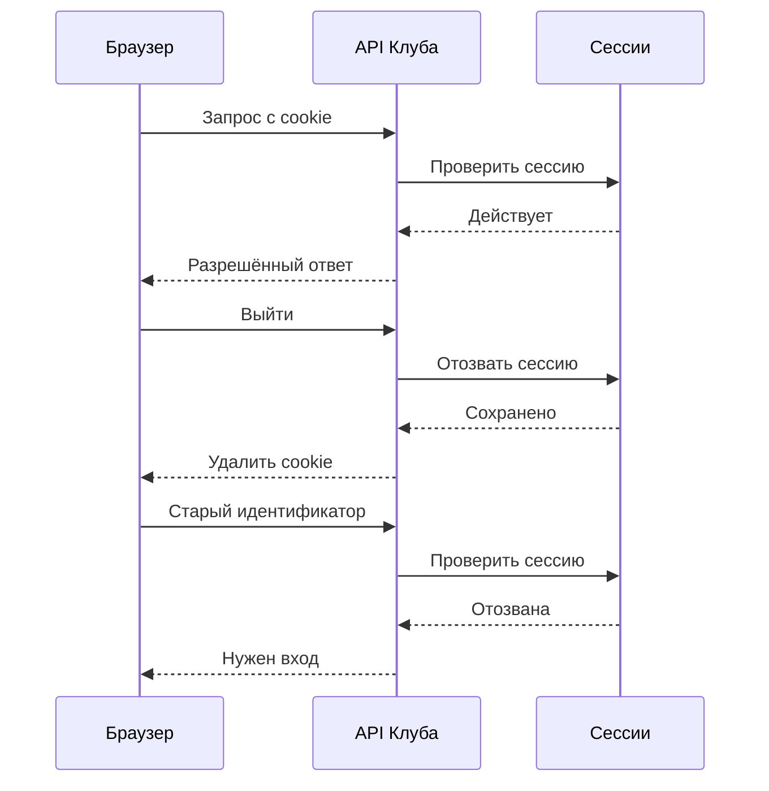
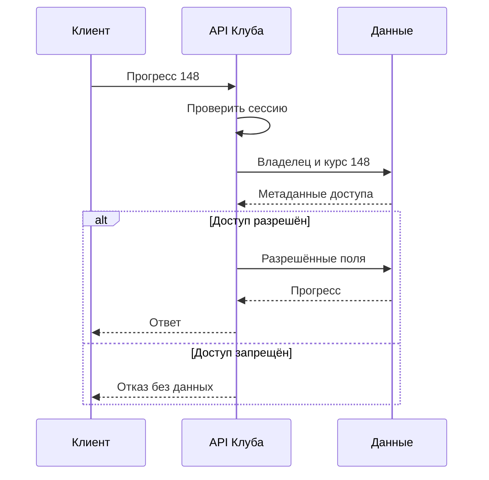

Ученик Клуба видит собственный прогресс по адресу с числом в конце. Он меняет число и получает чужие результаты. Пользователь вошёл в систему, соединение защищено HTTPS, токен действителен. Ошибка находится в другом месте: сервер установил личность, но не проверил право читать конкретную запись.

При проектировании безопасности полезно начинать с данных и действий. Кто может менять расписание? Кто видит оценки? Что произойдёт, если пользователь отправит неожиданный ID или повторит дорогой запрос тысячу раз? Ответы становятся частью контрактов API, модели данных, фоновых задач и кэша.

## 45. Личность и разрешение

Проверка личности называется аутентификацией. Проверка допустимости действия — авторизацией. Пароль, сессия или токен помогают ответить, кто отправил запрос. Они сами по себе не отвечают, может ли этот человек редактировать занятие номер 72.

После входа сервер может хранить сессию, а браузеру выдать случайный идентификатор. Другой вариант — подписанный токен с утверждениями. Выбор влияет на отзыв доступа, срок жизни и способы проверки. Подпись токена подтверждает его происхождение и целостность при корректной проверке; она не гарантирует, что роль пользователя с тех пор не изменилась.

Для небольшого Клуба роли ученика, преподавателя и администратора дают понятное начало. Но роль преподавателя ещё не означает право изменять любое занятие. Потребуется связь с конкретным курсом. Проверка может звучать так: пользователь имеет роль преподавателя и входит в список владельцев этого курса. Условия по свойствам объекта и пользователя часто относят к модели ABAC, а права через роли — к RBAC. В реальной системе они могут сочетаться.

| Действие | Ученик | Преподаватель курса | Администратор |
|---|---|---|---|
| Читать опубликованное описание | Да | Да | Да |
| Читать личный прогресс | Только свой | По разрешённому курсу | По установленной процедуре |
| Менять материал | Нет | Только своего курса | По установленной процедуре |
| Выгружать данные всех участников | Нет | Не следует из роли автоматически | Отдельное право и аудит |

Такая таблица заставляет уточнить неоднозначные полномочия. «Администратор может всё» удобно в прототипе, но плохо описывает операции с чувствительными данными. Для редких действий можно требовать отдельное разрешение, причину и запись аудита.

Граница доверия проходит между браузером и сервером, между приложением и внешним сервисом, иногда между внутренними подсистемами. Данные из браузера не становятся достоверными из-за скрытого поля формы. ID владельца сервер получает из проверенного контекста пользователя, а не принимает без проверки из тела запроса.

### Как сессия переживает запрос и как её отозвать

Рассмотрим простой вариант с серверной сессией. После проверки входа Клуб создаёт случайный, трудно угадываемый идентификатор и хранит связь с пользователем, временем создания и ограничениями. Браузер получает идентификатор в cookie — небольшом значении, которое отправляет с подходящими запросами. Cookie не должна содержать пароль. Получив её, сервер находит сессию, проверяет срок и состояние, затем формирует контекст пользователя для конкретного действия.

Выход завершает сессию на сервере и удаляет cookie в браузере. Одного удаления на экране недостаточно: копия прежнего идентификатора иначе продолжит работать. Для сценария «выйти на всех устройствах» понадобится найти и отозвать все активные сессии пользователя или изменить общий признак их действительности. Если результаты проверки сессий кэшируются, нужно определить, как быстро отзыв попадёт в каждый экземпляр приложения. Наличие центральной таблицы само по себе не доказывает мгновенный отзыв из кэшей.

Диаграмма показывает выбранную модель с проверкой актуального состояния. Для автономно проверяемого подписанного токена порядок иной: сервер может не обращаться к хранилищу на каждом запросе. Тогда токен с прежней ролью остаётся приемлемым до истечения срока, если не предусмотрены список отзыва или дополнительная проверка версии разрешений. Выбор экономит обращения, но переносит часть сложности в управление сроками и отзывом.

У сессии могут быть два ограничения: максимальная общая длительность и срок бездействия. Их проверяет сервер. Для чувствительной операции, например смены адреса восстановления, можно потребовать повторное подтверждение личности. После входа и изменения привилегий идентификатор обновляют по правилам системы, чтобы ранее известное значение не стало пропуском к новой роли. Это меры управления сессией, а не замена проверки прав на объект.

Пароль не хранят в открытом виде и не шифруют как обычный обратимо читаемый секрет для будущего сравнения. Для проверки применяют подходящий алгоритм хеширования паролей с солью и настроенной стоимостью вычисления. Конкретный алгоритм и параметры выбирают по актуальным рекомендациям, возможностям библиотеки и измерениям. Медленная проверка помогает против перебора украденной базы, но создаёт стоимость для сервера; защита входа также ограничивает попытки и поддерживает безопасное восстановление доступа.

## 46. Ошибки API, которые нужно увидеть на схеме

Первый класс ошибок — отсутствие проверки доступа к объекту. Исправление заключается не в сложных случайных ID. Даже если чужой ID трудно угадать, его можно получить из ссылки, журнала или общей переписки. Сервер проверяет доступ каждый раз, когда обращается к объекту от имени пользователя.

Проверка должна охватывать поля ответа и изменения. Ученик может иметь право менять свой ник, но не поле `role`. Если сервер автоматически переносит все присланные поля в строку пользователя, он отдаёт лишние полномочия. Контракт перечисляет разрешённые поля, а остальные отклоняет или игнорирует по явно выбранному правилу.

Вторая ошибка — смешивание данных с исполняемой командой. SQL-запросы строят с параметрами, чтобы пользовательский текст оставался значением. Это не отменяет проверки допустимой длины, типа и смысла. Например, параметризованный запрос может быть корректным с точки зрения SQL, но всё ещё позволять скачать слишком большой объём данных.

Третья ситуация возникает при импорте обложки по ссылке. Сервер загружает указанный пользователем адрес. Если разрешить любой адрес, запрос может попасть к внутреннему ресурсу, который недоступен самому пользователю. Такой класс ошибок называют SSRF. Защита должна учитывать разрешённые назначения, сетевые ограничения, перенаправления и изменение разрешения имени. Для первой версии Клуба загрузка файла может оказаться проще и безопаснее произвольного импорта URL.

Секреты — пароли подключения, ключи провайдеров, токены — не включают в исходный код клиента и обычные журналы. Сообщение об ошибке не должно выдавать строку подключения. Но полностью скрыть ошибки от разработчиков тоже нельзя: подробности сохраняют в ограниченном техническом контексте, а пользователю возвращают понятный код и идентификатор обращения.

Все упражнения по этим темам выполняют на локальной учебной системе со своими тестовыми аккаунтами. Проверка Клуба не требует отправлять неожиданные запросы чужим сервисам.

### Проверяйте разрешение на том объекте, который действительно меняете

Пусть преподаватель вправе редактировать курс A и отправляет запрос изменения материала M. Нельзя отдельно проверить присланный `course_id=A`, а затем обновить произвольный M из другого курса. Сервер получает действительную принадлежность материала из своей модели данных и применяет правило к этой связи. Если материал можно переносить между курсами, проверка и изменение должны быть согласованы так, чтобы перенос не сделал уже выполненную проверку устаревшей.

Следующая схема показывает отказ до чтения закрытого содержимого для ответа. Технически метаданные принадлежности всё равно могут читаться, но их не возвращают пользователю вместе с отказом.

Отказ не должен сопровождаться побочным эффектом. Например, сервер не сначала создаёт дорогостоящую выгрузку, а потом сообщает отсутствие прав на скачивание. Аналогично проверка в одной ручке API не защищает другие пути: поиск, пакетное получение, экспорт, WebSocket-подписка и фоновая задача могут выдавать тот же объект. Полезно составить карту всех таких путей и указать, где применяется одно и то же правило.

Отдельная граница связана с действиями от имени браузера. Cookie отправляются по правилам браузера, поэтому наличие действующей cookie не всегда доказывает намерение пользователя выполнить изменение. Защита от подделки межсайтового запроса, CSRF, связывает запрос с разрешённым контекстом: применяются проверяемые токены, проверка происхождения и подходящие настройки cookie. `SameSite` помогает ограничить некоторые межсайтовые отправки, но его значение выбирают с учётом сценария; одного слова в конфигурации недостаточно для всех приложений.

Параметр `HttpOnly` ограничивает чтение cookie скриптом страницы, а `Secure` ограничивает передачу защищённым соединением. Они не исправляют ошибочную выдачу чужого прогресса. Также они не позволяют считать безопасным произвольный HTML из сообщений чата. При отображении пользовательского текста применяется экранирование; если продукт разрешает форматирование, допускается только явно выбранный набор элементов после обработки. Эти меры защищают разные участки пути и должны проверяться отдельно.

Для Клуба это превращается в конкретные тесты: ученик не может передать новую роль в обычном редактировании профиля, преподаватель не меняет чужой курс через подмену связи, а внешний сайт не создаёт действие только за счёт автоматически отправленной cookie. Тестовые аккаунты и локальное окружение позволяют проверить эти условия без обращения к чужим системам.

## 47. Защита ресурсов от обычной и намеренной перегрузки

Даже авторизованный пользователь может запросить слишком много. Одно действие «экспортировать все попытки за год» способно занять больше CPU и памяти, чем сотни чтений каталога. Поэтому одинаковый лимит запросов в секунду не всегда отражает стоимость работы.

Клуб вводит отдельные ограничения: число входов, частоту отправки сообщений, объём загрузок, количество одновременных обработок видео и размер выгрузки. Лимиты действуют по пользователю, организации и системе в целом. Ограничение только по IP несправедливо для школы, где сотни учеников выходят через один адрес; только по аккаунту не защищает от множества аккаунтов.

Квота отвечает на вопрос об общем разрешённом объёме, например гигабайтах файлов за месяц. Rate limit ограничивает скорость действий. Ограничение параллелизма определяет, сколько дорогих работ одновременно выполняется. Эти механизмы решают разные проблемы и могут использоваться вместе.

До постановки задачи в очередь проверяют размер и право её запускать. Иначе очередь защитит ответ API, но позволит накопить огромный долг обработки. Для выгрузки нужно ограничить диапазон, число строк и срок хранения результата. Ключ временной ссылки не должен давать доступ другому ученику.

При отказе из-за лимита клиент получает различимый ответ и разумную стратегию ожидания. Автоматический повтор без задержки только усиливает нагрузку. В распределённой системе лимит может быть приблизительным, поэтому для дорогого необратимого действия одного приблизительного счётчика недостаточно. Инвариант проверяют там, где фиксируется действие.

### Право начать работу не означает право получить любой её результат

Рассмотрим экспорт прогресса. В момент создания задания преподаватель имел доступ к курсу. Через минуту администратор убрал его из команды, а ещё через минуту сформировался файл. Если обработчик отправляет бессрочную публичную ссылку, старая проверка превращается в постоянное право. Клуб вместо этого хранит результат закрыто и проверяет право при выдаче. Если используется временная подписанная ссылка, её остаточное окно доступа принимают осознанно и связывают с чувствительностью данных.

Ограничения работы удобнее применять до резервирования дорогих ресурсов. Сначала проверяется роль, затем допустимый диапазон выгрузки и оставшаяся квота, после этого создаётся задание. Но между параллельными запросами возможна гонка: оба увидят свободную квоту. Если превышение недопустимо, резервирование должно быть согласованной операцией. Приблизительный распределённый счётчик полезен для сглаживания потока, но не доказывает точный денежный или ресурсный инвариант.

После неудачи квота возвращается по определённому правилу. Если задача упала после создания файла, нельзя автоматически считать, что ресурсы не потрачены. Разделите лимит одновременных задач, оплачиваемый объём хранения и число разрешённых запусков. Первый освобождается после завершения работы, второй — после удаления файла, третий может не возвращаться вовсе. Такая модель объяснима пользователю и не зависит от случайной последовательности ошибок.

Для журналирования отказов тоже задают пределы. Миллион одинаковых запрещённых запросов не должен заполнить диск аудитом и остановить сервис. Можно агрегировать повторяющиеся технические сигналы, сохраняя необходимые сведения о чувствительных действиях. При этом ограничение журналов не должно скрывать факт массовых отказов: нужен счётчик, временной диапазон и способ перейти к доступным примерам.

## 48. Где остаются данные после удаления

Клуб хранит имя, адрес для уведомлений, записи на занятия и прогресс. Прежде чем добавлять новое поле, нужно объяснить, для какого действия оно требуется и сколько его хранить. «Возможно, понадобится аналитика» слишком расплывчато: каждое поле попадёт в копии, журналы и процедуры удаления.

Шифрование соединения защищает данные в пути. Шифрование хранения помогает в определённых сценариях доступа к носителям и копиям. Но приложение, которое имеет ключ и право чтения, всё ещё способно выдать чужую запись при ошибке авторизации. Разные меры нельзя считать взаимозаменяемыми.

Запись аудита должна объяснять, кто и когда выполнил чувствительное действие. Обычно достаточно идентификаторов, типа действия, результата и причины. Копирование токена или полного содержимого личного сообщения в аудит создаёт ещё одно чувствительное хранилище. Доступ к журналам и срок их хранения задают отдельно.

Удаление пользователя проходит по нескольким местам: основная база, поисковый индекс, кэш, файлы, аналитика и резервные копии. Клуб создаёт задачу удаления со статусом и повторяемыми шагами. Ошибка одного шага не должна превращать интерфейсное «удалено» в ложное обещание.

Резервные копии часто хранят историю до установленного срока. Поэтому восстановление должно повторно применить сведения о ранее выполненных удалениях, если выбранная политика требует этого. Иначе старые данные вернутся после аварии. Конкретные сроки и юридические основания определяют для реального продукта и его юрисдикции; учебная модель здесь задаёт технический маршрут, а не правовую норму.

### Удаление нужно проверить после восстановления

В учебной модели задача удаления получает собственный идентификатор и перечень затронутых хранилищ. Запрет обычного доступа фиксируется раньше очистки производных данных. Затем обработчики удаляют или преобразуют записи согласно принятой политике, отмечая завершённые шаги. Повтор того же шага должен быть безопасен: отсутствие уже удалённого объекта является ожидаемым результатом, а не поводом вернуть пользователя в активное состояние.

Поисковый индекс и аналитическая витрина не являются невидимыми подробностями. Если они позволяют получить прежние данные, путь удаления ещё не завершён. Для каждой копии нужен владелец, срок обработки и способ доказать исполнение. Аудит удаления лучше хранить в форме, которая подтверждает действие без повторного сохранения полного удаляемого содержимого. Иначе система одновременно удаляет запись и создаёт её копию в журнале.

Восстановление из резервной копии возвращает не только полезные записи, но и старое состояние разрешений, сессий и удалений. До открытия доступа Клуб применяет актуальные сведения об отозванных сессиях и выполненных удалениях, сверяет производные хранилища и проверяет выбранные контрольные аккаунты. Если этих сведений вне восстановленной копии не сохранилось, нельзя честно обещать точное восстановление запретов. Источник такого журнала и его собственное резервирование входят в проект.

Здесь не задаются юридические сроки. Реальная организация должна определить основания хранения, применимые обязательства и допустимое содержание аудита. Технический проект показывает, можно ли выполнить выбранное правило и какие копии он охватывает. Формулировка «кнопка удаления нажата» описывает действие интерфейса, но ещё не доказывает результат во всех системах.

## Разобранный пример: прогресс ученика

Запрос приходит на `/progress/148`. Сервер проверяет сессию, получает ID ученика из неё, читает принадлежность записи и проверяет право. Ученик видит только свой прогресс; преподаватель — разрешённые поля своего курса. Ответ личного запроса не попадает в общий кэш без разделения пользователей и корректной политики.

Фоновая выгрузка проходит ту же проверку при создании. Если права отозваны до скачивания готового файла, система заново проверяет доступ при выдаче ссылки либо использует достаточно короткий срок и явно принимает остаточное окно. Решение зависит от чувствительности данных; оно должно быть записано, а не случайно получиться из устройства очереди.

## Практика и разбор

**Задание 1.** Создайте два тестовых аккаунта и таблицу из шести проверок: чтение своего и чужого прогресса, изменение своих разрешённых полей, изменение роли, загрузка в свой и чужой курс.

**Подсказка.** Для каждого запроса зафиксируйте пользователя, объект, ожидаемый результат и фактическое изменение данных.

**Разбор.** Недостаточно получить код отказа: проверьте, что побочный эффект не произошёл. Также проверьте путь через фоновые задачи и общий кэш, если они участвуют в сценарии.

**Задание 2.** У школы один IP и 500 учеников. Предложите ограничения для чата и загрузки видео.

**Разбор.** Лимит сообщений удобно считать по ученику с общей защитой системы. Загрузки ограничивать по роли, курсу, объёму и параллелизму. IP остаётся одним из сигналов, но не единственным владельцем квоты.

**Задание 3.** Пользователь удалён, затем система восстановлена из вчерашней копии. Опишите проверку перед возвратом сервиса: применение журнала удалений, очистку производных данных и подтверждение завершения. Отдельно укажите, какие действия в учебной работе только спроектированы, а какие действительно выполнены.

### Подробное решение первого задания

Для проверки чтения создайте учеников А и Б с разными записями прогресса. Сессия А читает свою запись и получает разрешённые поля; та же сессия обращается к записи Б и не получает её содержимое. Затем повторите запрос после предварительного чтения Б его собственным аккаунтом: это обнаруживает общий кэш, который ошибочно различает ответы только по адресу объекта. Сравните не только код ответа, но и тело, заголовки кэширования и появление производных файлов.

В проверках изменения профиля А меняет разрешённый ник, но присланное поле роли не повышает полномочия. Для загрузки назначьте преподавателя одного курса и проверьте чужой курс, прямой запрос API и выдачу временной ссылки. Откройте базу тестового окружения или журнал допустимых эффектов: отказ после изменения данных всё равно является провалом. Завершите тест отзывом сессии и повтором прежнего идентификатора. Результат должен соответствовать заявленному окну отзыва, а не только состоянию кнопки входа.

### Подробное решение второго задания

Для 500 учеников за одним IP начните с отдельных лимитов сообщений каждого аккаунта и общего ограничения чата. Добавьте ограничение размера сообщения и входящего потока группы: сотня разрешённых маленьких сообщений и сотня огромных отличаются стоимостью. IP можно использовать как дополнительный сигнал аномалии, но жёсткая общая квота одного пользователя для всей школы заблокирует обычную совместную работу.

Видео загружают только уполномоченные преподаватели. Ограничьте размер отдельного файла, суммарное хранение курса и число одновременно обрабатываемых материалов. Проверяйте окончательный размер после передачи и освобождайте резерв по описанным правилам. Проведите два опыта: обычное занятие с массовой активностью и один тестовый аккаунт, превышающий лимиты. Хорошее решение различает эти ситуации, показывает понятный отказ и не накапливает бесконечную очередь уже отклонённых работ.

## Чтение

[S22: OWASP API Security Top 10](https://api-security.owasp.org/editions/2023/en/0x11-t10/) помогает проверить классы рисков. [S12: HTTP caching](https://developer.mozilla.org/en-US/docs/Web/HTTP/Guides/Caching) нужен для обсуждения личных ответов, [S10: backup and restore](https://www.postgresql.org/docs/18/backup.html) — для восстановления. Список рисков не заменяет модель угроз конкретного продукта.

Для проверки конкретных механизмов: [OWASP Session Management](https://cheatsheetseries.owasp.org/cheatsheets/Session_Management_Cheat_Sheet.html), [OWASP Authorization](https://cheatsheetseries.owasp.org/cheatsheets/Authorization_Cheat_Sheet.html), [OWASP CSRF Prevention](https://cheatsheetseries.owasp.org/cheatsheets/Cross-Site_Request_Forgery_Prevention_Cheat_Sheet.html) и [OWASP Password Storage](https://cheatsheetseries.owasp.org/cheatsheets/Password_Storage_Cheat_Sheet.html). Описанные маршруты Клуба — учебная модель с явно выбранными условиями отзыва и хранения.
