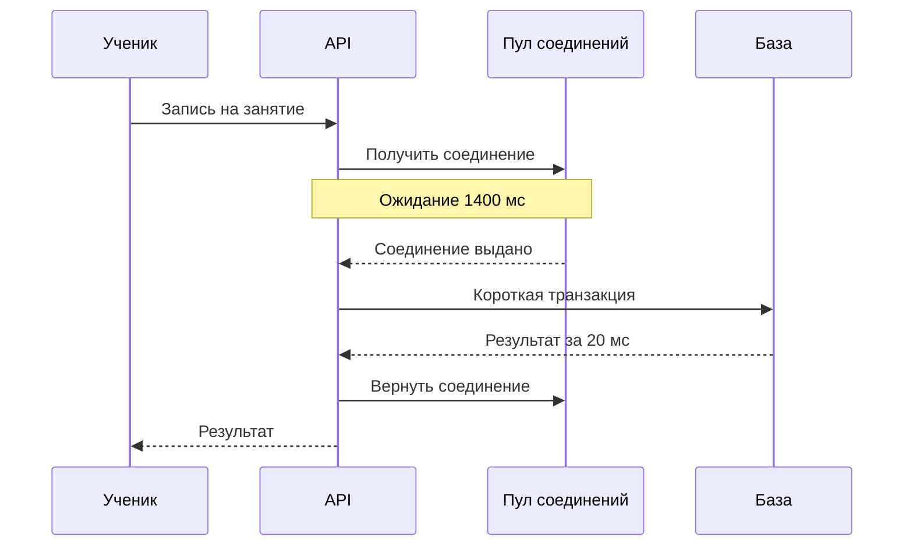
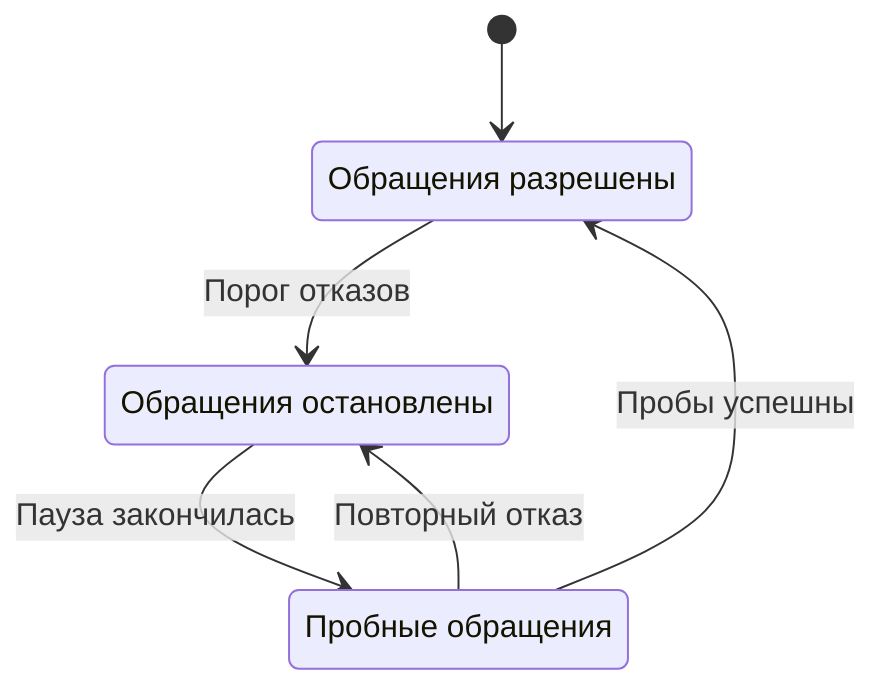

Серверы Клуба отвечают на проверки, процесс API работает, база принимает соединения. При этом ученики не могут записаться на занятие: запросы ждут медленный внешний сервис. Панель с зелёными индикаторами машин не описывает то, что происходит с пользователем.

Надёжность начинается с конкретного обещания. Пользователь хочет занять место, увидеть материал или отправить сообщение. Для каждого такого действия нужны наблюдаемый результат, допустимое время и правила измерения. Затем выбирают сигналы, которые помогают заметить нарушение и понять, что делать.

## 49. Что именно обещает Клуб

Измеряемый показатель называют SLI. Например, доля допустимых попыток записи, завершившихся успешным сохранением за две секунды. Целевое значение за выбранный период — SLO. Договор с внешними обязательствами и последствиями нарушения — SLA; он не возникает автоматически из внутренней цели команды.

Определение «допустимой попытки» требует внимания. Ошибка сервера должна ухудшать показатель. Запрос неавторизованного пользователя может считаться другим сценарием. Отказ из-за отсутствия мест является корректным бизнес-результатом, если система вернула его вовремя и верно. Но нельзя исключить из показателя перегрузку только потому, что она возвращает аккуратный код ошибки.

Предположим, учебный SLO равен 99,9% хороших операций за 30 дней. При миллионе допустимых операций бюджет плохих результатов составляет 1000. Это бюджет по запросам, а не фиксированное число минут простоя. Для SLO по времени расчёт был бы другим. На низком трафике один сбой заметно меняет долю, поэтому нужны размер выборки и контекст.

Задержку также определяют точно. Измерение только внутри обработчика исключает ожидание в балансировщике и сети. Пользовательское измерение шире, но зависит от устройства и связи. Клуб может иметь несколько показателей, однако каждый должен отвечать на свой вопрос. Складывать p99 разных сервисов и называть результат p99 всего запроса нельзя: распределения и зависимости так не складываются.

Бюджет ошибок помогает выбирать работу. Если система быстро тратит его на повторяющиеся сбои, новые рискованные изменения можно замедлить и заняться причиной. Это управленческая договорённость команды. Само наличие красивого процента ничего не запрещает и не исправляет.

### Из обещания получаем измеримый контракт

Запишем контракт для операции `enroll`: «за две секунды ученик получает достоверный результат записи». Хороший результат — либо сохранённое место, либо обоснованный ответ, что мест нет. Ответ «принято в обработку» относится к другому обещанию: он подтверждает приём намерения, но не выдачу места. Если смешать эти ответы в одной метрике, перевод всей работы в очередь нарисует улучшение надёжности без улучшения результата.

Счётчики должны иметь общую границу. Пусть шлюз замечает каждую подходящую попытку и её завершение. Он увеличивает `total` для каждой попытки, а `good` — если результат корректен и уложился в срок. Потерянное соединение и истёкший срок учитываются по заранее описанному правилу. Если считать только ответы, уже прошедшие через обработчик, зависшие запросы исчезнут из знаменателя именно тогда, когда пользователям хуже всего.

Есть ещё различие между попыткой и намерением. Ученик трижды повторил одну запись с одним ключом: по метрике HTTP это три попытки, по продуктовой метрике — одно намерение. Обе точки зрения полезны. Первая показывает качество обслуживания запросов, вторая — сколько людей смогли завершить действие. Нельзя незаметно переключаться между ними при сравнении двух недель.

Разделите ошибки результата и задержки. Если 99,95% запросов получают правильный ответ, но только 98% делают это за две секунды, цель «99,9% правильных и быстрых» не выполнена. При этом нельзя просто сложить доли ошибок и медленных запросов: один запрос может попасть в обе группы. Для объединённого показателя каждому запросу присваивают один признак `good`, учитывающий оба условия.

### Как быстро расходуется бюджет

Для SLO 99,9% допустимая доля плохих результатов равна 0,1%. Если сейчас плохи 2% запросов, относительная скорость расхода бюджета, burn rate, равна `2 / 0,1 = 20`. При неизменном потоке и таком качестве на всём будущем интервале бюджет тридцати дней расходовался бы за полтора дня. Это ориентир при заданных допущениях, а не прогноз: трафик меняется, часть бюджета уже потрачена, а скользящее окно сдвигается.

На практике полезно спросить: сколько допустимых ошибок случилось за последний час и продолжается ли проблема сейчас? Длинное окно показывает существенный расход, короткое — что он не закончился. Сигнал по обоим окнам уменьшает риск поднять тревогу из-за давно завершившегося всплеска. Для редкой операции понадобятся дополнительные признаки: несколько ошибок подряд и синтетическая проверка могут быть полезнее процента по двум запросам.

Не копируйте пороги другой команды как универсальную норму. Дежурному нужны время на реакцию, право включить деградацию и проверяемая инструкция. Алерт, срабатывающий за десять секунд до исчерпания допустимого ущерба, почти бесполезен, если переключение занимает десять минут. Метод расчёта и ограничения окон разобраны в [главе Google SRE об алертах](https://sre.google/workbook/alerting-on-slos/).

## 50. Как увидеть и объяснить проблему

Метрика — численное наблюдение во времени: число запросов, длительность, глубина очереди. Лог — запись отдельного события с контекстом. Трасса связывает шаги одного запроса между компонентами. Вместе они позволяют перейти от «ученикам плохо» к «запрос ждёт исчерпанный пул соединений».

Клуб измеряет успешность записи, распределение задержки и возраст ожидающих уведомлений. Для диагностики добавляет число занятых соединений, ошибки зависимостей и время SQL-запросов. Пользовательский сигнал сообщает о проблеме, технические помогают найти её источник. Высокая загрузка CPU сама по себе не говорит, что нужно будить дежурного.

Идентификатор запроса передают через API и фоновые сообщения. В журнале видно, какая запись породила какое уведомление. При этом идентификатор корреляции не обязан содержать имя или адрес ученика. Секреты и полные личные данные не нужны для связи событий.

У метрик опасно число уникальных сочетаний меток, cardinality. Если поставить `user_id` и `request_id` в каждую метрику, количество временных рядов может стать огромным. Для общего графика нужны ограниченные категории: операция, код результата, регион. Подробности конкретного запроса лучше искать в логах и трассах с выбранными правилами хранения.

Алерт должен указывать на действие. «Свободной памяти стало меньше» не всегда требует немедленного вмешательства. «Записи на занятия пять минут массово не завершаются, бюджет ошибок расходуется быстро» — повод проверить зависимость и включить предусмотренную деградацию. Два окна наблюдения помогают отличать короткий шум от устойчивой проблемы; точные пороги подбирают под SLO и поток.

### Идём от симптома к проверяемой гипотезе

Представим учебное наблюдение: p95 записи вырос с 200 до 1800 мс, процессоры заняты наполовину, база отвечает на отдельный запрос за 20 мс. Из этого ещё не следует, что база исправна. Большую часть времени запрос может ждать свободное соединение, а измерение SQL начинается уже после этого ожидания.

Разделим время на очередь шлюза, ожидание обработчика, ожидание соединения, выполнение SQL и отправку ответа. Трасса содержит интервалы, которые иногда вложены или идут параллельно. Сумма всех интервалов трассы не всегда равна длительности запроса: два параллельных вызова могут занимать одно и то же календарное время. Ищите цепочку, которая задерживает завершение, а затем проверяйте соответствующий ресурс метриками.

На схеме API сначала ждёт пул. Быстрая база не компенсирует это ожидание.

Теперь сформулируем две гипотезы. Либо транзакции долго удерживают соединения, либо их одновременно слишком много. Проверяем время владения соединением и число одновременно выполняемых запросов. Если код отправляет письмо, не завершив транзакцию, увеличение пула лишь разрешит большему числу запросов одновременно зависнуть. Исправление — убрать внешнее ожидание из транзакции и отдельно ограничить доставку.

У наблюдаемости тоже есть отказы. Логи могут теряться, трассы — собираться выборочно, метрики — запаздывать. Отсутствие трассы ошибочного запроса не доказывает отсутствия ошибки. Во время инцидента сопоставляют несколько источников: пользовательский показатель, счётчики API, состояние очередей и записи операций. Для редких ошибок полезно сохранять больше ошибочных трасс, но такая выборка уже не представляет долю всех запросов.

### Почему средний график скрывает пострадавшую группу

Допустим, один из десяти курсов полностью недоступен, а остальные девять обслуживаются нормально. Если на проблемный курс приходится 0,05% трафика, общий SLO 99,9% может формально выполняться. Ученикам этого курса от этого не легче. Группируйте показатели по ограниченным, осмысленным категориям: операция, регион, тариф или размер объекта. Не добавляйте бесконечный набор идентификаторов в каждую метрику.

При расследовании конкретного курса используйте логи с контролируемым доступом. В рабочей записи инцидента достаточно идентификатора операции и технического результата. Пароль, токен сессии и полный текст личного сообщения не улучшают диагностику задержки пула.

## 51. Как отказ становится каскадом

Почтовый сервис замедлился. Запросы Клуба ждут его, занимая рабочие потоки. Клиенты повторяют запросы. Повторов становится больше, свободных обработчиков меньше, и уже обычное чтение каталога начинает ждать. Первоначальная локальная проблема распространилась на независимые действия.

Таймаут ограничивает ожидание отдельного вызова, но весь запрос имеет общий бюджет времени. Если пользователю обещан ответ за две секунды, нельзя последовательно дать трём зависимостям по две секунды. Перед каждым шагом учитывают оставшийся срок. Истечение ожидания не доказывает, что удалённая операция не выполнилась.

Повторы разрешают только там, где они имеют смысл и безопасный эффект. Задержка между попытками растёт, а случайная добавка, jitter, разносит клиентов во времени. Нужен общий предел попыток. Если каждый из трёх уровней независимо делает до трёх попыток, включая первую, нижняя зависимость в некоторых сценариях получает до 27 попыток вместо одной.

Circuit breaker временно прекращает обращения к явно сбоящей зависимости и позже пробует ограниченное восстановление. Он полезен только при ясном поведении без этой зависимости. Если письмо вторично, запись можно завершить и поставить уведомление в очередь. Если требуется подтвердить оплату, нельзя просто выдать платный доступ из-за открытого breaker.

Изоляция ресурсов, bulkhead, выделяет зависимостям отдельные ограниченные пулы. Медленная обработка видео не должна забирать все соединения, нужные записи на занятие. Ограничение входной нагрузки и очередь конечного размера позволяют отказать части работы явно, вместо того чтобы завести всю систему в растущую задержку.

Деградацию проектируют по операциям. Клуб может временно убрать рекомендации и показывать сохранённый каталог. Сохранение прогресса допустимо отложить только при надёжном хранении намерения и понятном статусе. Подмена ошибки красивым ответом «всё сохранено» нарушает обещание, даже если график HTTP 200 стал лучше.

### Разделяем решение о повторе и решение о деградации

Для каталога допустимо вернуть сохранённое описание десятилетней лекции при временной недоступности рекомендательного сервиса. Для остатка мест устаревшее значение годится только как подсказка интерфейсу. Финальное подтверждение должно пройти проверку вместимости. Поэтому правило «при ошибке берём из кэша» нельзя применить ко всему API одинаково.

Рассмотрим circuit breaker как автомат состояний. В закрытом состоянии обращения разрешены. Когда выбранный критерий отказов выполнен, автомат открывается и сразу отклоняет новые обращения. После паузы он разрешает немного пробных запросов. Успех этих проб позволяет постепенно вернуть нагрузку. Если сразу открыть поток целиком, восстанавливающийся сервис может снова упасть.

Автомат не сообщает, выполнился ли старый запрос. Он регулирует новые обращения. Запрос, который успел уйти до открытия breaker, мог изменить удалённые данные. Его исход выясняют по идентификатору операции, а повтор защищают отдельным механизмом идемпотентности. Смешение этих двух задач приводит к двойным платежам даже при аккуратно настроенном breaker.

Предусмотрите пределы очереди отложенной работы. Если сервис писем отсутствовал час, нельзя одновременно отправить весь накопленный миллион писем. Получатель имеет собственные квоты, а новая работа продолжает поступать. Выделите ограниченную скорость разгребания, следите за возрастом старейшего элемента и задайте приоритеты. Для устаревшего напоминания о уже прошедшем занятии отправка может быть хуже явной отмены с объяснимым статусом.

## 52. Восстановление нужно выполнить

Реплика повторяет изменения основной базы, включая ошибочное удаление. Поэтому она не заменяет резервную копию. Копии нужны для возвращения к прежнему состоянию, но их полезность доказывает восстановление, а не наличие файлов в каталоге.

RPO задаёт допустимую потерю данных по времени. RTO задаёт целевое время восстановления. Если копия делается раз в сутки и других механизмов нет, нельзя обещать потерю максимум пяти минут. Если восстановление ни разу не измеряли, оценка RTO остаётся предположением.

В учебном упражнении Клуб восстанавливают в отдельную базу, проверяют таблицы, ограничения, ключевые запросы и связанные файлы. Затем повторяют сведения об удалённых пользователях и проверяют, что резервная копия не вернула запрещённые данные. Только после этого обсуждают возврат трафика. Сервис может отвечать раньше, чем его данные станут пригодны для использования.

Runbook — последовательность действий для определённой проблемы. Он содержит признаки, условия применения, безопасные проверки, команды или шаги, критерии успеха и путь обращения за помощью. Инструкция «перезапустить всё» не объясняет риск и может уничтожить свидетельства причины.

После инцидента составляют временную шкалу: начало, обнаружение, решения, восстановление. Разделяют исходную причину и усилители. Вопрос «почему система позволила одной ошибке повлиять на всех» полезнее поиска виноватого. Каждое улучшение получает владельца и проверяемый результат, иначе разбор останется документом без последствий.

### Восстановление как последовательность проверок

Допустим, ошибочный скрипт удалил часть записей в 14:10. Реплика уже повторила удаление. У команды есть копия на 12:00 и журнал последующих изменений. Цель — получить состояние до ошибочной операции в изолированном окружении, проверить его и решить, как объединить с законными изменениями после 14:10. Простая подмена всей базы старой копией вернёт удалённые записи, но одновременно потеряет новые записи учеников.

Сначала останавливают источник повреждения: отключают скрипт и его планировщик, сохраняют журналы и ограничивают опасные записи. Затем выбирают границу восстановления и поднимают отдельную базу. К ней не должны случайно подключиться рабочие обработчики писем или платежей: восстановленные намерения иначе снова уйдут наружу. Сеть и учётные записи тестового восстановления ограничивают заранее.

Проверка включает не только количество строк. Для бронирования сравнивают уникальность участника, вместимость, связи с занятиями и статусы оплат. Для медиа проверяют наличие объектов, на которые ссылаются метаданные. Возвращение работоспособного SQL не означает восстановления целой системы: часть её состояния находится в файлах и внешних сервисах.

RTO складывается из обнаружения, принятия решения, получения копии, загрузки, применения журнала, проверки и возврата трафика. Если файл объёмом 300 ГБ удаётся читать со скоростью 100 МБ/с, только чтение занимает примерно 3000 секунд при десятичных единицах, то есть 50 минут. Проверки и применение изменений идут сверх этого либо частично параллельно, если процедура это допускает. Обещание восстановиться за десять минут противоречит уже нижней оценке чтения.

### Практика: два исправления одного инцидента

После удаления в 14:10 новые записи продолжались до 14:25. В 14:40 готова проверенная база на 14:09. Первый инженер предлагает сразу переключить трафик. Второй — извлечь из восстановленной базы только ошибочно удалённые записи. Какие сведения нужны для выбора?

Подсказка: старое состояние не знает о законных отменах и изменениях после 14:09. Возвращение всех прежних строк может воскресить отменённые бронирования.

Разбор: нужен список повреждённых сущностей, история законных изменений и правило разрешения конфликтов. Точечное восстановление подходит, когда границы ущерба можно установить и изменения объединить без нарушения инвариантов. Полное переключение проще по механике, но требует осознанно разрешить судьбу поздних операций и сверить внешние эффекты. До решения нельзя обещать, что все подтверждения сохранены. Успех процедуры проверяют запросами к восстановленным данным и сверкой конкретных операций, а не одним зелёным индикатором.

## Разобранный пример: зависшая запись

Учебный симптом: доля быстрых успешных записей падает, а каталог пока работает. Трассы показывают ожидание почтового сервиса. Команда отключает синхронную отправку по заранее предусмотренному флагу; outbox продолжает сохранять уведомления. Успешность записей восстанавливается, возраст очереди растёт и виден на отдельной панели.

После восстановления провайдера обработчики запускаются с ограниченной скоростью, чтобы не вызвать новый пик. Команда проверяет отсутствие потерянных намерений и допустимость дублей. Считать инцидент завершённым сразу после возвращения API было бы рано: обещанные уведомления ещё ждут отправки.

## Упражнения с проверкой

**Задание 1.** За период было 200 000 допустимых попыток и 350 плохих результатов. При SLO 99,9% сколько бюджета осталось?

**Разбор.** Бюджет равен 200 операциям. Потрачено 350, то есть 175% бюджета; превышение — 150. Нельзя сказать, что осталось отрицательное число минут: измерение было по операциям.

**Задание 2.** Напишите runbook для отставания очереди. Включите проверку скорости поступления, скорости обработки, постоянных ошибок и состояния провайдера.

**Подсказка.** Добавление обработчиков поможет только тогда, когда ограничение находится у них, а не у внешнего сервиса.

**Задание 3.** Проведите локальное восстановление либо бумажный разбор. Во втором случае назовите его tabletop и перечислите непроверенные предположения. Хороший отчёт содержит фактическое время, объём восстановленных данных и результаты запросов; выдуманные измерения хуже отсутствующих.

## Практика: бюджет ошибок и решение дежурного

Для упражнения выберем запросный SLO: за 30 дней не менее 99,9% допустимых попыток записи дают оговорённый полезный результат. До подсчёта определим, входят ли 429, разрыв соединения и отказ внешней зависимости в плохие события. Не меняем знаменатель после инцидента, чтобы улучшить график.

Пусть за период было 2 000 000 допустимых попыток. Бюджет плохих событий — 2000. За один час пришло 100 000 попыток, из них 800 плохих. Доля ошибок этого окна — 0,8%; она в восемь раз выше допустимых 0,1%. Это burn rate 8 для выбранного запроса и окна, а не доказательство, что система уже потратила восемь месячных бюджетов. Фактически за час потрачено 800 из 2000, то есть 40% бюджета при этих исходных числах.

Алёрт должен ответить, требуется ли действие сейчас. Короткое окно быстрее замечает всплеск, длинное помогает отличить его от случайной малой выборки. Порог выбираем по времени обнаружения и допустимому расходу бюджета. Пример подхода есть в [SRE Workbook](https://sre.google/workbook/alerting-on-slos/); конкретные пороги для «Клуба» проверяются на его нагрузке.

Постройте runbook: что увидел пользователь; какие показатели подтверждают масштаб; как безопасно остановить рост очереди; кто решает о деградации; как проверяется восстановление. В историю включите принятые, но ещё незавершённые действия. Возврат процесса в состояние ready не доказывает отсутствие пропущенных записей.

Измените условие: каталог работает, а запись недоступна. Средний показатель по всем API может скрыть отказ главного сценария. Отдельно покажите SLI записи, симптомы по группам пользователей и критерий возвращения обычной нагрузки. После инцидента объясните причинную цепочку и проверку исправления, а не только последовательность действий дежурного.

## Чтение

[S19: SLO](https://sre.google/sre-book/service-level-objectives/), [S20: алерты по SLO](https://sre.google/workbook/alerting-on-slos/), [S21: сигналы OpenTelemetry](https://opentelemetry.io/docs/concepts/signals/), [S17: таймауты и повторы](https://d1.awsstatic.com/builderslibrary/pdfs/timeouts-retries-and-backoff-with-jitter.pdf), [S10: восстановление PostgreSQL](https://www.postgresql.org/docs/18/backup.html). Для разбора цепочки отказов прочитайте [S33: GitHub, октябрь 2018](https://github.blog/news-insights/company-news/oct21-post-incident-analysis/): короткое нарушение сети привело к длительному восстановлению сервиса.
