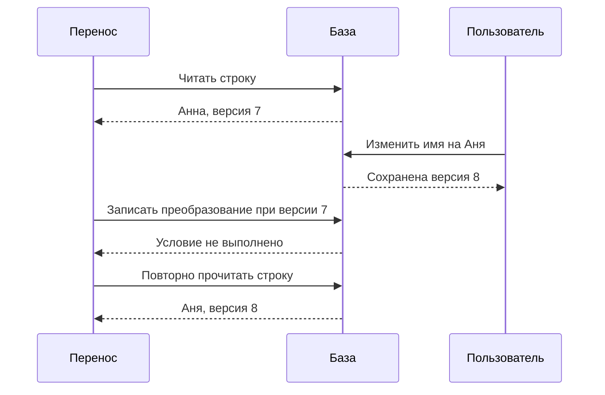
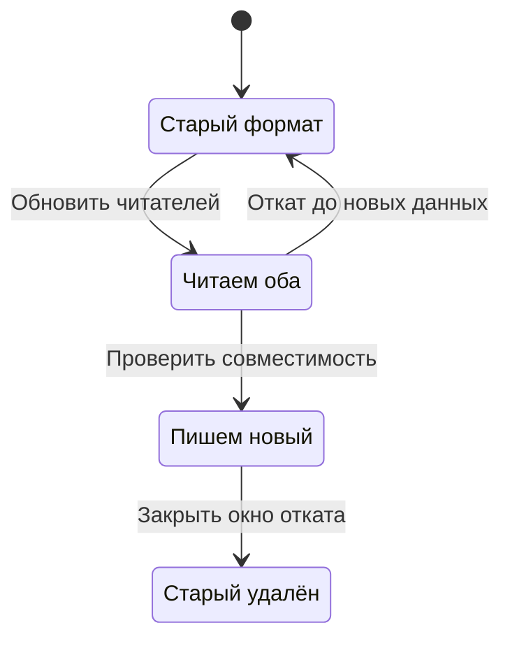

Клуб меняет модель имени пользователя: вместо одного поля появляются отображаемое имя и отдельное имя для документов. Новая версия приложения понимает оба поля, старая — только прежнее. Развёртывание занимает несколько минут, поэтому какое-то время обе версии работают одновременно. Если миграция базы немедленно удалит старое поле, часть серверов начнёт ошибаться.

Изменение работающей системы происходит во времени. Нужно учитывать не только конечную схему, но и все промежуточные сочетания версий. Та же мысль пригодится при переключении региона: старый узел может ещё выполнять работу, пока новый уже считает себя главным.

## 53. Сначала расширить, потом убрать старое

Подход expand/contract разделяет изменение на совместимые этапы. Сначала добавляют новое поле или новый путь, сохраняя старый. Затем переводят данные и приложение. Только после проверки удаляют прежний вариант.

Для Клуба план может выглядеть так:

1. Добавить новые допускающие пустое значение поля без удаления старого.
2. Выпустить приложение, которое умеет читать новый формат, а при его отсутствии использует старый.
3. Определить, какой формат сейчас является источником истины, и согласованно записывать изменения.
4. Перенести старые строки небольшими порциями и сверить результат.
5. Переключить чтение на новый формат после измерения полноты.
6. Дождаться исчезновения старых клиентов и задач, затем удалить прежний путь.

Самая трудная часть часто скрывается в третьем шаге. Если приложение пишет оба поля, а фоновый перенос одновременно копирует устаревшее значение поверх нового, обновление пользователя потеряется. Перенос должен учитывать версию строки, время изменения или условие «новое значение ещё не заполнено». Конкретный механизм зависит от модели данных.

Backfill, заполнение существующих записей, делают возобновляемым. Он сохраняет позицию, ограничивает нагрузку и умеет безопасно обработать строку повторно. Признак «скрипт завершился без ошибки» не доказывает корректности: сверяют количество, обязательные поля и содержательные инварианты. Проверка выборки полезна, но не равна полной проверке.

События тоже имеют версии. Старый обработчик может встретить новое поле, а новая программа — сообщение, созданное месяц назад. Добавление необязательного поля часто проще удаления или смены смысла существующего. Нельзя оставить прежнее имя `amount`, но незаметно поменять рубли на копейки.

Feature flag позволяет включать новый путь отдельно от доставки кода. У флага нужны владелец и срок удаления. Сотни забытых комбинаций усложняют проверку поведения. Флаг также не откатывает уже изменённые данные; это только механизм выбора пути выполнения.

### Проверяем не две версии, а сочетания читателей и писателей

Пусть формат V1 содержит `name`, а V2 — `display_name`. Добавление колонки безопасно только для части системы. Нужно выяснить, что произойдёт, когда старый обработчик изменит `name` после того, как новая версия уже записала `display_name`. Если читатели предпочитают новое поле, изменение старого обработчика станет невидимым. Схема базы остаётся допустимой, но смысл операции нарушен.

На переходном этапе выберем одного владельца смысла. Пока существуют старые писатели, `name` остаётся источником истины, а новое поле — производным. Новая версия умеет читать оба формата, но не создаёт независимое значение, которое старый код не способен сохранить. Затем обновляем всех писателей, включая фоновые задачи. Только после этого разрешаем изменение нового поля по новым правилам. Такое ограничение иногда временно откладывает новую функцию; это цена безопасного перехода.

Составим матрицу. Строки обозначают писателя, столбцы — читателя. В каждой клетке спрашиваем, понимает ли читатель значение и сохраняется ли его смысл.

| Кто записал | Старый читатель | Совместимый читатель | Только новый читатель |
|---|---|---|---|
| Старый писатель | Понимает `name` | Использует старый смысл | Нужен перенос или fallback |
| Совместимый писатель | Получает прежний формат | Читает согласованные поля | Читает новое поле |
| Только новый писатель | Может не увидеть изменение | Зависит от контракта | Читает новый формат |

Матрица не заменяет тесты. Она показывает, какие сочетания вообще нужно проверить. В систему входят мобильные клиенты, выгрузки, обработчики старых событий и административные скрипты. Пустой список старых серверов не доказывает, что старых писателей больше нет.

### Разбираем одну гонку переноса

Фоновая задача прочитала `name = Анна`, версия строки 7. Пользователь поменял имя на `Аня`, версия стала 8. Затем задача попыталась заполнить новое поле значением из версии 7. Условная запись должна проверить версию в тот же момент, когда сохраняет результат. Отдельное чтение версии перед обычным UPDATE оставляет новую гонку между проверкой и записью.



После отказа задача перечитывает строку и повторяет преобразование. Она не трактует отказ условия как потерю соединения и не бесконечно отправляет прежнее значение. При повторном запуске результат для той же версии должен быть тем же самым. Позицию обработки сохраняют после устойчивой записи данных; иначе падение оставит пропущенную строку за сохранённой позицией.

Если преобразование теряет сведения, обратимость требует отдельного решения. Из одного `name` нельзя надёжно восстановить фамилию и имя по пробелу для всех людей. Здесь технический скрипт не может заменить продуктовую договорённость: потребуется сохранить исходное значение, предложить человеку уточнить поля или отказаться от такого автоматического преобразования.

## 54. Как ограничить риск развёртывания

При rolling deployment экземпляры заменяются постепенно. Система должна выдержать совместную работу версий и временное уменьшение доступной мощности. При canary новую версию сначала получает малая часть трафика. При blue-green готовят отдельное окружение и переключают поток между двумя наборами экземпляров. Каждый способ имеет цену ресурсов и собственные условия применимости.

Критерии остановки задают до начала. Например, новая версия не должна заметно ухудшать долю успешных записей, хвостовую задержку и нагрузку базы на сопоставимом трафике. Маленькая canary может не увидеть редкую ошибку, поэтому важно учитывать число операций и типы пользователей, а не только процент серверов.

Для Клуба опасно проверять только чтение каталога, если изменение касается записи на интенсив. Нужно направить в canary именно затронутые сценарии и проверить побочные эффекты. Иногда новая версия создаёт неверные данные, хотя отвечает быстро и без ошибок. Тогда потребуются проверки бизнес-инвариантов.

Откат приложения возвращает прежний код. Откат данных — отдельная задача. Если новая версия уже записала формат, который старая не читает, возврат бинарного файла не восстановит совместимость. Поэтому безопаснее заранее сохранить возможность чтения нового формата старым путём или подготовить обратное преобразование, если оно вообще возможно.

Изменение конфигурации тоже является развёртыванием. Оно может охватить все серверы быстрее, чем обычный релиз. Исторический разбор Cloudflare показывает, почему правила и настройки требуют проверки области воздействия и пути отката. Клуб применяет те же этапы к дорогому фильтру загрузок, а не считает его безопасным из-за отсутствия нового бинарного файла.

### Canary — сравнение, для которого нужны сопоставимые условия

Допустим, новая версия получила 5% запросов. За десять минут в ней было 100 операций записи без ошибок, а в старой — 1900. Ноль ошибок на ста операциях не доказывает безопасность редкой ветки, которая возникает раз на тысячу запросов. Если проблема связана только с повтором после таймаута, обычные успешные операции вообще не проверяют её.

Перед включением составьте список затронутых сценариев: новая запись, повтор, отсутствие места, отмена, ошибка зависимости. Часть проверяется тестами до релиза, часть — наблюдением ограниченной группы. Canary получает ограниченную область воздействия, но достаточно разнообразную работу. Если новую версию видят только сотрудники с пустыми аккаунтами, сравнение не представляет учеников с большой историей.

Показатели сравнивают по одинаковым операциям. Новая версия могла получить больше простых чтений и поэтому показать меньшую среднюю задержку. Отдельно сравните задержки записи, технические ошибки, нагрузку базы на одну операцию и корректность сохранённых состояний. Методика ограниченного выпуска описана в [Google SRE: Canarying Releases](https://sre.google/workbook/canarying-releases/); конкретные пороги зависят от вашего сервиса.

### Откат начинается до первого переключения

План выпуска содержит условие остановки и действие после него. Например: прекратить направлять новые записи в V2, дождаться уже принятых операций либо передать их совместимому обработчику, сохранить диагностику, вернуть чтение на V1. Важен каждый глагол. Просто выключить процесс — значит потерять сведения о работе, если они находились только в памяти.

На схеме разрешение новой записи появляется только после обновления всех читателей. Состояния описывают допустимые комбинации, а не названия веток Git.



Возврат из `NewWrites` к старому коду не показан намеренно. Сначала нужно доказать, что старый код понимает созданные данные, либо выполнить проверенное обратное преобразование. Если новый формат хранит сведения, которых не было раньше, без потерь откатиться может быть невозможно. Тогда безопасным восстановлением окажется исправленный совместимый выпуск, а не возврат старого бинарного файла.

Изменения базы, кода, конфигурации и флагов имеют разные скорости распространения. Даже если оператор нажал одну кнопку, серверы увидят изменение не одновременно. Успех релиза требует корректности промежуточных сочетаний. Это особенно важно для флага, который меняет не оформление страницы, а формат событий или право принимать запись.

## 55. Когда Клубу нужен второй регион

Дополнительный регион может уменьшить задержку или позволить пережить региональную недоступность. Он добавляет копии данных, маршрутизацию, процедуры переключения и стоимость. Если главная проблема — медленный запрос без индекса, географическое размножение её не исправит.

В модели active/passive основной регион обслуживает запись, запасной готовится принять работу. При асинхронной репликации запасной может не иметь последних изменений. Перед переключением команда должна знать допустимую потерю и способ сверки. Обещание нулевого RPO без соответствующего подтверждения записи необоснованно.

В active/active несколько регионов обслуживают запросы одновременно. Однако это ещё не означает, что любой регион независимо изменяет любой объект. Клуб может закрепить курс за домашним регионом, home region, и направлять изменения мест туда. Локальные копии помогают чтению, но запись остаётся согласованной у владельца.

Если разрешить независимую запись с обеих сторон, потребуется правило конфликтов. Для избранных материалов иногда подходит слияние. Для последнего места простое «последнее изменение побеждает» может отменить уже выданное обещание одному ученику. Выбор зависит от операции, а не только от названия базы.

```text
Регион A: владелец мест курса → подтверждает запись
Регион B: локальный каталог → читает допустимо устаревшую копию
Запрос изменения из B → владелец в A
При недоступности A → выбранный режим отказа или управляемое переключение
```

После восстановления A нельзя просто направить трафик обратно. Нужно установить, какие записи принял B, проверить владение и исключить конкурирующих писателей. Ограничения размещения данных также обсуждают отдельно: нахождение копии в регионе не гарантирует, что журналы, бэкапы и поддержка находятся там же. Для реального продукта требования уточняют по его условиям и юрисдикции.

### Перед переключением разделяем маршрутизацию и владение

Балансировщик отвечает на вопрос, куда направить новый запрос. Он не отзывает уже выданное старому процессу право изменять данные. У клиента может остаться старое соединение, а обработчик очереди вообще не использует пользовательский балансировщик. Поэтому смена DNS сама по себе не обеспечивает единственного писателя.

В Клубе есть запись владения курсом: регион A, поколение 12. Все изменения ограниченного ресурса должны проходить механизм, который отвергает старое поколение после смены владельца. Для перехода на B сначала устанавливают надёжный барьер старой записи, затем проверяют доступную историю B и выдают ему новое поколение. Способ барьера зависит от системы: проверяемый fencing в ресурсе, прекращение доступа старых писателей или другой доказуемый механизм. Недоступность A для оператора не является доказательством остановки A.

Предположим, A подтвердил операцию 501, а B получил только 500. Если A потерян без возможности извлечь 501, нельзя одновременно сохранить обещание о нулевой потере и немедленно объявить B полным продолжением истории. Нужно либо иметь заранее организованную устойчивую удалённую копию подтверждённых операций, либо признать неопределённость и ограничить запись до сверки. Требование выбирается до аварии, когда ещё можно изменить правило подтверждения.

Для каталога допускается локальное чтение старой версии; для выдачи последнего места такое чтение недостаточно. Разделите переключение на операции: каталог может восстановиться за минуту, запись — позже после проверки владения. Один показатель «регион переключён» скрывает это различие.

### Почему возвращение региона — отдельная миграция

Когда A вернулся, его данные не обязательно являются подмножеством истории B. На нём могли остаться неподтверждённые операции, а в B уже появились новые. Сначала A изолируют от записи и сравнивают происхождение историй. Затем готовят его как реплику текущего владельца, проверяют применение данных и лишь потом возвращают в обслуживающую группу.

Нельзя выбирать победителя по самому позднему времени файла или числу строк. Более длинная история может содержать операции, которые никогда не были подтверждены, и не содержать уже выданных обещаний нового владельца. Нужны идентификаторы истории, позиции и контракт репликации. Подробный сценарий продолжен в [разборе нескольких регионов](/system-design/hard-parts/multiregion).

## 56. Что решает согласованный журнал

Если несколько узлов должны договориться о последовательности изменений, им нужен протокол координации. Raft описывает модель с лидером и реплицируемым журналом. Лидер предлагает записи, а подтверждение зависит от установленного протоколом большинства. Смена лидера использует сроки полномочий, term, чтобы различать поколения управления.

Для трёх узлов большинство составляет два. Изолированный один узел не может продолжать подтверждать новые записи как большинство. Два доступных узла могут продолжить работу при соблюдении условий протокола. Это уменьшает риск двух независимых подтверждённых историй, но означает, что меньшая часть теряет возможность принимать такие изменения.

Не всякая запись, попавшая в журнал одного узла, уже зафиксирована. После смены лидера незавершённая часть может измениться. Поэтому приложение должно различать «получено лидером» и «подтверждено протоколом». Чтение также требует подходящего механизма: случайная реплика может отставать.

Консенсус не делает произвольный внешний эффект безопасным. Старый обработчик мог зависнуть, потерять право владения, а потом продолжить писать в объектное хранилище. Для этого применяют fencing: новый владелец получает больший номер поколения, а защищаемый ресурс отвергает устаревший номер. Если ресурс не проверяет номер, наличие lock-сервиса само по себе не остановит старую работу.

Реализацию Raft в промышленной системе обычно берут из проверенного компонента. Учебная симуляция нужна, чтобы понять условия, а не написать собственный протокол для платных мест после одной главы. Согласованный журнал даёт основу порядка, но бизнес-инварианты всё равно проверяет приложение.

### Порядок команд ещё не означает корректность продукта

Пусть согласованный журнал содержит две команды: «забронировать место для Маши» и «забронировать место для Лены». Журнал определяет их порядок, но не отвечает, сколько мест осталось. Приложение последовательно применяет команды к состоянию: первая уменьшает остаток с одного до нуля, вторая получает отказ. Если обработчик обеих команд безусловно создаёт бронирование, консенсус добросовестно воспроизведёт одну и ту же ошибку на всех копиях.

Также нужно определить повтор команды. Клиент не получил ответ на первую запись и прислал тот же идентификатор ещё раз. В журнале могут оказаться две доставки одного намерения. Машина состояний хранит результат по идентификатору операции и возвращает его, не уменьшая остаток повторно. Согласование порядка и распознавание повтора решают разные задачи.

Внешнее письмо отправляют после фиксации намерения, через отдельного исполнителя. Если включить отправку прямо в применение записи, каждая реплика может отправить письмо, а повторное восстановление состояния — отправить его снова. Детерминированная обработка состояния должна воспроизводить данные; внешний эффект требует своего протокола доставки.

Для защиты проекта достаточно уметь провести одну команду: кто предложил, какое подтверждение считается устойчивым, когда результат применён, что видит повтор и что произойдёт после смены лидера. Подробные ограничения Raft и чтений вынесены в [блок о консенсусе](/system-design/hard-parts/consensus).

### Практика: новый код быстр, но откат сломан

Версия V2 начала писать статус `awaiting_review`. V1 знает только `new`, `approved`, `rejected`. Через десять минут команда обнаружила ошибку интерфейса V2 и хочет вернуть V1. Предложите порядок действий и назовите сведения, без которых откат опасен.

Подсказка: наличие неизвестного статуса может сломать и читателя, и фоновую задачу. Замена его на `new` не обязательно сохраняет смысл.

Разбор: сначала ограничиваем появление новых несовместимых записей и выясняем, какие процессы читают статус. Если V1 не умеет его обрабатывать, возвращение старого кода не является безопасным откатом. Можно выпустить совместимую версию с исправленным интерфейсом, временно выключить проблемную функцию или выполнить заранее определённое преобразование данных. Преобразование допустимо только при ясном соответствии состояний и сохранении обязанностей перед пользователем. На будущее сначала выпускают читателей, понимающих будущий статус, и только затем разрешают писателям его создавать.

## Разобранная миграция и упражнения

**Пример.** Клуб добавляет отдельное поле отображаемого имени. Первая версия читает старое поле, вторая умеет оба. Backfill заполняет только строки без нового значения и сохраняет checkpoint. Метрика показывает долю чтений по старому пути. После её снижения до нуля команда проверяет старые фоновые задачи и мобильные клиенты. Только затем планирует удаление прежнего поля, сохраняя резервный путь до окончания окна отката.

**Задание 1.** В новой версии поле стало обязательным, но backfill ещё не закончился. Где возможна ошибка?

**Разбор.** На чтении старой строки, в старом клиенте и в событии прежней версии. Требование обязательности вводят после подтверждённой миграции всех соответствующих путей либо обеспечивают совместимый fallback.

**Задание 2.** Из трёх узлов один изолирован. Нарисуйте, кто может подтвердить запись, а затем объясните, почему старый worker всё ещё может повредить внешний файл.

**Подсказка.** Отдельно рассматривайте журнал координации и ресурс, в который пишет worker.

**Разбор.** Большинство управляет подтверждённой историей, но внешний ресурс должен самостоятельно проверять право поколения или иной эквивалентный механизм. Старое соединение с ним не исчезает от смены лидера.

**Задание 3.** Составьте план регионального переключения с RPO пять минут. Укажите, как измерить фактическое отставание и что делать, если оно составляет двадцать минут. Корректный ответ допускает остановку переключения или согласованное изменение ожиданий, а не скрывает нарушение цели.

## Практика: цена совместимости и отката

Старая версия считает пользователя участником по одной строке enrollments. Новая версия добавляет состояния pending и confirmed. Если старая версия читает любую строку как подтверждённую, совместный запуск уже нарушает бизнес-правило. Возможность выполнить SELECT не означает смысловую совместимость.

Составьте матрицу четырёх сочетаний: старый писатель/старый читатель, новый/старый, старый/новый, новый/новый. Для каждого укажите допустимые поля и смысл результата. Первое развёртывание должно подготовить совместимое чтение, затем вводится новая запись; удаление старого формата следует после подтверждённого завершения старых писателей, отложенных задач и окна отката.

Добавьте стоимость перехода: временные индексы, два представления, нагрузка backfill, backlog доставки и период сверки. Пиковая мощность миграции должна помещаться в бюджет вместе с текущей работой. Если фоновое копирование занимает весь пул БД, формально правильный алгоритм может сделать сервис недоступным.

Откат бинарного файла и откат смысла данных — разные операции. После подтверждения нового состояния старая версия может не уметь корректно прочитать его. Поэтому до релиза определяем, что именно можно откатить, как остановить новые действия и как сохранить уже подтверждённые данные. [Практика canary в SRE](https://sre.google/workbook/canarying-releases/) помогает ограничить область проверки, но не исправляет несовместимый формат.

На выходе нужен ADR с критериями перехода и остановки. Измените условие: потребитель был offline неделю и прислал запись старого формата. Объясните, как версия события, дедупликация и договор преобразования защищают новое состояние. Подробный протокол — в [углублённом блоке миграций](/system-design/hard-parts/migrations).

## Чтение

[S36: Raft](https://raft.github.io/raft.pdf), [S27: Spanner, OSDI 2012](https://research.google/pubs/spanner-googles-globally-distributed-database-2/), [S29: миграция Discord](https://discord.com/blog/how-discord-stores-trillions-of-messages), [S32: Cloudflare, июль 2019](https://blog.cloudflare.com/details-of-the-cloudflare-outage-on-july-2-2019/), [S33: GitHub, октябрь 2018](https://github.blog/news-insights/company-news/oct21-post-incident-analysis/). Исторический кейс помогает задать вопросы к плану, но не заменяет проверку выбранного механизма в Клубе.
