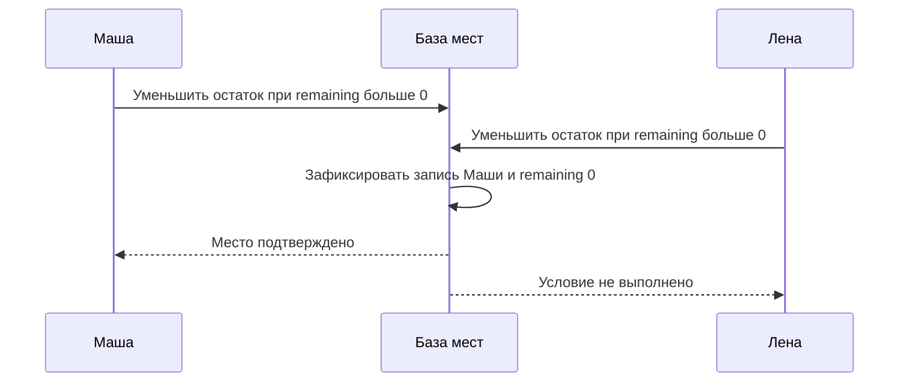
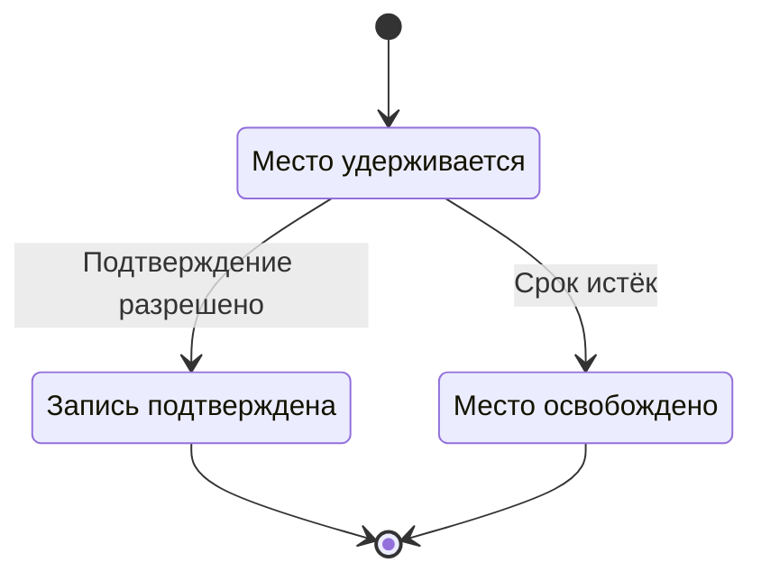

На интенсив Клуба осталось десять мест. Через минуту откроется запись, и организатор ожидает несколько тысяч желающих. Команда предлагает очередь, отдельный сервис бронирования, распределённый кэш и второй регион. Каждое предложение может оказаться полезным, но пока непонятно, какую конкретную проблему оно решает и какой результат обязано сохранить.

Архитектурная защита начинается с обещаний пользователю и условий работы. Затем схема показывает, кто выполняет каждое обещание, где хранится решение и как обнаружить нарушение. На этой стадии нужно уметь отказаться от лишнего компонента и подробно разобрать действительно опасное место.

## 57. Бронирование ограниченного ресурса

Место на интенсиве существует в ограниченном количестве. Основной инвариант: число подтверждённых записей и действующих удержаний не превышает вместимость. Если продукт не использует удержания, формулировка упрощается, но путь оплаты становится другим. Сначала выбирают бизнес-правило, потом модель хранения.

Удержание, hold, временно резервирует место, пока ученик завершает действие. Оно имеет ID, владельца, срок и состояние. Истечение срока — не просто удаление строки по расписанию. Запрос подтверждения и фоновая очистка могут прийти одновременно, поэтому переход проверяется атомарно в месте хранения состояния.

Простейшая модель Клуба использует одну SQL-базу. Транзакция проверяет доступную вместимость и создаёт удержание с защитой от конкурентного изменения. Можно использовать блокировку подходящей строки или условное обновление счётчика вместе с записью удержания. Выбор должен сопровождаться точным SQL и проверкой гонки, а не словом «транзакция» на схеме.

Идентификатор операции клиента обеспечивает повтор после потерянного ответа. Если удержание уже создано, сервер возвращает его прежний результат в рамках определённого контракта. Новый ключ означает новое намерение, поэтому также нужна продуктовая уникальность: одному ученику не разрешено одновременно удерживать десять мест одного занятия, если он покупает только одно.

Оплата в учебной работе выполняется только в песочнице или симуляторе. Внешний сервис может подтвердить её позже, повторить уведомление или дать ответ после таймаута. Клуб хранит собственное состояние процесса и ID операции провайдера. Уведомление проверяют и сопоставляют с ожидаемой оплатой, а повтор не выдаёт доступ второй раз.

Если оплата пришла после истечения удержания, нельзя считать, что место всё ещё принадлежит ученику. Нужна сверка текущего состояния и заранее определённое действие: возврат, предложение другого времени или разрешённое продление. Денежное подтверждение и существование свободного места — два факта, которые следует согласовать.

### Проводим два запроса через одну точку решения

Рассмотрим упрощённую модель без оплаты: `remaining` — число оставшихся мест, `enrollments` — записи учеников. Транзакция сначала атомарно уменьшает `remaining`, но только если он больше нуля. Если изменена одна строка, она создаёт запись ученика и сохраняет результат операции. Если следующая вставка нарушила уникальность, вся транзакция откатывается, включая уменьшение остатка. Обработка конфликта не должна случайно зафиксировать только счётчик.

Условный SQL ниже описывает намерение, а не готовый клиентский код. Проверка числа изменённых строк и ветвление выполняются внутри одной транзакции. Все пути выдачи места обязаны использовать тот же инвариант.

```sql
BEGIN;
UPDATE sessions
SET remaining = remaining - 1
WHERE id = :session_id AND remaining > 0;
-- Продолжать только если изменена одна строка.
INSERT INTO enrollments(session_id, student_id, operation_id)
VALUES (:session_id, :student_id, :operation_id);
-- Уникальность участника и операции защищается ограничениями.
COMMIT;
```

Почему отдельное чтение остатка не подходит? Два клиента могут одновременно прочитать единицу, а затем независимо вставить записи. Атомарное условное изменение заставляет их конкурировать за одно изменение состояния. При корректной реализации транзакции и подходящих гарантиях базы один получит место, второй увидит отсутствие остатка либо повторит прерванную конфликтом транзакцию. Само наличие `BEGIN` без атомарной защиты общего условия этого не обеспечивает.

На диаграмме показано логическое упорядочивание успешных операций. Физический способ ожидания или обработки конфликта зависит от базы.



Теперь добавим потерянный ответ. База зафиксировала запись Маши, но сервер упал до отправки результата. При повторе нужно сначала распознать прежнюю операцию и вернуть её результат. Это проверяется вместе с изменением данных, с защитой от двух параллельных повторов. Если ключ распознаётся только в памяти API, другой экземпляр не узнает прежний результат.

### Удержание меняет инвариант и жизненный цикл

С оплатой остаток уменьшается при создании удержания, а подтверждение переводит уже занятое место в окончательную запись. Повторно уменьшать остаток при подтверждении нельзя. Освобождение истёкшего удержания увеличивает остаток ровно при успешном переходе из активного состояния в истёкшее. Повторный запуск очистки не должен снова добавить место.

Удержание хранит срок, но часы клиента не решают его судьбу. Проверку срока и переход выполняет доверенная сторона в согласованной модели времени. При гонке подтверждения и освобождения победитель определяется атомарным изменением состояния. Если подтверждение уже зафиксировано, очистка не освобождает место. Если истечение уже зафиксировано, поздняя оплата требует отдельного разрешения ситуации.



Эта маленькая схема не изображает оплату целиком. Она показывает локальное владение местом. У платежа есть собственные состояния, включая неизвестный исход и возврат. Не объединяйте их в один флаг `paid`: иначе сложно объяснить, что делать с оплаченным, но уже освобождённым местом. Полная история разобрана в [распределённых транзакциях](/system-design/hard-parts/transactions).

## 58. Клуб во время пика

Для учебной защиты зададим условия: 3000 попыток записи за одну минуту, 1000 одновременных зрителей каталога, вместимость интенсива 100 мест. Это допущения задачи, не измерения реального сервиса. Средняя скорость записи в эту минуту — 50 запросов в секунду, но секундные всплески могут быть выше. Команда должна определить профиль или запас для них.

Первый вариант архитектуры — несколько экземпляров одного API, SQL-база, outbox и обработчик уведомлений. Каталог может использовать кэш; видео идёт через отдельную доставку. Критическая запись остаётся короткой транзакцией. Уже такой вариант разделяет ожидание письма, передачу видео и распределение мест.

Второй вариант — отдельная подсистема бронирования, которая принимает команды, регулирует входной поток и обрабатывает ограниченный ресурс. Она может быть оправдана независимым развитием команды или специфической нагрузкой. Но очередь перед бронированием меняет ответ пользователю: «заявка принята» ещё не означает «место получено». Интерфейс и контракт должны различать эти состояния.

| Вопрос | API и SQL | Отдельная обработка команд |
|---|---|---|
| Когда известен результат | После короткой транзакции | После обработки команды |
| Где проверяется вместимость | В базе в момент изменения | У владельца состояния при обработке |
| Что даёт очередь | Уведомления после записи | Сглаживание входа и ожидание результата |
| Дополнительная сложность | Контроль блокировок и пула | Статусы команд, повторы, задержка, восстановление |

Нельзя объявить второй вариант быстрее без измерения. Один популярный интенсив остаётся общим ограниченным ресурсом. Разделение по ученикам не устраняет необходимость согласовать вместимость. Если очередь помогает выдержать всплеск, нужно посчитать максимальное ожидание и решить, сколько людей разумно держать в ней после окончания мест.

В общей схеме показывают основные границы и потоки. Для бронирования рисуют отдельную временную последовательность двух конкурентных запросов. Для видео — отдельный путь байтов. Одна гигантская картинка с каждой таблицей хуже объясняет архитектуру, чем несколько небольших схем с точным вопросом.

### Считаем очередь до выбора очереди

Предположим, в первую секунду пришло 3000 команд, а подсистема способна устойчиво обрабатывать 100 команд в секунду. Даже без новых поступлений последняя команда начнёт обрабатываться примерно через 30 секунд. Если пользователь ждёт результат за две секунды, очередь сохранила команды, но не выполнила обещание задержки. Нужно либо честно ввести асинхронный статус, либо ограничить приём, либо увеличить подтверждённую производительность.

Теперь предположим, что из 3000 команд только первые 100 могут получить место. Очередь в строгом порядке имеет смысл, если продукт действительно обещает порядок принятия. Иначе можно быстро отклонять запросы после исчерпания вместимости, сохраняя защиту от гонок. Сам факт использования брокера не задаёт справедливость: порядок может различаться между партициями, повторная доставка меняет наблюдаемую последовательность, а часы клиентов не дают единой очереди прихода.

Для синхронного варианта тоже нужен предел одновременной работы. Если 3000 запросов одновременно попытаются взять соединение из пула размером 50, большая часть будет ждать. Входной предел должен учитывать доступную мощность и время ожидания, а не только максимальное число TCP-соединений. Излишняя работа отклоняется с понятным контрактом повторов. Уже принятая операция с неизвестным исходом не превращается при этом в новую операцию.

### Сравниваем стоимость на одной и той же границе

Сравнение «один сервис дешевле трёх» слишком грубо. Посчитайте, какие ресурсы действительно отделяются. Если обработка видео использует CPU часами, отдельные исполнители позволяют масштабировать её без увеличения числа API. Если два сервиса всё равно держат одну транзакционную границу и постоянно общаются, разделение может добавить задержку без независимости.

У каждого варианта перечислите данные, которыми он владеет, контракт вызова и процедуру отказа. Для API и SQL это отказ базы и повтор операции. Для очереди команд добавляются потерянное подтверждение приёма, повтор обработки, задержка результата и восстановление исполнителя. Эти обязанности можно выполнить, но их нужно включить в оценку.

В конце сравнения сформулируйте условие пересмотра. Например: «Оставляем синхронную запись, пока измеренный p99 на целевом профиле укладывается в 500 мс с запасом при потере одного API. Если очередь ожидания соединения становится главным ограничением, сначала уменьшаем длительность транзакции; переход к асинхронному результату требует отдельного согласования продукта». Число 500 мс здесь — условие учебного проекта, а не общепринятый стандарт.

## 59. Как проводить разбор проекта

Рецензент сначала проверяет задачу, а не любимый инструмент. Какие операции входят в объём? Какие данные нельзя потерять? Что считается успехом? Какие числа измерены, а какие предположены? Если автор и рецензент используют разные ответы, спор о базе бессмысленен.

Далее рецензент выбирает конкретный сценарий. Например: два ученика одновременно подтверждают последнее место; сервер падает после commit; подтверждение оплаты приходит дважды; регион возвращается после переключения. Автор проводит сценарий по схеме и указывает состояние данных после каждого шага.

Хорошее замечание связывает риск с механизмом. Вместо «здесь плохая надёжность» — «после изменения базы процесс может упасть до публикации события, поэтому уведомление потеряется; нужно сохранить намерение в той же транзакции или предложить эквивалентную проверяемую схему». Такое замечание можно исправить и проверить.

Запись архитектурного решения, ADR, содержит контекст, варианты, выбранный путь, последствия и условие пересмотра. Она не должна доказывать, что команда всегда была права. Полезно явно написать: «пока оставляем одну базу; пересматриваем при подтверждённом ограничении записи или требовании независимого региона». Это делает решение временным осознанно, а не случайно.

Новое ограничение может изменить ответ. Если интенсив требует строгого порядка по времени поступления, обычная конкурентная транзакция не обязательно обеспечивает ожидаемую справедливость. Нужно определить точку принятия запроса, порядок и поведение при повторе. Если появилась очередь ожидания, меняются статусы и правила освобождения мест. Хорошая защита показывает, какие части решения останутся, а какие придётся заменить.

### Как читать архитектурную схему на защите

Начните с внешнего сценария: ученик нажал «Записаться». На схеме найдите входной API, проверку права, владельца данных, момент фиксации и путь ответа. На каждой стрелке задайте четыре вопроса: что передаётся, синхронен ли вызов, как ограничено ожидание и что означает подтверждение. Если ответов нет, линия пока декоративная.

Отдельная диаграмма контекста показывает учеников, организатора, Клуб и внешний платёжный сервис. Диаграмма компонентов приложения показывает API, базу, очередь и исполнителя. Диаграмма последовательности показывает одну историю во времени. Это разные уровни описания; метод [C4](https://c4model.com/diagrams) помогает отделять масштаб обзора. Не следует называть серверный процесс контейнером Docker только потому, что в C4 используется слово container: в этой модели смысл термина шире.

Добавьте к схеме таблицу ответственности. Кто проверяет вместимость? Кто знает статус платежа? Кто хранит намерение отправить письмо? Если одно обещание принадлежит сразу двум независимым компонентам, уточните протокол согласования. Если не принадлежит никому, оно существует только в тексте требований.

### Замечание рецензента превращаем в проверку

Рецензент говорит: «Между commit и ответом возможен повтор». Автор должен показать конкретное состояние: запись уже есть, ключ операции сохранён, клиент не знает результата. Затем он проводит повтор с тем же ключом и показывает ответ. Если объяснение сводится к «у нас есть Redis», замечание не закрыто: нужно знать, что произойдёт после потери записи Redis и как ключ связан с транзакцией места.

Удобный формат заметки: сценарий, нарушаемое обещание, причина, предлагаемое изменение, проверка. Например: «Два одновременных повтора создали две записи, потому что проверка ключа выполнялась до транзакции без уникальности. Добавляем атомарную защиту идентификатора и проверяем два параллельных клиента». Здесь есть наблюдаемый критерий завершения.

ADR сохраняет также отклонённый вариант, но не обязан перечислять весь рынок. Для выбора очереди достаточно сравнить синхронную обработку с отложенной при тех же требованиях. Укажите, что изменится для пользователя, какие новые состояния появятся и кто будет разбирать зависшие команды. Операционная обязанность — часть архитектуры, а не задача, которую можно навсегда оставить «на потом».

## 60. Эксперимент вместо уверенного предположения

Команда спорит, выдержит ли одна база пиковую запись. Эксперимент начинается с гипотезы: «при заданной схеме и профиле транзакция сохраняет инвариант и укладывается в выбранный бюджет задержки». Нужно определить параметры среды, данные, число клиентов, длительность и критерии отказа до запуска.

Для проверки корректности запускают конкурирующие попытки на малую вместимость и проверяют итоговые строки. Для производительности измеряют задержку всего запроса, число завершённых операций, ожидание блокировок, загрузку CPU и пула соединений. Успешные отказы «мест нет» учитывают отдельно от технических ошибок, чтобы быстрые отказы не скрыли медленные успешные записи.

Один короткий запуск на пустой базе мало говорит о долговременной нагрузке. Индексы, объём истории, кэш и прогрев влияют на результат. Но это не повод сразу строить огромный стенд. Сначала проверяют узкий вопрос минимальным опытом, затем расширяют его, если результат не отвечает на решение.

Изменять нужно по одному существенному фактору: число обработчиков, размер пула или конкретный запрос. Если одновременно поменять базу, железо и алгоритм, непонятно, что помогло. Сохраняют команды, версию схемы, параметры и сырые результаты, чтобы другой человек мог повторить опыт.

Локальный тест не доказывает готовность к эксплуатации. Он может исключить неверную гипотезу или показать ограничение конкретной конфигурации. В защите нужно сказать: «на этом стенде получили такой результат; сеть между регионами, длительная работа и сбой диска не проверялись». Это полезнее уверенного числа без условий.

### Стенд должен уметь обнаружить неправильный ответ

Нагрузочный генератор, считающий только HTTP-коды, может пропустить перепродажу мест. Добавьте независимую проверку результата: число уникальных действующих записей не выше вместимости, одна операция не имеет двух результатов, остаток соответствует записи событий или текущим удержаниям по выбранной модели. Выполняйте проверку после завершения конкурентных действий в согласованном снимке; несогласованное чтение нескольких таблиц само может показать временное несоответствие.

Проверьте, не ограничивает ли генератор сам себя. Если каждый клиент отправляет следующий запрос только после ответа, замедление сервера автоматически уменьшает входной поток. Такой опыт отвечает на вопрос о фиксированном числе последовательных клиентов, но не имитирует внешний поток 500 новых запросов в секунду. Для второго случая расписание поступления задают отдельно и учитывают задержанные или неотправленные генератором запросы.

Проводите опыт ступенями: малый поток для проверки сценария, целевой поток, короткий пик, возвращение к нормальному потоку. Последняя стадия показывает, умеет ли очередь разгребаться. Если после пика возраст старейшей команды продолжает расти, система не восстановилась, даже если число HTTP-ошибок снизилось.

Все приведённые здесь числа — параметры учебного опыта. Не записывайте их в отчёт как полученные измерения. Сохраните исходные результаты и отметьте, какие факторы не воспроизведены: удалённая сеть, размер рабочей истории, длительная работа, падение процесса или недоступность диска.

### Практика: стенд показывает успех, ученики получают лишние места

На стенде 20 клиентов одновременно покупают 10 мест. Все ответы имеют код 200, средняя задержка 40 мс. После опыта в таблице 14 подтверждённых записей. Автор предлагает добавить серверов, чтобы ответы стали ещё быстрее. Какой вывод должен сделать рецензент?

Подсказка: сначала определите, какое условие опыта нарушено; затем отделите корректность от производительности.

Разбор: нарушен инвариант вместимости, поэтому измеренная скорость не характеризует работоспособное решение. Нужно восстановить порядок чтений и записей двух конфликтующих транзакций, найти незащищённое общее условие и изменить атомарную границу. После исправления сначала повторяется опыт на корректность, затем измеряется задержка. Добавление API может усилить гонку и не исправляет модель. Хороший отчёт сохраняет оба результата и объясняет, почему первый был непригоден для выбора мощности.

## Проработанный фрагмент защиты

«Для первого Клуба выбираем API и одну SQL-базу. Основной риск — конкурентное распределение ста мест. Письма вынесены в outbox, поэтому их задержка не удерживает транзакцию. Каталог кэшируется отдельно. Каждая запись имеет ключ повторной операции и ограничение по ученику и интенсиву.

Проверим параллельные запросы при вместимости десять: подтверждённых мест должно быть не больше десяти, повтор не создаёт вторую запись. Затем измерим профиль в 50 запросов в секунду с короткими всплесками. Если задержка определяется блокировкой одной строки, сравним длительность транзакции и альтернативную модель мест. Отдельный сервис пока не выбираем: он не устраняет сам инвариант». Это защита конкретного решения, которую можно оспорить опытом.

## Задания и разбор

**Задание 1.** Добавьте требование: после успешной оплаты место гарантировано, даже если ответ провайдера задержался. Как изменится удержание?

**Подсказка.** Согласуйте момент оплаты, истечение срока и состояние неопределённого результата.

**Разбор.** Возможны продление удержания на время оплаты и отдельное состояние сверки. При строгом обещании «успешная оплата гарантирует место» освобождение допустимо только после достоверного окончательного отказа или отмены платежа, после которой успех уже невозможен. Локальный таймер этого не доказывает. Если провайдер не позволяет установить такой исход, место приходится удерживать до сверки либо менять продуктовое обещание: поздний успех допускает возврат вместо места. Окончательный срок полезен для запуска расследования и эскалации, но сам по себе не разрешает нарушить инвариант.

**Задание 2.** Напишите ADR на одну страницу для двух вариантов из таблицы. Сравните их по одинаковым критериям: корректность, задержка ответа, восстановление, стоимость эксплуатации и сложность команды.

**Задание 3.** Составьте эксперимент, который способен опровергнуть ваше решение. Хороший ответ содержит неблагоприятный сценарий, критерий провала и следующее действие. «Запустить и посмотреть» не даёт основания для выбора.

## Решение архитектора как проверяемая запись

Команда выбрала PostgreSQL для бронирований и отдельный производный индекс для поиска. Запишите архитектурное решение — ADR: ситуация, требуемые свойства, варианты, выбранный протокол, последствия и условие пересмотра. Слова «надёжнее» и «быстрее» замените конкретным поведением при отказе и бюджетом.

Для этого выбора важны три разные границы. Бронирование защищает вместимость в согласованной операции. Поиск имеет допустимую задержку обычных обновлений. Отзыв доступа не должен раскрывать приватную карточку через отстающий индекс. Даже если все компоненты отвечают 200, эти обязательства могут нарушаться.

Рецензент проверяет историю: два клиента бронируют последнее место; ответ успешной попытки теряется; приходит повтор; индекс получает события в обратном порядке; пользователя исключают из организации. Для каждого шага покажите, кто может ответить, какое состояние устойчиво и какая проверка подтверждает вывод.

Сравните альтернативу с одним хранилищем. Она может быть предпочтительнее при небольшой нагрузке и достаточном поиске по его индексам. Отдельный поиск добавляет переиндексацию, мониторинг задержки, правила доступа и операционную стоимость. Порог перехода задаём по измеренной нагрузке и требованиям, а не по желанию иметь больше компонентов.

Самостоятельно подготовьте двухстраничный ADR и проверку одного критического отказа. Затем измените условие: запись между регионами обязана иметь нулевой RPO. Объясните, что меняется в пути подтверждения и доступности записи при разделении сети. В [четырёх финальных кейсах](/system-design/hard-parts/architecture-cases) используются те же критерии на других системах.

## Чтение

[S09: изоляция PostgreSQL](https://www.postgresql.org/docs/current/transaction-iso.html), [S15: outbox](https://docs.aws.amazon.com/prescriptive-guidance/latest/cloud-design-patterns/transactional-outbox.html), [S18: безопасные повторы AWS](https://aws.amazon.com/builders-library/making-retries-safe-with-idempotent-APIs/), [S30: Stripe об идемпотентности](https://stripe.com/blog/idempotency), [S06: C4](https://c4model.com/). Из реальных кейсов выберите один и объясните, какое его условие отсутствует у Клуба. Чужой масштаб сам по себе не оправдывает усложнение учебной системы.
