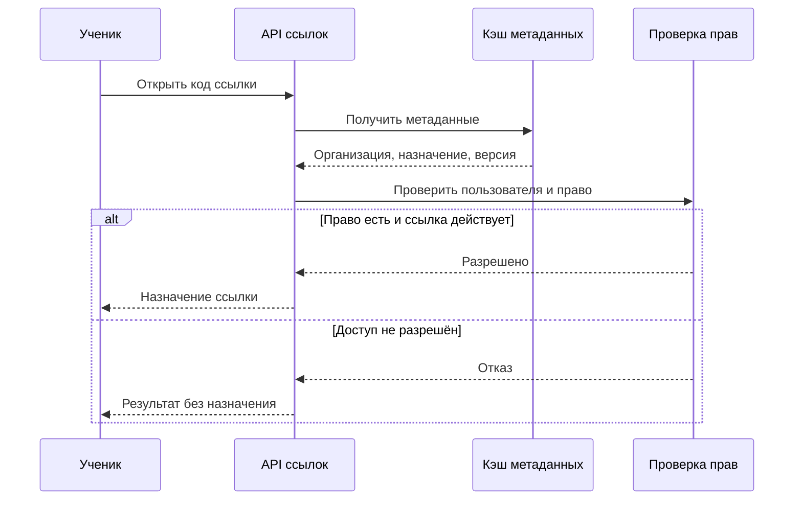
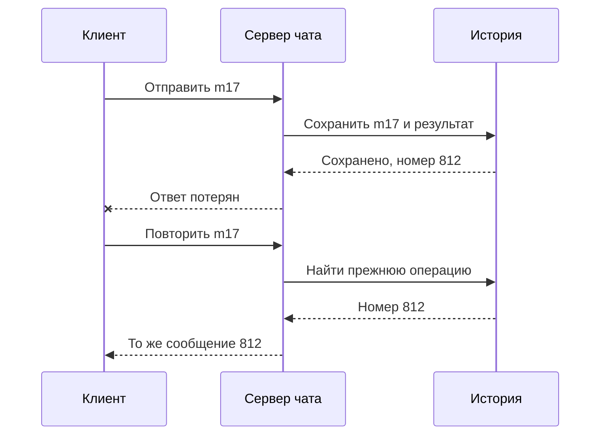

На собеседовании просят спроектировать сервис коротких ссылок. Ученик помнит схему с кэшем, несколькими базами и балансировщиком, но интервьюер добавляет: ссылки закрытые, доступ разрешён только участникам одной организации. Прежняя схема перестаёт отвечать на главный вопрос: где и когда проверять право перехода?

Подготовка к system design строится на переносе метода между задачами. Требования меняются, а действия остаются похожими: уточнить сценарии, назвать инварианты, оценить нагрузку, предложить простое решение и проверить его на неприятных историях. Знакомая задача помогает только до тех пор, пока вы понимаете причины каждого элемента.

## 61. Разбор на 45 минут

Тайминг ниже — тренировочный ориентир. Конкретный интервьюер может выбрать другой формат и попросить раньше перейти к глубокой теме. Важно следить не за секундомером любой ценой, а за тем, какие вопросы уже закрыты и где остаётся неопределённость.

Первые пять минут посвящают рамкам. Кто пользователь? Какие два или три действия обязательны? Что можно оставить за пределами? Какие ошибки недопустимы? Для Клуба это может быть каталог, запись и подтверждение места. Рекомендации и видеоредактор не стоит добавлять без запроса.

С пятой по десятую минуту оценивают нагрузку. Число пользователей превращают в запросы через частоту действий и окно активности. Разделяют среднее и пик, чтение и запись, маленькие ответы и большие файлы. Если данных нет, предлагают допущение и проверяют, подходит ли оно собеседнику. Записанное предположение лучше молчаливого угадывания.

Следующие десять минут — контракт и общая схема. Достаточно нескольких операций API, основных сущностей и пути одного запроса. Назовите, где хранится источник истины, кто проверяет инвариант и когда клиент получает успех. Схема должна объяснять поведение, а не демонстрировать все известные технологии.

С двадцатой по тридцать пятую минуту выбирают глубокий вопрос. Для бронирования это конкурентность, для чата — порядок и восстановление, для файлов — публикация готовой версии. Интервьюер может направить выбор. Полезно сказать: «Вижу два риска; предлагаю сначала разобрать последний свободный слот, потому что он определяет корректность».

Последующие семь минут посвящают отказам, наблюдению и компромиссам. Проведите потерянный ответ, повтор, недоступную зависимость или рост нагрузки. В последние минуты коротко восстановите логику: требования, выбор, цена и оставшийся риск. Не вводите в самом конце новый сложный компонент, который уже не успеете объяснить.

### Что говорить, когда исходных данных нет

Интервьюер предлагает «сервис ссылок» и не сообщает нагрузку. Полезный следующий вопрос — какие действия и пользователи важны, а не сколько серверов можно купить. Допустим, сервис создаёт закрытые ссылки на материалы внутри организаций. Ссылка может истечь, владелец может её отозвать, переход разрешён только участникам организации. Уже эти ответы меняют критический путь сильнее, чем выбор базы.

После рамок можно предложить учебные числа: миллион переходов и десять тысяч созданий в день, пик переходов в двадцать раз выше среднего. Средний поток переходов — примерно `1 000 000 / 86 400 = 11,6` в секунду, принятый пик — около 232. Уточните, что множитель пика является допущением, а не результатом измерения. Не округляйте вверх каждое число на порядок: это незаметно превратит исходную задачу в другую.

Следом оцените данные. При условных 500 байтах метаданных на ссылку десять тысяч новых ссылок дают 5 МБ в день до индексов, реплик, журналов и истории. Этот расчёт пока не требует шардирования. Если хранится аналитика каждого перехода, она создаёт отдельный поток из миллиона событий. Нужно спросить о сроке хранения и допустимости агрегации. Одно и то же число пользователей не задаёт объём всех подсистем.

Затем назовите самое сильное ограничение: «Право доступа должно проверяться до выдачи назначения, а отзыв имеет согласованный срок применения». Теперь схема получает причину: API, источник прав, хранилище ссылок и, при необходимости, кэш метаданных. Аналитику можно обрабатывать отдельно, если продукт допускает её задержку или потерю в определённых пределах. Не прячьте такую потерю за словами «отправим асинхронно».

### Как выбрать глубину при ограниченном времени

На листе могут появиться десятки вопросов. Разделите их по влиянию. У приватных ссылок обход авторизации нарушает смысл продукта, поэтому его разбирают раньше сжатия журналов аналитики. У бронирования перепродажа места важнее формата метрик. Такой порядок не означает, что остальные вопросы не нужны; он позволяет сначала проверить решение там, где ошибка делает его непригодным.

На каждый ключевой механизм выделите короткую доказательную цепочку: исходное состояние, операция, точка изменения, ответ, повтор после потери ответа. Если рассказ застрял на выборе конкретной библиотеки, вернитесь к этой цепочке. Интервьюер сможет оценить модель, даже если выбранный продукт ему незнаком.

Когда задают уточнение, сначала назовите, какое предположение изменилось. «Теперь отзыв должен действовать немедленно; значит, прежний пятиминутный кэш разрешений больше не подходит». После этого меняйте конкретный участок пути. Перерисовывание всей системы в ответ на любое уточнение часто означает, что связи между требованиями и компонентами не были сформулированы.

## 62. Общий метод для разных систем

У короткой ссылки главный путь — разрешить идентификатор в адрес. Нужно определить уникальность, срок жизни, изменение назначения и доступ. Если ссылка приватная, кэш и CDN должны учитывать права. Если разрешён пользовательский адрес назначения, возникает вопрос проверки опасных переходов и злоупотреблений. Не все эти требования обязательны в каждой задаче; их нужно уточнить.

У чата главные различия — сохранение, порядок внутри разговора и возвращение после разрыва. WebSocket решает обмен по соединению, но не историю. Поэтому интервьюер может убрать постоянное соединение, а модель сообщений, ID и повторной синхронизации останется полезной.

У ленты важны подписки, частота публикаций и просмотров, популярные авторы и свежесть. Предварительное распределение и сборка при чтении — варианты с разной ценой. Если требуется ранжирование, следует отделить подготовку кандидатов от оценки порядка. Не нужно выдумывать ML-систему, если задача допускает хронологическую выдачу.

У файлов важны размер, возобновление загрузки, доступ, готовность обработки и удаление. Метаданные и байты идут разными путями. У бронирования центральный вопрос — ограниченный ресурс и момент обещания. Кэшированный остаток может помогать интерфейсу, но финальное решение принимается по механизму, который сохраняет вместимость.

| Задача | Инвариант или обещание | Уместный глубокий разбор |
|---|---|---|
| Короткие ссылки | Код ведёт к разрешённому назначению | Уникальность, кэш, срок и доступ |
| Чат | Принятое сообщение можно восстановить | Повтор отправки, порядок, reconnect |
| Лента | Пользователь видит разрешённые события | Fan-out и пагинация |
| Видео | Опубликована целая готовая версия | Конвейер, повторы, очистка |
| Бронирование | Мест не больше вместимости | Транзакция, hold, поздняя оплата |

Таблица задаёт направление, а не готовый ответ. В каждом интервью проверяйте, действительно ли это обещание важно заказчику. Иногда задача о чате ограничена временными сообщениями, а задача о ссылках требует редактирования назначения с немедленным отзывом старого кэша.

### Полный фрагмент: приватная короткая ссылка

Определим сущности: `Link(code, organization_id, target, expires_at, status, version)` и членство пользователя в организации. Код — уникальный идентификатор, но сам по себе не доказательство права. Даже случайный длинный код можно переслать постороннему человеку. Уникальность защищают ограничением хранилища; при случайной генерации коллизия требует повторной генерации, а не предположения «этого никогда не бывает».

API создания проверяет, может ли автор размещать ссылку в этой организации, валидирует назначение и сохраняет запись. Повтор с тем же идентификатором намерения должен иметь определённый результат. API перехода устанавливает личность пользователя, находит ссылку, проверяет организацию, срок и статус, затем выдаёт разрешённое назначение. Если целевой материал тоже закрытый, его сервер должен самостоятельно защищать доступ: один защищённый редирект не делает публичный файл приватным.

На диаграмме кэш содержит только метаданные. Разрешение проверяется отдельно при каждом переходе в рамках принятого контракта.

Схема намеренно оставляет вопрос свежести статуса ссылки. Если `status` кэшируется пять минут, отзыв может опоздать на эти пять минут, а гонки заполнения требуют дополнительного учёта. Для учебного варианта с немедленным отзывом проверяем актуальные статус и права в авторитетном хранилище на критическом пути. Тогда при его недоступности переход может быть отклонён. Это явная цена выбранной гарантии; нельзя одновременно обещать независимое локальное разрешение по старой копии и немедленный отзыв при разрыве сети.

Клиентские и общие HTTP-кэши тоже входят в модель. Если браузер уже сохранил редирект, новый переход может не дойти до сервера проверки. Контракт ответа должен запрещать нежелательное повторное использование. Значение `no-store` предназначено для запрета хранения кэшем, а `no-cache` требует проверки перед повторным использованием и не означает запрет хранения; определения есть в [RFC 9111](https://www.rfc-editor.org/rfc/rfc9111.html). Заголовки кэширования не удаляют уже раскрытое человеку назначение и не заменяют защиту целевого ресурса.

### Меняем только одно требование

Интервьюер говорит: «Теперь ссылки общедоступные, менять назначение нельзя, срок жизни — год». Проверка членства исчезает из критического пути. Неизменяемое назначение облегчает кэширование, но срок окончания всё равно нужно соблюдать. Создание, уникальность кода и защита административного удаления остаются. Аналитика переходов всё ещё имеет отдельные требования.

Затем другое изменение: «Ссылки приватные, но отзыв может распространяться до минуты». Появляется возможность ограниченного кэширования разрешений, однако нужно определить ключ, срок и поведение после изменения членства. Ключ только по коду ссылки неверен: разрешение одного пользователя будет использовано другим. Срок считается с понятной точки, а ошибки обновления не должны бесконечно продлевать старое разрешение.

Эти два изменения демонстрируют метод: новый контракт меняет конкретные зависимости и допустимые копии данных. Число прямоугольников на схеме не является мерой качества ответа.

## 63. Два пробных интервью

Первую попытку проводят с подсказками. Партнёр играет интервьюера и помогает заметить пропущенный шаг, но не рисует решение вместо автора. Тема — знакомый Клуб. Записывают ход разговора или ведут подробные заметки с согласия участников. Цель — увидеть, где мысль становится неясной.

Пример задания: «Спроектируйте запись на школьные занятия. Места ограничены, несколько тысяч учеников могут прийти одновременно, подтверждение отправляется письмом». Партнёр сначала отвечает на вопросы о требованиях. Если автор сразу выбирает брокер, спрашивает: «Какое действие должно завершиться до ответа ученику?» Если обещает ровно одно письмо, просит показать падение между отправкой и подтверждением.

Во второй попытке подсказок нет, а ограничение меняется. Например, появляется оплата и десятиминутное удержание либо два региона с сетевыми разрывами. Автор должен объяснить, что меняется в данных и гарантиях. Простое добавление прямоугольника региона не считается решением проблемы владения местами.

После каждой попытки оценивают требования, расчёты, данные, архитектуру, сбои и коммуникацию. Для учебной шкалы можно использовать значения от нуля до трёх: ноль — тема отсутствует, один — названа, два — объяснён работающий механизм, три — механизм проверен на изменённых условиях и ограничениях. Это рубрика курса, не официальная шкала работодателя.

Особое внимание уделяют критическим противоречиям. Нельзя компенсировать нарушенную вместимость красивой диаграммой мониторинга. Нельзя обещать отсутствие потерь, если единственная копия хранится в памяти. Если такое обнаружено, следующая тренировка посвящается этому механизму, даже когда общая оценка выглядит высокой.

Обратная связь должна быть конкретной. «Нужно лучше знать базы» слишком широко. «Вы не показали, что произойдёт при двух параллельных проверках остатка; нарисуйте расписание транзакций и проверьте условное обновление» даёт следующее действие. Повтор задачи полезен после исправления причины, а не после запоминания чужой формулировки.

### Партнёр проверяет переходы, а не угадывает правильную технологию

В первой тренировке интервьюер выдаёт вводные постепенно. После общей схемы просит показать успешный запрос. Затем обрывает ответ после сохранения, спрашивает про повтор и только потом добавляет рост нагрузки. Если сразу объявить десять аварий, новичок начнёт перечислять защитные механизмы, не успев построить нормальный путь.

Во второй тренировке партнёр выбирает одно скрытое противоречие. Например, автор обещает немедленный отзыв ссылки, но разрешает переход из локального кэша при недоступности источника прав. Вместо подсказки «добавьте консенсус» партнёр спрашивает: «Пользователь удалён в другом регионе, связь разорвана. Какие данные здесь докажут, что ему ещё можно выдать назначение?» Ответ должен признать границу доступной информации.

После попытки разберите два или три самых существенных пробела. Для каждого запишите следующий опыт: воспроизвести гонку, нарисовать потерянный ответ, пересчитать поток с единицами. Повторите короткий фрагмент без подсказки. Только когда объяснение стало устойчивым, переходите к новой большой задаче. Иначе каждая тренировка повторяет один и тот же пробел в другой декорации.

### Образец обратной связи по рубрике

Ученик уточнил приватность и нагрузку, но не определил срок отзыва. Общая схема понятна. После уточнения про отзыв предложил «очищать кэш», однако не разобрал запрос, который одновременно заполняет кэш старым значением. По учебной шкале требования заслуживают доработки, а механизм отзыва пока только назван. Это не повод обнулить всю работу: нужно исправить конкретное обещание.

Следующее задание: нарисовать два параллельных действия — отзыв и чтение старого значения — и выбрать допустимый контракт. Если допустима задержка, задать её границу и условия. Если нет, показать авторитетную проверку и поведение при её недоступности. Проверяющий оценивает именно этот ответ, а не количество упомянутых продуктов.

## 64. Что показывает портфолио

Портфолио Клуба состоит из эволюции решений. Начальная схема с одним сервисом, добавленный outbox, эксперимент с гонкой, план восстановления и пересмотр миграции показывают, как менялось понимание задачи. Только конечная сложная картинка скрывает эту работу.

Для каждого результата полезно иметь вопрос, исходное предположение, артефакт, наблюдение и вывод. Например: «Предполагал, что проверка остатка перед вставкой достаточна. Два параллельных клиента получили место. Добавил атомарную защиту и повторил эксперимент». Ошибка здесь является частью доказательства обучения, если ясно показано исправление.

Отделяйте выполненное от спроектированного. Локальное восстановление базы — выполненный опыт. План переключения регионов без стенда — проект или tabletop. Прочитанный кейс Discord — источник, а не ваш опыт миграции триллионов сообщений. Такое разделение делает защиту точной и позволяет собеседнику понять реальную глубину практики.

Если вопрос выходит за знания, полезен ответ из трёх частей: что известно, какое предположение сейчас принимается и как его проверить. Например: «Я не помню, какой контракт у конкретного брокера после разрыва соединения. Для схемы предполагаю повторную доставку и защищаю эффект. Перед реализацией проверю документацию и тест падения после commit». Это продолжает решение и не выдаёт догадку за факт.

Следующий шаг выбирают по наблюдаемому пробелу. Если трудно рассуждать о блокировках, нужен небольшой эксперимент с транзакциями. Если путаются подтверждение журнала и запись на одном узле, полезна симуляция Raft. Университетские курсы по базам и распределённым системам требуют подготовки; их можно проходить отдельными темами после основного маршрута.

### Из набора файлов собираем доказательство решения

Хороший артефакт отвечает на один вопрос и содержит достаточно контекста для воспроизведения. Для опыта с последним местом сохраните схему таблиц, параметры клиентов, последовательность запуска, проверку инварианта и результаты. Для регионального переключения без стенда сохраните таблицу состояний и допущения, которые ещё нужно проверить. Не называйте бумажный сценарий проведённым аварийным учением.

Свяжите версии работы. Первый ADR может выбирать одну базу, следующий — добавлять очередь уведомлений после измеренной задержки провайдера. В описании изменения укажите, какое наблюдение стало причиной. Так видно, что архитектура менялась из-за требований или фактов, а не из-за желания использовать ещё одну технологию.

Перед защитой попросите другого человека выполнить один опыт только по инструкции. Если ему пришлось спрашивать, где взять данные или какое число считается успехом, документация неполна. Исправление инструкции тоже является полезным результатом: инженерная работа должна быть понятна человеку, который не присутствовал при её создании.

### Практика: восстановите ход сообщения после обрыва

В пробном интервью вы проектируете чат. Сервер сохранил сообщение с клиентским ID `m17`, но подтверждение потерялось. Клиент переподключился и отправил `m17` ещё раз. Нарисуйте состояние до повтора и результат после него. Затем добавьте условие: другой клиент пользователя уже получил первое сообщение.

Разбор: повтор не создаёт новое сообщение, потому что область уникальности клиентского ID и сохранение результата защищены вместе с историей. Другой клиент может увидеть доставку повторно и должен распознать уже показанное сообщение по устойчивому ID. Это не противоречие: единственный эффект сохранения не означает единственную сетевую доставку. При восстановлении клиент запрашивает недостающую историю с позиции, а не надеется, что WebSocket помнит всё за него.

Дополнительное условие — тот же ID пришёл с другим текстом. Нужно определить контракт: отклонить несовпадающее намерение, а не молча заменить старое сообщение. Область ключа должна учитывать разговор и автора либо иметь другой явно определённый способ уникальности. Такой разбор переносит знания об идемпотентности из бронирования в чат.

### Практика: исправьте ответ про масштаб

Автор говорит: «У нас миллион пользователей, поэтому нужна распределённая база». Каких сведений не хватает и какой минимальный следующий шаг вы предложите?

Разбор: неизвестны активность, доля чтения и записи, размер данных, пик, география и обязательные гарантии. Миллион зарегистрированных пользователей может создавать небольшой поток. Сначала нужно выбрать операции и перевести активность в запросы, байты и конкурентность. Затем сравнить требования с измерением простого варианта. Если ограничение — один популярный объект, распределение остальных ключей не обязательно его устранит. Если ограничение — география и обязательная доступность записи, проект меняется по другой причине. Ответ показывает связь масштаба с механизмом, а не готовность произнести слово «шардирование».

## Проработанный ответ на новое условие

Интервьюер: «Теперь запись должна работать при недоступности основного региона». Неудачный ответ — «добавим реплику и балансировщик». Проработанный ответ сначала уточняет допустимую потерю подтверждённых мест и возможность временного отказа записи.

Если потеря недопустима, автор рассматривает механизм подтверждения между регионами и его цену задержки. Если допускается управляемое переключение с ненулевым RPO, задаёт проверку отставания и процедуру владения. Каталог при этом может продолжать работать с локальной копией. Разные операции получают разные режимы, вместо общего обещания «всё доступно всегда».

В конце автор называет предел: «Текущий вариант принимает запись только у владельца курса. Вторая копия улучшает восстановление, но до безопасного переключения новые места не обещаем». Этот ответ можно дальше менять вместе с интервьюером, потому что условия сформулированы явно.

## Самостоятельные задания

**Задание 1.** Проведите 45-минутный разбор Клуба по таймбоксу. После него отметьте, сколько времени ушло на перечисление продуктов и сколько — на путь запроса и инвариант.

**Подсказка.** Название технологии должно сопровождаться причиной выбора и границей гарантии.

**Задание 2.** Возьмите одну схему и измените только одно условие: приватность, десятикратный пик или невозможность потерять подтверждённую запись. Напишите три изменения и три части, которые остаются прежними. Это проверяет перенос решения, а не скорость перерисовки.

**Задание 3.** Подготовьте пятиминутную защиту одного эксперимента. Покажите параметры, результат, ограничение и следующее действие. Если эксперимент ещё не выполнен, представьте план и не подставляйте правдоподобные числа вместо измерений.

## Чтение и дальнейший маршрут

[S37: MIT 6.5840](https://pdos.csail.mit.edu/6.824/schedule.html) и [S38: CMU Database Systems](https://15445.courses.cs.cmu.edu/fall2024/syllabus.html) дают направления для углубления. Вернитесь также к [S36: Raft](https://raft.github.io/raft.pdf) или [S19: SLO](https://sre.google/sre-book/service-level-objectives/), если они соответствуют вашему пробелу. Завершение курса подтверждается работами и объяснениями; оно не заменяет опыт эксплуатации и не гарантирует результат найма.
