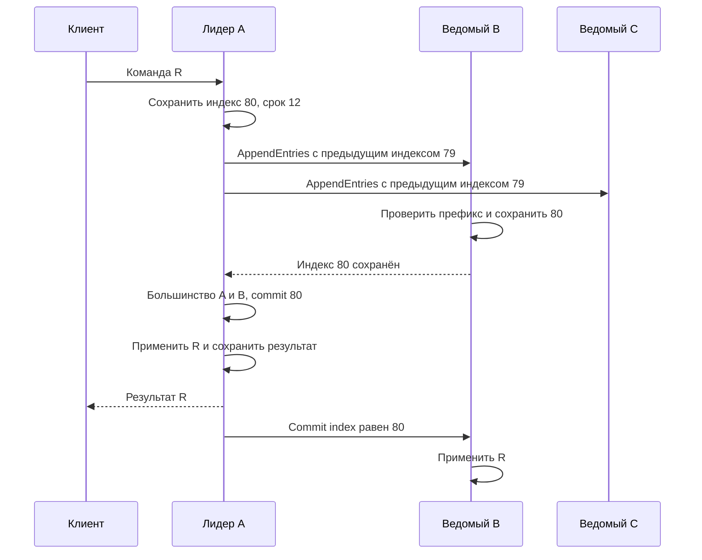
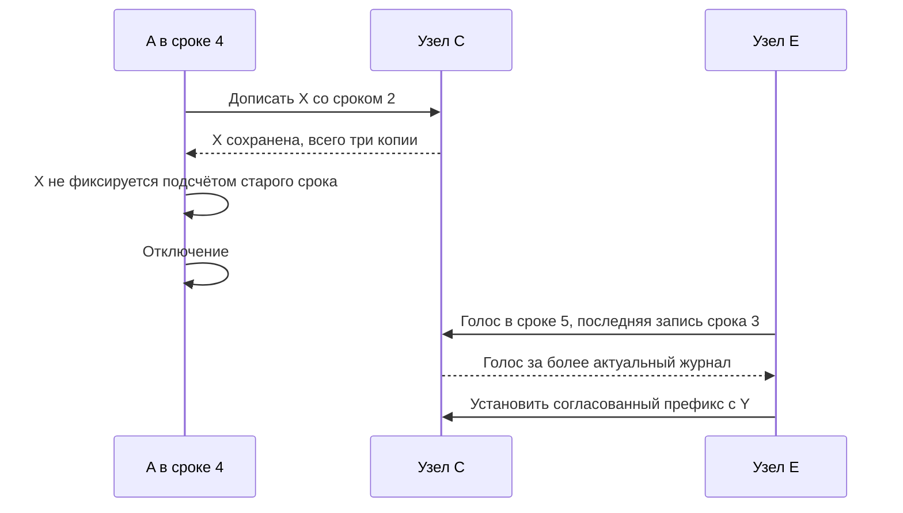
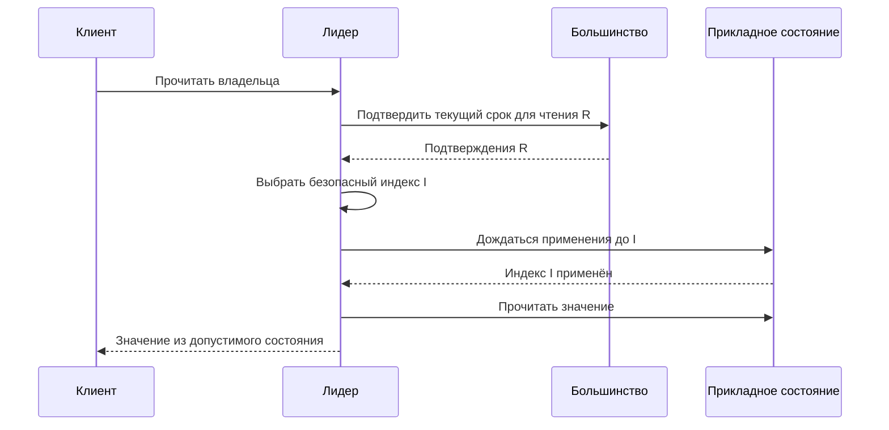
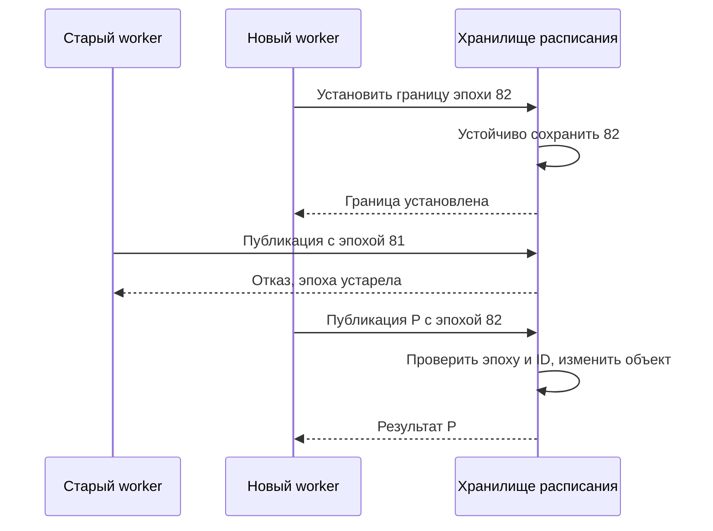

Сервис «Клуба» назначает единственного обработчика публикации расписания. Решение хранится на трёх узлах A, B и C. Узел A подтвердил назначение, но ответ не дошёл до клиента, а сам A отключился. Новый лидер B принимает повтор. Должен ли он назначить ещё одного обработчика? И что делать, если прежний обработчик жив, просто долго не отвечал?

Здесь две разные задачи. Узлы должны согласовать последовательность решений. А внешний ресурс должен отвергать действия устаревшего владельца. Консенсус помогает с первой задачей, но вторая требует отдельного механизма. Учебная история ниже покажет границу между ними.

Мы рассматриваем остановки и восстановления узлов, задержки и потери сообщений. Узлы не подделывают ответы, а подтверждённые записи устойчивого журнала не исчезают произвольно. Защита от злонамеренных участников и повреждения всех дисков относится к другим моделям.

## Граница модели и устойчивые данные

Сначала фиксируем состав группы: три узла и большинство из двух. В отдельном контрпримере будет пять узлов и большинство из трёх. Произвольно менять состав между сообщениями нельзя: два большинства разных наборов могут вообще не пересекаться. Изменение состава — отдельный протокол, который здесь не реализуем.

Каждый узел устойчиво хранит текущий срок, кому отдал голос в этом сроке, и записи журнала. Если узел проголосовал, ответил, перезапустился и забыл голос, он способен отдать второй голос. Тогда рассуждение «два кандидата не получат большинство в одном сроке» перестаёт работать. Поэтому подтверждение зависит не только от получения сообщения, но и от порядка сохранения состояния.

В памяти лидер ведёт сведения о прогрессе репликации: что, по подтверждениям, есть у каждого ведомого. Такие сведения можно восстановить обменом после смены лидера. Их нельзя путать с устойчивым знанием самого ведомого. Снимок прикладного состояния должен соответствовать определённому префиксу журнала; удаление записей до создания согласованного снимка может уничтожить возможность восстановления.

Главный инвариант: если узел применил команду X на индексе i, ни один корректный узел не применит на i другую команду Y. Из него при детерминированном применении следует одинаковое состояние после одинакового префикса. Если команда читает случайное число или текущее время каждого узла отдельно, одинаковый журнал сам по себе одинаковый результат не обеспечит. Такие входы нужно включать в согласованную команду либо обрабатывать специальным образом.

## Журнал, срок и применение — три разных понятия

У записи журнала есть индекс, срок создания и команда. Индекс задаёт позицию в последовательности. Срок, term, — логический номер периода выборов; он не измеряет секунды. Команда описывает изменение, например «назначить worker 7 владельцем расписания 42 с эпохой 81».

Узлы могут временно хранить разные незафиксированные окончания журнала. Наличие команды на диске ещё не означает, что её можно необратимо показать пользователю как принятое решение. Фиксация, commit, отделяет согласованную часть от предположительного продолжения. Применение выполняет зафиксированные команды в порядке индексов и меняет состояние приложения.

Для «Клуба» полезно вести три колонки: «сохранено», «зафиксировано», «применено». Если объединить их в одно слово «записано», легко отправить успех слишком рано или прочитать состояние до применения уже известного решения.

Основные правила Raft таковы: узел голосует не более одного раза за срок и сохраняет сведения о голосовании; кандидат должен иметь достаточно актуальный журнал; при сравнении сначала учитывают срок последней записи, затем её индекс. AppendEntries проверяет совпадение предшествующей записи. Лидер продвигает commit по большинству для записи своего текущего срока; предшествующие записи фиксируются вместе с ней. Условие текущего срока и пример, почему его нельзя убрать, даны в [статье Raft, разделы 5.4.1–5.4.2 и рисунок 8](https://raft.github.io/raft.pdf).

### Нормальный проход записи: от запроса до ответа

Пусть все узлы применили индекс 79. A — лидер срока 12. Получив R, он добавляет индекс 80 со сроком 12 и сохраняет его, затем отправляет AppendEntries. Сообщение содержит проверяемую предыдущую позицию: индекс 79 и его срок. Ведомый подтверждает новую запись после проверки префикса и устойчивого сохранения. Несовпадение означает, что сначала требуется найти общую часть журнала, а не слепо дописать команду.

Диаграмма «Три разных завершения одной записи» разделяет сохранение на репликах, commit у лидера и apply приложения. Читайте её сверху вниз; ответ клиенту расположен после получения результата применения.

Текстовый ход: лидер сохраняет запись; B проверяет и сохраняет её; лидер знает о большинстве, фиксирует и применяет команду; клиент получает результат; B узнаёт commit index и применяет тот же префикс. C может догнать позже. Слабое место наивного варианта — ответ клиенту сразу после локального сохранения: при потере A запись могла остаться только у него и ещё не входить в защищённую часть истории.

Падение B до устойчивого сохранения не даёт ему права подтвердить запись. Падение после сохранения, но до ответа лишь заставит A повторить обмен. Повтор согласованной записи не создаёт второй индекс автоматически. После перезапуска B сверяет журнал с действующим лидером; конфликтующее незафиксированное окончание может быть заменено. Зафиксированный префикс при соблюдении протокола не заменяется другой командой.

### Выборы: кто имеет право продолжить журнал

Ведомый, перестав получать сообщения лидера в течение выбранного интервала, начинает новый срок, устойчиво голосует за себя и запрашивает голоса. Получатель сначала проверяет срок запроса. Увидев больший срок, узел обновляет свой срок и перестаёт действовать как старый лидер. Затем проверяет, не голосовал ли уже и достаточно ли актуален журнал кандидата.

Сравнение актуальности лексикографическое: сначала срок последней записи, затем индекс при равных сроках. Поэтому длинный журнал старых сроков не всегда предпочтительнее короткого журнала с более поздним сроком. Эта деталь станет решающей в контрпримере ниже. Таймауты со случайным разбросом помогают кандидатам не начинать выборы синхронно, но сами по себе не доказывают сохранность журнала.

Если голоса разделились, новый срок может закончиться без лидера. При дальнейшем обмене начинается следующая попытка. Для продвижения нужна достаточно благоприятная связь и живое большинство; безопасность не требует обещать конечное время выборов при бесконечно задерживаемых сообщениях. Это различие между «не принять неверное решение» и «обязательно скоро принять решение».

## Конкретный сбой: результат существует, ответа нет

Пусть A — лидер срока 12. Команда `request=R, owner=7` попадает на индекс 80. Узел C временно недоступен. Приложение хранит результат выполненного запроса вместе со своим согласованным состоянием.

| Шаг | Узел A | Узел B | Клиент и наблюдение |
|---|---|---|---|
| 1 | Добавляет `(80,12,R)` | Получает запись и устойчиво сохраняет | Клиент ждёт |
| 2 | Получает подтверждение B, фиксирует индекс 80 | Может ещё не знать новый commit index | Решение принято большинством A+B |
| 3 | Применяет R и формирует результат | Хранит журнал | Ответ теряется |
| 4 | Отключается | Начинает выборы срока 13 | Клиент получает таймаут |
| 5 | Недоступен | С голосом C становится лидером | Клиент ищет нового лидера |
| 6 | Недоступен | Реплицирует служебную запись срока 13 на B+C | Подтверждается текущий префикс |
| 7 | Недоступен | Применяет префикс и видит результат R | Повтор R возвращает прежнее назначение |

В этой истории B имеет более актуальный журнал, чем C, и может получить его голос. Служебная запись не должна менять бизнес-состояние; её роль — установить необходимую границу журнала в новом сроке. Таблица упрощает обмен сообщениями, но сохраняет различие сохранения, фиксации и применения.

Если приложение не хранит идентификатор R, повтор может стать второй допустимой командой журнала. Raft согласует обе команды; он не знает, что человек считал их одной попыткой. Поэтому дедупликация относится к состоянию приложения и должна переживать смену лидера. Время хранения результатов и повтор после истечения этого времени входят в API-контракт.

Неизвестный исход документируют и реальные системы: таймаут не является доказательством отсутствия эффекта. Посмотрите соответствующие гарантии операций в [etcd API guarantees](https://etcd.io/docs/v3.5/learning/api_guarantees/). Для учебного сервиса мы выбираем явный ID намерения и запрос его состояния.

## Зачем ограничивать фиксацию текущим сроком

Представьте другую историю с пятью узлами. Старый лидер частично разослал команду X в сроке 2. Позже другой лидер получил срок 3 и создал конфликтующую команду Y на том же индексе, но тоже не успел зафиксировать её. После очередных выборов лидер срока 4 содержит X и распространяет её на большинство.

Ошибка — сразу объявить X зафиксированной только по числу копий. На одном узле может оставаться Y со сроком 3. При дальнейших выборах её более поздний срок в конце журнала способен влиять на сравнение актуальности. Арифметика пересечения большинства не говорит, какое знание несёт пересекающийся участник и по каким правилам он голосует.

Если же лидер срока 4 реплицирует новую запись своего срока на большинство, меняется основание доказательства. Эта новая запись закрепляет предшествующий префикс в рамках правил Raft. Важна вся совокупность правил: устойчивые голоса, ограничения выборов, согласование префиксов и корректное обновление commit index. Удаление одного условия нельзя оправдать тем, что два большинства всё равно пересекаются.

Для самостоятельной проверки возьмите рисунок 8 из статьи и подпишите для каждой строки: последний срок, последний индекс, возможные голоса. Не пытайтесь запомнить рисунок целиком. Проверяйте каждый переход и отдельно отмечайте, где автор демонстрирует опасный вариант с удалённым правилом.

### Разворачиваем контрпример в таблицу журналов

У всех пяти узлов сначала есть индекс 1 срока 1. Обозначим `X2` команду X на индексе 2 со сроком 2, а `Y3` — другую команду на том же индексе со сроком 3. Пустая клетка после общего префикса означает отсутствие второй записи, не потерю индекса 1.

| Этап | A | B | C | D | E | Что произошло |
|---|---|---|---|---|---|---|
| Срок 2 | X2 | X2 | — | — | — | A разослал X только B и отключился |
| Срок 3 | X2 | X2 | — | — | Y3 | E выбран голосами C,D,E; Y осталась только у E |
| Срок 4 | X2 | X2 | X2 | — | Y3 | A вернулся, выбран A,B,C и дописал X на C |
| Возможный срок 5 | X2 | X2 | Y3 | Y3 | Y3 | A снова отключён; E избран C,D,E |

На третьей строке X лежит на большинстве A,B,C, но A не может зафиксировать её подсчётом копий: X создана в сроке 2, а A действует в сроке 4. На четвёртой строке C законно предпочитает журнал E: его последняя запись имеет срок 3, больший, чем 2. Если на третьей строке объявить X необратимо принятой, четвёртая перезапишет якобы принятую команду.

Диаграмма «Как старый срок проходит через большинство» показывает выборы после опасного момента. Надпись о трёх копиях не является commit; именно это различие требуется удержать при чтении.

Текстовый ход: C добавляет X; у A появляется большинство её копий, но правило текущего срока запрещает преждевременный commit. После отказа A кандидат E с более поздней последней записью получает голос C. Его законная победа допускает замену незафиксированного X.

Исправленная ветка добавляет в сроке 4 индекс 3 со сроком 4 на A,B,C. Теперь новая запись фиксируется большинством и закрепляет X перед собой. E со сроком последней записи 3 уже не получит голос ни одного из A,B,C, пока его журнал не станет совместимым с защищённым префиксом. Существование пересечения и правило голосования работают совместно.

## Чтение тоже требует протокола

Старый лидер может потерять связь с большинством, пока другая часть уже выбрала нового. Если он продолжит отвечать из своей памяти, чтения могут устареть. Присутствие слова «лидер» в локальной переменной не доказывает текущие полномочия.

Один путь — проводить чтения через согласованный порядок журнала. Другой — подтверждать актуальность лидерства обменом с кворумом, получить безопасную границу чтения и дождаться её применения. Второй путь позволяет избежать записи каждого чтения в журнал, но сохраняет необходимость правильной синхронизации. Подробнее варианты взаимодействия клиентов разобраны в [диссертации Diego Ongaro, глава 6](https://github.com/ongardie/dissertation).

Для «Клуба» можно разделить API: окончательное назначение владельца требует строгого чтения, а информационная страница «кто обслуживал расписание минуту назад» допускает устаревшую копию. Ослабленный режим нужно назвать в договоре; нельзя незаметно включить его ради красивой задержки.

### Безопасная граница чтения пошагово

Рассмотрим кворумный путь без lease. Новый лидер сначала должен знать зафиксированный префикс, чему помогает фиксация записи собственного срока. Для чтения он подтверждает свои текущие полномочия обменом с большинством, связывая ответы с конкретной попыткой проверки. Старые подтверждения от предыдущего чтения не годятся как бессрочное разрешение.

Диаграмма «Чтение после применения безопасного префикса» показывает два разных ожидания: подтверждение большинства и применение уже зафиксированных команд. Они защищают от разных ошибок.

Текстовый ход: лидер начинает новую проверку полномочий; собирает нужные ответы; устанавливает границу, до которой состояние должно быть применено; ждёт применения; возвращает чтение. Конкретная реализация ReadIndex задаёт точный порядок и связывание сообщений — эта схема не заменяет её спецификацию.

Контрпример первого ожидания: старый A изолирован, B уже записал нового владельца, A отвечает прежним значением. Контрпример второго: лидер знает commit index 100, но приложение применило только 98; ответ из памяти приложения пропускает подтверждённое изменение 99. При падении между проверкой и ответом клиент повторяет чтение по новому протоколу, а не использует старое разрешение после перезапуска.

## Fencing: где проверяется право действовать

Вернём worker 7 в историю. Он получил эпоху 81, затем завис на длительной паузе. Координатор назначил worker 9 с эпохой 82. После возобновления worker 7 отправляет старый запрос публикации напрямую в хранилище файлов. В Raft при этом нет противоречия: журнал правильно назначил нового владельца.

Внешний ресурс должен проверять полномочия. При fencing запрос несёт монотонно возрастающую эпоху, а ресурс атомарно отклоняет эпохи старее уже принятой границы. Границу нужно устойчиво хранить и проверять вместе с защищаемым изменением. Проверка только в приложении оставляет окно между проверкой и записью. Идея защиты ресурсов от устаревших владельцев представлена в [Chubby, раздел о sequencers](https://research.google/pubs/the-chubby-lock-service-for-loosely-coupled-distributed-systems/).

Есть тонкость: простое запоминание максимальной увиденной эпохи не запрещает старый запрос, который пришёл раньше первого запроса нового владельца. Если требуется отсечь старого владельца с определённого момента, установка новой границы на ресурсе должна входить в протокол передачи полномочий. Для строгого порядка публикации одной проверки числа недостаточно без определения этого момента.

Одинаковая эпоха также не различает повтор одной команды и две разные команды того же владельца. Для повторов нужны ID операций или условное обновление версии. Fencing и идемпотентность дополняют друг друга.

### Передача полномочий внешнему ресурсу

В нашем выборе новый worker не начинает публикацию, пока ресурс не установил его эпоху. Координатор выдаёт 82; worker отправляет установку границы; ресурс устойчиво обновляет её условной операцией; только после подтверждения выполняются публикации. Запоздалая установка 81 не уменьшает границу. Публикация проверяет эпоху и меняет объект одной атомарной операцией.

Диаграмма «Ресурс закрывает старую эпоху» подчёркивает, что остановка старого worker не требуется. Требуется запретить его эффект в правильном месте.

Текстовый ход: новый worker сначала закрывает старую эпоху на ресурсе. После этого публикация старого отвергается, а новая выполняется с проверкой ID. Если новый worker упадёт после установки границы, старый не возобновляет полномочия автоматически: безопасность сохраняется ценой паузы до нового назначения.

Если ресурс не умеет условную атомарную проверку, можно поставить перед ним единственный проверяющий шлюз, но тогда нужно доказать, что старый worker не обходит шлюз и сам шлюз корректно восстанавливает границу. Локальная проверка токена до обычного сетевого PUT не эквивалентна проверке внутри операции ресурса: между ними старый запрос может задержаться.

## Два варианта чтения и их цена

Подтверждение кворумом при чтении добавляет сетевой обмен и зависит от доступности большинства. Зато безопасность не строится на предположении, что процесс обязательно проснётся через заданное число секунд. При недоступном большинстве приложение может честно отказаться от строгого ответа.

Lease разрешает владельцу действовать в течение ограниченного интервала при выполнении условий конкретного протокола. Это может сократить обмены, но требует точных предположений о часах, длительности полномочий и правилах выдачи нового lease. Обычный таймер «пять секунд» без доказанного ограничения дрейфа и согласованной передачи прав не делает чтение безопасным. Пауза процесса опасна ещё и для действий, уже отправленных внешнему ресурсу.

Выбор зависит от нужной задержки и способности поддерживать временные предположения. Для учебного назначения владельца начните с кворумного пути и fencing. Оптимизацию lease добавляйте только после описания модели времени и тестов пауз. Это не инструкция писать собственный Raft для продукта: существующая реализация тоже требует проверки её конкретного API и гарантий.

### Прикидка задержек и конкретный выбор

В учебной сети A получает подтверждение B через 8 миллисекунд, C — через 40. Для группы из трёх нужен A и ещё один узел, поэтому нормальная запись может не ждать C. Но добавляются локальное устойчивое сохранение, сохранение ведомого, обработка и применение. Если A отключился, обмен B+C уже может иметь другой путь и задержку; прежние 8 миллисекунд нельзя обещать после отказа.

При строгих чтениях кворумный обмен тоже находится на пути ответа. Если в продукте десять тысяч чтений каталога на одно изменение владельца, разумнее не отправлять весь каталог в координационную группу. Для назначения и проверки полномочий выбираем строгий путь, для отображения публичного описания — отдельную копию с договором свежести. Это уменьшает нагрузку без ослабления критического инварианта.

## Практика: новый лидер, старый worker

Расширьте таблицу сбоя. После шага 7 лидер назначает нового worker с эпохой 82. Старый worker отправляет публикацию эпохи 81, а новый — две одинаковые попытки эпохи 82. Нарисуйте две истории: старый запрос приходит до установки новой границы ресурса и после неё. Определите допустимые эффекты.

### Подсказка 1

Разделите решение в журнале и момент, когда внешний ресурс узнал новую границу полномочий.

### Подсказка 2

У одного владельца может быть несколько операций. Эпоха не заменяет идентификатор каждой публикации.

### Подсказка 3

Отметьте, что хранится устойчиво после перезапуска: журнал, результаты запросов и граница эпохи на ресурсе.

### Разбор и критерии

После установки границы 82 ресурс отвергает 81. До установки простая проверка максимальной увиденной эпохи может принять 81; более строгий договор требует дополнительного шага передачи полномочий. Повтор публикации с тем же ID возвращает прежний результат или не создаёт новый эффект. Новый ID того же владельца может обозначать следующее законное изменение.

Работа принята, если различены commit и apply; потерянный ответ не трактуется как отмена; правило текущего срока названо точно; безопасность внешней записи не приписана одному консенсусу; указано место атомарной проверки эпохи.

## Практика 2: удалите одно правило и найдите нарушение

Возьмите таблицу пяти журналов. Разрешите A в сроке 4 ответить успехом для X сразу после получения третьей копии. Затем продолжите до выборов срока 5. Укажите, какую команду увидел клиент A и какую применит новый лидер. После этого восстановите правило текущего срока и добавьте служебную запись на индекс 3.

### Подсказки

Первая: на каждом шаге записывайте отдельно текущий срок узла и срок последней записи. Вторая: определите, какие именно три узла голосуют, а не просто скажите «большинство». Третья: сравнение кандидатов сначала использует срок последней записи, и только затем длину журнала.

### Решение

С удалённым правилом клиент получил X как окончательный результат, но E способен выиграть C,D,E и установить Y на тот же индекс. Возникает нарушение безопасности. После фиксации записи срока 4 на A,B,C кандидат с последней записью срока 3 не соберёт большинство: любое большинство пересекается с A,B,C, а эти узлы отвергнут его недостаточно актуальный журнал.

Работа принята, если есть точный состав голосов и различение срока выборов от срока последней записи. Затем измените условие: C перезапускается и забывает голос. Укажите, какое предположение модели нарушено, прежде чем снова ссылаться на доказательство. Это проверяет, видите ли вы роль устойчивого состояния, а не только геометрию пересечения наборов.

## Вопрос на интервью

**«Запись есть на трёх из пяти узлов. Можно ли отвечать клиенту успехом?»**

Сначала уточните протокол, срок записи, лидерство и смысл подтверждения. В Raft недостаточно посчитать копии записи прошлого срока. Даже корректный commit журнала ещё не сообщает результат её применения и не доказывает завершение внешнего платежа или публикации. Сильный ответ прослеживает путь от команды до обещанного пользователю эффекта.
