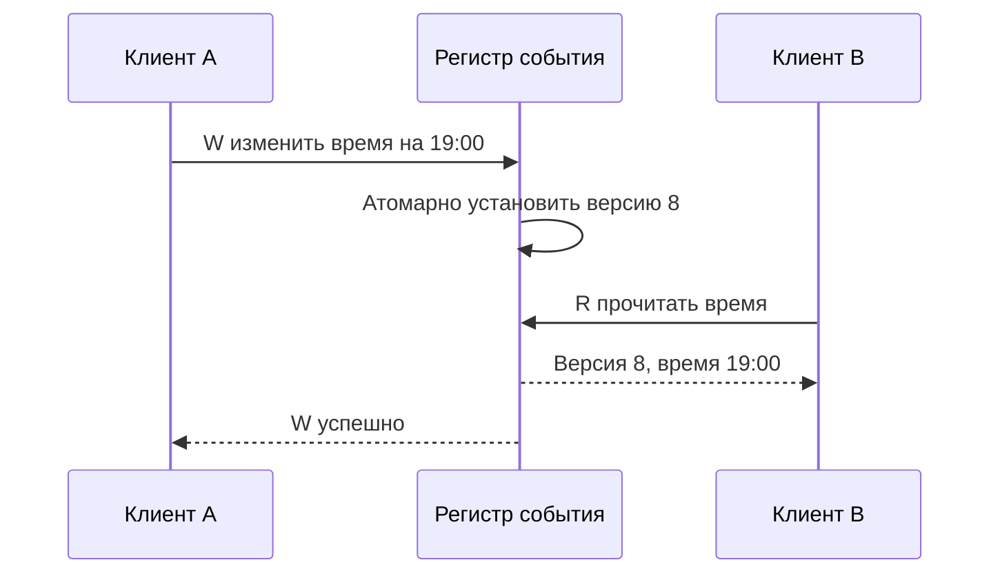
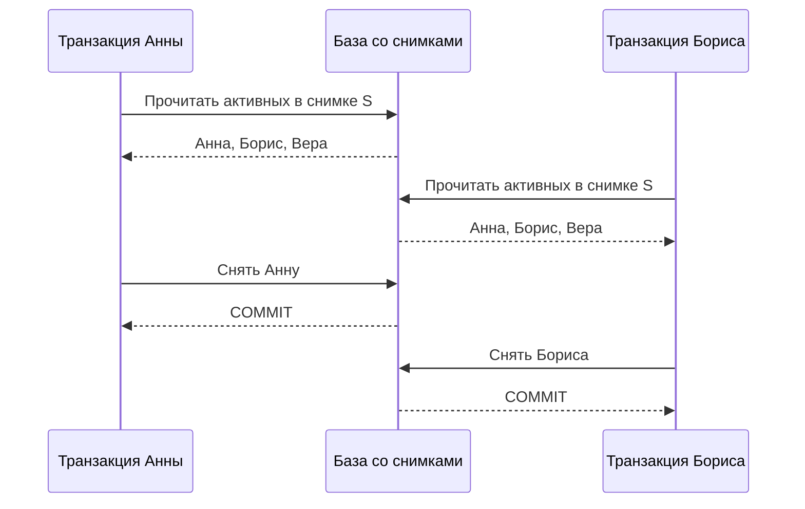
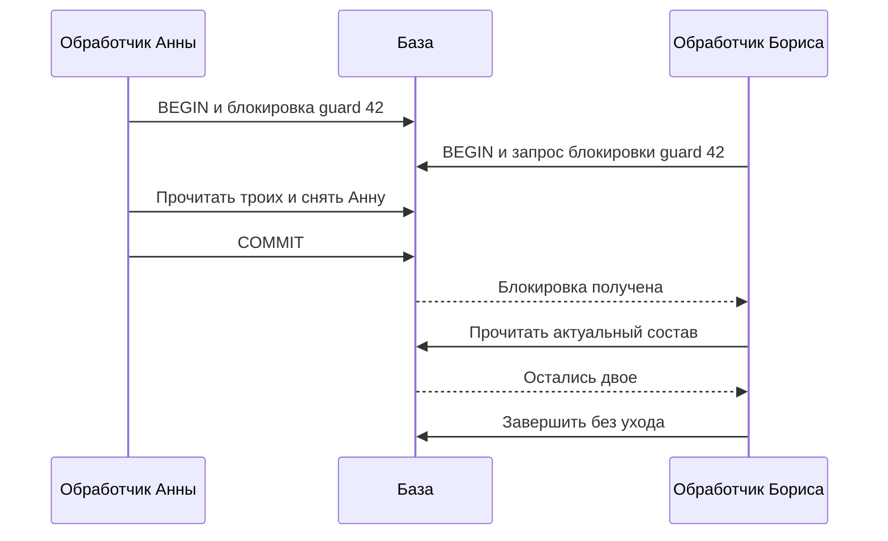
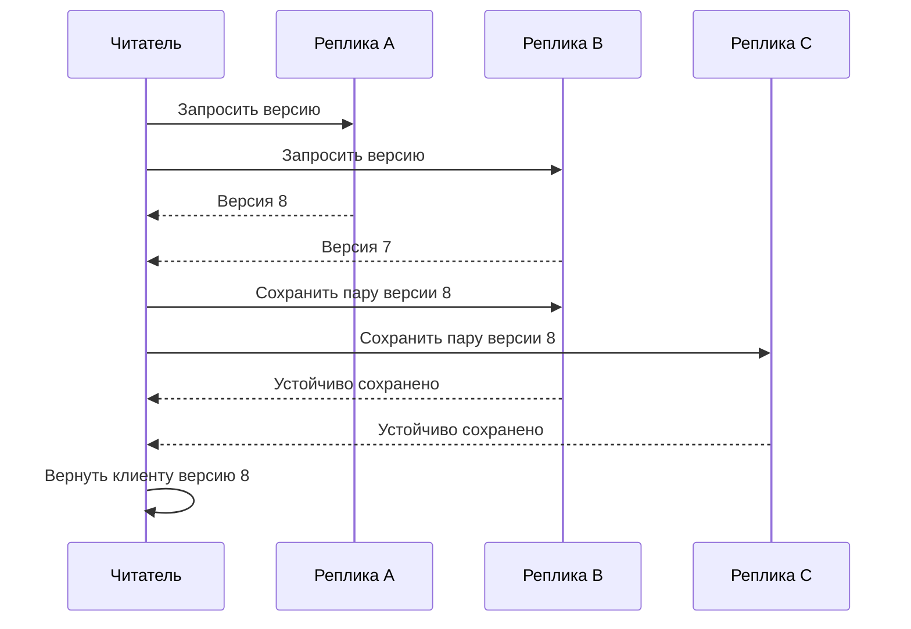

На ночном наблюдении «Клуба» должны присутствовать хотя бы два взрослых организатора. Сейчас дежурят Анна, Борис и Вера. Анна и Борис одновременно снимают себя с дежурства. Каждый видит троих и рассуждает правильно: «После моего ухода останутся двое». Оба изменения успешно сохраняются. В итоге остаётся одна Вера.

Ни одна строка не потеряна, грязных чтений нет, каждая транзакция атомарна. Нарушено правило, которое охватывает несколько строк. Чтобы объяснить сбой, недостаточно сказать «нужна сильная согласованность». Нужно выбрать точную гарантию и показать историю, которую она запрещает.

Все имена, числа и расписания ниже — учебные. После блока вы сможете различить гарантии одного объекта и группы операций, найти цикл зависимостей и защитить инвариант двумя способами.

## Модель: что узлы знают после перезапуска

В первой части главы есть клиенты и одна логическая база. Клиент хранит ID намерения, отправляет команду и ждёт результат. База хранит строки, версии и сведения о завершённых транзакциях устойчиво: перезапуск процесса не возвращает уже подтверждённые строки к предыдущему состоянию. Мы не рассматриваем уничтожение всех носителей и злонамеренные узлы. Сеть может задерживать, повторять и терять сообщения; клиент может остановиться после любого шага.

Во второй части базу заменят три реплики A, B и C. Каждая хранит пару «номер версии, значение». Подтверждение реплики означает, что пара переживёт предусмотренный моделью перезапуск. Если реализация отвечает до устойчивого сохранения, приведённое дальше доказательство к ней не относится. Состав тройки фиксирован: замена узла требует отдельного протокола переноса состояния.

Разделяем два инварианта. Для регистра времени начала события завершённое чтение не должно двигаться назад после уже завершённого чтения нового значения, если не было более поздней записи. Для дежурства после каждого подтверждённого изменения должны оставаться минимум двое. Первый касается истории одного объекта, второй — общего состояния нескольких строк. Их нельзя доказать одной фразой «у базы есть ACID».

## История состоит из вызовов и результатов

Обозначим чтение `r(x) → 0`, запись `w(x=1) → OK`. Для каждой операции фиксируем клиента, начало, завершение, результат и идентификатор попытки. Если ответ отсутствует, записываем неизвестный исход. Таймаут нельзя автоматически заменять отменённой операцией в проверяемой истории.

Предположим, `x` — признак открытия регистрации. Клиент A закончил запись `x=1` в момент 10. Клиент B начал чтение в момент 12 и получил 0. Если между операциями не было нового изменения, такое чтение нарушает обещание линеаризуемого регистра. Запись завершилась раньше, чем началось чтение.

Если чтение началось в момент 9, а закончилось в момент 13, оно пересекается с записью. Тогда старое значение может быть допустимым: чтение можно расположить перед записью внутри перекрывающегося интервала. Реальное время здесь задаёт порядок только для непересекающихся операций.

Линеаризуемость требует представить каждую операцию как один мгновенный шаг между её вызовом и ответом, сохранив порядок непересекающихся вызовов и спецификацию объекта. Для незавершённых вызовов проверка рассматривает допустимое завершение или исключение; она не объявляет их все неисполненными. Формальное определение дано в [работе Herlihy и Wing](https://cs.brown.edu/~mph/HerlihyW90/p463-herlihy.pdf), раздел 2.

В практическом тесте часы клиентов могут расходиться. Поэтому порядок лучше устанавливать наблюдаемой причинностью: клиент получил ответ записи и только затем отправил чтение. Одна пара несогласованных временных меток с разных машин не является достаточным доказательством нарушения.

### Точка линеаризации — не обязательно момент ответа

На следующей диаграмме «Публикация времени встречи» читайте сообщения сверху вниз. Запись W ещё не вернула ответ, но уже изменила логическое состояние; пересекающееся чтение R может наблюдать новое значение. В учебной реализации точкой линеаризации служит атомарная смена версии в базе. В другом протоколе место доказательства может быть иным.

Текстовый ход: A начинает запись; регистр меняет состояние; B читает новую версию; затем A получает ответ. Линеаризация W располагается до R, хотя ответ W пришёл позже. Сортировка только по времени ответов дала бы неверное объяснение этой истории.

Если A упадёт до получения ответа, W останется незавершённой с точки зрения клиента. Наблюдение B позволяет включить W в объясняющую последовательность как выполненную. Поэтому проверяющий историю не должен выбрасывать все запросы с таймаутом: иногда именно они объясняют видимые значения. В журнале теста сохраняйте полный ID попытки и оба события — вызов и ответ, если он появился.

Для поиска контрпримера попробуйте разместить операции в разрешённых интервалах. Если R началась строго после успешного ответа W, но вернула старую версию, передвинуть R перед W уже нельзя. Если подходящего порядка нет, найдена нарушающая история. Проверка одной истории способна опровергнуть гарантию; тысяча успешных историй не доказывает её для всех возможных исполнений.

## Почему линеаризуемых строк недостаточно для транзакции

Теперь есть два объекта: `available` и `reserved`. Даже если операции над каждым объектом линеаризуемы, последовательность «прочитать первый, прочитать второй, изменить оба» не превращается в одну атомарную транзакцию. Между шагами другой клиент успеет выполнить свою работу.

Сериализуемость говорит о группе транзакций: их результат должен соответствовать некоторому последовательному выполнению, будто транзакции исполнялись по одной. При этом одна только сериализуемость не обязательно требует сохранять реальное время между клиентскими транзакциями. Для этого добавляют требование реального порядка и говорят о строгой сериализуемости.

Разница важна на собеседовании. «Каждая запись атомарна» отвечает на вопрос об отдельном изменении. «Все транзакции сериализуемы» отвечает на вопрос о взаимодействии многошаговых действий. «Чтение видит завершённую запись» добавляет временное требование. Одно название не подменяет остальные.

Проверим дежурство последовательным исполнением. Если первой ушла Анна, Борис затем видит только двоих и должен остаться. Если первым ушёл Борис, остаться должна Анна. Ни один порядок не даёт одну Веру. Значит, история с двумя успешными уходами несериализуема при указанной логике транзакций.

Сериализуемость не исправляет неверное бизнес-правило. Если программа снимает дежурного без проверки числа оставшихся, последовательное выполнение тоже нарушит требование. Сначала покажите корректность отдельной транзакции, затем выберите изоляцию, сохраняющую это рассуждение при конкуренции.

## Конкретный сбой: write skew

В snapshot isolation транзакция работает со стабильным снимком, а конкурентные изменения одной и той же записи ограничиваются правилами конфликта записи. Однако транзакции могут читать общие данные и изменять разные строки. Тогда прямого столкновения записей недостаточно для обнаружения нарушенного правила.

Ниже `active=true` обозначает дежурного. Обе транзакции стартуют со снимком, в котором активны трое.

| Шаг | Транзакция Анны | Транзакция Бориса | Зафиксированное состояние |
|---|---|---|---|
| 1 | Читает число активных: 3 | Ещё не начала проверку | Анна, Борис, Вера |
| 2 | Решает, что уход допустим | Читает свой снимок: 3 | Анна, Борис, Вера |
| 3 | Меняет строку Анны на false | Решает, что уход допустим | Изменения ещё не зафиксированы |
| 4 | COMMIT | Меняет строку Бориса на false | Борис, Вера |
| 5 | Ответ об успехе | COMMIT и ответ об успехе | Только Вера |

Это пример write skew: решения основаны на прочитанном состоянии, а изменения разнесены по разным строкам. Название не означает «двое перезаписали одно поле». Здесь как раз нет общего обновляемого поля, которое заставило бы операции напрямую конфликтовать.

Удобно построить зависимости. Анна прочитала Бориса активным, а Борис изменил это значение: чтобы сохранить наблюдение Анны в последовательной истории, её транзакция должна идти раньше Бориса. Симметрично Борис должен идти раньше Анны. Получается цикл, который невозможно превратить в последовательный порядок. Snapshot isolation и связанные аномалии разобраны в [A Critique of ANSI SQL Isolation Levels](https://www.microsoft.com/en-us/research/wp-content/uploads/2016/02/tr-95-51.pdf).

### Почему снимок не может сам запретить write skew

Диаграмма «Два правильных локальных решения» показывает чтения из одинакового снимка. Обратите внимание: каждая транзакция обновляет свою строку, поэтому ожидания записи в одну общую строку здесь нет.

Текстовый ход: обе транзакции читают троих; первая выключает Анну, вторая Бориса; обе фиксируются, поскольку меняют разные строки. Получившийся результат запрещён бизнес-правилом, хотя каждый снимок внутренне непротиворечив. Добавление повторного чтения внутри того же неизменного снимка не исправляет решение: транзакция снова увидит троих.

## Два способа защитить правило

Первый вариант — создать общую точку сериализации: строку `event_guard` для события и блокировать её перед проверкой дежурства. Все пути изменения состава должны брать ту же блокировку. При Read Committed в PostgreSQL можно сначала получить строку через `SELECT ... FOR UPDATE`, а затем отдельным запросом проверить актуальное число дежурных и выполнить изменение в той же транзакции.

Именно порядок имеет значение. Прочитать число до ожидания блокировки, а затем использовать старый результат — ошибка. Снимок уровня Repeatable Read тоже требует отдельного анализа: простая блокировка неизменяемой строки не обновляет весь снимок. Нельзя переносить доказательство для одного уровня изоляции на другой без проверки.

Цена общей строки — последовательная обработка изменений одного события. Для редких смен организаторов это может быть приемлемо. При высокой конкуренции очередь блокировки вырастет. Зато механизм легко объяснить и проверить на маленькой истории. Добавление новой функции «заменить всех дежурных» обязано соблюдать тот же протокол.

Второй вариант — выполнять проверку и изменение в Serializable с обработкой отказа сериализации. PostgreSQL отслеживает опасные зависимости и может отменить одну из транзакций. Приложение повторяет всю транзакцию с новым снимком, а не только последний UPDATE. После повторной проверки один уход окажется запрещён бизнес-правилом. Конкретные гарантии и требования к повторам описаны в [документации PostgreSQL об изоляции](https://www.postgresql.org/docs/current/transaction-iso.html).

Этот вариант уменьшает число ручных протоколов блокировки, но требует общего пути обработки конфликтов, ограничения повторов и наблюдения за их частотой. Все операции, участвующие в инварианте, должны быть совместимы с выбранным доказательством. Внешнее письмо нельзя отправлять без защиты внутри повторяемого тела: отмена SQL-транзакции не заберёт уже доставленное уведомление.

### Нормальный протокол общей блокировки и восстановление

Пусть одна строка `event_guard(42)` существует весь срок жизни события. Протокол состоит из пяти шагов: начать транзакцию, заблокировать guard, отдельным запросом прочитать состав, при допустимом остатке изменить участника, зафиксировать. Уведомление помещается в outbox той же транзакции, а отправляется после фиксации. Защита действует только тогда, когда все изменения состава проходят через этот путь.

Диаграмма «Общая граница изменения состава» показывает, почему второй обработчик проверяет правило после первого. Ожидание блокировки не считается успешной проверкой; после него читаются данные для нового решения.

Текстовый ход: Анна удерживает общую блокировку и фиксирует уход. Борис получает её только после освобождения, видит двоих и отказывает в собственном уходе. Если транзакция Анны откатится, Борис увидит троих и сможет уйти. В обоих случаях подтверждённых уходов не больше разрешённого числа.

Падение до COMMIT не оставляет половину изменения как завершённую транзакцию. Падение после COMMIT, но до ответа создаёт неизвестный клиенту исход: повтор находит прежний результат по ID. Логика восстановления не пытается угадать исход по длительности паузы. База восстанавливает факт фиксации, приложение восстанавливает пользовательский ответ.

Индуктивное объяснение короткое: до первого изменения инвариант выполнен; очередной владелец guard видит результат предыдущего владельца и разрешает только сохраняющий инвариант переход. Следовательно, после каждого завершённого шага правило остаётся истинным. Доказательство ломается, если импорт данных или административная команда меняет состав без guard.

Цена также измерима. При условных 20 миллисекундах удержания блокировки одна такая последовательная граница обслуживает не более примерно 50 изменений/с без учёта накладных расходов. Тысяча независимых событий может обрабатываться параллельно, но один горячий объект остаётся ограниченным. В «Клубе» смены дежурных редки, поэтому выбираем guard: проще проверить все пути изменения. Для множества разнородных взаимосвязанных правил предпочтение может сместиться к Serializable с контролем повторов.

## Сессионные гарантии: полезны, но уже глобальной модели

Read-your-writes обещает клиенту видеть собственные подтверждённые изменения. Monotonic reads запрещает его сессии возвращаться к более старой виденной версии. Это не означает, что другой клиент видит то же самое. Один пользователь может иметь два устройства, которые считаются разными сессиями, если договор не предусматривает перенос контекста.

Практический контекст сессии может хранить минимальную позицию журнала. После записи сервер возвращает позицию 812. При следующем чтении клиент передаёт её, а обработчик ждёт реплику, достигшую как минимум 812, либо выбирает другой узел. Сбой после выдачи позиции не делает её ложной, если подтверждённый журнал устойчив. При потере контекста приложение должно восстановить его или явно вернуться к более слабому режиму.

Наивное «читайте с того же сервера пять секунд» опирается на прогноз задержки. Оно нарушится, если репликация отстанет на десять секунд или процесс перезапустится. Позиция связывает чтение с конкретным изменением. Однако в системе с несколькими независимыми шардами одного числа может быть недостаточно: нужен контекст соответствующих журналов и способ сохранить причинные зависимости.

## Почему пересечение кворумов требует протокола версий

Рассмотрим один регистр времени встречи и три реплики. Писатель W единственный и последовательно нумерует записи. Его номер устойчив и не повторяется после перезапуска. Реплика сохраняет только пару с номером не меньше своего текущего. Запись завершается после устойчивого подтверждения двух реплик. Для простоты предполагаем, что читатель может получить ответ от любых двух.

Наивное чтение запрашивает две реплики и возвращает максимальную версию. Оно видит любую завершённую запись: группы из двух узлов пересекаются. Но есть контрпример с незавершённой записью. Версия 8 дошла только до A, а W остановился. Первое чтение получает A+B и возвращает 8. Следующее, начавшееся после его ответа, получает B+C и возвращает 7. Завершённые чтения пошли назад без новой записи.

Чтобы понять исправление, читайте диаграмму «Чтение распространяет выбранную версию». Она показывает обязательную вторую фазу: найденное значение нужно устойчиво закрепить на большинстве прежде, чем вернуть его клиенту.

Текстовый ход: читатель выбирает максимум из ответов, затем распространяет эту пару на большинство и ждёт подтверждений. Следующее чтение большинства пересечётся с закреплённой парой и не выберет меньший номер. Узлы никогда не уменьшают версию, поэтому задержавшееся старое сообщение не отменит результат. Это учебное объяснение идеи двухфазного чтения атомарного регистра; первичный алгоритм приведён в [Sharing Memory Robustly in Message-Passing Systems](https://groups.csail.mit.edu/tds/papers/Attiya/JACM95.pdf).

Если читатель упадёт до второй фазы, он ничего не успел обещать. Если после части подтверждений, но до ответа, другие чтения могут сохранить более новую пару; это допустимое развитие незавершённой операции. Возобновлённый читатель не должен отправлять клиенту старое предварительное значение без выполнения протокола. Если большинство недоступно, операция ждёт или завершается технической ошибкой, а не выдаёт неподтверждённое значение как строгое.

Для нескольких писателей счётчик одного процесса уже недостаточен. Потребуется протокол получения версии и уникального упорядочения конкурирующих писателей, например составная метка; это дополнительная часть доказательства. Для нескольких полей атомарный регистр также не даёт общей транзакции. Нельзя копировать формулу `R+W>N` в архитектуру и пропускать эти границы.

При условном сетевом RTT 12 миллисекунд чтение в две последовательные фазы требует порядка 24 миллисекунд сетевого ожидания плюс сохранение и обработка, если обе фазы завершаются за один такой обмен. Медленная реплика не обязательно задержит большинство, но потеря двух узлов остановит строгий путь. Чтение одной ближайшей копии может быть быстрее, однако выбирается лишь для каталога с допустимым устареванием, а не для разрешения занять последнее место.

## Где в этом месте появляется CAP

Разделим «Клуб» на два региона, связь между которыми пропала. Оба видели троих дежурных. Если каждый независимо подтвердит уход своего организатора, после объединения снова останется один. Локальная Serializable в каждой базе не делает общую историю автоматически сериализуемой.

Для сохранения глобального правила можно разрешить изменение только стороне с нужными полномочиями и доступом к координации. Другая сторона временно не подтверждает уход. Можно также заранее распределить ограниченные права: при трёх дежурных право снять одного существует только в одном экземпляре, и регион без права не тратит его. Это отдельный протокол, а не бесплатное следствие репликации.

CAP показывает невозможность одновременно сохранить линеаризуемость и ответ на каждый запрос к исправному узлу в модели, допускающей разделение сети. Прикладной быстрый ответ «не могу подтвердить» полезен, но не считается успешным выполнением операции согласно такой гарантии доступности. Формулировку и модель проверяйте по [работе Gilbert и Lynch](https://www.comp.nus.edu.sg/~gilbert/pubs/BrewersConjecture-SigAct.pdf).

Ослабить договор тоже можно: разрешать только предварительную заявку на уход, окончательно подтверждая её после согласования. Тогда пользователь должен ясно видеть предварительное состояние. Нельзя называть его окончательным успехом, а затем незаметно отменять обещание.

## Практика: защищаем минимум двух дежурных

Спроектируйте смену состава для события с четырьмя дежурными. Одновременно приходят три запроса на уход, причём один клиент после таймаута повторяет запрос. Представьте историю не менее чем из восьми шагов. Выберите общую блокировку или Serializable и объясните, какие операции завершатся успешно. Затем разделите сервис на два региона и назначьте правило работы при потере связи.

### Подсказка 1

Не начинайте с названия базы. Запишите инвариант и допустимое число успешных уходов: после любого подтверждённого шага остаются минимум двое.

### Подсказка 2

Отделите технический повтор от нового намерения. Повтор одного ухода не должен ещё раз уменьшить счётчик или создать второе уведомление.

### Подсказка 3

После ожидания или отмены используйте актуальные предпосылки. Успешный повтор всей транзакции может вернуть бизнес-отказ, и это нормальное завершение обработки.

### Разбор и критерии

Из четырёх человек могут уйти максимум двое. Кто именно — зависит от допустимого порядка операций. Третий получает отказ по правилу состава. Повтор уже выполненного намерения возвращает его результат либо согласованное состояние без нового эффекта. При разделении регионов выбранный протокол должен объяснить, почему обе стороны не расходуют одно право одновременно.

Работа принята, если история содержит начала, ответы и неизвестный исход; есть доказательство инварианта после каждого коммита; повтор не создаёт второй эффект; описана цена выбранной изоляции. Ответ «поставим Serializable» без границы транзакции и политики регионов недостаточен.

## Практика 2: найдите историю, которую скрывает hit rate

Реплики A, B и C содержат версии 12, 11 и 11. Писатель версии 12 получил подтверждение только A и остановился. Клиент P читает A+B, затем клиент Q после ответа P читает B+C. Сначала исполните чтение без распространения, затем с обязательной второй фазой. Добавьте падение P между сохранением на B и ответом клиентскому приложению.

### Подсказки

Первая: неизвестный исход писателя не запрещает последующим операциям обнаружить его версию. Вторая: для проверки важен порядок завершённых чтений P и Q. Третья: различайте ответ одной реплики и завершение всей операции чтения.

### Решение

Без второй фазы P вернёт 12, а Q — 11: допустимого линеаризуемого объяснения для завершённых чтений нет. С распространением P сначала закрепляет 12 на большинстве; Q получает хотя бы одну пару с номером не меньше 12 и тоже завершает свою фазу распространения. Если P упал до ответа, возвращённого клиенту значения пока нет, но частично разосланная 12 остаётся допустимым знанием для Q.

Работа принята, если объяснение использует состав конкретных групп, устойчивость пар и отсутствие уменьшения версии. Фраза «большинство гарантирует» без второй фазы и модели отказов не засчитывается. Для переноса замените одного писателя двумя: перечислите новые вопросы, которые нельзя решить прежним локальным счётчиком.

## Вопрос на интервью

**«Все записи нашего key-value-хранилища линеаризуемы. Значит ли это, что перевод между двумя балансами корректен?»**

Сильный ответ сначала уточняет атомарную единицу API. Два отдельных изменения не образуют транзакцию только из-за линеаризуемости каждого объекта. Далее кандидат предлагает атомарную операцию над общей моделью либо протокол, сохраняющий инварианты при промежуточных состояниях и сбоях. Полезное продолжение — показать конкретную историю списания без зачисления и назвать наблюдаемый пользователем результат.
