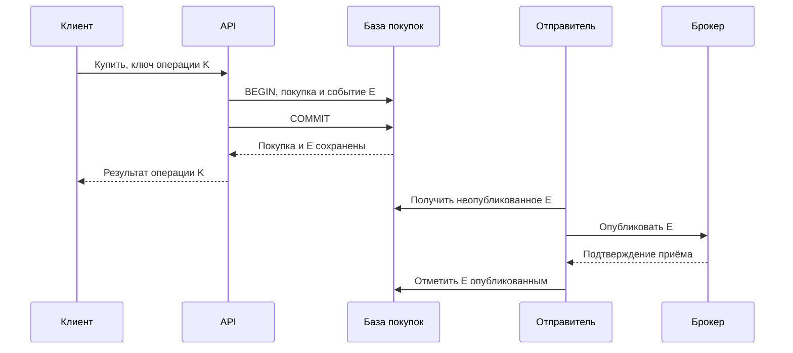
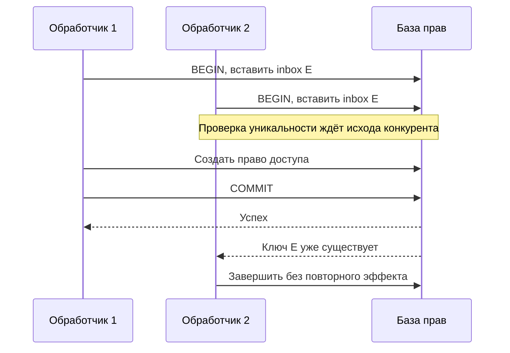
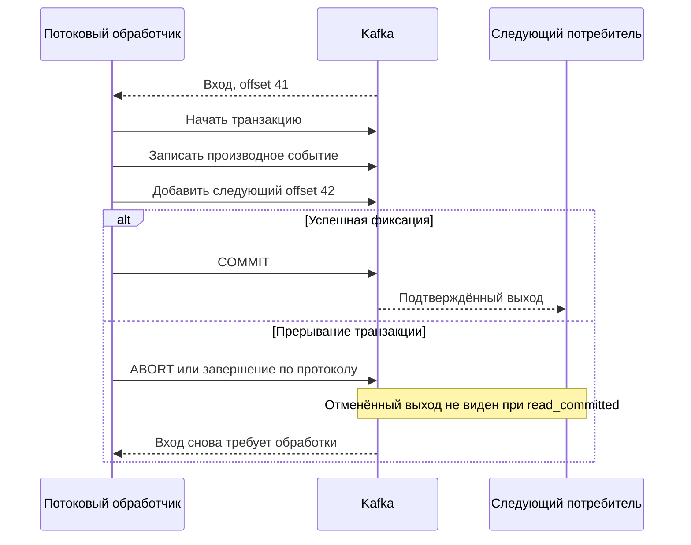
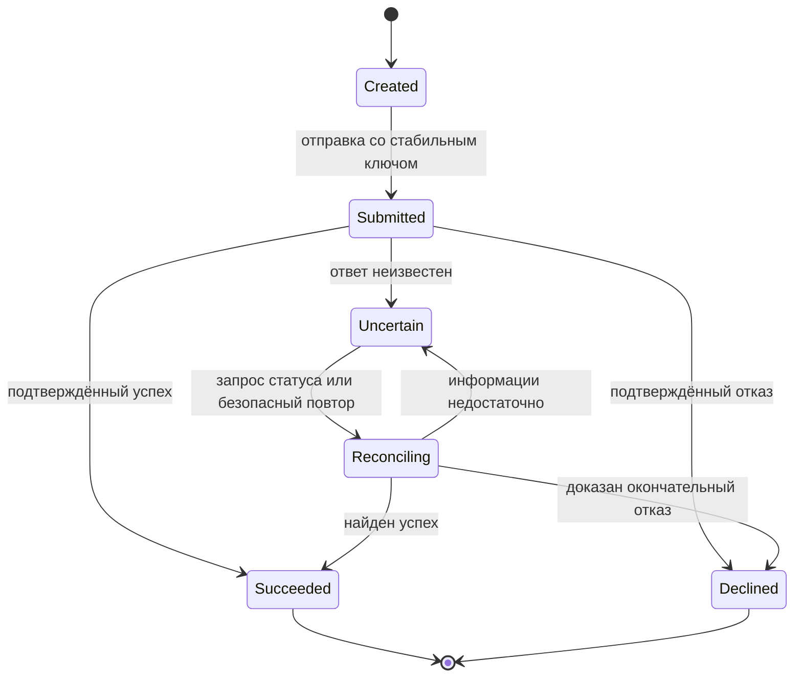

Обработчик Клуба получил событие об оплате интенсива, выдал доступ и отправил письмо. Затем процесс завершился до сохранения позиции чтения в брокере. Новый процесс получил то же событие. Разработчик включил транзакции брокера, но второе письмо всё равно ушло. Настройка не была бесполезной: просто письмо находилось за пределами её гарантии.

В этом блоке мы будем считать отдельными объектами запись в базе, сообщение в журнале, позицию потребителя и результат внешнего вызова. Для каждого понадобится ответить: кто хранит результат, чем узнаёт повтор и какие изменения фиксируются вместе. Фраза exactly-once становится содержательной только после указания этой границы.

## Четыре факта вместо одного статуса

У Клуба есть операция `purchase-204`, событие `event-817` и уведомление `notice-204-confirmed`. Они связаны, но не взаимозаменяемы. Повтор публикации сохраняет ID события. Повтор запроса оплаты сохраняет ID намерения пользователя. Новое уведомление об изменении расписания имеет другой ID, хотя относится к той же покупке.

Если назначать случайный ID каждой попытке доставки, получатель не отличит повтор от нового события. Если использовать только ID покупки, можно ошибочно подавить все последующие события этой покупки. Ключ дедупликации отражает конкретный эффект: например, выдачу доступа по определённой операции или отправку определённого вида уведомления.

Слово «обработано» также неоднозначно. Событие могло быть прочитано из сети, сохранено локально, применено к данным или подтверждено брокеру. Клуб хранит явные состояния и не использует один флаг для всей цепочки. Особенно опасен флаг `sent`, если неизвестно, означает ли он принятие письма провайдером или доставку в почтовый ящик.

## Трасса, в которой возникает повтор

Предположим, входное событие занимает offset 41 в одном разделе журнала. Сохранённая позиция потребителя указывает на следующий offset 41. После успешной обработки он должен сохранить 42. В таблице все номера условные; смысл позиции зависит от API конкретного клиента.

| Шаг | Действие | Долговечное состояние | Последствие падения |
|---|---|---|---|
| 1 | Прочитать событие 41 | Позиция по-прежнему 41 | Событие будет прочитано снова |
| 2 | Записать право доступа | Право есть в SQL | Повтор может ещё раз применить эффект |
| 3 | Вызвать почтовый сервис | Письмо могло быть принято | Локально результат может остаться неизвестным |
| 4 | Сохранить позицию 42 | Брокер помнит продвижение | Обычный restart начнёт со следующего события |

Если перенести шаг 4 перед шагом 2, повторов станет меньше, но появится потеря: процесс упадёт после продвижения позиции, а право доступа не создаст. Если оставить шаг 4 последним, требуется защита повторяемого эффекта. Перестановка операций не создаёт общей атомарности.

Для наблюдаемого результата нужно различать safety и liveness. Защита от дубля отвечает за то, что лишний эффект не произойдёт. Возможность в конце концов завершить обработку зависит от повторов, доступности хранилищ, сохранности события и разбора постоянных ошибок. Таблица inbox сама не вытащит сообщение из забытой DLQ.

## Вариант первый: SQL хранит результат и память о нём

Обработчик начинает транзакцию в своей базе. Он пытается вставить строку в inbox с уникальным ключом получатель/ID события. Если вставка действительно новая, изменяет право доступа и фиксирует транзакцию. Если ключ уже существует, проверяет, что прежняя обработка относится к тому же содержанию, и не повторяет эффект. После этого можно продвинуть позицию брокера.

```text
BEGIN
  зарегистрировать event-817 в inbox с уникальным ключом
  если событие новое: создать право доступа
COMMIT
после commit: подтвердить обработку брокеру
```

Оба изменения должны находиться в одной базе и одной транзакции. Два параллельных обработчика не могут решать вопрос через отдельный SELECT «есть ли ID»: оба могут увидеть отсутствие. За конкуренцию отвечает уникальное ограничение и корректная обработка конфликта. Если вставка ID не прошла, бизнес-изменение этой попытки не выполняется.

Падение до commit отменяет обе записи. Падение после commit, но до подтверждения вызывает повтор, который встречает inbox. Такой механизм даёт один зафиксированный эффект в этой базе при сохранении событий и корректном повторе. Он не обещает, что код обработчика выполнится только один раз: код может стартовать много раз.

Можно вместо ID каждого события сохранять позицию раздела рядом с результатом. Тогда выходные данные и позиция фиксируются вместе, а после restart потребитель начинает с позиции из базы. Этот вариант требует строгого владения разделом, непрерывной обработки и защиты от старого владельца после перераспределения. При параллельной обработке нельзя записать позицию после события 45, пока 44 ещё не завершилось: restart пропустит пробел.

Inbox с отдельными ID проще для независимых событий, но занимает место. Историю нельзя чистить только потому, что событие старое. Сначала определяют максимальный срок повторной доставки, ручного replay, восстановления копии и повторной публикации. Если удалённый ID ещё может вернуться, гарантия дедупликации закончилась. Для необратимого эффекта полезно иметь и постоянный бизнес-ключ, а не полагаться только на временный inbox.

## Вариант второй: вход и выход остаются в журнале

Если обработчик читает события Kafka и публикует производные события обратно в Kafka, транзакция может связать выходные записи с продвижением позиции входа. Потребители с `read_committed` не должны видеть отменённые транзакционные записи. При прерывании обработки вход будет доступен для повторного вычисления, а незавершённый выход не станет видимым как подтверждённый результат.

Область этой гарантии — согласованная работа входного и выходного журналов в рамках механизма Kafka и его настроек. Обычный HTTP-вызов, запись в произвольную SQL-базу и отправка email туда автоматически не входят. Идемпотентный producer также решает более узкую задачу повторов публикации; он не заменяет всю транзакцию приложения. Эти границы описаны в [документации Kafka о доставке и транзакциях](https://kafka.apache.org/41/design/design/).

Для Клуба второй вариант подходит преобразованию события просмотра в агрегируемое событие аналитики. Первый подходит выдаче права в SQL. Их можно сочетать, но на каждой границе нужно заново определить атомарность. Слово «транзакционный» в названии соседнего компонента не переносит гарантию через сеть.

## Outbox связывает причину с будущей публикацией

При покупке Клуб одновременно сохраняет её состояние и событие в outbox. Это устраняет окно «покупка есть, намерение уведомить потеряно». Отправитель публикует событие и только после подтверждения отмечает строку опубликованной. Между этими действиями остаётся повтор, поэтому получатели всё равно должны его выдерживать.

При нескольких отправителях нужен способ распределить строки и восстановить зависшую работу. Порядок событий одного объекта требует отдельного решения: порядковый номер, маршрутизация по ключу и проверка версий у получателя. Outbox сам по себе не означает глобального порядка.

Повторное событие с тем же ID, но другим содержанием следует считать конфликтом, а не безопасным повтором. Полезно сохранять тип, версию схемы и отпечаток существенных параметров. Иначе ошибочный отправитель способен заменить смысл события, а получатель молча ответит «уже обработано». [AWS описывает outbox](https://docs.aws.amazon.com/prescriptive-guidance/latest/cloud-design-patterns/transactional-outbox.html) именно как решение проблемы двойной записи, а не универсальную гарантию внешних эффектов.

## Почта и платёж оставляют неопределённый результат

Провайдер принял письмо, но соединение оборвалось до ответа. Запись в локальном inbox не может установить, что произошло в чужой системе. Если перед вызовом отметить уведомление завершённым, возможна потеря; если после — возможен повтор. Устранить эту неопределённость без участия внешнего сервиса нельзя простой перестановкой флагов.

Если провайдер поддерживает идемпотентный запрос, Клуб передаёт стабильный ключ и соблюдает его область, срок хранения и правила параметров. Подтверждение приёма письма всё равно не равно единственной доставке в ящик: дальнейшая почтовая цепочка имеет собственное поведение. Обещание пользователю должно соответствовать наблюдаемому событию.

Для оплаты контракт строже. Клуб сохраняет ID намерения и ключ до первой попытки, а после таймаута использует тот же ключ либо запрос состояния. Нельзя породить новый ключ только из-за неизвестного результата. При истечении срока хранения ключа сначала нужна сверка операции, иначе новый вызов может создать второй эффект. Конкретные условия всегда берут из [контракта провайдера, например Stripe](https://docs.stripe.com/api/idempotent_requests), а не переносят между сервисами.

Для провайдера без дедупликации Клуб выбирает явную политику. Необязательное письмо можно повторить с допустимым риском дубля. Неопределённую денежную операцию переводят в состояние сверки и не объявляют неуспешной автоматически. Оператор получает ID, историю попыток и разрешённые действия. Ручное вмешательство тоже должно оставлять аудит и не обходить уникальность бизнес-операции.

## Полная модель одной покупки

Зафиксируем модель, чтобы проверить протокол. В первой базе находятся `purchase`, `outbox` и сведения о ключе клиентской операции. Во второй — `inbox`, право доступа и намерение уведомить. Почтовый или платёжный провайдер хранит свой результат независимо. Предполагаем, что локальные транзакции атомарны и подтверждённые данные переживают рассматриваемый сбой процесса. Потеря всех дисков выходит за эту модель и требует резервирования и восстановления отдельно.

Строка покупки содержит `purchase_id`, владельца, сумму в согласованных единицах и состояние. Строка outbox содержит `event_id`, `purchase_id`, тип, версию и неизменяемое содержимое события. Inbox имеет уникальную пару получатель/`event_id`. Право доступа дополнительно защищено уникальным бизнес-ключом, например покупка/курс. Это не лишнее дублирование: история транспорта может очищаться, тогда как правило выдачи доступа продолжает действовать.

Задание получателю состоит из ID события, данных и технического контекста доставки. Номер попытки допускается менять; смысл события — нет. Получатель не принимает присланный клиентом `purchase_id` как доказательство оплаты. Он доверяет только авторизованному источнику подтверждённого события в пределах заранее определённого контракта.

### Схема: намерение переживает падение API

Смотрите на границу commit: она связывает покупку и outbox, но не брокер.



1. API проверяет существующий ключ операции и параметры; другой смысл под тем же ключом является конфликтом.
2. Новая покупка и событие появляются одним commit. Если процесс падает раньше, нет ни одного из них.
3. Отправитель повторяет публикацию до подтверждённого исхода. Потерянное подтверждение не позволяет ему считать публикацию неуспешной, поэтому повтор имеет тот же ID.
4. Отметка публикации означает завершение работы отправителя, а не обработку всеми подписчиками. Для этого нужны другие наблюдения.

Если API упал после commit, клиент повторяет запрос с K и получает сохранённый результат. Если клиент придумал новый K, транспортная идемпотентность не узнает прежнее намерение. От нежелательной второй покупки защищает отдельное бизнес-правило, если продукт действительно запрещает её. Поэтому ограничения пользователя и ключ запроса решают разные задачи.

## Гонка двух потребителей: почему SELECT недостаточно

Допустим, срок аренды сообщения истёк, пока первый обработчик ждал базу. Второй получил тот же E. Оба сделали SELECT по inbox и увидели отсутствие строки. Если после этого независимо увеличат баланс, эффект произойдёт дважды. Даже последовательность «сначала SELECT, потом INSERT» безопасна только при корректном использовании уникальности и откате бизнес-изменения при конфликте.

### Схема: конкурентность останавливает ограничение базы

Смотрите, что второй обработчик не выполняет эффект до разрешения конкуренции за уникальный ключ.



Если первая транзакция отменится, вторая должна получить возможность зарегистрировать событие и применить эффект. Если первая завершится, вторая распознаёт повтор. Конкретные ответы драйвера и состояние транзакции после конфликта различаются: реализация должна обработать их по контракту базы, а не продолжать работу после любой ошибки как ни в чём не бывало.

Инвариант доказывается через два случая. До commit право и запись inbox не видны как завершённая пара; после commit существуют оба. Уникальность допускает только одну успешно зафиксированную регистрацию E для этого получателя. Поскольку эффект выполняется лишь у победившей регистрации и находится в той же транзакции, две конкурирующие доставки не могут зафиксировать два эффекта по E. Доказательство перестаёт работать, если часть эффекта вынесена во внешний вызов.

Для прогресса вида «установить версию 14» полезна ещё проверка версии объекта. Inbox защищает от повторного E, но не от другого события E2 с устаревшей версией 13. Идентичность сообщения и порядок бизнес-состояний — независимые измерения правильности. Событие, которое нельзя применить из-за отсутствия предшественника, не следует необратимо помечать успешно выполненным без выбранной политики восстановления.

## Транзакция журнала: нормальный путь и прерывание

В потоке аналитики исходный offset 41 превращается в выходное событие. Потребитель использует транзакционный producer, публикует результат и включает следующий входной offset в ту же транзакцию с корректным контекстом группы. После успешного commit downstream с выбранной изоляцией видит результат, а входная позиция продвигается согласованно.

### Схема: выход и продвижение позиции имеют общий исход

Здесь нет SQL и почты. Это намеренное ограничение схемы, а не пропущенные стрелки.



При отмене нельзя просто продолжить с текущей позиции в памяти: приложение должно восстановить корректную позицию и состояние обработки по используемому API. Смена владельца раздела тоже требует корректного завершения или отмены. Готовая библиотека может управлять частью этих шагов, но автор системы обязан знать границу её ответственности.

Транзакция может содержать результаты нескольких входов. Это уменьшает накладные расходы на фиксацию, но увеличивает время до видимого результата и объём повторной работы при отмене. Долгая открытая транзакция также задерживает наблюдение данных в соответствии с механизмом чтения. Размер пакета выбирают по бюджету задержки и восстановлению, а не только по максимальной пропускной способности.

## Внешнее списание: состояние uncertain нельзя назвать failed

Для симулятора оплаты определим состояния `created`, `submitted`, `uncertain`, `succeeded`, `declined`, `reconciling`. `submitted` означает, что попытка отправлена, а не деньги списаны. `declined` допускается только по достоверному отрицательному результату согласно контракту провайдера. Истечение таймаута приводит в `uncertain`, потому что операция могла завершиться без доставленного ответа.

### Схема: неопределённость разрешается сверкой

Смотрите, что из таймаута нет автоматической стрелки к новой независимой покупке.



Перед первой отправкой Клуб сохраняет параметры и ключ. После неоднозначного ответа планировщик сверки получает ту же операцию, а не создаёт новую. Если провайдер позволяет запросить статус, использует ID; если гарантирует повтор по ключу, соблюдает срок и параметры. Уведомления провайдера рассматриваются как повторяемые сообщения и применяются идемпотентно. Поздний успех не должен быть отброшен только потому, что прежняя попытка ожидания завершилась.

Планировщик имеет ограниченные повторы и сигнал о долгой неопределённости. Человеку передаются безопасные идентификаторы и допустимые команды, а не предложение «нажать оплатить ещё раз». Если сверка выявила успех после освобождения места, требуется отдельный бизнес-процесс возврата или замены. Он получает собственный ID и собственные состояния: компенсация не удаляет факт первоначального списания.

## Сверка платежа как самостоятельный рабочий протокол

Чтобы состояние `uncertain` не стало вечным, зададим запись сверки: ID покупки, ключ провайдера, хеш исходных параметров, известный внешний ID, следующий срок проверки и последнее подтверждённое наблюдение. Несколько работников могут искать зависшие операции, поэтому получение работы имеет ограниченную аренду и номер попытки. Потеря аренды не разрешает создать новую оплату: все попытки продолжают ссылаться на то же намерение.

Нормальная проверка сначала читает состояние покупки. Если успех уже подтверждён другим каналом, работник не повторяет списание и завершает своё задание. Иначе обращается к разрешённому контрактом способу узнать исход. Полученный ответ применяется условно: он не должен затереть более новое подтверждение успеха результатом старого запроса «ещё обрабатывается». Состояния образуют разрешённые переходы, а не произвольную строку, которую переписывает последний ответ.

Допустим, запрос статуса и уведомление провайдера пришли одновременно. Уведомление подтвердило успех, пока запрос статуса ещё находился в сети. Поздний ответ со старым промежуточным состоянием не переводит покупку обратно в ожидание. Обработчик проверяет существующее состояние, внешний ID и идентичность операции в одной транзакции. Отдельная уникальность события уведомления помогает при его повторе, но именно правило переходов защищает от разных сообщений об одной покупке.

Ответ «не найдено» тоже требует смысла из документации. Он может означать окончательное отсутствие операции либо задержку доступности поискового индекса провайдера. Без соответствующей гарантии его недостаточно для новой независимой попытки списания. Сверка сохраняет неопределённость и повторяет проверку, а после предела ожидания передаёт задачу оператору. Это сознательный отказ подменять незнание отрицательным фактом.

Проверка завершения охватывает две стороны. У провайдера есть успешная операция на заданную сумму и получателя; в Клубе она связана с нужной покупкой и выдала предусмотренное право либо запустила компенсацию. Совпадение суммы без ID недостаточно: два ученика могли заплатить одинаково. Если найдено два внешних списания, дедупликация входных событий уже не исправит денежное состояние; требуется отдельный возврат с собственным устойчивым идентификатором.

Для испытания симулятор должен уметь принять списание и потерять ответ, задержать уведомление, повторить его и вернуть промежуточный статус после окончательного. В журнале ожидается один ID исходного намерения, отсутствие отката подтверждённого успеха в ожидание и явное состояние для неразрешённого случая. Если проверяете только успешный HTTP-ответ, самый важный участок протокола остаётся непроверенным.

## Что проверить остановкой процесса

Испытание должно сохранять журнал наблюдений: ID операции, событие, момент commit, попытки внешнего вызова и итог. Остановите API после commit перед ответом, отправитель после подтверждения брокера перед отметкой, потребитель после commit перед offset. В каждом случае ожидается повтор, но число прав доступа остаётся единицей. Для почты без дедупликации ожидаемый результат допускает дубль — тест не должен объявлять его неожиданным нарушением иной гарантии.

Отдельный опыт восстанавливает старую копию базы потребителя. Если inbox откатился, а внешний платёж остался, локальная память больше не защищает от повтора. До возобновления replay нужна сверка с внешним источником и сохранёнными бизнес-ключами. «Мы уже проверили crash» не покрывает восстановление более раннего состояния данных: это другая модель отказа.

Цена двух подходов выражается конкретно. SQL-вариант добавляет строки inbox, индексы и транзакционный конфликт; журналовый — требования к клиенту, изоляции и длительности транзакций. Оба нуждаются в наблюдении отставания. Ни один не обещает завершение при вечной недоступности зависимости, а проверка идемпотентности не исправляет неверные параметры исходной операции.

## Задание: шесть точек остановки

Спроектируйте обработку покупки: запись в SQL, публикация события, выдача доступа, отправка письма. Остановите процесс до и после каждого commit, после приёма сообщения брокером и после приёма письма провайдером. Для каждого случая укажите, что сохранено, кто повторяет действие и какая проверка останавливает лишний эффект.

Провайдер писем в условии не поддерживает ключ идемпотентности и поиск отправления по вашему ID. Письма допускают редкие дубли. Право доступа должно создаваться однократно. Нельзя менять эти требования молча, чтобы упростить решение.

### Три подсказки

1. Нарисуйте отдельные границы SQL-транзакций. Почтовый вызов ни в одну из них не входит.
2. Сохраните ID намерения раньше первой внешней попытки. ID повторной попытки и ID эффекта различаются.
3. Определите, что происходит после ручного replay через месяц: сохранилась ли память о прежнем результате?

### Разбор

Покупка и outbox фиксируются вместе. Отправитель допускает повтор публикации того же события. Обработчик прав в одной транзакции пишет inbox и право; подтверждает брокеру после commit. Для письма создаётся отдельное долговечное намерение. Его повтор может дать дубль, который условие разрешает. Не следует притворяться, что inbox устранил это окно: он защищает локальное создание намерения, а не чужую отправку.

Если доставка письма постоянно не удаётся, намерение остаётся в разборе с владельцем и сигналом. Повтор события покупки не создаёт новое намерение того же уведомления. После месяца защита права сохраняется бизнес-ключом, а срок истории доставки выбирают отдельно. В отчёте перечисляют гарантию каждой части вместо общего обещания «всё ровно один раз».

### Критерии готовности

- В трассе нет подтверждения до долговечного сохранения нужного результата.
- Конкурирующие обработчики защищены ограничением базы, а не отдельной проверкой наличия.
- Удаление inbox и ручной replay имеют совместимые сроки.
- Неизвестный внешний результат имеет собственное состояние и процедуру.
- Для каждого эффекта названы область гарантии и допустимый остаточный риск.

### Вопрос на собеседовании

«Мы включили exactly-once в брокере. Почему пользователь получил два письма и можно ли исправить это, не меняя провайдера?» Хороший ответ проводит границу транзакции, показывает окно после внешнего приёма и выбирает допустимую продуктовую политику. Ответ «запишем ID перед отправкой» должен сопровождаться разбором возможной потери.

## Первичные источники

[Kafka 4.1: Message Delivery Semantics и Using Transactions](https://kafka.apache.org/41/design/design/), [AWS: transactional outbox](https://docs.aws.amazon.com/prescriptive-guidance/latest/cloud-design-patterns/transactional-outbox.html), [RabbitMQ: acknowledgements и confirms](https://www.rabbitmq.com/docs/confirms), [Stripe: idempotent requests](https://docs.stripe.com/api/idempotent_requests). Версия Kafka закреплена для чтения; примеры Клуба являются самостоятельной учебной моделью.
