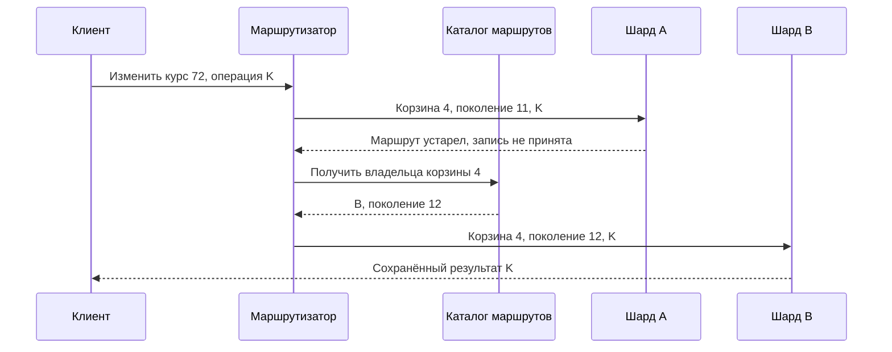
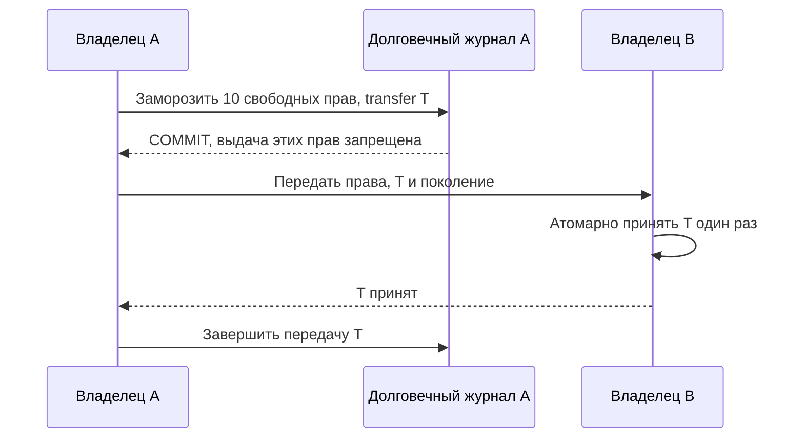
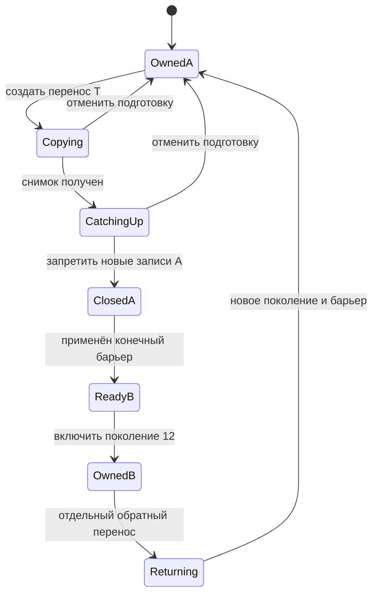
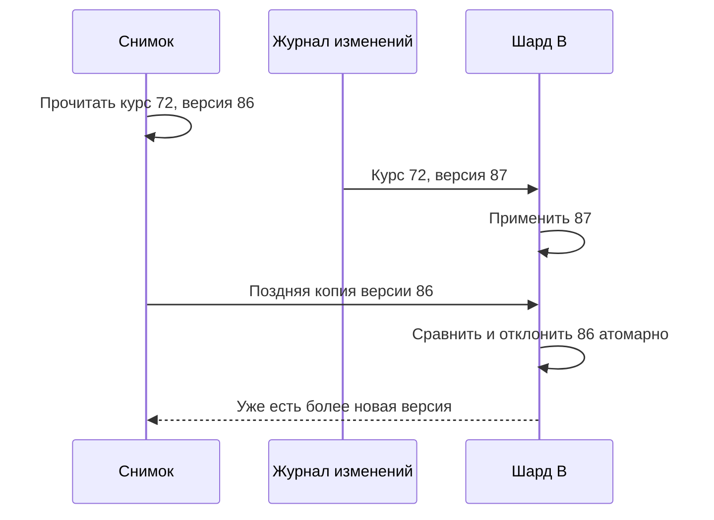

Клуб распределил миллион курсов между десятью шардами. На каждом примерно сто тысяч строк. После объявления открытого занятия один курс получил половину всех запросов, и его шард начал отвечать медленно. Остальные девять почти простаивали. Добавление ещё десяти шардов не помогло: ключ популярного курса по-прежнему принадлежал одному владельцу.

Равномерность числа строк не означает равномерность работы. Один ключ может быть крупным, часто читаемым, часто изменяемым или дорогим в обработке. Эти причины требуют разных решений. Прежде чем менять функцию хеширования, нужно установить, что именно перегружено и какое свойство операции нельзя потерять при разделении.

## Где находится перекос

Измерьте долю запросов по разделам и по самым активным ключам, размер объектов, время выполнения и очередь ожидания. Если один ключ создаёт 50% запросов, но его ответы дешёвы и кэшируются, он может не быть главным источником CPU. Если редкий запрос сканирует огромную историю, счётчик RPS скроет его стоимость.

В учебном профиле Клуба всего 20 000 обращений в секунду. Популярный курс получает 12 000, остальные — 8000. При десяти шардах среднее равно 2000, но шард с курсом получает как минимум 12 000 плюс свою обычную нагрузку. Среднее не позволяет выбрать ёмкость этого узла. Все числа здесь условные и нужны для рассуждения, а не для обещания производительности базы.

Различайте горячий ключ и горячий раздел. Раздел может содержать множество независимых активных ключей; его перенос или разбиение поможет. Если вся нагрузка относится к одной атомарно изменяемой записи, новый узел не делит её автоматически. Время, добавленное к ключу, иногда распределяет историю по корзинам, но текущая временная корзина может остаться горячей.

В [разборе хранения сообщений Discord](https://discord.com/blog/how-discord-stores-trillions-of-messages) авторы отмечают, что переход на другой движок не устраняет горячие разделы сам по себе. Для Клуба это повод исследовать путь запросов до базы, а не вывод о превосходстве конкретного продукта.

## Чтение, запись и неизбежная координация

Для популярного публичного описания курса можно использовать кэш и объединение одновременных промахов. Один запрос загружает значение, остальные ждут тот же результат. Предварительное обновление или небольшой разброс TTL уменьшают синхронный наплыв. Это помогает чтению, если допустима выбранная свежесть и ключ не смешивает права разных пользователей.

Для изменяемого счётчика кэш чтения не снимает нагрузку записи. Счётчик просмотров можно разбить на полосы, stripes: вместо одного ключа хранить несколько частичных счётчиков. Каждое событие направляется в полосу по стабильной функции от ID события. Чтение суммирует полосы или использует периодически обновляемую сумму.

Стабильная маршрутизация сама по себе не устраняет дубли событий. Повтор попадёт в ту же полосу, но снова увеличит её, если нет отдельной защиты. При смене числа полос функция также может изменить результат. Значит, ключ операции должен включать или однозначно определять поколение схемы распределения, а память о применении не должна потеряться при переносе.

Цена полос — чтение нескольких значений и сложность получения единого снимка. Для приблизительной статистики сумма, прочитанная в разные моменты, может быть допустима. Для выдачи последнего места она опасна: два обработчика могут независимо увидеть остаток и оба подтвердить право.

## Два варианта для общего лимита

Предположим, организация может одновременно запустить не больше 100 обработок видео. Это строгий лимит. Вариант A — один согласованный владелец счётчика или набора разрешений. Получение и освобождение проверяются атомарно, выдача имеет ID, а потерянный ответ обрабатывается как повтор. Такой владелец может стать узким местом, зато место решения ясно.

Вариант B — заранее распределить бюджет между исполнителями: четыре узла получают по 25 разрешений. Каждый локально выдаёт только свои разрешения, поэтому общая вместимость не превышается, если передача прав устроена безопасно. Незанятый бюджет одного узла не помогает перегруженному соседу до перераспределения. Это цена уменьшения координации на каждой операции.

| Свойство | Общий владелец | Разделённый бюджет |
|---|---|---|
| Решение каждой выдачи | Через общую точку | Локально в пределах выделенного права |
| Использование свободного остатка | Гибкое | Возможен неиспользуемый запас у соседа |
| Разрыв сети | Часть клиентов не получает решение | Узлы используют только уже выданные права |
| Перераспределение | Не требуется между полосами | Требует защиты от двойного владения |

Разделённый бюджет нельзя раздать заново после подозрения, что узел умер, если старый узел ещё может использовать прежние права. Нужны подтверждённый отзыв, fencing или схема аренды с доказанными условиями истечения. Иначе оптимизация вернёт превышение, которое должна была исключить.

Для мягкого rate limit, защищающего каталог, иногда достаточно локальных приблизительных лимитов с общей оценкой. Тогда нужно назвать допустимое превышение. Если десять экземпляров независимо разрешают по 100 запросов в секунду, общий предел не равен 100. Значение может достигать 1000 при подходящем распределении трафика.

Сам алгоритм окна тоже имеет значение. Фиксированный минутный счётчик может пропустить почти два лимита около границы соседних минут. Это не гонка обновления, а свойство выбранного определения скорости. Атомарный `INCR` устраняет потерянное увеличение, но не меняет смысл окна и не объединяет отдельные операции установки TTL. [Документация Redis](https://redis.io/docs/latest/commands/incr/) отдельно разбирает такое окно ошибки.

## Когда перенос действительно поможет

Если горячий раздел содержит много разных курсов, часть можно перенести. Если горяч один курс, сначала решают, допускает ли его модель разделение: история сообщений по корзинам, просмотры по полосам, заранее выделенные разрешения. Нельзя отделить физический перенос от модели чтения и инварианта.

Маршрутизация должна понимать версию карты. Пусть курс 72 находился на шарде A в поколении 11 и должен перейти на B в поколении 12. В каждый момент существует авторитетный владелец записи. Старый клиент может иметь старую карту, поэтому один лишь rollout маршрутизаторов не обеспечивает переключение.

В учебной схеме шард проверяет поколение владения для диапазона. После закрытия записи на A старый маршрут получает отказ с указанием обновить карту. Это механизм уровня нашей модели; конкретное хранилище может реализовывать другую схему. Если проверку делает только новый маршрутизатор, старый клиент всё ещё способен писать на A напрямую.

## Трасса безопасного переключения

Рассмотрим вариант с короткой паузой записи. B получает снимок и изменения после его границы. Пока идёт копирование, только A принимает записи. Затем координатор закрывает запись диапазона на A, получает конечную позицию и ждёт её применения на B. Лишь после этого разрешает поколение 12 на B и публикует новую карту.

| Момент | Шард A | Шард B | Что разрешено клиенту |
|---|---|---|---|
| Копирование | Владелец поколения 11 | Принимает копию | Запись только на A |
| Закрытие | Новые записи отклонены | Догоняет конечную позицию | Ожидание или повтор с тем же ID |
| Проверка | Сохраняет старую копию | Данные проверены | Новая запись ещё не разрешена |
| Переключение | Отвергает поколение 11 для записи | Владелец поколения 12 | Запись на B |
| Очистка | Копия удаляется позже | Обычная работа | Старый маршрут обновляется |

Нужно обработать запросы, уже находившиеся в полёте при закрытии A. Барьер записи должен иметь точную семантику: все разрешённые до него изменения входят в конечную позицию; новые не фиксируются. Проверка «активных запросов вроде нет» без защиты на уровне владельца не создаёт такой границы.

Скопировать нужно не только основные строки. Если идемпотентность операции хранится отдельно, повтор после переключения может создать вторую запись. Переносят историю необходимого срока, версии и сведения об удалениях. Проверка числа строк полезна, но также нужны диапазоны ключей и содержательная сверка. Иначе одинаковые количества скроют замену одной записи другой.

## Вариант без паузы стоит дороже

Второй подход сохраняет запись через прежнего владельца, который направляет изменения новому, либо использует журнал миграции и контролируемое переключение. Важно не превращать его в два независимых успешных пути. Если приложение просто пишет и на A, и на B, частичный сбой создаёт разные состояния, а повтор способен поменять порядок.

При выборе непрерывной записи задают, кто отвечает за результат, как восстанавливаются неуспешные копии и где проходит момент смены владельца. Это может уменьшить паузу, но увеличивает число состояний для тестирования. Для небольшого Клуба короткая объявленная пауза одного курса иногда дешевле сложной безостановочной миграции.

После первой новой записи на B возврат карты к A уже не является безопасным откатом. A отстаёт от новой истории. Нужна обратная синхронизация и новый управляемый переход. До окончательного удаления старой копии полезно сохранять наблюдаемость, но её наличие не даёт права снова принимать туда записи.

## Маршрут — это данные и протокол

Уточним, как запрос вообще находит владельца. В варианте с хешированием клиент вычисляет `bucket = H(course_id) mod 16`. Здесь 16 — постоянное число логических корзин учебной схемы, а не число серверов. Каталог маршрутов версии 11 сообщает, что корзины 0–7 находятся на A, а 8–15 — на B. Запрос несёт ID курса, ID операции и поколение маршрута. Шард проверяет право обслужить соответствующую корзину.

Функция H должна быть одинаковой во всех клиентах: одинаковые кодировка, представление числа и алгоритм. Встроенный хеш языка не всегда является стабильным межпроцессным контрактом. Несовпадение функций направит одну запись в разные корзины даже без аварии. Поэтому маршрутизацию тестируют общими примерами входов и ожидаемых корзин, а не только локальными unit-тестами каждого сервиса.

Если вычислять остаток по текущему числу физических серверов, переход с двух на три поменяет размещение многих ключей. Логические корзины позволяют переместить несколько диапазонов без изменения функции каждого ключа. Но 16 маленьких единиц — лишь учебный выбор. Слишком мало единиц ограничивает балансировку; слишком много увеличивает карту, служебные действия и число переносов.

### Схема: запрос по устаревшей карте

Смотрите, что решение старого маршрутизатора не заставляет A принять запись после смены владения.

Маршрутизатор не создаёт новый K при перенаправлении. B либо применяет новую операцию, либо находит её результат среди перенесённых данных. Каталог может быть недоступен; тогда запрос ждёт в пределах срока или получает явный отказ. Использование заведомо устаревшей карты как запасного способа записи отменило бы защиту владельца.

## Hash, range и виртуальные узлы дают разную цену

При range-разбиении ключи сортируются, а каталог сопоставляет интервалы владельцам. Запрос диапазона дат или ID может пройти по немногим соседним разделам. Но монотонно растущие ключи направляют новые записи к правому краю. Разделение старых диапазонов не разгружает этот активный край, если новые значения продолжают попадать в одну часть.

Хеширование обычно лучше перемешивает разные ключи, зато чтение диапазона бизнес-значений теряет локальность. Для списка курсов школы понадобится индекс или запрос к нескольким корзинам. Нельзя одновременно обещать произвольное равномерное распределение и сохранение близости всех полезных диапазонов без дополнительных структур и затрат.

При consistent hashing физическому узлу назначают несколько точек на кольце; ответственность лежит между точками по выбранному правилу. Виртуальные узлы дают более мелкие единицы переноса и позволяют учитывать разную мощность машин. Это одна из схем управления назначением, а не способ расщепить запросы одного ключа. Все обращения конкретного ключа всё ещё идут к назначенному владельцу или его явно выбранным репликам.

Выберите карту по запросам. Клуб может хранить записи участников рядом с курсом, а личную историю строить как отдельное представление. Тогда перенос курса сохраняет локальную проверку вместимости, но обновление истории становится асинхронным. На схеме нужно назвать источник истины, чтобы устаревшее представление не использовалось для повторной выдачи места.

## Полосы счётчика: что именно сохраняется

У счётчика просмотров состояние — набор пар `stripe_id, value`, а также память о событиях в пределах выбранной политики. Событие содержит ID просмотра и ID курса. Приёмник сначала определяет поколение полос, затем полосу; проверку дубля и увеличение выполняет в одной допустимой атомарной области. Если база не поддерживает нужную атомарность между этими ключами, схема требует другой формы хранения или согласования.

Инвариант точного счётчика в такой модели: каждое принятое уникальное событие добавляет единицу ровно в одну полосу. Сумма всех полос равна числу применённых событий только для согласованного набора состояний. Чтение полос в разные моменты может вернуть промежуточное значение. При положительных увеличениях оно может быть приемлемо для интерфейса, но при уменьшениях и корректировках нужны дополнительные условия интерпретации.

При увеличении числа полос с четырёх до восьми уже принятые события не перераспределяют повторным увеличением. Возможны чтение суммы двух поколений и явная граница назначения новых событий. Либо выполняется отдельная миграция с версионированием. Без границы один повтор может попасть в старую полосу, другой — в новую, и локальная дедупликация перестанет защищать общий результат.

Счётчик мест имеет другой инвариант: выданные права не должны превышать вместимость ни в один момент подтверждения. Разнесённые независимые проверки общего остатка его не сохраняют. Даже если итоговый отчёт позже исправится, два пользователя уже получили обещание. Именно поэтому статистику и разрешения нельзя объединить одним словом «счётчик».

## Передача бюджета: конкретный протокол escrow

Возьмём 100 именованных разрешений на обработку, распределённых между A и B. A владеет номерами 1–50, B — 51–100. Каждое разрешение либо свободно, либо занято работой с ID, либо передаётся. Выдача локально атомарно меняет свободное разрешение на занятое. Завершение с тем же ID освобождает его однократно; повтор завершения не увеличивает вместимость.

Для передачи десяти свободных разрешений A создаёт долговечную операцию T и переводит их в состояние «передаются B». С этого commit A уже не может их выдавать. B принимает список, поколение и T, проверяет авторизованную передачу и регистрирует её уникально. Повтор сообщения T не добавляет вторую копию прав.

### Схема: права сначала исчезают у прежнего владельца

Смотрите на порядок: уменьшение доступного бюджета A предшествует увеличению бюджета B.

Если подтверждение B потеряно, A повторяет T или запрашивает его статус. Он не возвращает права себе по простому таймауту: B мог уже начать их выдавать. При потере связи безопасное состояние может временно уменьшить доступную ёмкость. Это сознательная цена сохранения общего предела.

Здесь предполагается, что A не откатывает свой долговечный журнал к состоянию до заморозки и не имеет второго активного экземпляра с прежними правами. При восстановлении старой копии требуется сверка с авторитетным реестром передачи или fencing, иначе A воскресит уже переданный бюджет. Нельзя доказать глобальный предел, рассматривая только благополучную передачу сообщений.

Доказательство опирается на непересечение: свободные, занятые и передаваемые права образуют части исходного набора 100. A исключает передаваемые права из выдачи до их появления у B. B принимает T только один раз. Поэтому одновременно выдаваемые права не размножаются. Протокол не гарантирует полную загрузку ресурсов при разрыве сети: часть прав может застрять в передаче.

## Автомат переноса корзины и журнал координатора

Для переноса целой корзины координатор хранит поколение, источник, цель, состояние и конечную позицию копирования. Эти записи должны переживать его restart. Каталог назначения и протокол владения согласуют переход, а не обновляются независимыми скриптами «примерно одновременно».

### Схема: после открытия нового владельца откат меняет смысл

Смотрите, из каких состояний можно просто отменить подготовку, а где нужен следующий перенос.

До закрытия A он остаётся единственным владельцем. После закрытия новые запросы ждут или получают отказ. Координатор фиксирует барьер только когда A гарантирует, что более поздних успешных записей прежнего поколения не будет. B применяет все изменения до него, включая удаления и результаты идемпотентных операций. Затем состояние разрешает новое владение.

Если координатор падает в `ClosedA`, восстановление читает журнал, проверяет фактическое закрытие и продолжает с известной позиции. Нельзя предположить, что команда не выполнилась, лишь потому, что ответ потерян. Все управляющие команды имеют ID переноса и идемпотентный контракт. Если состояние нельзя доказать, безопаснее сохранить ограничение записи до выяснения.

## Версия объекта не заменяет поколение маршрута

Поколение 12 говорит, кто имеет право менять корзину. Версия 87 говорит, насколько новое состояние одного курса. Это разные номера. Поздняя копия версии 86 должна быть отвергнута даже на правильном владельце поколения 12. И наоборот, высокий номер состояния, присланный старым владельцем без полномочий, не даёт ему права продолжать запись.

### Схема: backfill проигрывает более свежему событию

Смотрите на атомарное условие применения, а не на порядок прихода сообщений.

При удалении вместо исчезнувшей строки на нужный срок сохраняется минимальная отметка версии удаления. Иначе поздний снимок увидит отсутствие и воскресит объект. Если равная версия пришла с другим содержанием, это конфликт протокола или повреждение, а не обычный повтор. Его нужно остановить и расследовать, а не выбирать случайно последний пакет.

Практическая проверка переноса сочетает управление трафиком и данные: stale-клиент после барьера, два повторных T, падение координатора, запоздалое удаление и восстановление старого узла. Наблюдайте не только длину копирования, но и число отказов старого поколения, расхождения версий и задержку новых запросов. Такая проверка объясняет, за что заплачено сложностью, и позволяет сравнить протокол с короткой плановой остановкой.

## Индекс и нагрузка могут иметь разные hot keys

Исходные встречи распределены по event_id. Индекс «встречи ведущего» распределён по presenter_id. Один популярный ведущий теперь перегружает индекс, хотя основные записи равномерны. Hash статистика исходных данных не описывает распределение другого представления. У range placement новые возрастающие ключи могут идти в крайний диапазон; split данных и скорость новых записей измеряют отдельно.

При 20 шардах и запросе без routing key fan-out составляет до 20 обращений. Тысяча внешних RPS создаёт до 20 тысяч внутренних чтений прежде retry. Global index уменьшает чтение, но запись теперь обслуживает второе размещение и проверяет lag/delete. Новый hot key можно создать самой оптимизацией.

Практика: 60% запросов относятся к одному tenant, 40% равномерны по остальным. Сравните hash по tenant и hash по event. Разбор: первый colocates tenant, но сохраняет 60% на одном логическом ключе; второй распределяет события и требует fan-out/индекса для tenant listing. Для одного сверхпопулярного event второй также не делит точный лимит. Решение меняют после измерения нагрузки по keys, queries и представлениям, а не только по bytes. Мотивы первичного ключа и range placement показаны в [Bigtable](https://research.google/pubs/bigtable-a-distributed-storage-system-for-structured-data/).

## Задание: популярный интенсив

У курса 72 есть счётчик просмотров и 100 мест. Просмотры допускают задержку отчёта до минуты и исправление дублей. Вместимость превышать нельзя. Курс создаёт 60% записи своего шарда. Предложите разные способы разгрузки этих двух операций и план переноса истории на новый шард.

Добавьте сбой: после переключения старый клиент повторяет подтверждение места, ответ на которое потерялся перед барьером. В вашем плане должно быть понятно, где найдётся результат прежнего запроса.

### Три подсказки

1. Разделите измеряемую статистику и право на ограниченный ресурс: одинаковый вид счётчика скрывает разные требования.
2. В перенос включите память о повторных операциях, а не только итоговый остаток мест.
3. Отметьте первую запись на новом владельце: после неё простой возврат маршрута уже недостаточен.

### Разбор

Просмотры можно направить в полосы с постоянными ID событий и агрегировать с выбранной задержкой. Для мест оставить согласованного владельца либо заранее разделить права на места с безопасной передачей. Распределять независимые «остатки по полосам», а затем суммировать перед выдачей нельзя без механизма общей проверки.

Историю переносят при одном владельце записи, догоняют журнал, закрывают A, фиксируют конечную позицию и только после проверки включают B. Вместе с данными сохраняется результат операции, ответ на которую потерялся. Старый клиент получает перенаправление или повторяет через обновлённую карту с тем же ID. B возвращает прежнее подтверждение, не занимает новое место.

### Критерии готовности

- Измерения показывают перекос стоимости и запросов, а не только числа строк.
- Для полос определены чтение, повторы и смена поколения распределения.
- Общий строгий лимит имеет объяснимого владельца или непересекающиеся права.
- Старый маршрут не может подтвердить запись после смены владельца.
- Перенос включает идемпотентность, удаления и план действий после новых записей на B.

### Вопрос на собеседовании

«Один ключ перегружает кластер. Почему consistent hashing и удвоение числа узлов могут не помочь?» Ответ должен показать неделимую операцию и предложить два решения с разными гарантиями: например, полосы для статистики и разделение прав либо единый владелец для вместимости.

## Первичные источники

[Discord: горячие разделы и миграция сообщений](https://discord.com/blog/how-discord-stores-trillions-of-messages), [DynamoDB: write sharding и цена чтения нескольких ключей](https://docs.aws.amazon.com/amazondynamodb/latest/developerguide/bp-partition-key-sharding.html), [Redis: INCR и примеры rate limiting](https://redis.io/docs/latest/commands/incr/), [Bigtable, оригинальная публикация](https://research.google/pubs/bigtable-a-distributed-storage-system-for-structured-data/). Трасса миграции и разделение бюджета здесь — учебные конструкции с явно заданными условиями, а не обещания конкретного сервиса.
