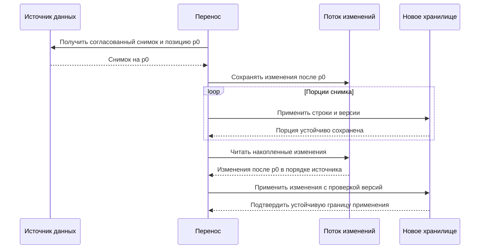
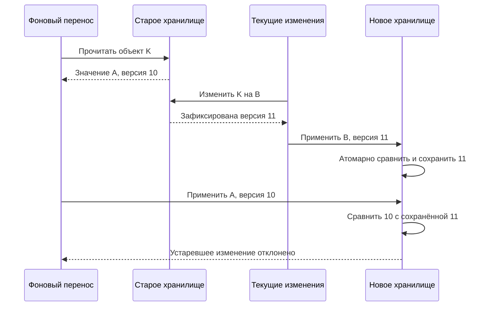
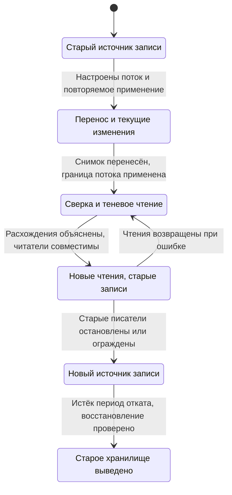

В «Клубе» прогресс ученика хранится одним числом: номером последней открытой главы. Новая версия должна хранить состояние каждой главы и время прохождения проверки. Старый формат остаётся доступным, пока приложения обновляются. Миллионы существующих записей нужно перенести без остановки обучения.

На схеме миграция выглядит коротко: новая таблица, копирование, переключение. Сложность возникает во времени. Пока фоновая задача копирует строку, ученик проходит следующую главу, другая задача удаляет аккаунт, а старая версия приложения продолжает писать в прежнее поле.

## Сначала договориться о смысле данных

Из значения «открыта глава 8» нельзя вывести, что ученик решил задания первых восьми глав. Если миграция создаст восемь записей «проверка пройдена», она придумает достижения, которых не было.

Составьте таблицу преобразования. Для каждого старого состояния укажите новый результат, неизвестные сведения и обратное преобразование. В нашем случае можно перенести последнюю открытую главу как историю чтения. Результаты проверок должны остаться неизвестными, если их негде получить. Новая схема не даёт права улучшать качество старых данных задним числом.

Обратное преобразование тоже может терять сведения. Старый формат не умеет представлять независимое прохождение глав. Значит, откат приложения допустим лишь при условии сохранения новых данных отдельно либо после ограничения новых функций. «У нас есть backup» не отвечает на вопрос, как сохранить изменения после его создания.

## Гонка фонового переноса с пользователем

Для следующего примера используем более простое преобразование: одинаковое значение переезжает из старой таблицы в новую. Каждое изменение одного пользователя получает возрастающую версию, выдаваемую источником истины. Это логический номер, а не часы на машине приложения.

| Шаг | Фоновый перенос | Запрос пользователя | Новая таблица |
|---|---|---|---|
| 1 | Читает главу 5, версию 10 | — | Строки ещё нет |
| 2 | Ждёт свободное соединение | Записывает главу 6, версию 11 | Глава 6, версия 11 |
| 3 | Записывает прочитанную главу 5 | Завершён | Глава 5, версия 10 |

Последняя строка показывает потерю нового значения. Обе операции по отдельности успешно выполнились. Проблема в том, что перенос не проверил, имеет ли он право перезаписывать результат более нового изменения.

При выбранной модели приёмник может применять запись только тогда, когда её версия новее сохранённой. Равная версия означает повтор того же состояния; меньшая должна быть отклонена как устаревшая. Проверка и запись должны выполняться атомарно. Сначала прочитать версию, а потом отдельным запросом сделать безусловное обновление недостаточно: между ними может прийти ещё одно изменение.

Такой порядок работает, только если версии действительно сравнимы для одного объекта. Два независимых региона, выдающих номера без общей координации, не создают этот порядок автоматически. Не исправляйте условие добавлением случайного времени из разных процессов.

## Двойная запись не делает две базы одной

Если старая и новая таблицы находятся в одной базе, иногда их можно обновлять одной локальной транзакцией. Это даёт ясную границу атомарности, но добавляет работу и блокировки в текущий запрос. Нужно проверить нагрузку, поведение старых писателей и совместимость преобразования.

При записи в две независимые базы появляются частичные исходы. Старая сохранила значение, новая недоступна. Новая сохранила, но ответ потерялся. Процесс упал между операциями. Решение не должно зависеть от обещания, что второй запрос обычно быстрый.

Один подход — назначить старую базу источником истины и сохранять рядом с изменением событие для переноса. Отправитель доставляет его в новую базу с повторами. Тогда временное расхождение ожидаемо, а не считается невозможным. Для переключения чтения нужно измерить отставание, обработать ошибки и доказать полноту на выбранной границе.

Другой подход — читать журнал изменений базы. Здесь важен стык снимка и журнала: если между ними есть пропуск, часть обновлений исчезнет; если есть перекрытие, приёмник должен безопасно обрабатывать повторы. Конкретный протокол зависит от инструмента, поэтому в проекте нельзя ограничиться подписью «подключим CDC».

## Удаления: как не воскресить аккаунт

Предположим, перенос прочитал пользователя версии 10. Затем пользователь удалил аккаунт, а новая база удалила его строку. Старый перенос приходит позже, видит отсутствие строки и создаёт её заново.

Нужно сохранять информацию, позволяющую отличить «никогда не переносили» от «удалили после прочитанной версии». Например, временная отметка удаления с версией 11 не позволит применить устаревшую версию 10. Такая отметка называется tombstone. Сама по себе она не определяет срок хранения: необходимо знать, как долго ещё могут прийти старые события, повториться перенос или восстановиться отставший потребитель.

Удаление персональных данных требует отдельного решения о том, что именно допускается оставить в технической отметке. Не храните полный профиль ради удобства защиты от повторного создания. Для учебной задачи достаточно логического идентификатора, версии удаления и явной политики очистки; требования реального продукта нужно разбирать отдельно.

## Что сравнивать перед переключением

Равенство числа строк — слабая проверка. В двух таблицах может быть по миллиону строк с разными владельцами, значениями или признаками удаления. Проверяйте преобразованные данные по ключам, версии, бизнес-инварианты и типы расхождений.

Теневое чтение означает, что приложение получает ответ из обоих хранилищ, но пользователю пока возвращает старый. Это помогает находить различия на настоящих запросах. Оно увеличивает нагрузку, поэтому долю таких чтений нужно ограничить. И сравнивать нужно состояния с учётом допустимого отставания: более новая версия в старой базе не обязательно означает ошибку преобразования.

Выборка удобна для поиска распространённых ошибок, но не доказывает отсутствие редкого повреждения. Дополните её проверками по диапазонам ключей, пересчётом контрольных значений и отдельным анализом проблемных категорий: удаления, повторные изменения, пустые значения, старые версии записей.

Для переключения задайте границу — например, позицию журнала, до которой все изменения применены. При нескольких независимых разделах может понадобиться набор позиций. Подпись «отставание равно нулю» должна иметь измеримый смысл, а не означать пустой график.

## Как состыковать снимок и текущие изменения

Допустим, источник умеет отдавать согласованный снимок данных на позиции журнала `p0`. Позиция обозначает границу зафиксированных изменений: снимок содержит состояние до неё, а поток позволяет получить изменения после неё. Это свойство выбранного механизма источника, а не возможность любого произвольного обхода таблицы.

Подписку на изменения нужно подготовить так, чтобы данные после `p0` не исчезли, пока читается снимок. Затем переносим снимок и применяем накопленные события. Приёмник умеет безопасно обрабатывать повтор, потому что после сбоя некоторые события могут прийти ещё раз.

На диаграмме снимок и изменения идут разными путями. Их соединяет общая позиция `p0`, а не совпадение времени на часах двух серверов.

Сначала определяется общий срез, затем сохраняется возможность дочитать всё, что произошло после него. Снимок даёт исходное состояние. Поток доводит его до новой границы. Если событие применения уже записано в новой базе, но подтверждение потерялось, перенос повторяет его; условное применение версии предотвращает откат к более старому состоянию.

Что будет, если согласованного снимка нет? Обычный постраничный обход читает разные строки в разные моменты. Простой курсор по ID не делает их единым состоянием. Иногда это допустимо: для независимых объектов можно сочетать обход с полным потоком изменений и проверкой версий. Но если нужно перенести согласованные остатки сразу нескольких связанных объектов, независимое обновление строк не сохранит границу транзакции. Тогда требуется механизм, который переносит такие изменения как группу, либо явный период, когда промежуточное состояние нельзя показывать читателю.

Ещё одно ограничение — срок хранения журнала. Если снимок читается сутки, а изменения доступны только последние шесть часов, подписка должна успевать сохранять их отдельно или удерживать нужную историю поддерживаемым способом. Иначе к моменту окончания снимка в потоке уже будет невосстановимый пропуск. Показатель «скопировано 99%» этого не обнаружит.

## Почему курсор нельзя сохранять раньше данных

Перенос читает события с позициями 101–150 и отправляет их в новое хранилище. Где сохранить позицию 150, после которой продолжится чтение? Рассмотрим два порядка.

В первом перенос сначала пишет курсор 150, затем пытается применить данные. Если он падает между этими действиями, после перезапуска начинает с 151. Изменения 101–150 потеряны для приёмника. Сам журнал может их ещё хранить, но механизм восстановления больше не знает, что должен вернуться назад.

Во втором сначала устойчиво применяются изменения, затем сохраняется курсор. Падение между шагами приводит к повторной доставке, а не к пропуску. Этот порядок безопасен, если применение повторяемо: та же версия с тем же содержимым не создаёт второй эффект.

Однако вторая схема тоже требует аккуратного определения порции. Если из 50 событий выполнено 49, нельзя подтвердить весь диапазон только потому, что последнее событие успешно. Либо порция применяется атомарно, либо перенос хранит непрерывную подтверждённую границу и отдельно учитывает незавершённые операции. При параллельной обработке завершение позиции 150 не означает завершение позиции 149.

Можно сохранить данные и курсор одной транзакцией приёмника. Это удобный вариант, когда оба находятся в одной системе и транзакция не чрезмерно велика. Он не превращает исходную и новую базы в общую транзакцию: лишь закрывает локальное окно между применением и отметкой прогресса.

## Условная запись как маленький протокол

Для каждого объекта приёмник хранит ключ, версию, значение либо признак удаления. Нормальное правило выглядит так: большая версия заменяет меньшую, та же версия допускает только то же логическое изменение, меньшая не применяется. Сравнение и изменение составляют одну атомарную операцию.

Уточнение про одинаковую версию важно. Если два разных значения пришли с одним номером, нельзя молча объявлять это повтором. Значит, нарушено предположение об источнике версий либо преобразование данных недетерминированно. Например, функция переноса подставляет текущее время в поле результата: один и тот же исходный объект при повторе превращается в другое значение. Такое поле нужно вычислять из стабильного исходного события или явно исключать из сравнения.

Следующая диаграмма показывает гонку фонового переноса и нового изменения. Приёмник сохраняет версию 11, после чего отклоняет пришедшую позднее версию 10.

Сначала перенос прочитал старое значение. Затем текущая запись успела пройти и в источник, и в приёмник. Последняя стрелка переноса не разрушает результат, потому что решение принимает новое хранилище по версии, а не по порядку прибытия запросов. Если убрать атомарность сравнения, между проверкой и записью снова появится окно гонки.

Удаление в таком протоколе — ещё одно версионированное состояние. Для версии 12 можно хранить отметку удаления, которая побеждает и 10, и 11. При этом копирование старого объекта не должно сначала создавать строку без версии и лишь потом дописывать номер: промежуточная строка уже может стать видимой.

## Преобразование нескольких строк

Перенос одной строки в одну строку — удобный начальный случай. Теперь профиль превращается в запись пользователя и несколько записей его доступов. Что означает «версия 11 применена», если профиль уже обновлён, а часть доступов ещё старая?

Первый вариант — применить весь набор одной транзакцией приёмника. Тогда читатели видят прежний или новый набор в рамках выбранной изоляции чтения. Цена — размер транзакции и конкуренция за связанные объекты. Второй вариант — записать новую версию набора под отдельным идентификатором, проверить комплектность и атомарно переключить ссылку на активную версию. Старый набор удаляется позже.

Во втором варианте запись дополнительных строк сама по себе не публикует результат. Видимость меняется в момент переключения ссылки. Читатель сначала получает идентификатор активного набора и использует его для всех последующих чтений. Если он заново выбирает «последнюю версию» для каждой строки, снова получится смесь поколений. Заодно нужно определить, когда старое поколение можно удалить: начавшиеся читатели ещё могут его использовать.

Оба способа задают точку публикации целого результата. Выбор зависит от того, какие операции поддерживает новое хранилище и сколько данных связано одним инвариантом. Не нужно создавать распределённую транзакцию ради любого нового столбца. Но и обещать согласованность нескольких объектов без границы публикации нельзя.

## Переключение — проверяемая смена состояния

Ниже схема миграции. У каждого состояния есть один понятный источник записи. Возврат чтений показан отдельно от возврата записи: после смены источника записи простой откат приложения уже недостаточен.

Сначала новая база следует за старой, не определяя бизнес-истину. Затем новые чтения постепенно получают данные из приёмника. Смена источника записи — отдельная операция: старые писатели должны перестать принимать изменения либо получать явный отказ. Флаг только в новой версии приложения не останавливает старую версию, зависшую задачу или ручной скрипт.

На практике пригодится журнал переходов: состояние, ответственный, применённая граница данных, время, результат проверки и разрешённый следующий шаг. Это не формальность. После падения управляющего процесса другая команда должна понять, кому сейчас разрешено писать. Если состояние хранится только в памяти оператора, безопасно продолжить миграцию будет трудно.

## Дополнительная практика: порядок подтверждений

Два обработчика переносят события одного потока. Первый применяет позицию 201 медленно, второй уже применил 202. Координатор сохранил курсор 202 и завершился. Нарисуйте восстановление, при котором изменение 201 больше не будет прочитано. Затем предложите два исправления.

В первом решении позиции одного упорядоченного потока применяются последовательно. Во втором допускается параллельность, но подтверждается только непрерывный префикс завершённых событий: 202 ждёт окончания 201. Если события относятся к независимым разделам, можно хранить отдельный курсор для каждого, однако граница должна совпадать с реальной независимостью данных. Общий инвариант между разделами требует дополнительного протокола.

Проверьте решение ещё одним сбоем: данные 201 сохранены, а отметка о завершении потерялась. Правильное восстановление повторит применение без второго эффекта. Если вместо этого предлагается пропустить любую «похожую» запись, укажите точный идентификатор, по которому подтверждается уже выполненное событие.

## Совместимость проверяется в обе стороны

Старая версия writer пишет `amount=125`, подразумевая рубли. Новая решила считать копейки с тем же именем. JSON декодируется в обеих версиях, но смысл изменился в сто раз. Wire compatibility не означает semantic compatibility. Безопаснее ввести новое поле с единицами, переходное чтение и определённый источник истины; одновременная запись обоих полей требует согласованности.

| Writer | Reader | Обязательная проверка |
| --- | --- | --- |
| Старый | Старый | Прежний договор сохраняется |
| Старый | Новый | Отсутствующее новое поле и default имеют правильный смысл |
| Новый | Старый | Новые поля/типы не ломают прежнее чтение |
| Новый | Новый | Новая семантика и ограничения выполняются |

Добавьте пятую проверку: старое событие из retention/backup читает новый consumer. Это может произойти через месяцы после завершения deploy. Старую схему нельзя удалить только потому, что в данный момент старые процессы выключены. В Protobuf удалённые field numbers резервируют; повторное использование меняет смысл прежних bytes. [Protocol Buffers: Updating](https://protobuf.dev/programming-guides/proto3/#updating).

Backfill читает объект v8, затем live path удаляет его v9. Запоздавший backfill не должен восстановить v8. Требуется version compare и tombstone, причём удаление самого tombstone раньше конца replay снова открывает resurrection. При переключении из old-read в new-read проведите сверку одинакового префикса; simple COUNT не обнаружит неверные значения и права.

Практика: добавьте поле `display_name` к прежнему `name` и опишите expand → backfill → dual-read/write → cutover → contract. Разбор: сначала все версии должны переживать отсутствие поля; backfill не перекрывает свежую правку; новая ветка определяет авторитетный факт; contract выполняют после прекращения поддерживаемых старых readers/writers и анализа сохранённых записей. Если после cutover новая версия уже принимает отличающиеся данные, rollback старого кода без синхронизации не является безопасным возвратом.

## Задание: план миграции с откатом

Есть 20 миллионов записей. Фоновый перенос ограничен скоростью 2 000 записей в секунду. Пользователи продолжают менять данные. Старый и новый форматы совместимы по смыслу, новые изменения имеют версию на объект. В одном проценте операций изменяется объект, который перенос уже успел прочитать, но ещё не записал. Это специально заданная учебная частота, а не статистика промышленной системы.

Опишите состояния миграции и допустимые переходы между ними. Для каждого укажите источник истины, путь чтения, путь записи и условия остановки. Рассчитайте нижнюю границу времени копирования. Разберите гонку обновления и гонку удаления. Затем объясните, как вернуть чтения в старую базу через час после переключения, не потеряв записи этого часа.

**Подсказка 1.** Факт успешного копирования строки не означает, что её содержимое по-прежнему актуально.

**Подсказка 2.** При откате проверьте не только совместимость кода, но и направление передачи новых изменений.

**Подсказка 3.** Момент удаления старого хранилища и момент переключения чтений — разные события.

### Разбор

20 000 000 / 2 000 = 10 000 секунд, то есть примерно 2 часа 46 минут 40 секунд. Это нижняя граница для непрерывного копирования с заданной скоростью. Повторы, ограничения нагрузки и сверка увеличат срок. Если очередь текущих изменений растёт, окончание обхода старых строк ещё не означает готовность к переключению.

На первом этапе старое хранилище остаётся источником истины. Перенос и текущие изменения используют одно правило версий в новом хранилище. Удаления защищены отметками с версией. Затем выполняется сверка и ограниченный перевод чтений. Пока записи продолжают проходить через старый источник, возврат чтений сравнительно прост.

Если источник записи уже переключили, потребуется другой план. Старое хранилище должно получать совместимые новые изменения, либо перед возвратом нужно остановить приём на определённой границе и перенести недостающее. Обратная передача не должна создавать бесконечную петлю событий. Если преобразование необратимо, обещать обычный откат нельзя: нужен отдельный план восстановления с сохранением новых данных.

## Что спросит рецензент

«Какая запись может исчезнуть в этом плане и как вы узнаете об этом до удаления старой базы?» Ответ должен пройти по конкретному временному порядку: изменение, фиксация, доставка, применение, сверка. Затем добавьте падение в любой промежуток и повтор после восстановления.

Критерий хорошего решения — понятный источник истины в каждом состоянии, защита от устаревших записей, учёт удалений и выполнимый откат. Слова «двойная запись», «канареечный релиз» и «флаг переключения» без этих свойств не решают задачу.

## Источник и границы примера

[Stripe: Online migrations at scale](https://stripe.com/blog/online-migrations) описывает поэтапный перенос с двойной записью и переключением чтения. Это полезный пример организации миграции, а не доказательство корректности любого переноса между двумя базами. Версии, отметки удаления и сценарий прогресса «Клуба» выше — самостоятельная учебная задача с явно заданными условиями.
