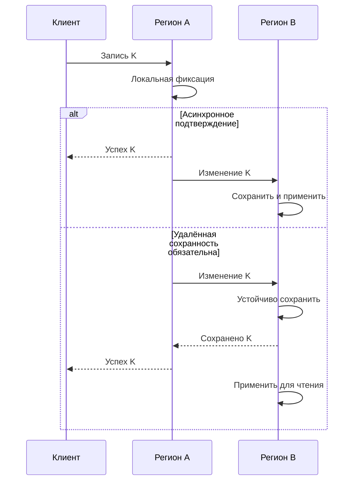
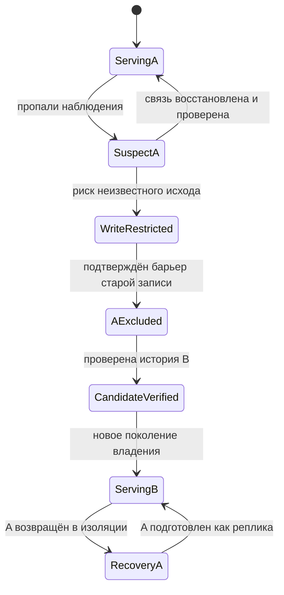
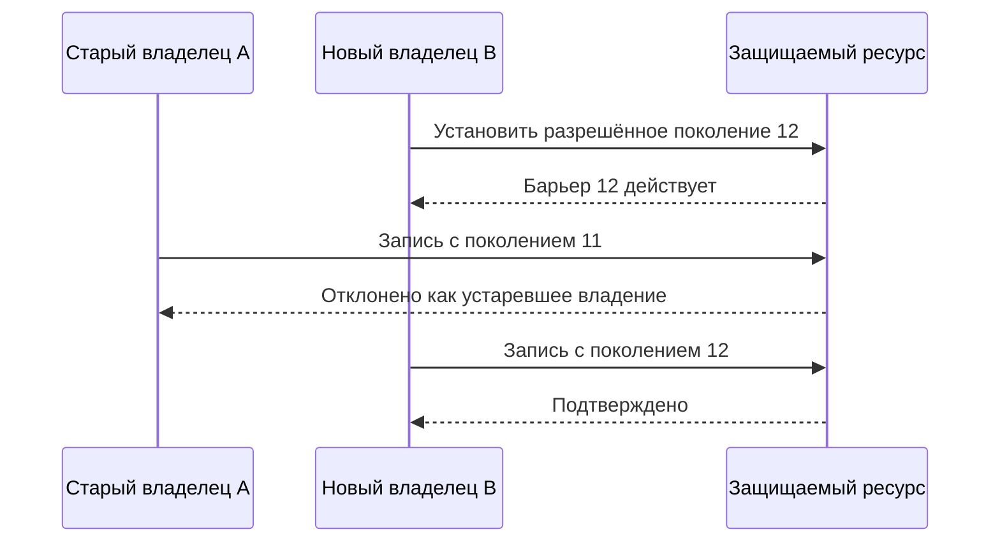
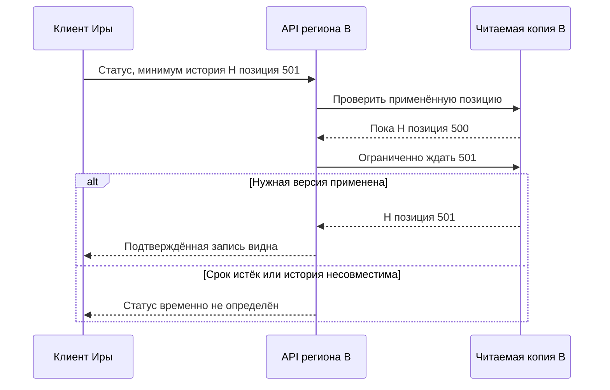

Регион A подтвердил ученику последнее место на интенсиве. Через секунду связь с ним исчезла. Клуб переключил запросы в регион B, где асинхронная копия ещё показывала одно свободное место. Другой ученик получил такое же подтверждение. Когда A вернулся, обе базы содержали по одной корректной локальной записи, но общее обещание вместимости было нарушено.

Ни балансировщик, ни факт наличия второй копии не определяют, какое подтверждение нужно сохранить. Региональное переключение требует решения о данных, владельце записи и поведении пользователя в период неопределённости. В этом блоке каталог и ограниченные места будут иметь разные режимы: каталог может устаревать, а подтверждение места должно сохранять заявленный инвариант.

## Что именно потеряно при асинхронной репликации

В асинхронной модели A может ответить клиенту после локального commit, не дожидаясь долговечного приёма изменения в B. Если A недоступен, B нельзя считать полной копией всех подтверждённых операций. Данные могут ещё существовать на диске A, но отсутствовать в новой активной истории B. Это различие важно для последующей сверки.

RPO выражает допустимую потерю данных по времени, RTO — целевое время восстановления сервиса. Это цели, а не свойства, автоматически созданные резервным регионом. Если последний подтверждённый контакт с B был минуту назад, нельзя уверенно назвать текущий lag по старому графику. Связь могла пропасть раньше, а A продолжал принимать записи.

Метрики должны различать отправленную, полученную, долговечно сохранённую и применённую позицию журнала. Принятые байты не обязательно переживут отказ питания; сохранённая запись не обязательно уже видна запросам. Конкретные уровни подтверждения зависят от движка и конфигурации. [Документация PostgreSQL](https://www.postgresql.org/docs/18/warm-standby.html) прямо различает асинхронную репликацию, ожидание записи и ожидание применения.

### Трасса опасного переключения

| Время | Регион A | Регион B | Что знает клиент |
|---|---|---|---|
| 10:00:00 | Зафиксировал место для Иры, позиция 501 | Применил до 500 | Ира получила успех |
| 10:00:01 | Недоступен наблюдателю | Всё ещё до 500 | Новые запросы получают таймаут |
| 10:00:10 | Может продолжать работу в изоляции | Назначен новым владельцем | Клиенты направлены в B |
| 10:00:11 | Старая история содержит Иру | Выдал место Олегу | Олег получил успех |
| 10:05:00 | Снова доступен | Продолжает новую историю | Два человека ожидают одно место |

В строке 10:00:10 скрыты две разные опасности. B не имеет последней записи, и A может всё ещё принимать запросы от части клиентов. Даже если первую проблему принять как допустимый RPO, вторую нельзя игнорировать. Продвижение реплики без ограничения старого владельца способно создать две развивающиеся истории.

## Вариант A: быстрые локальные подтверждения и явный риск потери

Клуб может выбрать асинхронную копию для операций, где допустима потеря последних изменений после катастрофы. Например, промежуточное состояние просмотра видео можно восстановить повторной отправкой с устройства, если продукт принимает соответствующее поведение. В таком варианте локальная задержка записи мала, но переключение требует объявленного правила сверки.

Для ограниченных мест ненулевой RPO означает больше, чем исчезнувшую строку. Подтверждение могло вызвать оплату, письмо и планы пользователя. Бизнес должен определить, как разрешить конфликт: восстановить подтверждение, вернуть оплату, предложить замену. Техническая настройка репликации не выбирает справедливое решение за продукт.

При неопределённом состоянии Клуб может временно закрыть новые подтверждения и оставить чтение каталога. Это увеличивает время восстановления записи, зато даёт возможность получить журнал A или провести сверку. Необязательно отключать весь сайт, чтобы не делать обещаний о месте, существование которого пока неизвестно.

Цена варианта должна быть записана до инцидента: какие операции могут исчезнуть, как их искать и кто принимает решение. Формулировка «редко бывает» не является политикой восстановления. Также нельзя полагаться только на повтор клиента: некоторые пользователи уже закрыли страницу, получив успех.

## Вариант B: подтверждение учитывает удалённую сохранность

Если Клуб обязан сохранить подтверждённое место при потере одного региона, результат нужно подтверждать только после требуемого удалённого сохранения в выбранной модели отказов. Это может быть синхронная репликация на подходящие узлы или протокол согласованного журнала. Само слово quorum не определяет ни размещение копий, ни режим чтения, ни допустимые отказы.

Если все участники большинства расположены в A, потеря A уничтожит доступность этого большинства. Размещение узлов влияет на гарантию. Если подтверждение зависит от B, разрыв связи с B может остановить запись даже при полностью работающем A. Так проявляется цена гарантии: межрегиональная задержка и отказ продолжать некоторые операции при недостатке подтверждений.

При трёх участниках протокол вроде Raft использует большинство и правила журнала для сохранения согласованной подтверждённой истории. Продвижение произвольной отставшей копии в обход протокола отменяет эту логику. Промышленная конфигурация также должна учитывать диски, сеть и восстановление узлов, а не только число процессов в диаграмме.

Оба варианта жизнеспособны для разных операций. Нельзя одновременно обещать независимую запись в каждой изолированной части, единую строгую историю и отсутствие согласования. [Формальная работа Gilbert–Lynch](https://www.comp.nus.edu.sg/~gilbert/pubs/BrewersConjecture-SigAct.pdf) задаёт точные условия этого конфликта; её availability не тождественна обычному процентному SLO.

## Почему heartbeat не лишает старый узел полномочий

Наблюдатель не получил heartbeat от A. Возможны падение, остановка процесса или разрыв пути только между наблюдателем и A. По таймауту нельзя доказать, что A перестал писать. Поэтому назначение B должно сопровождаться механизмом, который не позволяет устаревшему владельцу успешно менять защищаемый ресурс.

Один подход — физически или административно изолировать старую запись: отключить доступ, остановить узел, отозвать маршрут или учётные данные с проверяемым результатом. Другой — использовать поколения владения, fencing tokens. Новый владелец получает больший номер, а ресурс атомарно проверяет допустимое поколение и отвергает старые операции после установленного барьера.

Проверка должна происходить там, где совершается эффект. Если worker один раз проверил аренду, затем остановился на минуту и продолжил работу, его прежняя уверенность устарела. Проверка только перед вычислением не защищает финальную запись. Ресурс должен связывать проверку поколения и изменение либо предоставлять эквивалентный контракт.

Если A и B имеют независимые локальные базы, запись нового поколения только в B не остановит A: он продолжит видеть своё старое поколение. Нужен общий авторитетный механизм, участие ресурса в протоколе либо проверяемая изоляция старой записи. Простое поле `epoch` в двух расходящихся таблицах не решает split brain.

Fencing не возвращает потерянные данные и не переносит гарантию на любой внешний API. Если платёжный провайдер не понимает ваши поколения, его защищают стабильным ID операции, контрактом повторов и сверкой. Новый регион должен иметь нужную память об операциях; иначе повтор после переключения создаст новый внешний эффект.

## Что увидит одна и та же сессия

Ира записалась в A и сразу открыла страницу через B. Если B отстаёт, интерфейс может показать «вы не записаны». Это нарушение read-your-writes даже без катастрофы. Для него нужны отдельные меры: направлять чтение к владельцу, ждать применения достаточной позиции или передавать с запросом минимальную версию сессии.

Токен минимальной версии означает: «этот пользователь уже наблюдал результат не раньше такой позиции». Реплика либо догоняет её, либо запрос уходит на подходящий узел, либо получает явный временный отказ. Токен сам не создаёт отсутствующие данные. После асинхронной потери новый регион может никогда не достичь прежней позиции в сопоставимой истории.

Позиции журнала нужно интерпретировать вместе с идентичностью истории или поколением. Просто сравнить два числа из разных независимых ветвей недостаточно. При смене владельца система определяет, какие клиентские токены ещё допустимы и как выполнять сверку неподтверждённого для новой истории состояния.

Для каталога можно принять временно старую выдачу; для страницы сразу после бронирования лучше показать «проверяем подтверждение», чем предложить занять место заново. Согласованность сессии влияет на интерфейс и API, но её источник находится в маршрутизации и данных.

## Возвращение A — новая миграция

После восстановления связи A нельзя автоматически вернуть статус владельца только потому, что он раньше был основным. Сначала его изолируют от новых записей, сохраняют необходимые свидетельства и сравнивают истории. Новые операции B должны быть учтены до любого возврата трафика.

Для физической реплики возвращение в общую историю может потребовать пересоздания из актуального состояния или поддерживаемой движком процедуры. Нельзя произвольно объединить два журнала SQL-базы по времени строк. Для прикладной сверки конфликтов заранее определяют бизнес-операции, уникальные ID и правила разрешения.

Управляемый failback включает синхронизацию, проверку данных, проверку фоновых обработчиков, новый барьер владения и постепенное переключение. Иногда безопаснее оставить B основным, а A сделать запасным. Географическое название региона не создаёт обязанности немедленно вернуть прежнее расположение.

Время восстановления должно включать этот операционный контекст. HTTP 200 от нового региона ещё не доказывает, что уведомления, платежи и доступ согласованы. Обязательства, оставшиеся в очередях, продолжают существовать после возвращения основной страницы.

## Состояние региона и сообщения протокола

Зададим учебную модель для одного курса. В ней есть авторитетная запись владения: `course_id`, поколение, регион-владелец и режим. Есть журнал изменений с идентичностью истории и позицией. Есть таблица результатов клиентских операций. Реплика сообщает отдельные позиции получения, долговечного сохранения и применения. Ни один из этих номеров не означает, что клиент уже увидел результат: ответ мог потеряться после фиксации.

Нормальная команда записи содержит ID операции K, курс, ожидаемое поколение и полезные параметры. Сообщение репликации содержит идентичность истории, позицию и данные изменения. Подтверждение явно сообщает, что произошло: байты приняты, устойчиво сохранены либо применены. Сообщение продвижения владельца — отдельное управляющее действие, а не побочный эффект отсутствующего heartbeat.

Предположим, что подтверждённое долговечное сохранение переживает отказ процесса или одной машины по выбранной модели, а диски разных регионов не теряются одновременно. Этот набор условий нужно назвать. Если одновременно исчезнут все нужные копии, протокол не восстановит данные из факта прежнего ответа. Для другой модели отказов понадобится другое размещение и восстановление.

## Две временные линии одной записи

Сравним один и тот же запрос при разных правилах успеха. В асинхронном варианте A фиксирует запись локально, отвечает клиенту и передаёт данные B независимо от ответа. Сообщение может уже идти по сети, но это не равнозначно полученному подтверждению B. В синхронном варианте нашего примера A ждёт устойчивого сохранения в B, а применение для чтения может произойти позже.

### Схема: условие ответа меняет окно потери

Смотрите на момент ответа клиенту относительно подтверждения B. Схема иллюстрирует выбранные условия, а не все режимы конкретной базы.

В первом варианте падение A до сохранения B оставляет подтверждённую клиенту операцию без доступной копии. Во втором ответ после подтверждения B доказывает наличие этой операции там при соблюдении модели. Однако произвольный третий узел C всё ещё может отставать. Переключение именно на C без получения необходимых данных нарушило бы обещание, хотя исходная запись была синхронной.

Если ответ B потерялся, A может вернуть клиенту неизвестный исход или продолжить проверку в пределах срока. Нельзя удалять запись B только потому, что A не успел сообщить успех. Повтор K должен найти прежнюю операцию. Для пользователя отсутствие ответа отличается от подтверждённого отказа; это различие сохраняется и при региональных сбоях.

## Доказательство доступности данных после отказа

Нулевая потеря для выбранного отказа требует цепочки утверждений. Во-первых, каждая операция, на которую выдан успех, достигла необходимого набора долговечных копий. Во-вторых, допустимый отказ не уничтожает весь такой набор. В-третьих, процедура выбора нового владельца получает историю, содержащую все эти подтверждённые операции. В-четвёртых, прежний владелец не создаёт параллельную подтверждённую ветвь.

Число копий отвечает только на часть второго утверждения. Оно не доказывает ни первое, ни третье, ни четвёртое. Именно поэтому схема «три региона» недостаточна. Нужно показать правило commit, размещение, допустимые отказы, выбор кандидата и ограничение старого владельца.

В журнале с большинством кандидату недостаточно иметь больше записей по количеству. Важны поколения записей и правила допустимости избрания, предусмотренные протоколом. Незавершённый длинный хвост не должен вытеснить подтверждённую историю. Этот блок использует смысл готового протокола, а не предлагает реализовать сравнение журналов самодельным условием.

При потере большинства безопасный протокол может перестать фиксировать новые записи. Данные при этом не обязательно потеряны: исчезла возможность подтвердить нужное согласование. Добавить новый пустой узел и немедленно объявить новое большинство — не универсальный способ восстановления; изменение состава само должно сохранять пересечение и историю по правилам выбранного протокола.

## Переключение с проверяемыми переходами

Для Клуба зададим состояния `ServingA`, `SuspectA`, `WriteRestricted`, `AExcluded`, `CandidateVerified`, `ServingB`. Отдельно фиксируем причину перехода, доступные свидетельства и ответственного исполнителя. Переходы сохраняются в долговечном управляющем состоянии, чтобы restart автоматизации не начинал переключение заново с противоречащими командами.

### Схема: подозрение не равно полномочию нового писателя

Обратите внимание на две самостоятельные проверки перед обслуживанием в B: прежний писатель исключён, кандидат проверен.

Практически проверки могут выполняться параллельно, но право записи не выдаётся, пока обе не завершены. Если история B недостаточна, состояние не переходит в `ServingB` с прежними гарантиями. Оператор либо восстанавливает данные, либо явно применяет заранее согласованный аварийный режим с возможной потерей. У такого режима отдельный аудит и последствия для продукта.

При падении управляющего процесса после команды изоляции, но до получения ответа новый процесс запрашивает фактическое состояние. Он не предполагает, что команда не выполнилась. Управляющие действия имеют ID и повторяемые контракты. Это тот же класс неопределённости, что у обычного API, только ошибка здесь влияет на всех пользователей курса.

## Fencing на месте эффекта

Представим общий защищаемый ресурс R, который атомарно хранит активное поколение и проверяет его при записи. Новый владелец B сначала устанавливает поколение 12 в рамках допустимого протокола. После подтверждённого барьера операция старого A с поколением 11 должна быть отвергнута R, даже если A ещё жив и сохранил TCP-соединение.

### Схема: поздняя запись старого владельца отклоняется

Смотрите на ресурс R: именно он применяет ограничение. Проверка только в B не остановила бы A.

Это учебная модель ресурса с таким контрактом. Если реальные A и B пишут каждый в независимую локальную базу, общего R нет. Тогда одинаковое поле поколения в двух таблицах не создаёт общий барьер. Нужен другой механизм исключения или участие самих баз в протоколе координации. В проекте нельзя оставлять R загадочным прямоугольником «сервис блокировок», не объяснив, как он останавливает финальный эффект.

Даже аренда с истечением требует условий о времени и паузах. Процесс может остановиться после проверки аренды и продолжить позже. Если ресурс не проверяет полномочие, старое вычисление всё ещё опасно. Fencing помогает отклонить его запись; сам алгоритм аренды не заменяет эту проверку там, где она необходима.

## Сессионное чтение после маршрутизации

Теперь запись Иры подтверждена и содержит минимальную требуемую версию истории. Балансировщик направляет чтение в B, где данные сохранены, но не применены. API должен отличить это временное отставание от отсутствия записи. Он ограниченно ждёт подходящую позицию либо использует другой допустимый маршрут.

### Схема: токен сессии не разрешает вернуть старое значение

Смотрите, что по истечении срока ожидания выбирается явный результат, а не устаревшее «не записаны» под видом выполнения гарантии.

Токен должен относиться к понятной области: одному объекту, разделу или истории репликации. Если система состоит из независимых разделов, один простой номер может быть недостаточен. Для базового Клуба можно сузить обещание до собственного результата бронирования и хранить его статус отдельно, вместо попытки дать универсальный глобальный порядок всем страницам.

При потере подтверждённой записи в аварийном асинхронном режиме токен не исчезает из браузера волшебным образом. Он показывает противоречие между прежним обещанием и доступной историей. Нужна сверка, объяснимое состояние и компенсация по выбранной политике. Возвращать «404, никогда не было» как будто пользователь ошибся — плохой контракт восстановления.

## RTO — сумма работ, а не время смены DNS

В упражнении обнаружение заняло 20 секунд, подтверждённое исключение старого владельца — 30, проверка и догон кандидата — 40, открытие и проверка трафика — 10. При последовательном выполнении это 100 секунд до выбранного критерия восстановления. Если некоторые действия идут параллельно, считают критический путь, а не складывают всё подряд. Время очередей и ручного решения нельзя молча считать нулевым.

RTO также зависит от запаса мощности. Регион B, рассчитанный на половину обычного чтения, может не выдержать весь поток плюс догон журнала и повторные запросы. Поэтому после переключения ограничивают второстепенные функции и скорость фоновой сверки. Региональная избыточность стоит не только хранения копии: нужны готовые ресурсы, проверенная конфигурация и способность обслужить пик после отказа.

Контрольный опыт должен включать не только выключение A, но и разрыв связи при продолжающейся работе A, потерю ответа управляющей команды, отстающую реплику и возвращение старого worker. После опыта сверяют множество подтверждённых клиентских ID с новой историей. Проверка одних HTTP-кодов не обнаружит исчезнувшее подтверждение.

Граница обещания остаётся явной: выбранная синхронная схема защищает конкретный класс отказов ценой задержки и возможного ограничения записи. Она не обещает одновременно бесконечную доступность при потере большинства и сохранение строгого порядка. Асинхронная схема может быстрее обслуживать локальные запросы, но требует честной политики утраты и восстановления. Усложнение оправдано, когда эта разница соответствует требованиям Клуба.

## Часы и география не убирают межрегиональную зависимость

Три голосующих узла в трёх failure domains требуют доступного большинства по протоколу. Расстановка двух узлов в A и одного в B может пережить потерю B, но не потерю A. Число регионов и способность пережить конкретный региональный отказ — разные расчёты. Witness может участвовать в выборе прав без сохранения полного suffix пользовательских записей: его роль проверяют по реализации.

Для локальных каталогов можно принять отставание. Для глобально точного лимита удалённая координация либо заранее распределённые права влияют на путь ответа. При RTT 80 ms дополнительная зависимая фаза создаёт порядка 80 ms ожидания без очередей. Если нужны быстрые локальные изменения, объясните конфликты или escrow и доступный локальный бюджет; одинаковый API не отменяет новое обещание.

Spanner использует TrueTime, представляющий неопределённость времени интервалом, и commit wait вместе с репликацией и транзакционным протоколом. Timestamp и обычная синхронизация NTP не воспроизводят всю гарантию. Чем шире неопределённость, тем больше может быть ожидание; сеть между группами также остаётся. [Spanner OSDI 2012, §§3–4](https://research.google.com/archive/spanner-osdi2012.pdf).

Практика: A подтвердил локально 100..110, B сохранил только до 106; связь пропала. Назовите последствия promotion B и возвращения A. Разбор: async путь допускает потерю подтверждённого suffix 107..110 по выбранному RPO; старый writer отсекается fencing. Возвращение A требует reconcile/resync, а не смены DNS обратно. Внешние эффекты 107..110 могут уже существовать и требуют сверки. Пересмотрите placement и подтверждение при ужесточении RPO, новой географии пользователей или изменении доменов отказа.

## Задание: два подтверждения последнего места

Используйте трассу выше. Требование Клуба: подтверждённое место нельзя молча отменить, превышение вместимости запрещено, каталог может работать с устареванием. Предложите поведение при потере связи с A и план возвращения. Отдельно напишите, какое требование придётся пересмотреть, если команда настаивает на немедленной независимой записи в B.

### Три подсказки

1. Различайте недоступность для наблюдателя и доказанное прекращение записи старым владельцем.
2. Проверьте, что успех Иры был удалённо сохранён до ответа; один факт существования реплики этого не доказывает.
3. Не завершайте план после смены маршрута: укажите обработку старых запросов, сессионных токенов и фоновых задач.

### Разбор

С исходной асинхронной схемой невозможно гарантировать сохранность неизвестного подтверждения и сразу безопасно выдать последнее место в B. Клуб временно ограничивает подтверждения, получает данные или проводит сверку, продолжая допустимые чтения. Для будущей гарантии меняет протокол подтверждения так, чтобы обещанная запись переживала заданный отказ.

Перед назначением B старого владельца исключают из успешной записи проверяемым механизмом. Сохраняют или восстанавливают память о повторных операциях. После возвращения A его не пускают в запись до сравнения и синхронизации. Если руководство всё же выбирает немедленную доступность асинхронной копии, оно должно принять риск утраты подтверждений и определить компенсации; назвать это прежней строгой гарантией нельзя.

### Критерии готовности

- RPO и RTO связаны с измерениями и процедурами, а не числом регионов.
- Известно, какие копии участвуют в подтверждении и какие отказы выдерживаются.
- Старый владелец не может успешно писать после установленного барьера.
- Для read-your-writes предусмотрены ожидание, маршрут или явная неопределённость.
- Failback включает новые записи B, фоновые эффекты и проверку данных.

### Вопрос на собеседовании

«Реплика отставала на секунду. Почему нельзя просто продвинуть её и обещать нулевую потерю?» Ответ должен различить старое измерение и фактическое состояние, сохранение и применение журнала, потерянный ответ и подтверждённую запись. Затем нужно выбрать режим работы и назвать цену доступности.

## Первичные источники

[PostgreSQL: standby и режимы подтверждения](https://www.postgresql.org/docs/18/warm-standby.html), [Raft: журнал, большинство и смена лидера](https://raft.github.io/raft.pdf), [Gilbert–Lynch: модель CAP](https://www.comp.nus.edu.sg/~gilbert/pubs/BrewersConjecture-SigAct.pdf), [GitHub: разбор инцидента 21 октября 2018](https://github.blog/news-insights/company-news/oct21-post-incident-analysis/). Сценарий Клуба является учебным; исторический инцидент помогает проверить вопросы к восстановлению, а не служит готовой инструкцией для любого движка.
