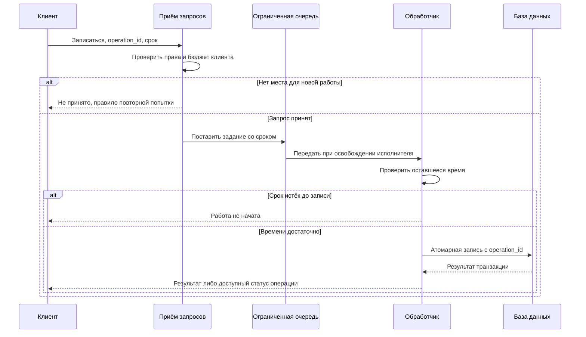
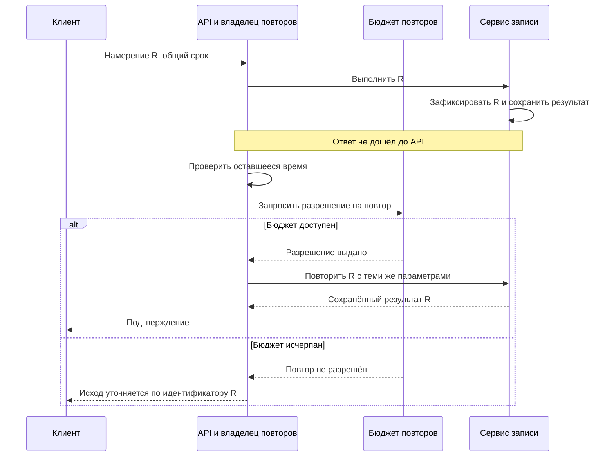
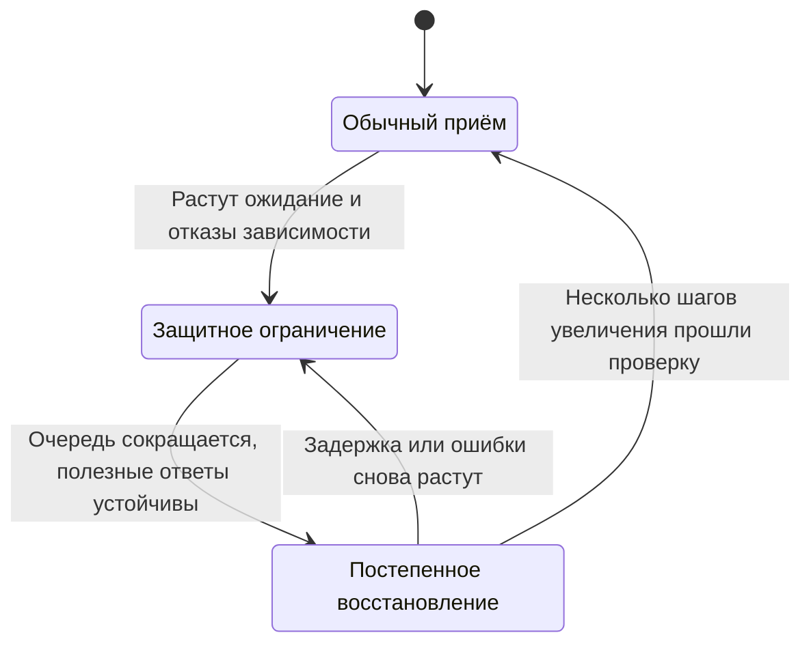

В «Клубе» открылась запись на популярный курс. Серверы приложения ещё работают, но база отвечает медленнее обычного. Пользователи видят задержку и нажимают кнопку снова. Приложение тоже повторяет запросы. Через минуту база почти перестаёт отвечать, хотя число новых пользователей уже снизилось.

Добавить серверы приложения в такой ситуации может оказаться вредно: они откроют дополнительные соединения к той же базе. Сначала нужно понять, какая работа занимает ограниченный ресурс, какая уже бесполезна и кто продолжает её создавать.

Все числа ниже — условия учебной модели. Они нужны для проверки расчётов, а не для оценки мощности конкретной базы.

## Когда средняя нагрузка скрывает проблему

Пусть база устойчиво выполняет 400 одинаковых операций в секунду. На вход приходят 350 новых операций в секунду. Запас вроде бы есть, но часть медленных запросов повторяется: на каждые 100 новых операций возникают ещё 20 попыток. База получает 420 попыток в секунду. Даже без новых пользователей входящий поток превысил принятую в модели мощность.

Здесь нельзя просто посчитать успешные ответы и объявить низкую нагрузку. Неудачные попытки тоже расходуют процессор, соединения, память и время блокировок. Повтор может оказаться дороже первого запроса, если ему приходится ждать занятую тем же действием строку.

| Момент | Что наблюдаем | Что нужно проверить |
|---|---|---|
| Начало всплеска | Растёт задержка БД | Долгие запросы, блокировки, диск, соединения |
| Первые таймауты | Число попыток растёт быстрее новых операций | Повторы браузера, приложения, библиотек |
| Заполнение очереди | Ответы приходят после ухода клиента | Сколько запросов уже потеряло смысл |
| Спад входа | База всё ещё перегружена | Старый хвост, повторы, фоновая работа |

Полезно измерять отдельно новые действия пользователей, все попытки, принятые запросы, успешные результаты и отказы до начала работы. Иначе защитное ограничение входа будет выглядеть как поломка, а бесполезные повторы — как популярность продукта.

## Один срок на весь запрос

Пользователь готов ждать подтверждение две секунды. Запрос проходит через API, сервис записи и базу. Если каждый участок получает собственный таймаут в две секунды, общий срок ожидания уже не ограничен двумя секундами.

Начальный срок завершения нужно передавать дальше. Перед дорогой операцией обработчик оценивает, осталось ли время на её выполнение и возврат результата. Например, после 1,8 секунды в очереди запуск операции, которая обычно занимает 300 миллисекунд, может быть бессмысленным для синхронного ответа.

Это не универсальное разрешение бросить работу. Для чтения просроченный запрос часто можно отменить. Если запись уже зафиксирована или платёж отправлен внешнему провайдеру, отмена ожидания не отменяет результат. Тогда клиенту нужен способ узнать статус операции. Отдельно определите, кто продолжит необходимую фоновую работу и сколько времени она может занимать.

Отмена также должна доходить до зависимостей. Приложение, которое прекратило ждать ответ БД, но оставило запрос исполняться, освободило только часть ресурсов. Проверяйте поведение драйвера и базы экспериментом: исчезает ли работа после отмены или продолжает держать блокировки.

## Почему длинная очередь не добавляет мощности

В нашей упрощённой модели обработчик выполняет 400 запросов в секунду. Если перед новым запросом стоит 800 одинаковых запросов, ожидание будет около двух секунд ещё до его обработки. Увеличение буфера до десяти тысяч не улучшит срок ответа. Оно лишь позволит дольше принимать работу, которую система не успеет завершить вовремя.

В реальном сервисе времена неодинаковы, поэтому деление длины очереди на среднюю скорость даёт только ориентир. Один тяжёлый запрос, ограниченный пул или порядок блокировок меняют картину. Для настройки нужны распределение времени обслуживания и измерение задержки в очереди отдельно от времени исполнения.

Выбирать стоит не только размер буфера, но и политику входа. Ограничение числа одновременно выполняемых запросов защищает соединения и память. Ограничение скорости защищает от слишком частого поступления новых запросов. Эти меры решают разные задачи: при замедлении БД прежний допустимый RPS может создавать слишком много незавершённой работы.

Для асинхронной обработки допустима более длинная очередь, если продукт обещает результат позже. Но и здесь нужны срок хранения, предел отставания и политика для устаревших заданий. Напоминание о встрече, завершившейся вчера, не становится полезнее от гарантированной доставки.

## Кто имеет право повторять

Представьте три вложенных клиента. Каждый допускает до трёх попыток, включая первую. В худшем случае один исходный запрос создаёт 27 обращений к самому нижнему сервису. Это верхняя граница для выбранной модели, где каждый уровень исчерпывает свой лимит, а не обязательное поведение любой системы.

Выберите уровень, который управляет повторами, и согласуйте настройки остальных. У попытки должны быть причина, оставшееся время и общий бюджет. Случайная задержка между повторами уменьшает их синхронность, но не создаёт свободную мощность.

Полезен бюджет на весь поток. Например, допускается не более пяти дополнительных попыток на сто новых запросов в заданном окне. Тогда массовые ошибки не могут без ограничения умножать трафик. Определите, где ведётся этот бюджет: независимые локальные лимиты на сотне процессов не равны одному глобальному лимиту. Не превращайте распределённый счётчик бюджета в новую критическую зависимость.

Повтор имеет смысл при временной ошибке и безопасном контракте операции. Ошибка прав, неверные данные или отсутствие мест не требуют такого же поведения, как краткий сетевой сбой. Ответ о перегрузке должен влиять на клиентскую политику, иначе раннее отклонение немедленно вернётся новой волной.

## Изоляция и справедливость

Фоновая выгрузка отчётов и запись на курс могут использовать одну базу. Общий лимит соединений не гарантирует, что запись получит свою долю. Длинные отчёты способны занять весь пул.

Можно разделить пулы и выделить лимиты по видам работы. Это уменьшает влияние отчётов на запись, но не разделяет физический диск и процессор базы. Поэтому проверяйте ограничение на последнем общем ресурсе, а не только на уровне приложения.

Внутри одного вида работы возникает вопрос справедливости. Один преподаватель запускает тысячи тяжёлых запросов, остальные делают по одному. Лимит на клиента или организацию помогает сохранить доступ для остальных. Приоритеты должны следовать требованиям продукта: например, сверка уже принятой оплаты может быть важнее нового рекомендательного запроса. Но бесконечное обслуживание только высокого приоритета способно навсегда вытеснить остальную работу.

## Проследим один запрос через ограничения

Пусть запрос записи на курс несёт `operation_id`, идентификатор пользователя и срок завершения. Первый идентификатор связывает повторы одного намерения, второй нужен для проверки прав, третий ограничивает ожидание. Они выполняют разные задачи. Просроченный запрос не становится новым намерением, а тот же идентификатор операции не разрешает другому пользователю читать её результат.

На входе работают две отдельные проверки. Первая решает, можно ли принять новую работу от этого клиента. Вторая допускает не больше заданного числа одновременно выполняемых операций к общей зависимости. Между ними может быть ограниченная очередь. Если отказ произошёл до принятия работы, сервер может прямо сообщить это клиенту. После начала записи исход уже нужно определять по её протоколу.

В этой диаграмме пунктиром показаны ответы, сплошными стрелками — вызовы. Ветка `alt` означает два разных исхода проверки: запрос либо отклоняется до выполнения, либо проходит дальше.



Сначала сервер проверяет, имеет ли запрос право занять ресурсы. Затем очередь удерживает только принятую работу. Обработчик повторно проверяет срок: разрешение на вход не гарантирует, что ожидание окажется коротким. Только после этого начинается операция с базой. Отмена до её начала и потеря ответа после фиксации должны выглядеть в журнале как разные исходы.

Есть ещё один момент, который легко пропустить. Разрешение на параллельную работу нужно освобождать, когда защищаемая работа действительно завершилась, а не когда браузер закрыл соединение. Иначе лимит показывает десять активных операций, хотя двадцать отменённых запросов всё ещё выполняются в базе. Если зависимость не поддерживает надёжную отмену, учитывайте такие операции до их фактического завершения либо до подтверждённого закрытия соответствующего ресурса.

## Выбираем лимит из измерений, а не из числа пользователей

Проведём учебный эксперимент: запустим одну и ту же смесь запросов, увеличивая число одновременно работающих обработчиков. Измеряем полезные результаты, время исполнения после допуска и долю ошибок. Результат может выглядеть так:

| Одновременных операций | Успешных результатов в секунду | p95 после допуска | Наблюдение |
|---|---|---|---|
| 8 | 140 | 80 мс | Есть запас |
| 16 | 250 | 110 мс | Дополнительная конкуренция помогает |
| 32 | 310 | 220 мс | Прирост уменьшается |
| 64 | 280 | 900 мс | Конкуренция уже мешает |

Эти числа придуманы для разбора. Их смысл в том, что пропускная способность не обязана расти вместе с параллелизмом. При высокой конкуренции время уходит на ожидание блокировок, переключение задач и дополнительные обращения к памяти. Даже если CPU ещё не загружен полностью, другой общий ресурс может быть исчерпан.

В таком эксперименте лимит 64 хуже 32 и по результатам, и по задержке. Но объявлять 32 постоянной настройкой тоже рано. Измените смесь запросов, размер данных и количество доступных узлов. Нужен рабочий диапазон, а не одна удачная точка.

Из закона Литтла можно получить полезную проверку: в устойчивой системе среднее число незавершённых операций равно средней интенсивности поступления, умноженной на среднее время в рассматриваемой части системы. При 200 операциях в секунду и среднем времени 0,1 секунды получится 20 незавершённых операций. Это не формула количества процессорных ядер. Также нельзя заменить среднее время значением p99 и назвать результат следствием закона. Для неустойчивой растущей очереди предположение о стационарном режиме не выполнено.

Теперь распределим лимит между экземплярами приложения. Если каждый из десяти экземпляров допускает 32 операции, база может получить 320 одновременных операций. При автоматическом добавлении ещё десяти экземпляров потолок удвоится. Поэтому нужно явно решить, где действует ограничение: перед всеми экземплярами, в общей зависимости или через согласованный бюджет на экземпляр. Ни один вариант не бесплатен: общий контроллер сам требует доступности, а консервативные локальные квоты могут оставлять часть мощности незанятой.

## Повтор должен оплачивать свою работу

Назначим владельцем повторов сервис API. Вызовы его библиотеки к сервису записи сами ничего не повторяют. Для каждого исходного запроса API хранит число оставшихся попыток и единый срок. Дополнительно есть бюджет повторов на поток: новые запросы пополняют его ограниченным числом разрешений, повтор расходует одно.

Так мы получаем два разных предела. Локальный предел не даёт одному запросу ходить бесконечно. Бюджет потока не позволяет всем запросам одновременно использовать максимум попыток. Если зависимость перегружена, исчерпание бюджета означает отказ от дополнительных попыток, а не создание новой очереди «повторить когда-нибудь» без срока.

Следующая диаграмма показывает потерянный ответ после записи. Дополнительная попытка разрешена бюджетом, но использует прежний идентификатор операции.



Сервис уже сохранил результат, поэтому повтор не создаёт вторую запись. Если бюджета нет, API прекращает повторять, но не утверждает, что операция не выполнена. Клиенту остаётся идентификатор для проверки статуса. Сам запрос статуса тоже нужно ограничивать: опрос каждую миллисекунду способен стать новым источником перегрузки.

Сохраняемый результат должен различать временный отказ до принятия операции и окончательный бизнес-результат. Например, «мест нет» можно зафиксировать как результат попытки по выбранному контракту. Отказ ограничителя до начала работы требует отдельного правила: считается ли ключ принятым, можно ли повторить с ним позже и как долго живёт запись. Иначе клиент будет бесконечно получать однажды закэшированный ответ о краткой перегрузке.

## Почему восстановление — отдельный режим

Защита не заканчивается установкой лимита. Представьте, что после ограничения входа загрузка упала. Контроллер немедленно вернул прежний лимит, клиенты одновременно повторили запросы, и система снова перегрузилась. Такой контроллер создаёт колебания вместо восстановления.

Ниже схема состояний контроллера. Подписи на стрелках обозначают наблюдаемые условия перехода, а не таймер, который сам по себе доказывает здоровье сервиса.



В обычном режиме допускается измеренный рабочий поток. В защитном режиме ограничение уменьшает вход и оставляет мощность для необходимой работы. Затем контроллер увеличивает допуск небольшими шагами и наблюдает результат каждого шага. Переход назад должен быть быстрее, чем необоснованное повышение лимита.

Для устойчивости полезны разные условия входа в защиту и выхода из неё, несколько последовательных окон наблюдения и ограниченная скорость изменения настройки. Но конкретные интервалы нельзя выбрать по этой диаграмме: они зависят от времени реакции сервиса. Слишком короткое окно реагирует на шум, слишком длинное запаздывает относительно отказа.

## Дополнительная практика: потерянное разрешение

Обработчик получил одно из 20 разрешений на работу с БД. Клиент отключился, приложение освободило разрешение, но операция БД ещё выполняется три секунды. Пришли новые запросы. Нарисуйте последовательность, в которой фактическое число операций превысит 20. Затем исправьте жизненный цикл разрешения.

В разборе должны появиться две границы: окончание ожидания клиента и окончание защищаемой операции. Освобождение разрешения связывается со второй. Если процесс приложения исчез, нужно понимать судьбу его соединения и транзакции; одной локальной переменной для глобальной гарантии уже недостаточно. Хорошее решение объясняет, как обнаруживается и учитывается такая оставшаяся работа, а не просто добавляет блок `finally` вокруг ответа браузеру.

## Задание: вывести сервис из перегрузки

После замедления база устойчиво выполняет 200 операций в секунду. Приходят 240 новых операций в секунду. В очереди осталось 1 000 запросов. Для расчёта считайте операции одинаковыми, а скорость постоянной. Клиентский срок — две секунды; 150 запросов в очереди уже просрочены и являются чтениями, которые разрешено отменить.

Предложите временную политику приёма, очистки очереди и повторов. Рассчитайте, за сколько опустеет очередь, если принимать только 160 новых операций в секунду. Объясните, что делать с лишними 80 и почему нельзя молча назвать их успешно обработанными. Затем отделите от чтений уже принятые записи с неизвестным исходом.

**Подсказка 1.** Сначала уберите работу, которая точно не нужна, если её отмена действительно освобождает ресурс.

**Подсказка 2.** Скорость опустошения очереди равна свободной мощности после обслуживания принятого нового потока.

**Подсказка 3.** Посчитайте отдельно время восстановления сервиса и обещанный срок конкретному клиенту.

### Разбор

После подтверждённой отмены просроченных чтений остаётся 850 запросов. Приём 160 новых операций оставляет 40 операций в секунду для сокращения очереди. В модели она опустеет за 21,25 секунды. Это время восстановления очереди, а не доказательство выполнения двухсекундного срока. Часть оставшихся запросов тоже может устареть: придётся повторно учитывать их сроки.

Лишние 80 запросов в секунду нужно явно отклонять, откладывать по согласованному асинхронному контракту или обслуживать в упрощённом режиме, если он допустим. Записи с неизвестным исходом нельзя просто удалить и предложить клиенту начать заново. Нужны идентификатор операции и проверка результата.

Восстанавливайте приём постепенно. Резкое открытие входа при накопленных клиентских повторах вернёт перегрузку. Условие завершения инцидента должно включать задержку, долю полезных результатов и устойчивость очереди, а не только зелёный индикатор процесса.

## Лабораторная: одинаковый вход и две политики допуска

Проверим механизм на локальной модели без сетевого сервера. Один исполнитель получает 80 безопасно отменяемых чтений в секунду восемь секунд. Обслуживание обычно занимает 10 мс, а между второй и четвёртой секундой — 50 мс. Срок каждого запроса 500 мс от прихода. Это фиксированный вход: замедление обработчика не уменьшает число предложенных запросов. Сравним неограниченную очередь и предел 20 ожидающих чтений. Просроченные чтения удаляются до исполнения.

Сохраните код в `overload_model.py` и выполните `python3 overload_model.py`. Нужна только стандартная библиотека. Лабораторная моделирует очередь, не измеряет capacity компьютера и не проверяет реальную отмену SQL.

```python
import heapq
from collections import deque

for queue_limit in (None, 20):
    events = [(i / 80, 1, i) for i in range(640)]
    heapq.heapify(events)
    queue, arrived = deque(), {}
    busy = False
    rejected = expired = completed = useful = peak = 0
    finish_time = 0.0
    while events:
        now, kind, request_id = heapq.heappop(events)
        if kind == 0:  # завершение работы
            busy = False
            completed += 1
            useful += now <= arrived[request_id] + 0.5
            finish_time = now
        else:
            arrived[request_id] = now
            if busy and queue_limit is not None and len(queue) >= queue_limit:
                rejected += 1
            else:
                queue.append(request_id)
                peak = max(peak, len(queue))
        if not busy:
            while queue and now >= arrived[queue[0]] + 0.5:
                queue.popleft()
                expired += 1
            if queue:
                current = queue.popleft()
                service = 0.05 if 2 <= now < 4 else 0.01
                busy = True
                heapq.heappush(events, (now + service, 0, current))
    print('limit=', queue_limit, 'offered=', len(arrived),
          'rejected=', rejected, 'expired_before_start=', expired,
          'completed=', completed, 'useful=', useful,
          'peak_queue=', peak, 'last_completion=', round(finish_time, 3))
```

Ожидается одинаковый offered=640. При ограничении появляются ранние отказы, зато очередь имеет меньшую границу. Часть принятых чтений может просрочиться даже с пределом 20: при замедлении очередь из двадцати работ требует примерно секунду, что больше срока 500 мс. Лимит памяти сам по себе не обеспечивает deadline. Ранний отказ также не гарантирует больше useful: сравните counters обеих политик, а не объявляйте ограниченную очередь победителем по одному показателю. Она защищает выбранную границу ресурсов; размер и правила просрочки ещё нужно согласовать со сроком. `completed` и `useful` могут различаться, если чтение завершилось после срока; отсюда необходимость измерять полезный результат, а не только количество завершений.

**Самостоятельно.** Сравните пределы 5, 10 и 20; затем удвойте срок. Выберите политику для двух разных продуктов: синхронной страницы с коротким сроком и асинхронного отчёта. Укажите, какие counters нужны в реальном сервисе и что отсутствует в модели.

**Разбор.** Меньшая очередь раньше отклоняет работу и уменьшает возможное ожидание, но не добавляет мощности. Для длинного асинхронного срока можно принять больше работы при ограниченном backlog и честном contract результата позже. Проверяется баланс `offered = rejected + expired + completed` после окончания всех событий; useful не больше completed. В production нужны распределение service time, p95/p99, возраст очереди, active operations и отмена зависимости. Модель не содержит retries, сети, CPU contention, fairness и несколькослойных pools, поэтому её числа не являются выбранными production defaults.

### Повторный всплеск и критерий восстановления

Тест восстановления должен включать normal → slowdown → ограничение → recovery → новый всплеск. Приём нельзя восстановить только потому, что процесс отвечает health endpoint. Проверьте, что сокращается возраст очереди, стабилен goodput критических действий, retry amplification ограничен и новая работа укладывается в срок. Иначе восстановление просто открывает путь накопленным клиентским повторам.

Для реальной лабораторной повторите профиль фиксированного входа в своём учебном сервисе и сохраните расписание отправок. Отдельно измеряйте опоздания генератора: если он перестал успевать, фактический offered load изменился. Закрытый цикл «ответ → следующий запрос» можно использовать для другой цели, но он не воспроизводит независимый наплыв. Операционные механизмы ограничения и деградации описаны в [Google SRE: Handling Overload](https://sre.google/sre-book/handling-overload/).

## Как защитить решение

Покажите на одной схеме место ограничения входа, владельца повторов и последний общий ресурс. Затем объясните, какая работа отбрасывается, какая сохраняется и что видит пользователь. Сильный ответ содержит измеримый критерий снятия ограничений и проверку поведения при повторном всплеске.

Вопрос для собеседования: «Мы увеличили число серверов приложения вдвое, а успешных записей стало меньше. Предложите три гипотезы и измерение, которое различит их». Назвать базу узким местом недостаточно: нужно выяснить, выросло ли число соединений, повторов, блокировок или бесполезной работы.

## Источники

[Google SRE: Handling Overload](https://sre.google/sre-book/handling-overload/) разбирает ограничения входа и политику повторов. [Addressing Cascading Failures](https://sre.google/sre-book/addressing-cascading-failures/) полезен для изучения цепочки вторичных отказов. Сценарий «Клуба», все расчёты и задания в этом блоке — самостоятельная учебная модель.
