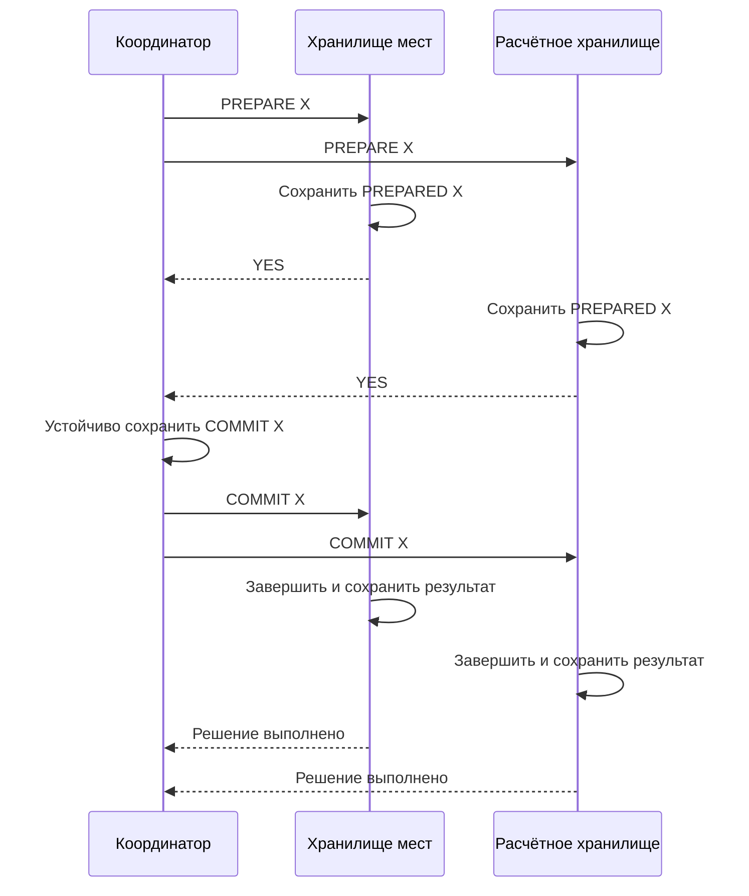
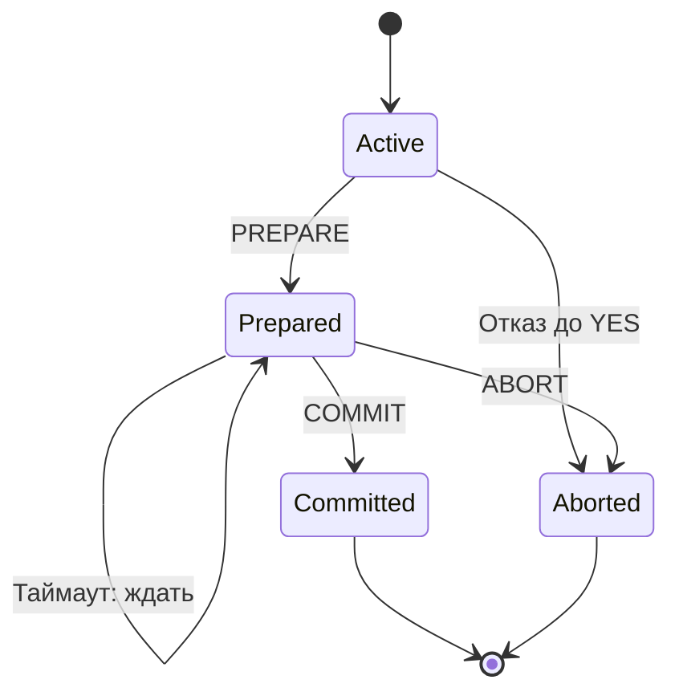
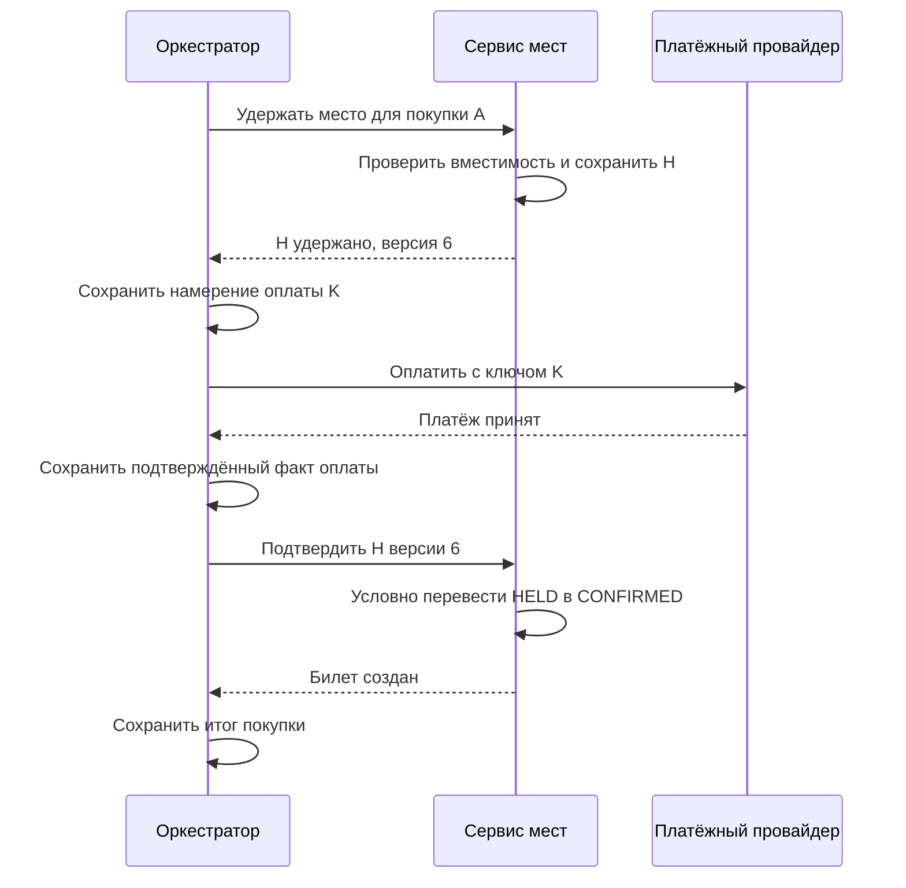
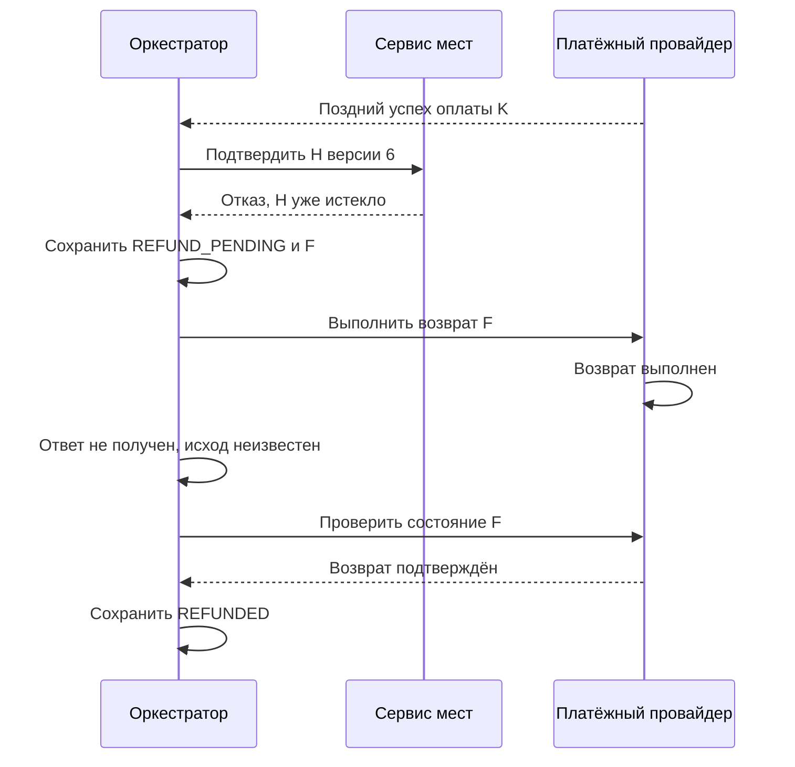

«Клуб» продаёт место на выездное наблюдение. Сервис мест подтвердил бронь, платёжный провайдер списал деньги, но ответ о платеже пропал. Через десять минут срок брони истёк, место получил другой участник. Затем пришло подтверждение оплаты первого покупателя. Вернуть деньги возможно, а вернуть уже использованное место — нет.

В этой задаче нельзя обещать один неделимый переход, просто назвав несколько HTTP-вызовов транзакцией. Сначала нужно выбрать инварианты и понять, какие системы умеют участвовать в общем решении. Затем определить, что делать, когда исход отдельного шага неизвестен.

Все суммы и интервалы в примере условные; платёжные эксперименты выполняются только в песочнице. После блока вы сможете отличить атомарную фиксацию от процесса с компенсациями и объяснить восстановление после падения координатора.

## Сначала определим недопустимые состояния

Для события на 100 мест сформулируем четыре правила. Активные удержания и подтверждённые билеты вместе не превышают вместимость. Одно намерение покупки не создаёт больше одного логического платежа. Подтверждённый билет связан с принятой оплатой или явно предусмотренным бесплатным основанием. Успешная оплата без билета находится в процессе завершения либо возврата, а не теряется в журнале ошибок.

Последнее правило содержит обещание будущего завершения. Оно зависит от восстановления связи, работоспособности провайдера и действий оператора. Нельзя доказать конечный срок возврата, если внешняя система может быть недоступна бесконечно. Поэтому разделяем safety — недопущение лишних мест и повторных эффектов — и liveness, способность довести процесс до определённого результата.

Поле `status=FAILED` не объясняет, что произошло с деньгами. Лучше хранить независимые факты: бронь удержана, платёж запрошен, исход неизвестен, платёж принят, билет подтверждён, возврат запрошен, возврат завершён. Пользовательский статус строится на этих фактах, а не стирает их.

## Модель участников и журнала покупки

Клиент отправляет одно намерение покупки с устойчивым ID. Повтор того же намерения сохраняет ID, а новая покупка получает другой. У каждого сервиса есть собственная транзакционная база. Обычный сетевой ответ может потеряться после фиксации. Мы предполагаем, что устойчиво подтверждённые данные участника не исчезают после предусмотренного перезапуска; уничтожение всех копий его журнала выходит за эту модель.

Для 2PC координатор хранит ID транзакции, полный состав участников и окончательное решение. Участник хранит свою подготовленную работу и состояние решения по тому же ID. В выбранном учебном протоколе координатор не выдаёт противоречивых решений: после устойчивого COMMIT он никогда не пишет ABORT для этого ID. Повтор сообщения должен узнавать уже выполненную транзакцию.

Для saga устойчивый журнал иной: ID покупки, ссылки на удержание и платёж, подтверждённые факты, ожидаемые действия, число попыток и время следующей проверки. Этот журнал не превращает внешние операции в локальную транзакцию. Он позволяет после остановки ответить на вопрос «что мы знаем и что ещё обязаны выяснить», не реконструируя намерение из случайных логов.

Не смешивайте событие и команду. «Платёж принят» — сообщение о состоявшемся факте, который требуется проверить и связать с покупкой. «Вернуть платёж» — просьба о новом действии; её отправка не доказывает успех. Такое различие понадобится при каждом восстановлении.

## Что именно делает двухфазная фиксация

Предположим сначала, что оба участника — управляемые нами транзакционные хранилища и поддерживают подготовленную транзакцию. Координатор назначает общий ID и просит каждого подготовиться. Участник отвечает YES, только если сохранил достаточно состояния, чтобы позднее выполнить окончательное решение. После всех YES координатор устойчиво записывает COMMIT и рассылает его; при отказе на подготовке выбирает ABORT. Это основа two-phase commit, 2PC. Формальная модель и её связь с консенсусом разобраны у [Gray и Lamport](https://www.microsoft.com/en-us/research/publication/consensus-on-transaction-commit/).

Первый этап согласует готовность, второй передаёт окончательное решение. YES не означает, что участник уже свободен закончить как пожелает. Он обещал сохранять возможность согласованного завершения. Если после этого просто отменить локальное изменение по таймауту, другой участник может уже выполнить COMMIT.

В PostgreSQL подготовленная транзакция переживает завершение сессии, сохраняет необходимые ресурсы и ждёт `COMMIT PREPARED` либо `ROLLBACK PREPARED`. Долго оставлять такие транзакции незавершёнными опасно для эксплуатации, в том числе из-за удерживаемых блокировок. Это прямо отмечено в [документации PREPARE TRANSACTION](https://www.postgresql.org/docs/current/sql-prepare-transaction.html).

2PC определяет атомарность решения commit/abort между участниками. Он сам по себе не задаёт общую сериализуемость всех конкурентных распределённых транзакций. Для неё нужны совместимые правила изоляции и контроля конкуренции. Также 2PC не включает произвольный внешний HTTP API, у которого нет состояния prepare и обязательства принять окончательное решение.

### Нормальный протокол 2PC с точками устойчивости

Координатор C сначала завершает набор участников: I отвечает за место, P за внутреннее списание. Локальные изменения подготовлены под общим ID X, но ещё не опубликованы как окончательные. C отправляет PREPARE обоим. I проверяет ограничения, сохраняет достаточные данные восстановления и состояние PREPARED, затем отвечает YES. P делает то же самое независимо.

Только получив оба YES, C сохраняет COMMIT в своём устойчивом журнале. Теперь решение необратимо в пределах модели. C рассылает его участникам; каждый завершает локальную транзакцию, фиксирует конечное состояние и подтверждает доставку. Повтор COMMIT X узнаёт конечное состояние X и возвращает согласованный ответ вместо второго списания.

Диаграмма «Нормальная двухфазная фиксация» выделяет порядок устойчивых записей перед ответами. Вертикальное расстояние не обозначает реальную длительность; порядок сообщений определяет, какие обещания уже даны.

Текстовый ход: оба участника сначала устойчиво готовятся; координатор после двух YES устойчиво принимает решение; участники исполняют именно его и подтверждают. Клиентский API отдельно определяет момент успеха: наличие необратимого решения или завершение применения на всех участниках. Второе даёт более прямое ожидание результата, но добавляет ожидание медленного участника.

Если хотя бы один участник отвечает NO, C выбирает ABORT и сообщает его всем. Участник, который ещё не обещал YES, может отказаться от подготовки при локальной ошибке. Ответивший YES уже не свободен самостоятельно решить судьбу транзакции. Именно это обещание позволяет координатору принять общее решение, а затем восстановить недоставленные части.

Инвариант доказывается двумя ограничениями. Координатор принимает COMMIT только при готовности всех и не меняет устойчивое решение. Подготовленные участники завершаются только согласно этому решению. Следовательно, корректные участники не могут законно закончить один и тот же X с разными исходами. Возможен промежуток, когда один уже закончил, другой ещё ждёт; «единое решение» не означает одновременное физическое применение на разных машинах.

## Сбой координатора после решения

Обозначим сервис мест как I, внутренний расчётный сервис как P. Оба в этом учебном варианте действительно поддерживают 2PC. Координатор C использует устойчивый журнал решений.

| Шаг | Координатор C | Участник I | Участник P |
|---|---|---|---|
| 1 | Отправляет PREPARE для X | Готовит удержание места | Готовит списание |
| 2 | Получает оба YES | Сохраняет PREPARED | Сохраняет PREPARED |
| 3 | Устойчиво записывает COMMIT X | Ждёт решения | Ждёт решения |
| 4 | Отправляет решение только I | Выполняет COMMIT | Пока не знает решения |
| 5 | Падает до отправки P | Хранит завершённое X | Остаётся PREPARED |
| 6 | Восстанавливает журнал | Повтор решения безопасен | Получает COMMIT и завершает X |

После шага 5 P нельзя автоматически откатывать X. Отсутствие сообщения не отменяет устойчивое решение координатора, а I уже завершил свою часть. Если P может достоверно узнать решение от другого участника по протоколу восстановления, ожидание сократится. В общем случае подготовленный участник может оказаться заблокированным до получения достаточной информации.

Если координатор упал до устойчивого решения и все доступные участники только подготовлены, они не всегда способны отличить эту историю от уже принятого, но недоступного решения. Поэтому обычный 2PC называют блокирующим при определённых отказах. Репликация координатора может повысить доступность его журнала, но нужно объяснить её протокол и что происходит без требуемого кворума.

Полезно задать операционные вопросы: где искать X, кто владеет восстановлением, сколько подготовленных транзакций допустимо, какие ресурсы они удерживают? Ручное «разблокировать базу» без установления решения способно нарушить атомарность, ради которой механизм выбирали.

### Состояния участника после перезапуска

Диаграмма «Обязательство после YES» показывает конечные состояния участника. Из PREPARED нет перехода «истёк таймер, откатить»: таймер запускает поиск решения, а не заменяет его.

Текстовый ход: участник работает, затем либо отказывается до обещания готовности, либо сохраняет PREPARED. После подготовки он ждёт решение и переживает перезапуски в том же обязательстве. Получив достоверное решение, фиксирует соответствующий конечный исход. Повторы не меняют уже выбранный исход.

После перезапуска координатор читает собственный полный журнал. Если COMMIT существует, он повторяет его, даже если клиент давно перестал ждать. Если устойчивого решения ещё нет, конкретный протокол восстановления может выбрать ABORT и завершить подготовленных участников. Но «записи нет в доступном мне обрезанном журнале» и «полный авторитетный журнал доказывает отсутствие решения» — разные утверждения.

Пусть P видит только своё PREPARED, а C и I недоступны. Для P совместимы две истории: C ещё не решил ничего либо уже записал COMMIT и отправил его I. Локальное состояние P одинаково. Если P откатится по таймеру, вторая история получит противоречие; если сам зафиксирует, первая могла иметь законный ABORT. Значит, без дополнительной информации безопасного произвольного выбора нет.

Это объясняет блокировку через неразличимость историй, а не через случайно большое число таймаутов. Уменьшение таймера не создаст недостающий факт. Опрос других участников иногда помогает: известный достоверный конечный исход можно использовать в предусмотренном протоколе. Если все доступные узлы знают только PREPARED, неопределённость остаётся.

Реплицированный координатор сохраняет решение консенсусом и позволяет новому процессу продолжить доставку. Цена — дополнительный протокол и зависимость от доступности его кворума. Если все копии авторитетного решения уничтожены, нельзя обещать автоматическое точное восстановление без иных доказательств. Восстановление из старого бэкапа тоже не должно превращать уже принятый COMMIT в новый ABORT.

Наконец, данные о завершении нельзя удалять раньше, чем исчезнет возможность спутать запоздалое сообщение с новой работой. Протокол определяет подтверждения, срок удержания результатов и уникальность ID. Формальное «забывание» транзакции отличается от очистки логов ради свободного места. Практические этапы доставки и восстановления описаны в [Microsoft: Two-Phase Commit Protocol](https://learn.microsoft.com/en-us/openspecs/windows_protocols/ms-tpsod/e34079f0-22de-4c03-9cb8-84c2448a4613).

## Когда вместо общей фиксации нужна saga

Внешний платёжный провайдер обычно не обещает держать SQL-транзакцию до нашей команды COMMIT. Тогда процесс строится из отдельных локально завершённых шагов. Saga задаёт их порядок и действия компенсации при невозможности закончить общий сценарий. Вариант с оркестратором описан в [AWS Saga orchestration](https://docs.aws.amazon.com/prescriptive-guidance/latest/cloud-design-patterns/saga-orchestration.html).

В «Клубе» оркестратор хранит состояние покупки и намерения следующих действий. Сервис мест создаёт удержание с ID покупки, версией и сроком. Платёжный шаг использует стабильный ключ намерения. После подтверждения платежа оркестратор пытается превратить именно это удержание в билет. Если оно уже недействительно, запускается предусмотренный путь компенсации.

Компенсация — новое действие с собственными ошибками и повторами. Возврат денег не стирает списание из истории. Отмена письма вообще может быть невозможна. Поэтому saga не обеспечивает невидимость промежуточных состояний так, как это делает единая локальная транзакция с подходящей изоляцией.

### Обычная покупка как последовательность локальных решений

Выберем вариант с оркестратором и платёжным API, которое поддерживает идентификатор намерения и проверку его состояния. Сначала транзакция сервиса мест проверяет остаток и создаёт H с состоянием HELD. Затем оркестратор устойчиво записывает намерение оплаты и передаёт его через восстанавливаемый механизм доставки. Получив достоверный успех, он сохраняет факт PAID и просит подтвердить конкретное H.

Диаграмма «Покупка без сбоя» показывает, что между шагами существуют наблюдаемые состояния. Каждая локальная фиксация самостоятельна; общую цель обеспечивает последующее продолжение процесса.

Текстовый ход: место удерживается; намерение платежа сохраняется; провайдер подтверждает оплату; её факт сохраняется; сервис мест атомарно подтверждает ещё действующее удержание; покупка получает конечный успешный результат. Если ответа на любой шаг нет, оркестратор продолжает с неопределённого состояния этого шага, а не начинает новую покупку.

Локальный инвариант вместимости сохраняет сервис мест. Он учитывает HELD и CONFIRMED при выдаче нового удержания и никогда не увеличивает их общую сумму выше 100. Переход HELD в CONFIRMED не добавляет ещё одно место: меняется категория уже занятого ресурса. Именно это позволяет повторять подтверждение H без повторного уменьшения остатка.

### Поздний платёж после освобождения места

| Шаг | Покупка A | Сервис мест | Платёжный провайдер |
|---|---|---|---|
| 1 | Получает удержание H версии 6 | Резервирует одно место | Ещё не вызван |
| 2 | Отправляет оплату с ключом K | H действует | Принимает платёж |
| 3 | Получает таймаут | Пока держит H | Успех известен только провайдеру |
| 4 | Состояние оплаты UNKNOWN | H истекает; место уходит B | Ответ или webhook задержан |
| 5 | Получает подтверждение оплаты | Отказывает подтвердить H версии 6 | Платёж успешен |
| 6 | Переходит в REFUND_PENDING | Билет A не создаётся | Принимает идемпотентный возврат |

Ключевой переход — шаг 5. Обработчик не должен создавать билет только потому, что деньги приняты. Он проверяет актуальность конкретного удержания атомарно с подтверждением. Иначе позднее событие обойдёт ограничение вместимости.

Истечение и подтверждение конкурируют за одно состояние. Условное обновление версии или транзакционная блокировка определяет победителя. Если подтверждение выиграло, процедура истечения уже не освобождает место. Если выиграло истечение, старый callback не воскрешает бронь. Порядок доставки сообщений не заменяет эту проверку.

### Восстановление после неудавшейся компенсации

Поздний успех оплаты должен привести к воспроизводимому пути. Оркестратор сохраняет REFUND_PENDING и ID возврата F. Если он упадёт до отправки, доставка продолжится по устойчивому намерению. Если после отправки, но до получения ответа, F остаётся тем же: новая попытка не выражает второй возврат. Допустимость такого повтора определяется договором провайдера.

Диаграмма «От поздней оплаты к подтверждённому возврату» показывает ещё один потерянный ответ. Заметьте, что завершение компенсации находится после проверки провайдера, а не после первой отправки команды.

Текстовый ход: оркестратор узнаёт поздний платёж, проверяет старую бронь, получает отказ и сохраняет намерение возврата. Провайдер выполняет возврат, но ответ теряется. Последующая проверка устанавливает факт завершения; только тогда покупка считается компенсированной.

Наивный вариант — записать FAILED после отказа брони и закончить обработку. Он сохраняет корректное число мест, но бросает обязательство перед оплатившим покупателем. Второй наивный вариант — снять деньги с покупателя B и восстановить старую бронь A. Это меняет договор уже подтверждённой чужой покупки и не является техническим откатом.

Внешние эффекты не всегда обратимы. Если подтверждённый билет уже использован, простой возврат места в доступные приведёт к повторной продаже физически занятого ресурса. Компенсации должны зависеть от состояния предметной области. Для завершившегося события понадобятся другие правила, а не тот же обработчик отмены удержания.

## Неизвестный исход требует отдельного состояния

После таймаута оплаты нельзя сразу отправлять новую оплату с новым ключом. Это новое намерение, и провайдер может выполнить оба. Повтор с тем же ключом допустим только согласно его контракту: срок хранения, область действия и правила несовпадения параметров нужно проверить. Конкретный пример таких правил опубликован в [Stripe: Idempotent requests](https://docs.stripe.com/api/idempotent_requests).

Запрос статуса помогает, если возвращает авторитетный результат нужной операции. Ответ «пока не найдено» не всегда доказывает, что первоначальный запрос никогда не завершится: он мог задержаться в сети или ещё обрабатываться. Договор должен определять окончательные состояния и способ связать все наблюдения с одним намерением.

Оркестратор после падения продолжает по устойчивому состоянию. Если он записал шаг в базе, но не отправил сообщение, помогает outbox. Если отправил, но не отметил отправку, получатель увидит повтор и должен распознать его. Сверка с провайдером подбирает операции, которые долго остаются UNKNOWN, даже если webhook не пришёл.

Возврат тоже может зависнуть в неизвестном состоянии. Нельзя считать покупку окончательно компенсированной в момент отправки команды. Нужны подтверждение, повтор по договору, срок эскалации и операторский путь. Пользователю показывают действительное промежуточное состояние и не обещают завершение, которого ещё нет.

## Два допустимых выбора и цена каждого

2PC подходит, когда все участники поддерживают протокол и требуется общее атомарное решение. Цена включает время подготовки, удержание ресурсов, зависимость от восстановления координатора и совместимость изоляции. Это может быть разумно для ограниченного числа внутренних хранилищ, но не расширяет возможности внешнего провайдера.

Saga допускает независимые фиксации и длительное выполнение, поэтому подходит для внешних действий. Цена — видимые промежуточные состояния, сложные компенсации, сверка и иногда ручной разбор. Для оплаты можно сначала использовать авторизацию, а затем захват средств, если провайдер это поддерживает. Однако и захват способен иметь неизвестный исход; он не превращает два сервиса в одну транзакцию.

Выбор определяется запретом продукта. Если даже временная оплата без билета недопустима, нужно менять процесс и возможности участников, а не переименовывать возврат в rollback. Если допустим подтверждённый путь возврата, это следует включить в договор покупки и модель состояний.

### Рассчитайте цену ожидания до выбора таймаута

Предположим, 2PC в норме удерживает конфликтующий ресурс 80 миллисекунд. Если все операции требуют одну эксклюзивную строку, верхняя грубая оценка — 12,5 операций/с через эту границу. Падение координатора на минуту может задержать все следующие операции с тем же ресурсом, даже если процессор и сеть свободны. Это оценка выбранной сериализованной модели, а не универсальная производительность 2PC.

У saga удержания тоже имеют цену. При четырёх новых попытках в секунду и среднем ожидании внешней оплаты 120 секунд одновременно потребовалось бы около 480 удержаний в устойчивом режиме. У события всего 100 мест, поэтому такой режим без ограничений невозможен: система упрётся в ресурс раньше. Уменьшить таймаут до десяти секунд недостаточно, если платежи часто подтверждаются позже: число возвратов вырастет.

Для «Клуба» выбираем saga из-за внешнего провайдера, ограничиваем число активных попыток доступными местами и сохраняем право на поздний возврат. Таймаут удержания определяем из допустимого пользовательского ожидания и наблюдаемой задержки оплаты. Если договор запрещает оплаченные покупки без немедленного билета, сначала меняем продуктовый процесс или платёжные возможности, а не коэффициент в таймере.

## Практика: координатор упал в двух разных местах

Для одной покупки составьте две истории. В первой C падает после всех YES, но до записи решения. Во второй платёж принят, оркестратор падает до сохранения результата, а удержание истекает. Укажите устойчивые факты, неизвестное и разрешённые следующие действия. Добавьте по одному повторному сообщению.

### Подсказка 1

Спросите у каждого участника, что он может доказать своим журналом. Не используйте знание автора истории как знание сервера.

### Подсказка 2

Подготовленный участник 2PC и завершённый шаг saga имеют разные обязательства. Первый ждёт решения, второй требует продолжения или отдельной компенсации.

### Подсказка 3

Назначьте ID покупке, удержанию, оплате и возврату. Объясните, какие повторные попытки разделяют ID, а какие выражают новое действие.

### Разбор и критерии

В первой истории подготовленный участник не отменяет обязательство только по таймеру. Восстановленный координатор действует по журналу и правилам протокола; отсутствие устойчивого COMMIT нельзя путать с потерянным доступом к уже существующему журналу. Во второй история провайдера помогает восстановить исход оплаты, а истёкшее удержание запрещает автоматическую выдачу занятого места. При выбранной политике начинается контролируемый возврат.

Ответ принят, если нет oversell и второго логического платежа; UNKNOWN не заменён произвольным успехом или отказом; компенсация имеет собственное подтверждение; восстановление не зависит от памяти упавшего процесса; названы условия, при которых потребуется оператор.

## Практика 2: истечение и подтверждение пришли одновременно

Удержание H занимает последнее место, его версия 6. Обработчик истечения и обработчик успешной оплаты одновременно прочитали HELD. Первый хочет записать EXPIRED и освободить место, второй — CONFIRMED и выдать билет. Покажите ошибку двух независимых UPDATE без проверки версии, затем исправьте её. После победы одного обработчика другой падает и повторяет запрос.

### Подсказки

Первая: проверка «в памяти было HELD» не защищает время между чтением и изменением. Вторая: конечное состояние должно выбираться атомарно в сервисе мест. Третья: повтор проигравшего не получает права перезаписать победивший переход.

### Решение

Без условного изменения последний UPDATE способен затереть исход первого, а отдельные побочные эффекты уже произошли: место освобождено и билет создан. Исправление выполняет переход только при совпадении ID, версии 6 и HELD, вместе с изменением учёта ресурса. Успешный переход повышает версию. Второй обработчик обнаруживает несовпадение и читает выбранное состояние.

Если победил CONFIRMED, истечение не освобождает место и его повтор остаётся без эффекта. Если победил EXPIRED, подтверждение не создаёт билет, а успешный платёж направляется в предусмотренную компенсацию. Сетевой повтор распознаётся по ID операции либо по уже достигнутому состоянию с проверкой принадлежности покупке.

Критерии: выданы не более одного билета и одного права повторной продажи; расписаны оба порядка победы; внешняя оплата не стирается локальным откатом; повтор после перезапуска воспроизводит прежний результат. Для переноса добавьте промежуточную авторизацию средств и объясните, что изменится при неизвестном исходе окончательного захвата.

## Вопрос на интервью

**«Почему не обернуть бронирование и внешний платёж в транзакцию базы?»**

Локальный COMMIT управляет только участвующими ресурсами. HTTP-вызов провайдера не откатывается вместе с таблицей. Хороший ответ уточняет поддержку prepare, формулирует инварианты и выбирает общий протокол либо процесс с промежуточными состояниями, идемпотентностью и сверкой. Затем кандидат показывает хотя бы один сбой между внешним успехом и локальной фиксацией результата.
